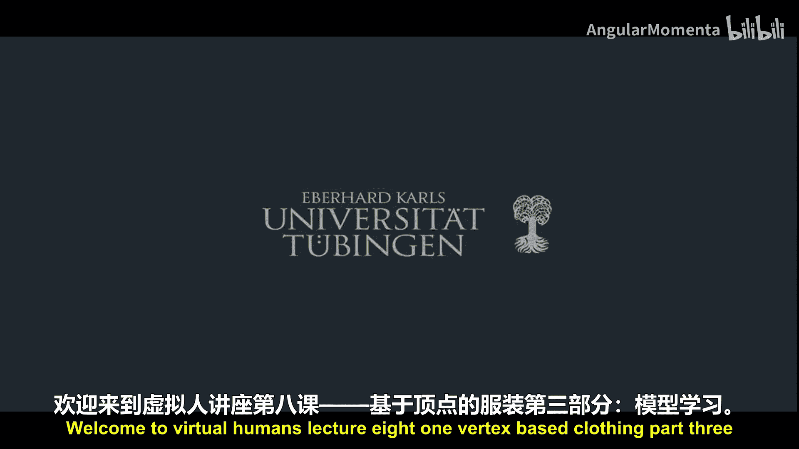
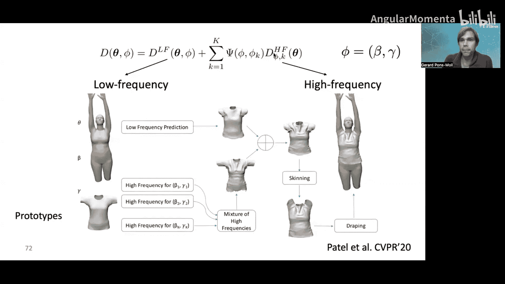
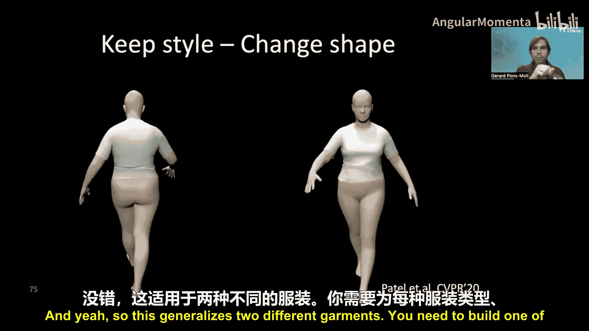
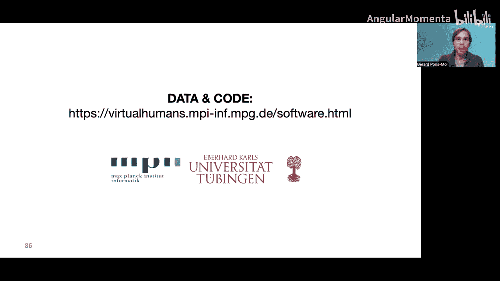

# 016：基于顶点的服装学习模型

在本节课中，我们将要学习如何构建一个基于顶点的服装模型。这个模型能够根据新的人体姿态、体型和服装款式，生成相应的服装几何形状。

上一节我们介绍了如何使用基于顶点的服装表示进行配准和从图像重建。本节中，我们来看看如何学习一个能够泛化到新姿态的服装模型。到目前为止，我们假设服装本身不发生变化，但这并不完全符合现实。此外，我们还需要一个能够控制服装几何形状的模型。

## 模型概述与数据生成

第一个能够泛化到新体型、新姿态和新款式的服装模型是名为 **TailorNet** 的论文。其基本思想是：首先运行基于物理的仿真来获取训练数据，然后基于这些数据学习一个模型。

为什么要这样做？因为基于物理的仿真需要专业软件和大量专业知识，且参数调优不当或发生意外穿插时容易出错。更重要的是，这类模型难以微分。物理仿真依赖于前一帧的状态，若想追溯第一帧对第一百帧的影响，需要随时间传播这种依赖关系，这并非易事。相比之下，深度学习模型易于使用、可微分，并且只要能够良好泛化，就不会“崩溃”。

首先，我们来看所使用的表示方法。我们可以应用顶点位移，或者将网格切割成不同部分以分离不同的服装。这里我们使用的是基于 **ClothCap** 的表示方法。

我们希望学习一个函数，它能根据姿态、体型和款式参数生成服装几何形状。基本思想是：对于一种体型，有一种款式。如果改变款式（例如让T恤变大），那么同一件T恤穿在更大的体型上应该看起来更小、更紧身。这个模型能够做到这一点。同时，模型也需要能够泛化到不同的姿态。

以下是生成训练数据的关键步骤：

1.  **获取多样化的服装几何形状**：使用 **Multi-Garment Net** 中的服装数据。这些数据来自穿着服装的人体3D扫描，通过分割和姿态归一化（与之前简单模型的方法相同）获得。
2.  **运行物理仿真以模拟穿着效果**：将服装应用到不同体型的人体上，改变人体形状，并运行物理仿真，使服装“披覆”在身体上，模拟服装在真人身上的实际外观。
3.  **构建款式变化空间**：对每种服装的几何形状进行主成分分析（PCA），以获得一个可能的服装几何形状空间。款式参数由PCA系数 **γ** 控制，例如控制袖长、T恤宽度等。
4.  **模拟姿态变化下的形变**：将服装应用到标准姿态上，然后通过从SMPL模型的姿态数据集中插值生成合成运动序列，并在此序列上运行物理仿真，以获得服装随时间（姿态）的形变。
5.  **同时变化体型**：在运动路径上平滑地改变体型，使物理仿真同时适应姿态和体型的变化，这有助于网络更好地泛化。
6.  **处理多种服装类别**：需要对每种服装类别（如T恤、长裤、短裤、裙子等）及其PCA参数的不同变体重复上述过程。
7.  **姿态归一化**：获得所有仿真数据后，需要将其归一化到标准姿态空间，原因与之前相同。

## 模型架构：从简单MLP到混合模型

如何学习这个模型？首先应该尝试最简单的方法。最简单的方法可能是线性模型，但这效果不会很好，因为服装形变与姿态之间是非线性的，存在非刚性效应。

可以尝试使用多层感知机（MLP），例如两层或三层的神经网络。输入是姿态参数、体型参数和款式编码（**γ**），输出是服装的 **M × 3** 个顶点坐标。需要为每种服装类型（如T恤、长袖衫、裤子、裙子）分别学习一个这样的神经网络。

MLP能很好地泛化到新姿态，这比预期要好。但当在多种体型和款式上训练时，它会产生过于平滑的结果。假设这是因为高频的褶皱图案在同一姿态下，会因体型和款式的不同而发生巨大变化。网络很难找出其中的规律，或许根本不存在统一的规律。

因此，一个合理的想法是：在泛化到新姿态时，只组合**相似**的体型和款式。这就是 **TailorNet** 工作的基本思想，它使用了一个**混合模型**。

为了简化表示，定义一个新变量 **Φ**，它是体型参数和款式参数组成的元组。

现在，预测分为两部分：
1.  **低频形变**：使用一个单一的MLP，根据给定的姿态和体型款式（**Φ**）预测服装的整体低频形变，它不包含高频的褶皱细节。
2.  **高频细节（混合模型）**：使用一个混合模型来建模高频褶皱图案。我们预先定义 **K** 个原型，每个原型是一对特定的体型和款式参数。对于查询的体型款式（**Φ**），我们使用一个核函数来计算它与每个原型的相似度权重。权重在距离较小时较高，距离较大时较低。最终的预测是这些原型预测的加权线性组合。我们使用一个非常窄的核，以确保只组合非常相似的体型款式模式，从而避免平滑掉由不同模型产生的高频褶皱细节。

基本公式可以表示为：
`最终顶点坐标 = 低频MLP(姿态, Φ) + Σ [权重_k(Φ) * 高频MLP_k(姿态, 原型_k)]`

其中，权重核函数确保只有与查询 **Φ** 相似的原型才会对高频部分有显著贡献。

最后，将预测出的标准姿态下的带褶皱服装，使用SMPL模型进行蒙皮，即可得到目标姿态下的服装。

## 模型效果与扩展

该模型使用静态姿态进行训练，但能够预测出时间上连贯的结果。这对于从单张图像估计人体形状和服装非常有用。

模型能够很好地泛化到不同款式和体型。例如，保持体型固定，改变款式参数（**γ**），T恤的长度和合身度会相应变化。保持款式固定，改变体型，随着身体变大，T恤会变得更紧身。

需要为每种服装类别（如裙子、长袖衫、T恤、短裤、长裤）分别构建一个模型。这虽然不是一个紧凑的单一模型，但合乎情理，因为不同类别服装的形变模式可能完全不同。这种分层表示对于许多应用是有优势的，并且能产生相当真实的服装形变效果。

**TailorNet** 是一个相对简单且代码开源的模型。此外，还有其他更复杂的工作，例如：
*   **SNUG**：这是TailorNet的自监督版本。它将物理仿真整合到训练循环中，通过自监督损失确保网络输出符合物理规律，从而减少了数据生成时间，将训练时间从17小时缩短到约2小时。
*   **Meta/Facebook的模型**：同样基于顶点位移和类似ClothCap的表示。他们使用一个编码器-解码器架构的变分自编码器（VAE），联合预测服装的几何形状和视角依赖的纹理。在测试时，可以从潜空间中采样以生成不同款式的服装。

## 基于顶点模型的优势与局限

基于顶点位移的模型有其优势：
*   **可控性强**：易于控制服装形状和纹理。
*   **兼容图形管线**：与现有的计算机图形流水线兼容。
*   **顶点对应关系完美**：可以轻松实现服装在不同身体间的转移、纹理更换等操作。

然而，其主要局限性在于：
*   **拓扑结构单一**：每个模型只能处理一种固定的网格拓扑结构，无法同时生成不同拓扑的服装（例如，不能从一个模型同时生成T恤和裙子）。
*   **难以处理非常宽松的服装**：例如宽大的裙子，顶点位移表示可能效果不佳。
*   **无法泛化到任意物体**：不能通过单一的基础形状施加顶点位移来生成世界上所有可能的物体。

## 总结

本节课我们一起学习了基于顶点的服装学习模型。
1.  我们首先了解了构建此类模型需要生成包含姿态、体型和款式变化的仿真数据。
2.  接着，我们探讨了从简单的MLP模型到更先进的**混合模型（TailorNet）** 的演进，混合模型通过组合相似款式的高频预测，有效解决了细节平滑的问题。
3.  然后，我们查看了模型的泛化效果，并简要介绍了其他相关扩展工作。
4.  最后，我们分析了基于顶点模型的**优势**（可控、兼容性好）和**主要局限**（拓扑结构单一）。

总而言之，建模服装比建模裸体人体更为复杂，需要仔细考虑表示方法、配准、图像拟合和模型构建策略。基于顶点的参数化模型功能强大、易于控制和集成，但受限于单一拓扑结构且难以训练出丰富细节。

在下一讲中，我们将探讨如何使用隐式曲面模型来解决其中一些局限性，特别是在生成细节和灵活处理不同拓扑结构方面。