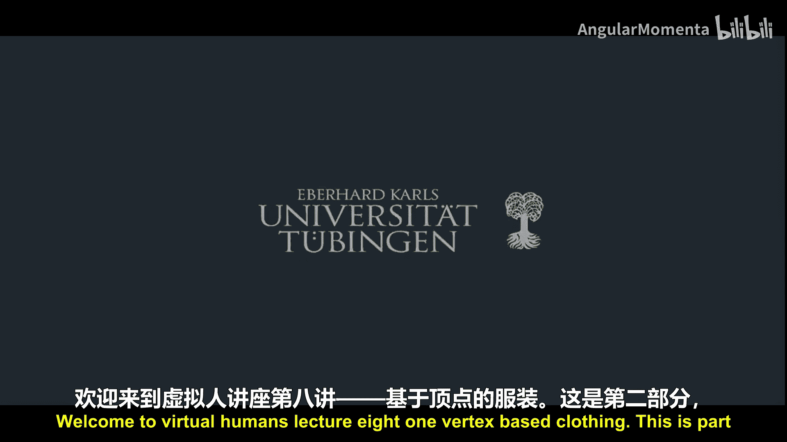
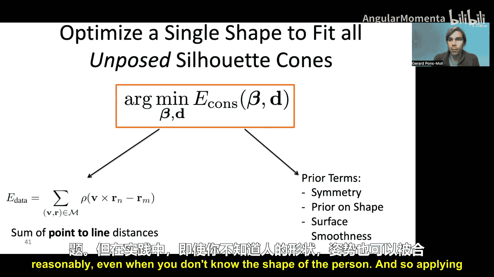
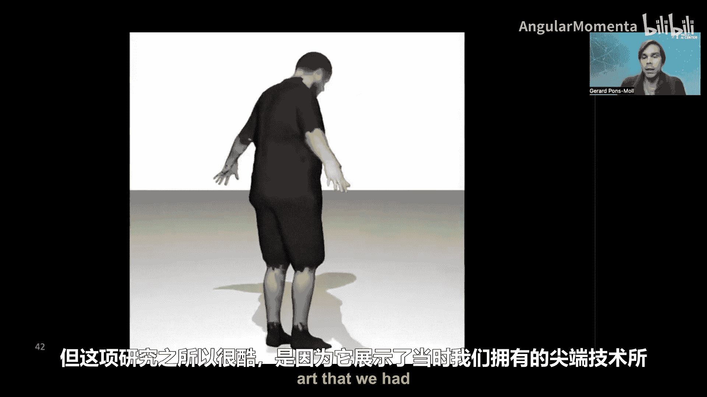
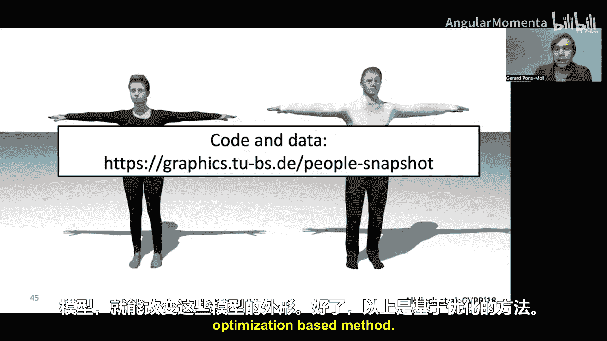
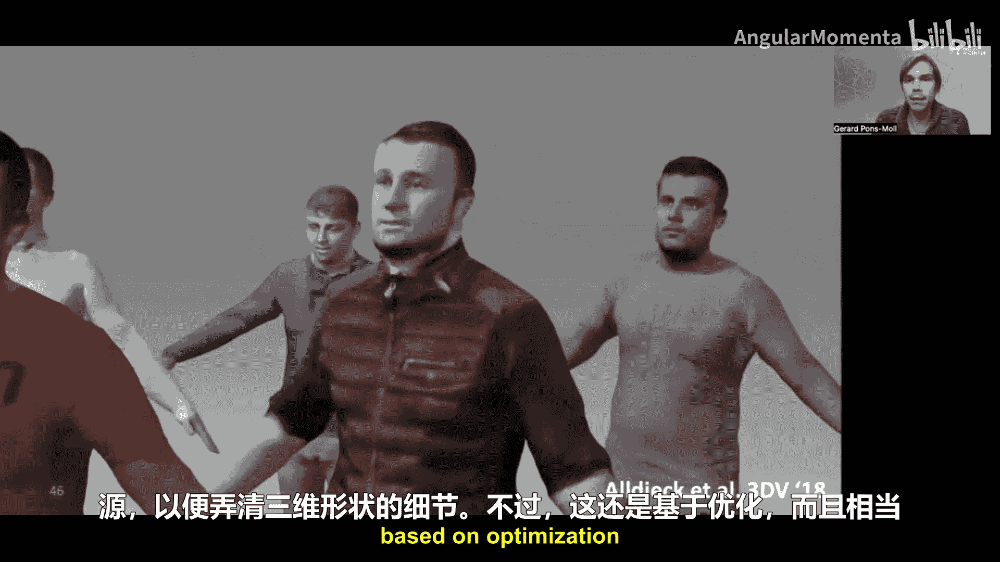
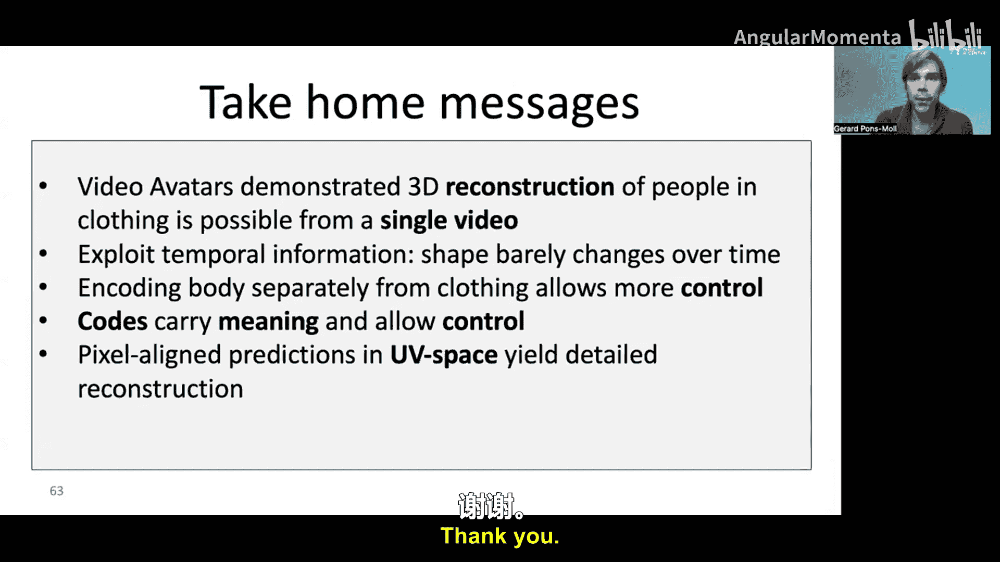

# 017：基于顶点的图像服装重建 - 第二部分

在本节课中，我们将学习如何从单张或多张图像中，重建穿着服装的三维人体模型。我们将探讨基于优化的方法和基于学习的方法，并了解如何将服装与身体分离以获得更高的控制度。

## 概述

上一节我们介绍了如何使用顶点位移来表示服装，以及如何利用这种表示来获取包含服装的人体扫描注册，并分离服装与估计服装下的体型。本节中，我们来看看如何从图像中估计穿着服装的人体三维模型。

## 从视频中重建三维人体模型

在2018年，自动重建穿着服装的人体三维模型尚不可能。以下介绍的方法可能是首个证明此任务可行的论文。该方法假设有一段人物在相机前旋转的单一视频。

目标是重建一个如你所见的虚拟化身，该化身可以在姿态和体型上进行编辑。

基本思想基于优化。首先想到的是，我们有一段视频，当人物旋转或移动时，其服装和体型几乎不变，唯一变化的是姿态。因此，一个想法是建立一个优化框架，在整个序列上同时优化姿态、体型和服装位移。

对于每一帧 `i`，都有一个姿态参数 `θ_i`。对于每一帧，都有一个衡量模型与数据拟合程度的度量，这类似于上一讲中稀疏惯性捕捉论文的方法，但这里使用的是图像。拟合度量基本上是依赖于优化参数（`θ_i`、体型参数 `β` 和位移 `D`）的模型 `M` 的渲染结果与图像本身之间的某种距离。这个距离度量可以是轮廓重叠、关节重叠或边缘比较等，即将预测的特征与图像中检测到的特征进行比较。

这种公式化的一个问题是必须一次性优化所有姿态。这在原则上计算量大且内存密集，因为需要为每一帧加载一个模型，并同时更新所有这些模型。虽然可以高效完成，但通常需要为此优化编写专门的代码，这可能不太方便。

## 视频化身与视觉外壳技术

另一种看待这个问题的方式是CBPR 2018年一篇名为“视频化身”的论文所展示的。其中运用了经典计算机图形学中从多视图重建三维形状的技术，称为**视觉外壳重建**。

标准的视觉外壳假设一个静态物体和多个观察该物体的视角。你可以从每个相机中心发射光线，这些光线从相机中心指向轮廓点，这就创建了一个所谓的“轮廓锥体”。通过相交这些锥体，可以获得三维形状。

另一种理解方式是体素化三维空间，然后将体素投影到每个相机视图中。如果它与前景重叠，则意味着它是表面内部的一部分；如果不重叠，则是背景的一部分。通过这种方式可以重建表面。

然而，问题在于人物在这里是移动的，姿态在变化，因此我们不能假设物体是静态的，需要对此进行补偿。

我们知道如何使用SMPL模型在每一帧估计三维人体模型，但这无法捕捉服装细节。那么，如何在不一次性优化所有姿态的情况下估计服装呢？

## 将视觉外壳推广到铰接物体

基本思想是基于视觉外壳技术，并将其推广到铰接物体。视觉外壳假设物体是静态的，这里我们将放宽这个假设，允许物体根据关节运动。

这里的轮廓光线从相机中心穿过轮廓，然后可以将其与模型表面的点建立对应关系。每一束光线都与一个身体模型点相关联。现在我们要做的是对这些从相机到轮廓的光线进行“逆姿态变换”，以便优化一个与姿态无关的单一形状。

这可以看作是我们学习SMPL模型时所用“逆姿态变换”技巧的推广，只不过这里我们拥有的不是完整的三维扫描姿态，而只是一个人的轮廓。

具体思路是：将光线与三维模型点关联，每个三维模型点根据SMPL模型对应的运动链变形。因此，光线会与SMPL模型一起变形，我们对光线进行了逆姿态变换。

这样做的好处是，这些光线对身体在空间中的位置设置了约束，但这些约束现在不依赖于姿态，因为我们已经对光线进行了逆变换。核心思想是根据非刚性运动的逆变换来变换轮廓锥体。

数学上，我们有一个规范空间中的光线 `R`（这是我们想要得到的），以及姿态空间中的光线 `R'`。我们需要做的是应用施加在模型顶点上的变换的逆变换。这束光线将与一个顶点关联，该顶点有其变换矩阵 `J_k` 和混合权重 `w_{k,i}`。因此，基本上，这个来自线性混合蒙皮的变换矩阵的线性组合需要被求逆，然后还需要减去姿态混合形状的贡献。

本质上，这就像是向前移动一个顶点，但现在是向后移动，并且不是应用于顶点，而是应用于一条光线。一旦完成，你就将姿态空间中的光线变换到了规范空间。

这个想法应该开始变得熟悉，因为它反复出现：即通过逆姿态变换来估计与姿态无关的形状属性，这与我们学习SMPL模型时的技巧相同。

## 基本优化框架

现在，基本的优化框架是：我们有一组形状参数（假设形状随时间恒定），以及服装的位移参数（也假设在序列中恒定）。

数据项是光线到模型中对应顶点的距离，由点线距离公式给出。先验项包括强制执行形状对称性、基于SMPL模型PCA空间的形状先验，以及基于拉普拉斯正则化器的表面平滑度。

关键点在于，一旦我们对光线进行了逆姿态变换，这个目标函数就不再依赖于姿态。这非常棒，因为现在优化速度更快，并且无需优化姿态就能产生期望的结果。当然，这里的技巧是，如果初始姿态估计错误，那么形状优化也不会正确。因此，必须首先确保姿态是准确的。但如果你一开始没有好的形状模型，这可能很困难，这就形成了一个先有鸡还是先有蛋的问题，可以通过先拟合姿态、再优化形状、然后重新拟合姿态的迭代方式来解决。

在实践中，即使不知道人的具体形状，姿态也可以被合理地估计出来。

应用这种方法可以利用时间信息，恢复人的三维形状以及优化后的姿态。

当时获得这些结果时，我们感到非常高兴和印象深刻。如今，你可以从单帧图像中获得更详细的重建，但这在当时的技术水平下，证明了什么是可能的。

基本上，可以使用这种方法重建各种穿着服装的人体模型。由于基于位移表示，对于像裙子这样的大范围服装，质量可能不会很好。

因为这是基于SMPL模型的，所以你可以对这些化身应用不同的姿态，也可以改变它们的体型。位移是应用在SMPL模型之上的，因此只需改变SMPL模型即可改变这些模型的形状。

这是一种基于优化的方法。如果你对细节感兴趣，可以使用基于“从明暗恢复形状”的方法获得更好的细节，该方法试图联合估计表面法线和光源以推断三维形状的细节。但这同样基于优化且相当复杂。

## 方法的局限性

局限性在于优化可能陷入局部最小值，正如我们在其他方法中看到的那样。最大的限制可能是将服装表示为单一偏移量，因为你无法将身体与服装分离，例如，不能将服装从一个身体重定向到另一个身体。另一个限制当然是可能陷入局部最小值。

这里除了在图像中检测人体的二维关键点和分割人体之外，没有真正的“学习”过程。

## 引入学习：从优化到学习范式

一年后，包括我们团队在内的研究者开始探索，基本上是从纯粹的优化方法转向包含学习的方法。

你可以将其视为增加一个前端：给定图像，预测模型的参数。然后训练这个网络。如果没有三维数据，可以通过自监督循环进行训练：从图像开始，用卷积神经网络预测三维模型的参数，然后通过一个可微的三维模型（如SMPL加位移）得到三维模型，接着将其渲染回图像，并要求最小化一致性损失。

这与我们之前的优化问题没有太大不同，但请注意，现在参数 `θ`、`β` 和服装参数被参数化为图像和神经网络参数 `Φ` 的函数。这允许我们在多个人物图像和视频上进行训练。

以下是遵循此范式的一些论文示例。其中，“视频化身”论文的扩展使用了自监督循环。MGN论文将服装与身体分离。DeepCap论文是特定于主体的，但允许从单一视频中稳健地跟踪穿着服装的人体，包括非刚性变形。如果你对这些主题感兴趣，建议至少阅读这些论文。

## 多服装网络

在本讲座中，我将介绍多服装网络，因为它是将服装与身体分离的论文，我想聚焦于不同服装表示方法的优缺点。

目标是从单张人物姿态图像中获取三维化身。设置与之前相同：一个人在相机前旋转，你想从这些图像中重建体型和服装，但现在你希望有能力将一个主体的服装转移到另一个主体上。

为了获得这种控制水平，需要一个将服装与身体分离的模型，正如我们在ClothCap论文中看到的那样。现在我们要从图像中做到这一点，这将更具挑战性。

在表示方面，同样需要将服装切割成片，并估计服装下的体型。这样做需要进行注册，这是一个非常困难的问题。如果对于不穿衣服的人已经很困难，想象一下对于不同种类、不同拓扑结构、不同形状、不同非刚性变形的服装，难度会有多大。

想象你想建立一个T恤的模型。你需要将扫描分割成服装，估计服装下的体型（类似于ClothCap），然后将每个服装模板非刚性注册到每个扫描。当然，你不会孤立地注册模板，你会利用身体，因为这会使问题更容易处理。

通过使用复杂的优化流程，我们能够注册一个包含33个穿着服装的人体扫描数据集。这允许你，例如，取一件服装并将其映射到不同人的扫描上。现在的问题是如何用图像做到这一点？

设置是：你有一个人在相机前旋转的8张图像（源），以及一个目标扫描，你想要这个三维服装网格。这是通过自监督完成的。

首先解析图像，得到人体的2D关键点和语义分割。这样做是因为没有足够的数据来泛化到所有可能的纹理和服装变化。如果将语义分割作为图像输入网络，网络将能更好地泛化到其他服装类型，例如，它不需要泛化到不同的颜色和纹理，因为这些信息在语义分割中被抽象掉了。

基本上，现在你为每件服装以及人物的形状和姿态都有不同的预测头。然后组合这些预测。对于服装，你也有一个PCA模型，通过这些特征向量和系数，你可以获得服装，再加上网络预测的一些额外位移，以表示PCA空间之外的东西。

然后，你使用自监督损失来闭合循环，其中包括预测与真实语义分割的重叠度。如果你有一点三维数据，还可以直接在三维扫描或三维顶点上应用监督。如果你有注册数据，可以在体型和服装参数上应用损失。

这是一个与神经身体拟合非常相似的设置。对于服装，你可能比仅估计姿态和体型需要更多的三维数据。

现在，你有人物在相机前旋转的8张输入图像，可以估计体型和服装，然后将其应用到任何体型上。令人惊讶的是，这种简单的、可能有些朴素的仅应用位移的模型，能产生视觉上相当吸引人的结果。

对于某些应用，例如游戏或体育赛事，需要将特定类型的服装应用到不同的体型上，这种位移的想法可能完全够用。

## 从图像到UV映射：提升细节预测

我们观察到的一个问题是，直接将位移作为图像的函数来预测是一项困难的学习任务。原因是图像中的像素空间与顶点空间非常脱节，网络没有直接的连接来弄清楚什么对应什么。

使学习问题表现更好的一种方法，是我们在这项名为“Tex2Shape”的工作中所做的：从单张图像获取详细全身几何，利用UV映射。

这里的想法是将三维重建问题转化为图像翻译问题。有一系列论文利用图像翻译网络，例如，输入语义分割，网络会输出包括纹理在内的完整真实感图像。这些基于“pix2pix”架构，卷积网络非常擅长找到这种图像到图像的映射，因为输入和输出之间有完美的像素对齐。

这里的想法是利用UV映射。UV映射是将人体的三维形状展开成二维图像的过程，就像将世界地图展开成地图集一样。每个像素在这个二维图像中都有一个对应的三维表面点，这意味着你可以在这里存储任何与三维形状相关的东西，例如位移或法线。好处是你可以有一个非常高分辨率的图像，当你想渲染时，只需在图像中查找法线，这比在网格上存储法线在数据结构上更高效。

我们知道如何将形状表示为图像，因为可以在每个UV坐标存储从平均平滑形状（例如SMPL模型）的位移。输出是存储了位移和法线的UV图。

现在，如何从图像得到这样一个UV图呢？有诸如DenseRack和DensePose等论文，它们学习一个对应关系图，为图像中的每个像素学习其在UV空间中的对应坐标。这允许你将图像直接展开成可见像素的UV图。注意这个UV图是不完整的，因为人物的背面没有被看到。

现在，我们可以利用这个UV变换，通过神经网络从图像像素转到UV预测。输出是法线和三维位移。使用这种像素到像素的翻译网络，可以直接学习从这些像素到这些法线和三维位移的映射。

我们这样做而不是直接从输入到输出的原因是，现在我们有一对一的对齐关系：输入中的眼睛与输出中的眼睛对齐，鼻子和胸部服装与胸部服装的三维几何对齐等等。这对神经网络来说非常方便，因为它可以在不同局部层次上观察，查看局部结构和全局结构，神经网络非常适合做这件事。

以下是一些结果，显示了扫描的三维渲染（灰色为真实值，绿色为神经网络重建）。对于正面部分，结果看起来相当详细；对于背面，也相当详细。

为了训练这个网络，使用了感知损失和对抗损失以获得细节并处理问题的多模态性。尽管这仅用三维人体扫描训练，但它可以泛化到野外的人物图像。值得注意的是，它还能泛化到各种随意姿态。

为了从合成数据泛化到真实数据，需要进行大量的数据增强，例如应用不同的光照、视角、着色等，否则网络会过拟合到训练渲染过程中的光照条件。

这是关于使用神经网络一次性重建三维化身，这比优化方法快得多，因为神经网络只需几毫秒就能产生输出。

## 纹理映射与虚拟试穿

我们还使用了类似的想法来映射纹理。一个问题是很难从不同纹理的三维人体扫描中获得各种纹理。我们意识到服装店有很多服装图像，因此我们想学习一个可能的人物纹理模型。学习直接将服装图像的纹理映射到三维人体模型是有意义的。

一个额外的优势是，这允许你进行某种虚拟试穿。我们训练了一个神经网络，学习将这些服装图像中的像素直接映射到不同服装的SMPL模型的UV图上，这允许你取商店里的服装图像，然后将它们映射到SMPL模型上，以获得这些带纹理的化身。

## 总结

本节课中，我们一起学习了从图像估计包括服装的三维人体模型。

**核心要点如下：**
*   **视频化身**论文证明了从单一视频重建包含服装的三维人物是可能的。
*   如果你想利用时间信息，必须利用形状随时间几乎不变这一事实。
*   将身体与服装分开编码允许更高的控制度，例如将一件服装从一个身体应用到另一个身体。
*   拥有具有意义和可控性的编码（如分离的身体和服装）是很好的。
*   直接预测顶点并不容易，特别是如果你想预测细节。
*   **在UV空间中进行像素对齐的预测**能产生更详细的重建，同时允许你对模型应用不同的姿态和体型。

我们将在下一讲中介绍另一类基于隐式表面的技术，它能提供比这些UV空间方法更好的细节。这将结束基于顶点的服装和图像中人体估计的第二部分。