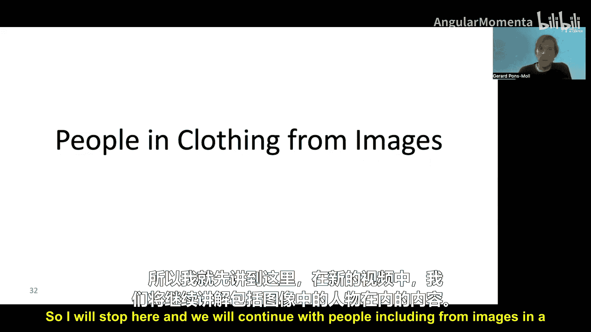

# 018：基于顶点的服装表示与注册

在本节课中，我们将学习如何使用顶点位移来表示服装，并利用这种表示方法进行三维扫描的注册。接着，我们将探讨如何从单张图像预测穿着服装的人体三维模型。最后，我们会了解如何学习一个将姿态、体型和服装风格作为输入参数的服装模型。

## 👕 服装表示方法概述

在本课程中，我们将看到几种不同的服装表示方法。本节将介绍基于**顶点位移**的方法，这是最基本、最简单的表示形式。后续课程还会介绍基于隐式曲面、点云和神经特征点等方法。

让我们先看看顶点位移表示法。如果你还记得，SMPL模型是基于一个基础形状（模板），通过添加一组向量位移来建模形状变形和姿态相关变形，所有这些计算都在一个规范姿态下进行。

现在，如果我们想为这个基础模型添加服装，最简单的方法就是再添加一组顶点位移来专门表示服装。这些顶点位移将叠加在规范姿态下的基础平均形状之上。

本质上，如果我们知道了这些位移，就可以从一个未着装的人体形状变换到一个着装的人体形状，如上图所示。这种表示法有其优点和缺点，我们将在本节中详细探讨。

## 🔍 基于顶点位移的服装注册

首先，让我们尝试用这种表示法解决一个实际问题：为穿着服装的人体三维扫描进行注册。

为服装进行注册的过程与为裸体人体注册没有太大不同。因为即使对于裸体，模型也无法解释所有细节。这里的技巧是同时优化模型参数和一组自由形式的顶点位移，以逐步适应扫描数据。

注册过程如下：
1.  从某个初始模型开始，首先优化模型参数。
2.  当模型足够接近数据后，启动自由形式的顶点位移优化（即之前提到的位移矩阵）。
3.  通过这种方式，我们得到一个与SMPL模板顶点数相同，但能表示服装的注册结果。

然而，你可能已经猜到，这种注册方法的主要问题是它完全忽略了服装在身体上的**分层结构**。这意味着，当某人抬起手臂，服装随之移动时，这种表示法并不是在追踪这种切向移动，而是试图通过顶点在法线方向上的位移来解释变化。这对于许多应用（如纹理映射或将服装转移到不同体型的人身上）来说是个问题。

## 🧩 多层注册：ClothCap方法

为了解决上述问题，我们引入了ClothCap工作。其核心思想是将服装分割成独立的网格部件，并分别估计服装下的身体形状。这样，我们就可以分别追踪服装下的身体和每件衣物，从而获得一个**多层注册**结果，更好地捕捉运动的物理特性。

实现这一目标的第一步是估计服装下的身体形状。这本身是一个挑战，因为服装会遮挡身体。然而，我们在2017年观察到：当人运动时，服装会在身体的不同部位产生褶皱和贴合。利用多帧时间序列信息，这些多重约束为我们提供了关于真实身体形状的大量信息。

我们利用了这一观察，开发了名为“Buff”的方法。具体做法是：积累所有时间帧的规范姿态注册结果，考虑这些注册结果的并集，我们称之为“融合扫描”。你可以把它想象成一个有很多层的洋葱。我们可以设置一个优化问题，要求身体模型位于这个“洋葱”（即融合扫描）的凸包内部，因为服装不能与身体相交。通过这种方式，我们可以相当准确地估计出服装下的身体形状。

## 🧠 ClothCap工作流程详解

ClothCap工作的输入是一系列由4D扫描仪捕捉的运动中的三维扫描序列。我们还会手动定义一些标签，来指定我们期望哪些身体部位与特定衣物（如T恤、裤子）重叠。这是一个非常弱的先验，用于帮助获得更好的扫描分割。

给定输入后，工作流程如下：
1.  **扫描分割**：首先将扫描序列分割成不同的衣物部件。
2.  **多层模型注册**：然后，将一个多层的SMPL模型（如果你愿意，可以看作是SMPL的多层版本）注册到这些分割后的扫描上。

本讲座不深入讲解扫描分割的具体技术（当时基于马尔可夫随机场和身体先验），而是聚焦于**多层部件注册**的过程。这个过程是全自动的，最终能得到一个包含服装下身体形状以及每件衣物随时间追踪的注册结果。

## 🛠️ 如何实现多层网格注册？

要获得好的注册，需要一个好的模型。而标准的SMPL模型不适合解释穿着服装的人，因为它本身没有服装。因此，我们在这里做的是：为正在追踪的目标对象创建一个**特化的SMPL模型**。

具体步骤如下：
1.  将SMPL模型分割成与扫描分割对应的部件（通过将扫描的分割信息传递到SMPL模板）。
2.  将SMPL模型切割成这些部件。
3.  变形这个SMPL模型，使其能够解释第一帧扫描。

这样，我们就得到了一个被分割成部件的网格。这个网格的顶点源于SMPL模型，这意味着我们仍然可以使用SMPL的函数来改变这个特化模型的姿态或形状，这对后续的注册非常有用。

我们将这个“服装模板”作为我们的模型，然后将其非刚性变形到每一帧扫描，以获得多层注册结果。这样，我们就能捕捉到服装的非刚性动力学，比如运动时产生的褶皱变形。

## ⚖️ 注册的目标函数

与裸体注册类似，我们的目标函数包含数据项和耦合项，但更为复杂。

*   **数据项**：这是扫描到网格的距离。但现在，我们计算的是**每个衣物部件**与其对应的扫描分割部分之间的距离。公式表示为：
    `∑_{garment=1}^{N} distance(V^{garment}, S^{garment})`
    其中 `V^{garment}` 是注册结果中衣物的顶点，`S^{garment}` 是扫描分割中对应的衣物部分。这样做比不考虑分割的整体注册效果更好。
*   **耦合项**：使注册结果接近我们的特化模型。这个模型知道服装的大致形状，但不知道随时间变化的非刚性变形（如皱纹）。耦合项在拟合数据和保持模型合理性之间进行权衡。
*   **边界项**：我们希望注册结果中衣物的边界与扫描中检测到的边界匹配，并且边界是平滑的。
*   **平滑项**：拉普拉斯项，用于使整个注册结果的表面平滑。

## 📐 边界平滑与拉普拉斯平滑

**边界平滑**是为了防止优化后边界变得噪声大、不平滑。对于一个用弧长 `s` 参数化的曲线 `γ(s) = [x(s), y(s), z(s)]`，其曲率的平方近似为二阶导数的平方和。我们希望曲率小，以实现平滑。

在离散网格中，对于边界环上的每个顶点 `n`，其平滑项可计算为：
`∑ ||v_{n-1} - 2v_n + v_{n+1}||²`
这本质上是计算一维拉普拉斯算子，最小化该项可使边界曲线平滑。

**拉普拉斯平滑**则作用于整个网格表面，用于保持整体光滑并允许合理的褶皱。给定一个网格，其图拉普拉斯算子 `L` 定义为：
`L = I - D^{-1}A`
其中 `A` 是邻接矩阵，`D` 是对角度矩阵（`D_ii` 为顶点 `i` 的邻居数）。

当我们最小化 `||L * V||²`（`V` 是顶点矩阵）时，对于每个顶点 `v_i`，我们实际上是在最小化其与邻居平均位置 `(1/N)∑v_j` 的差值。这个差值向量近似于法线方向，其大小与平均曲率相关。最小化这个项会使表面尽可能平坦，但通过与数据项的权衡，可以保留必要的细节（如皱纹）。

## 🎯 多层注册的应用与总结

一旦通过优化上述目标函数解决了多层注册问题，我们就能获得完美的、与底层SMPL模型对齐的衣物注册结果。这使得我们可以对服装和身体进行“线性代数”操作。

例如，我们可以计算衣物的位移：`位移 = 衣物顶点 - 对应的身体模板顶点`。当我们有一个新的身体时，只需将计算好的位移加到新身体的对应顶点上，就能为其“穿上”衣服。这实现了**服装在不同人体间的转移**。

以下是应用示例：
*   将一个人的服装注册结果，通过添加位移的方式，转移到另一个不同体型的人身上。
*   该方法不仅适用于紧身衣，也可用于追踪裙子等服装，只需为裙子准备一个单独的模板，并让其随着身体的根关节移动即可。

**需要指出的是**，ClothCap的这种简单位移添加模型，并没有考虑服装的物理属性（如一件T恤穿在更大体型的人身上会被撑大）。要建模这些效应，需要更复杂的服装模型，这将在后续课程中讨论。

本节课中，我们一起学习了基于顶点位移的服装表示方法，以及如何通过ClothCap方法实现考虑分层结构的多层服装注册，从而为后续的服装转移和编辑奠定了基础。

---

