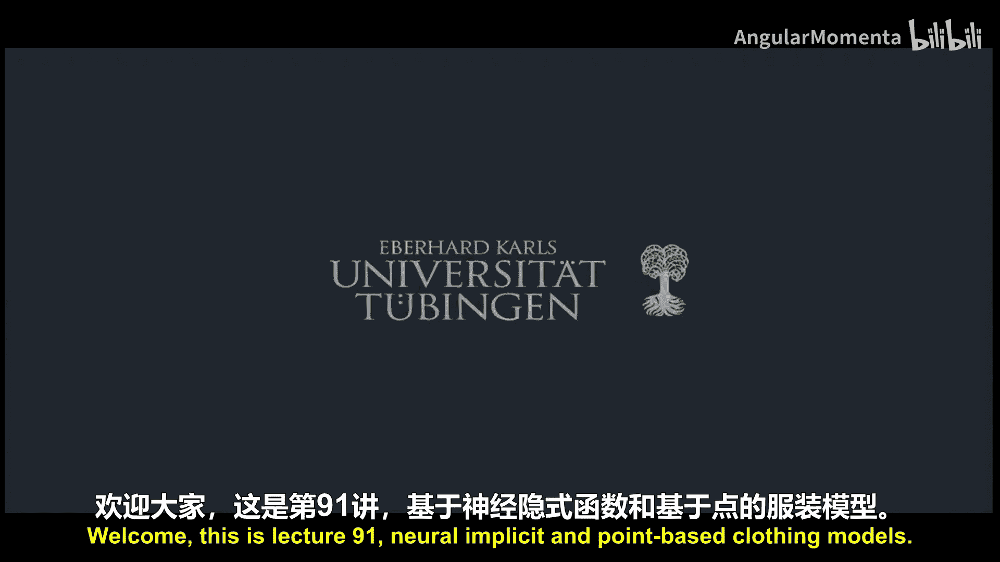

# 019：神经隐式与点基服装模型 - 第三部分和第四部分

在本节课中，我们将学习如何构建能够从潜在代码生成新形状的生成式神经隐式人体模型，并了解另一种基于点云的服装建模方法。我们将首先探讨生成式神经隐式模型的工作原理，然后介绍点基服装模型的优势与局限。

## 概述：从重建到生成 🧬

上一节我们介绍了用于人体重建的神经隐式模型。这些模型虽然能泛化到新姿态，但并非严格意义上的生成模型。本节中，我们将探讨如何构建真正的生成式模型，即给定一些控制参数（如潜在编码），模型能够生成以隐式方式表示的新人体形状。

## 生成式神经隐式模型：GDN 🏗️

我们将以名为GDN（Towards Generative Detailed Neural Avatars）的工作为基础进行讲解。其核心思想与之前类似，但关键在于训练一个模型，使其能够从潜在编码生成形状。

### 模型架构概览

模型在高层级的工作流程如下：
1.  输入一个编码人体整体形状和服装类型的潜在编码 `Z_shape`。
2.  输入另一个编码服装细节（如褶皱）的潜在编码 `Z_detail`。
3.  一个规范隐式模型在规范空间中生成形状的隐式表面以及空间中各点的法向量场。
4.  一个多主体前向蒙皮模块，将Simple模型的蒙皮思想扩展到神经隐式场，以处理不同体型。

该网络使用自解码框架进行训练，并通过对抗损失来学习更具随机性的细节部分。

以下是训练框架的简要说明：
*   **自解码框架**：为训练数据集中的每个实例初始化一组潜在编码（`Z_shape`, `Z_detail`），并与模型参数一起优化。
*   **对抗训练**：用于训练法向量细节部分，采用生成对抗网络的训练方式。

### 规范隐式模型

这部分没有新概念，主要是应用之前的知识构建系统。

*   形状潜在编码 `Z_shape` 生成一个神经特征体素网格。
*   对于给定点，通过三线性插值获取其特征，与点的绝对位置一同输入“占用率块”，解码出该点在规范空间中的占用率 `O`。
*   法向量模块根据点的特征、绝对位置以及细节潜在编码 `Z_detail` 预测法向量。

因此，形状被表示为一个隐式表面，即所有满足占用率 `O(x) = τ`（通常 `τ = 0.5`）的点 `x` 的集合。占用率场映射在0（内部）和1（外部）之间。

### 多主体前向蒙皮模块

此模块基于SNARF的前向蒙皮思想，但需处理多主体情况，因此更为复杂。

我们需要建模两项内容：**无服装的人体变形**和**有服装的变形**。为了更容易学习前向蒙皮，我们考虑使用不带服装变形的Simple模板。

具体流程涉及两个模块：
1.  **蒙皮权重模块 `W`**：输入形状潜在编码 `Z_shape` 和**尺寸无关**的规范点 `X*`，预测蒙皮权重。
2.  **体型依赖变形场模块 `M`**：用于将**尺寸依赖**的规范点 `X̄*` 转换为**尺寸无关**的点 `X*`，以便 `W` 模块能在此与体型无关的空间中预测蒙皮权重。这是使模型更容易泛化的关键新概念。

前向蒙皮过程需要满足模型预测的 posed 点 `x'` 与真实 posed 点匹配，这涉及通过迭代求根来寻找对应的规范点。

### 训练流程与结果

模型采用自解码设置训练。首先训练粗糙形状模型，然后在此基础上训练法向量细节模块。

此类模型可以生成相当详细的结果，并且能够从潜在编码生成全新的人体。虽然生成的变形看起来与蒙皮模型结果相似（因为蒙皮权重不依赖于姿态），但法向量预测引入了一些姿态依赖的细节。其优势在于能够生成具有不同服装风格的多样化人体。

## 分层生成模型：Simplicial 🧥

GDN模型的一个限制是它是单层的，没有分离身体和服装。分离两者能提供更多控制，例如更换服装。

Simplicial 是一个拓扑感知的生成模型，它使用神经隐式表面编码服装层，允许在不同服装（包括不同拓扑结构）之间进行插值。

### 与顶点基模型的对比

顶点基服装模型（如TailorNet）基于位移场，需要预测三维位移作为姿态和形状的函数：`M(pose, shape) -> displacement`。它们是离散的，需要预定义顶点数量。

神经隐式模型则使用一个函数 `C`，它接受空间中的任意点、姿态和服装编码，输出一个无符号距离场来表示表面：`C(point, pose, Z_cloth) -> unsigned distance`。表面是该距离场的零水平集。

在Simplicial中，`Z_cloth` 被分解为控制服装类别（如袖子长度）的 `Z_cat` 和控制合身度的 `Z_style`，以实现更精细的控制。

### 从图像拟合模型

隐式表示的一个便利之处是易于从图像拟合模型，可以直接优化模型的潜在编码。

**拟合流程**：
1.  从图像中提取服装语义分割。
2.  使用现有方法初始化人体姿态和形状参数。
3.  通过优化服装潜在编码 `Z_cloth`，使模型投影与图像分割掩码对齐，从而获得三维重建。

**优化目标函数简述**：
*   沿从相机出发穿过像素的光线采样点。
*   每个点用相对于人体网格上一组关键点的位移来表示（`P_β`），这编码了点与身体的关系。
*   对于每个采样点，判断其是否与对应的语义分割标签重叠（变量 `s_p ∈ {0, 1}`）。
*   **情况1 (`s_p = 0`)**：点位于分割区域外，应强制其位于服装表面之外，即要求距离场值 `C > 0`（通常设为最大允许距离 `d_max`）。
*   **情况2 (`s_p = 1`)**：点位于分割区域内，应强制其位于服装表面上，即最小化 `|C|`，使 `C` 趋近于0。
*   考虑投影到同一像素的所有点，通常取沿光线的最小值。

通过这种优化，可以恢复出与图像分割对齐并覆盖在身体上的分层服装模型。结果质量受训练数据和距离场阈值的影响。

## 点基服装模型：第四部分 ⚫

现在让我们转向点基服装模型。这部分内容相对简短，但作为一种表示方法值得了解。

### 表示方法比较

点云与其他模型相比如何？
*   **保真度高**，**拓扑灵活**（点可自由移动）。
*   **可直接从扫描中学习**，并允许**快速渲染**。
*   随着类似高斯泼溅这样的点基渲染技术兴起，点表示越来越受欢迎。

### POP：基于点的细节表示

之前的一些方法将特征附加在表面面片上，可能导致拼接边界处的伪影。POP 方法直接将特征附加到点上，实现了更细粒度的表示，从而能捕捉尖锐的局部细节。

**工作原理**：
1.  依赖于UV贴图，该贴图建立了图像UV位置与表面3D点之间的对应关系。
2.  一个编码器为每个UV位置生成点特征。
3.  结合服装潜在张量，一个形状解码器为表面上的每个点预测一个位移向量 `r_i ∈ R³`。
4.  该位移在规范空间中预测，然后与原始点一同变换到姿态空间，得到最终的点位置 `p_i`。

这与TailorNet 的核心思想（预测位移）相似，但关键区别在于：POP 输出的点是**离散且不连接**的，渲染时不使用连接它们的面片。

### 结果与局限

POP 可以产生比传统LBS更高质量的结果。然而，由于使用简单的UV贴图，在接缝处可能出现不连续。对于裙子这类服装，当腿部分开时，基于身体位移场的点可能会变得稀疏，导致伪影。

**总结点基模型**：
*   控制不复杂，能建模不同拓扑。
*   能达到良好的细节水平，渲染速度快。
*   **不是连续表示**，是离散的，需要预先指定点的数量，在这方面与网格有相同的问题。

后续课程中我们将看到基于高斯泼溅的点模型，其主要区别在于每个点附加了一个高斯分布（协方差），可以快速渲染出高质量结果，且无需顶点连接。

## 总结 🎯

本节课我们一起学习了生成式神经隐式人体模型和点基服装模型。
*   在第三部分，我们探讨了GDN等生成式神经隐式模型，它们能够从潜在代码生成带细节的人体形状，并通过分层模型（如Simplicial）实现了身体与服装的分离及跨拓扑插值。
*   在第四部分，我们介绍了点基服装模型（如POP），了解了其通过离散点表示服装、实现快速渲染和灵活拓扑的能力，同时也认识到其存在离散性带来的限制。

隐式表面更易于学习，并能提供一定程度的控制，相关研究正在不断改进。点基表示则在高保真渲染方面展现出独特优势。理解这些不同表示方法的优缺点，对于在虚拟人类建模中选择合适的技术至关重要。

