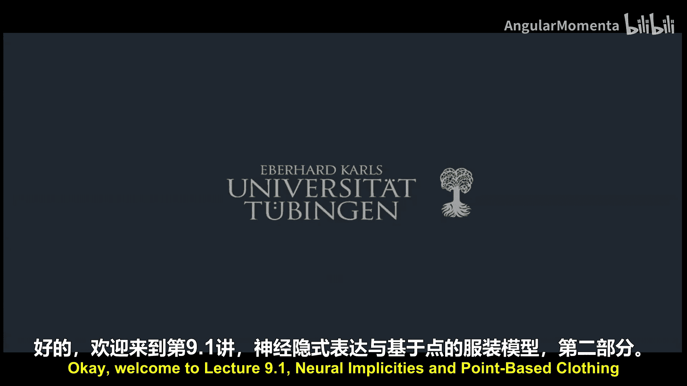
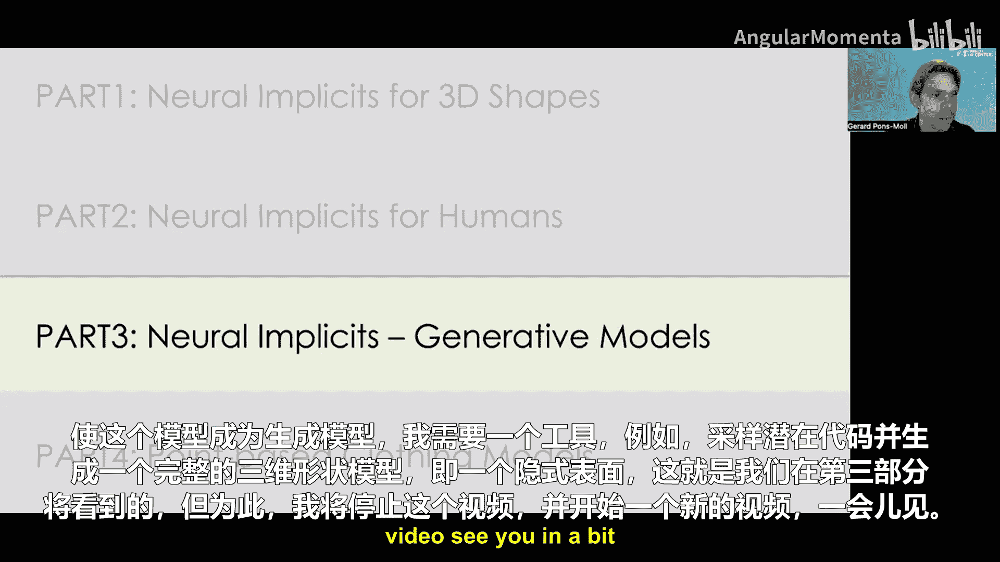

# 020：神经隐式与基于点的服装模型 - 第二部分

## 概述
在本节课中，我们将继续学习神经隐式模型，并探讨如何将其专门化，以更好地应用于人体建模，特别是穿着服装的人体。我们将从回顾基于网格模型的局限性开始，逐步介绍几种关键的神经隐式人体模型，分析它们的设计思路、优势与挑战。

---

## 从通用模型到人体模型

上一节我们介绍了用于通用物体的神经隐式模型。本节中，我们将看看如何使这些模型专门用于人体。

基于网格的人体模型，虽然在某些方面很方便，但在处理拓扑结构变化和复杂服装时存在问题。拓扑需要手动定义，并且分辨率有限。相比之下，隐式函数或隐式表面在拓扑变化方面更灵活，也更适合学习，因为它们允许对每个点进行预测。

用于人体和关节的神经隐式模型具有高保真度、拓扑灵活性，并允许一定程度的控制。它们可以直接从扫描数据中学习，而无需进行繁琐的配准。

基于顶点的人体模型是一个函数，它将姿态和形状参数映射到模型的 `3N` 个顶点（`V` 代表顶点，是三维的）。而在神经隐式模型中，给定一个维度为 `D` 的潜在编码 `z` 和一个三维点 `p`，模型预测一个距离或占据值（一个标量）。这是两种模型在数学上的核心区别。

为了使神经隐式模型更像人体模型，我们需要让它们不再依赖于随机的潜在编码，而是依赖于有意义的潜在编码，即人体的姿态 `θ` 和形状 `β`，并预测距离或占据值。

---

## NASA：首个神经隐式人体模型

第一个尝试用神经隐式模型预测人体或关节化表面的模型是NASA。该论文的核心论点是，需要对关节结构进行推理，否则网络很难为所有可能的姿态学习表面的占据情况。

以下是其基本思路：

*   **朴素方案**：直接从姿态预测隐式表面非常困难，因为网络需要为每种可能的姿态学习其配置。
*   **改进方案**：利用人体是关节化的这一先验知识，让网络的学习任务变得更容易。

其灵感来源于SMPL等模型在规范空间进行变形的思想。问题在于，能否将这些概念扩展到神经隐式模型？答案是肯定的。

---

## 分块刚性模型

为了改进不适用于新姿态的非结构化朴素模型，我们可以引入**分块刚性模型**。

该模型的操作如下：对于姿态空间中的每个点，模型会根据身体的每个部分将其“解除姿态”。我们虽然不知道空间中的一个点属于哪个部分，但模型会假设它属于每一个部分。

以下是具体步骤：
1.  根据每个部分，将点 `p` 变换回规范空间。
2.  为每个刚性部分预测占据值。
3.  点的总占据值取所有部分预测值的**最大值**。

这意味着，一个点只要被任何一个部分占据，就被认为是占据的。这与我们之前看到的通过 `max` 操作组合多个部分的隐式表面以得到并集的思想一致。

这个模型显著改善了结果，能够更好地重建姿态。然而，与简单的刚性网格模型类似，它在关节处存在问题，因为人体并非刚性部件的集合，还存在非刚性变形。

---

## 可变形分块模型

为了模拟这些依赖于姿态的变形（类似于SMPL中的姿态混合形状），模型在规范空间的占据网络函数中也加入了姿态 `θ` 作为条件。这样，网络就能学习也依赖于姿态的占据情况。

这与SMPL中的姿态混合形状完全类似，只不过后者是顶点位移。可变形模型在肘部等位置能产生更平滑的结果，符合预期。

NASA模型存在的问题包括：需要将点映射回规范空间、存在基于部件的伪影、以及泛化到新姿态的能力有限。其低维姿态编码未能完全消除长距离的虚假相关性。

---

## CAPE：引入局部结构感知

CAPE模型解决了上述问题，其思路直接而有效。

以下是其核心思想：
1.  获取SMPL模型的隐式表面，并独立地考虑每个部分。
2.  将这些部分分别规范到规范空间。
3.  使用PointNet等网络预测每个部分的**潜在编码**。
4.  从这些潜在编码预测占据值。

与NASA的主要区别在于，现在网络能够“看到”规范空间中未姿态部分的**局部结构**。这些潜在编码 `z_1` 到 `z_K` 更加强大。反姿态和取最大值的操作与NASA相同，但局部潜在编码的引入使CAPE具有比NASA更好的泛化能力。

然而，基于部件的模型在部件交界处始终存在问题，CAPE也不例外。此外，CAPE无法建模服装或精细细节，它更像一个关节化模型。拥有隐式表面表示对于测试点是否在内部（例如在模拟中判断服装是否在体内）或判断人物是否与3D场景相交仍然有用。

基于部件的模型通常需要蒙皮权重进行部件组合，在分布外姿态下部件伪影明显，且无法建模宽松服装。

---

## Neural-GIF：学习连续变形场

那么，如何建模这些精细的变形呢？接下来介绍一篇名为Neural-GIF的论文，它使用学习的线性混合蒙皮和规范形状来学习姿态和形状条件的神经隐式模型。

有趣的是，它与SMPL模型完全类似，但工作方向相反：
*   **SMPL（前向）**：从规范空间开始，应用一系列变形得到姿态空间。
*   **Neural-GIF（后向）**：从姿态空间开始，应用一系列变换以在规范空间评估占据值。

以下是其工作流程：
1.  从姿态空间中的查询点 `p‘` 开始。
2.  **解除姿态**：网络预测该点的蒙皮权重 `w`，使用逆蒙皮将其变换回规范空间点 `p`。
3.  **预测变形场**：网络预测一个依赖于规范空间点 `p` 和姿态 `θ` 的三维位移场 `Δp`。这类似于连续的姿态混合形状，但由于是隐式表面，其作用方向是相反的（例如，`Δp` 指向内会使表面变大）。
4.  **评估SDF**：在变形后的规范空间点 `p + Δp` 上评估符号距离函数或占据值。

该模型的目标是直接从扫描数据训练，并获得可以用骨架姿态驱动的神经隐式表面（包含服装细节）。这是一个特定于主体的模型，但能产生精细的细节。

与直接以姿态 `θ` 为条件来预测规范空间SDF的Scanimate等工作相比，Neural-GIF通过在评估SDF之前先对点进行变形，能够获得更好的细节。

---

## 前向与后向蒙皮的挑战

然而，Neural-GIF等模型仍存在问题。主要问题在于需要为空间中的每个点预测蒙皮权重，这是一个困难的学习问题。这被称为**后向蒙皮**。

当姿态复杂时，网络学习的蒙皮权重场可能无法正确泛化，导致规范空间点预测错误。这是因为为所有可能姿态学习蒙皮权重非常困难。

相比之下，在SMPL的**前向蒙皮**中，这不是问题，因为我们从一个点开始并变形它。规范空间的蒙皮权重相对静态，不随姿态剧烈变化，因此学习起来更容易。

---

## SNARF：可微分前向蒙皮

SNARF模型的关键思想是将SMPL的前向蒙皮模式整合到学习过程中。它学习规范空间的形状（网络 `Σ_f`）和**规范空间的蒙皮权重**（网络 `Σ_w`），而不是姿态空间的蒙皮权重。

其核心挑战在于：在前向蒙皮中，从规范空间点 `x*` 映射到姿态空间点 `x‘`。但从扫描数据学习规范形状需要知道逆映射——对于每个 `x‘`，需要知道对应的 `x*`。这是一个非投影映射，可能有多解。

以下是SNARF的解决方案：
1.  在规范空间，网络 `Σ_w` 预测点 `x*` 的蒙皮权重 `w`。
2.  前向蒙皮后，应满足：`x‘ ≈ Σ_i w_i * B_i * x*`。
3.  对于给定的 `x‘`，可能存在多个 `x*` 满足此方程（多个假设）。
4.  考虑所有可能的 `x*`，通过 `Σ_f` 获取其占据值，然后取最大值作为 `x‘` 的最终占据预测。
5.  损失函数是预测占据值与真实占据值之间的交叉熵。

关键技巧在于，需要通过一个非线性方程（根查找）的求解过程进行反向传播。通过这种方式，SNARF实现了类似SMPL的前向蒙皮，虽然表面细节可能稍显平滑，但对不同姿态（尤其是与数据集差异很大的姿态）的泛化能力要强得多。

比较表明，前向蒙皮模型对困难姿态的泛化更好，而后向蒙皮模型则具有更高的保真度，并且对宽松服装等建模更灵活。

---

## 总结

本节课中，我们一起学习了如何将神经隐式模型应用于人体建模。我们从分块刚性模型（NASA）开始，看到了其改进版本（CAPE）如何引入局部结构信息。接着，我们探讨了Neural-GIF如何通过后向蒙皮和连续变形场来建模精细细节，但也分析了后向蒙皮在泛化上的挑战。最后，我们介绍了SNARF如何通过可微分的前向蒙皮来解决泛化问题，在保真度和泛化能力之间取得了更好的平衡。

目前我们所见的模型都不是生成模型。在下一部分，我们将探讨如何使这些模型具备生成能力，例如通过采样潜在编码来生成完整的3D隐式表面形状模型。