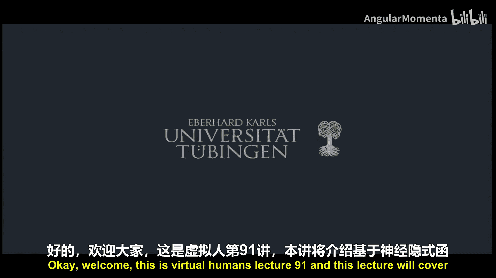
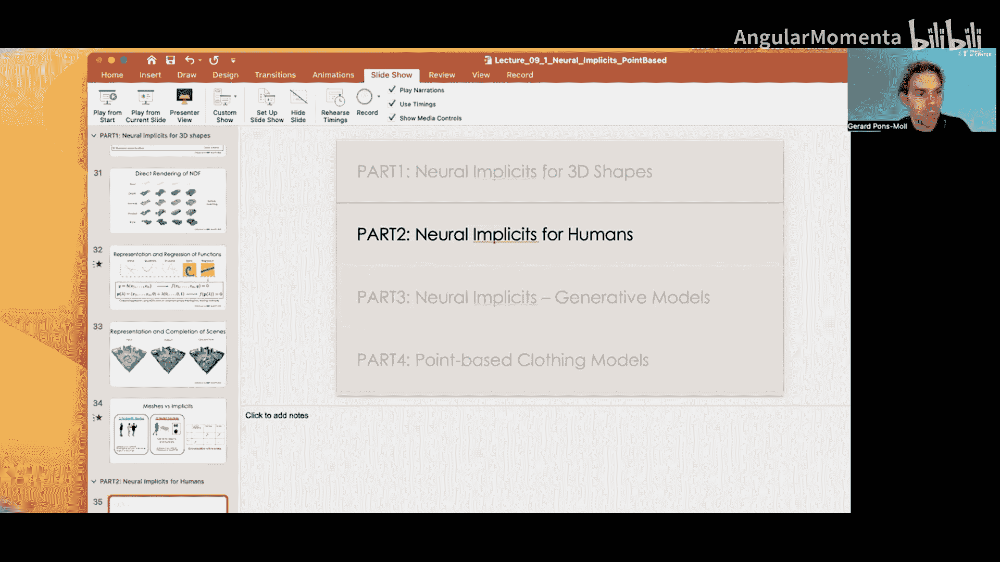

# 021：神经隐式与基于点的服装模型 - 第一部分

在本节课中，我们将学习神经隐式模型以及基于点的服装模型。课程内容分为四个部分。第一部分，我们将了解用于3D形状的通用神经隐式模型。第二部分，我们将探讨如何将这些模型专门应用于人体建模。第三部分，我们将学习如何使这些模型具有生成能力。最后，我们将介绍一种简单但有效的基于点的表示方法。

## 第一部分：3D形状的神经隐式模型 🧊

一个核心问题是：什么是3D数据的好表示方法？我们需要考虑几个因素：表示方法必须与神经网络兼容，需要足够灵活，并且能够产生高保真度的结果。

以下是几种常见的3D表示方法及其特点：

*   **体素网格**：这种表示方法非常适合卷积神经网络，因为可以直接对数据应用滤波器。然而，它将3D空间离散化为网格，所需内存与分辨率的立方成正比。此外，在训练或预测时，必须预先确定输出的分辨率。
*   **点云**：点云将3D空间离散化为一系列3D点。但它不建模点之间的连接关系或拓扑结构。通常也需要预先确定网络输出的点数，这限制了分辨率。渲染点云通常也更困难。
*   **网格**：网格由顶点和面组成，是我们课程中广泛使用的表示。它同样受限于分辨率，需要预先确定顶点数量，并且通常需要一个类别特定的模板（对于人体可行，但对于椅子等更复杂的物体则难以定义）。

一种在计算机图形学中已知多年但直到最近才与深度学习结合的有趣表示是**隐式表面表示**。它的优势在于不离散化空间，可以表示任意拓扑和分辨率，内存占用低，且不局限于特定类别。

2019年，几乎同时出现了三篇论文提出了相似的想法。我们可以定义一个函数 **`F(p)`**，它告诉我们一个点 `p` 是在物体内部还是外部，或者它到表面的距离。表面（图中蓝色边界）由这个函数 **`F`** 决定，即所有满足 **`F(p) = c`**（例如，对于占用率0/1，c=0.5）的点 `p` 的集合，这被称为函数的**等值面**。

这种表示的一个便利之处是，即使发生拓扑变化（例如表面分裂成两部分），我们也可以对函数 **`F`** 关于其参数求导，而无需担心点与点之间如何连接，这在网格表示中会非常困难。

对于常见物体，这是一个突破，因为它能以前所未有的分辨率表示不同的拓扑结构，并且可以在测试时选择分辨率。

那么这些网络是如何工作的呢？模型实际上相当简单。它接收一个点的坐标 **`(x, y, z)`**，通过一个神经网络来预测该点是在内部还是外部。通常，我们不只是想用神经网络记忆单个形状，因此需要一些条件输入。例如，输入 **`x`** 可以是稀疏点云、部分点云、低分辨率体素甚至图像，通过一个编码器得到一个 **`n`** 维的潜在向量 **`z`**，然后用 **`z`** 来条件化解码器。网络将基于 **`z`** 和点坐标预测内部/外部。

为了重建表面，我们需要查询空间中的许多点，解码出它们是内部还是外部，然后使用一种称为**行进立方体**的计算机图形学算法来恢复并网格化表面。

然而，当我们尝试对像人体这样的铰接形状建模时，遇到了许多问题。给定一个低分辨率体素作为输入，我们希望通过这种占用网络（现在常被称为神经场模型）重建一个高保真度的网格，但结果往往缺失铰接结构，并倾向于产生看起来非常“平均”的形状。

在2020年CVPR上发表的工作中，我们解决了这些限制，以建模更详细的铰接结构和更复杂的物体形状。首先，我们需要找出之前模型的问题所在。

从模型设计来看，存在两个潜在问题：
1.  **结构丢失问题**：原始形状空间存在于三维中，当我们将其编码并映射到一个潜在变量时，我们失去了这种结构，解码器更难知道输出形状也应存在于3D空间中。
2.  **坐标信息不足**：输入给网络的点坐标不包含关于局部形状的信息。我可以旋转整个形状，坐标会完全改变，网络需要学习根据所有可能的旋转来产生形状。坐标本身不包含形状信息，信息在于局部结构，即点与点之间的关系。

因此，我们借鉴卷积神经网络的成功，在3D中使用了卷积神经网络。我们对输入数据（例如一个我们想超分辨或补全的3D网格）进行卷积，得到一个多尺度的深度特征网格（特征体积）。现在，我们不再基于点坐标解码，而是基于在网格连续位置处（通过三线性插值提取）的特征来解码占用率或距离场。这样，在更深层我们拥有形状的更全局结构，在较浅层我们拥有更局部的结构。

从数学上看，之前是 **`F(z, p) -> occupancy`**，现在我们用多尺度特征 **`F1...FN`** 替换了潜在编码 **`z`**，解码函数基于这些在连续点位置 **`p`** 提取的深度特征。

这一主要改变对结果产生了显著影响。我们观察到，对于低分辨率体素，我们可以恢复细节并保留输入数据中已有的细节。我们还可以补全缺失部分的点云，因为模型在形状数据集上训练过，可以学习典型3D形状的外观。该模型后来还被扩展以预测纹理，并在一些3D重建挑战中取得了优异成绩。

## 第二部分：处理开放表面与流形 🌀

然而，我们仍然有一个遗留问题。我们假设输出是0或1（内部或外部），但这只能建模**水密**表面。现实中存在开放表面、流形和具有内部结构的复杂形状，对于这些结构，无法清晰定义内部和外部。

我们需要改变输出表示。一个解决方案是预测**无符号距离**到表面，而不是占用率。这意味着我们要预测空间中任意点 **`p`** 到表面上最近邻点 **`q`** 的距离 **`d = ||p - q||`**，注意这是无符号的。

现在，表面是这个无符号距离场的零等值面。问题是如何从一个无符号距离场恢复零等值面上的所有点？

最朴素的方法是在网格上采样点，然后基于一个阈值（例如距离小于0.01）来判断，但这不精确且计算量大。我们可以做得更好。我们有一个距离场，可以计算梯度场 **`∇F(p)`**。梯度指向距离变化最大的方向，即远离表面的法线方向。实际上，对于距离场，梯度 **`∇F(p)`** 指向最近点 **`q`**，并且其模长始终为1。

因此，负梯度 **`-∇F(p)`** 指向表面上的最近点 **`q`**。我们需要沿着这个方向移动多远呢？距离值 **`F(p)`** 本身告诉了我们。所以，更新公式为：**`p_new = p - F(p) * ∇F(p)`**。通过迭代这个步骤，我们可以从任意点“行进”到表面上，这种方法被称为**球面行进**。

这种方法的好处是，给定稀疏点云，我们可以重建密集点云，并且能够处理不定义内部/外部的复杂空间。我们可以对开放表面（如衣物）进行建模，也可以对具有内部结构的场景进行建模。

与之前的IF-Nets相比，新的神经距离场（NDF）可以恢复物体的内部结构，因为我们不需要表面是水密的。

此外，利用距离场的特性，我们可以通过球面行进直接渲染表面，得到深度图、法线图等。

这种方法比表面重建更通用。我们意识到可以用它来建模一般函数（线性、二次、正弦曲线），特别是可以建模**流形**（非函数数据，例如一个螺旋线，对于一个给定的x可能有多个y值）。我们可以将回归问题 **`y = h(x1...xn)`** 隐式地定义为函数 **`F`** 的零等值面：**`F(x1...xn, y) = 0`**。然后，对于给定的 **`x1...xn`**，我们可以沿着y轴方向行进，直到满足 **`F=0`** 的条件。这避免了传统回归网络在处理多值函数时可能产生的“平均”效应，而是直接对联合 **`(X, Y)`** 的流形进行建模。

## 总结与对比 📊

在进入讲座第二部分之前，让我们简要总结和对比网格与隐式函数：

*   **控制表面**：网格更容易控制，因为它们是紧凑的结构，可以使用线性代数进行变形。隐式表面也可以变形，但在当前学习模型中仍不那么容易控制（例如进行关节动画）。
*   **处理拓扑变化与细节**：在应对拓扑变化和获取细节方面，隐式表面表示无疑更方便。

本节课中，我们一起学习了3D形状的神经隐式表示，特别是如何通过使用多尺度特征和预测无符号距离场来克服早期模型的局限性，从而能够对复杂、开放和非水密的表面（如人体和衣物）进行高保真建模。我们还看到了这种表示如何扩展到更一般的流形建模问题。在下一节中，我们将探讨如何将这些神经隐式模型专门用于人体建模。