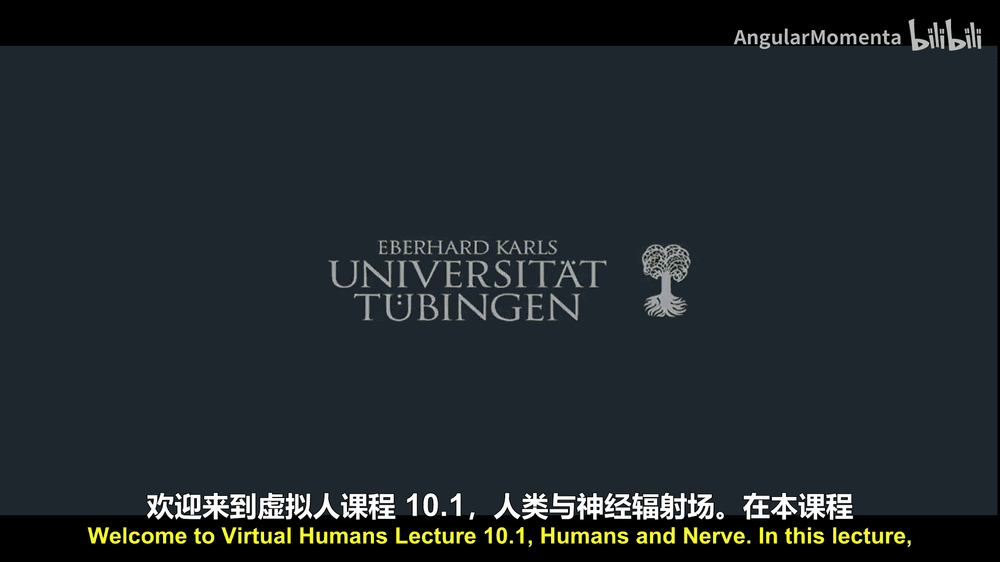
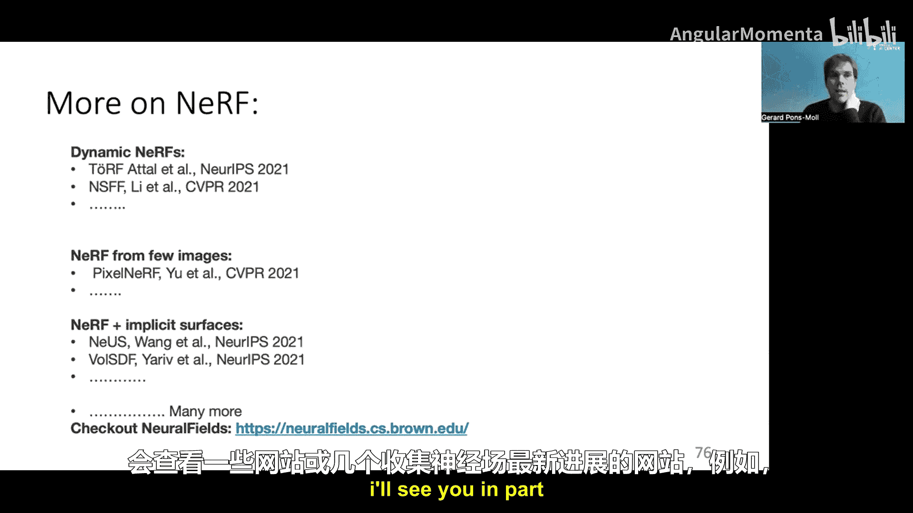

# 022：神经辐射场与人类建模 👤

在本节课中，我们将学习如何使用神经技术，特别是神经辐射场，来建模虚拟人类或其外观。我们将从理解神经辐射场试图解决的核心问题开始，逐步探讨其原理、优势、局限性以及相关的扩展工作。

## 概述

神经辐射场为**新视角合成**问题提供了一种全新的解决方案。该问题的核心是：给定一个场景的一组稀疏静态图像，目标是学习一个模型，使其能够以连续的方式从任意视角渲染该场景。

## 神经辐射场核心原理

上一节我们介绍了新视角合成问题，本节中我们来看看神经辐射场是如何解决这个问题的。

与传统的计算机图形学方法（如多视角立体视觉重建）不同，神经辐射场采取了一种更根本的方法。它学习场景中每个五维点的辐射亮度，这五维包括空间位置 **(X, Y, Z)** 和观察方向 **(θ, φ)**。

本质上，模型会“记住”场景中每个点、从每个可能观察方向看过去的颜色和该点的**体积密度**。理想情况下，在有实际几何体的地方密度高，在没有几何体的地方密度低。这种方法的一个优点是，它既能建模固体对象，也能建模体积对象。

一旦有了这个辐射场，我们就可以通过**体渲染**来获得目标图像。给定像素位置的颜色 **C** 是通过沿射线积分以下量得到的：

$$
C(r) = \int_{t_n}^{t_f} T(t) \cdot \sigma(r(t)) \cdot c(r(t), d) \, dt
$$

其中：
*   **r(t) = o + t·d** 是射线，从原点 **o** 出发，沿方向 **d** 前进，**t** 是参数。
*   **T(t)** 是透射率，表示射线从近端 **t_n** 传播到 **t** 而未击中任何粒子的概率。
*   **σ(r(t))** 是体积密度，可理解为射线在位置 **r(t)** 处终止于一个无穷小粒子的概率密度。
*   **c(r(t), d)** 是在位置 **r(t)**、沿方向 **d** 发出的颜色。

这个方程编码了两件事：**T(t)** 是“到目前为止未击中任何物体”的概率，而 **σ(t)** 是“即将在此处终止”的概率密度。

在实际计算中，我们使用数值积分来近似这个方程。以下是近似的离散形式：

$$
\hat{C}(r) = \sum_{i=1}^{N} T_i \cdot (1 - \exp(-\sigma_i \delta_i)) \cdot c_i
$$

其中：
*   **T_i = exp(-\sum_{j=1}^{i-1} \sigma_j \delta_j)** 是离散化的透射率。
*   **δ_i** 是相邻采样点之间的距离。
*   为了获得连续模型，射线被分成若干段，并在每个段内均匀采样。

关键思想是：一个多层感知机以五维（位置和方向）作为输入，输出 **RGB** 颜色和密度 **σ**。当我们需要生成图像时，就让射线穿过每个像素，沿途累积这些辐射亮度，并考虑由密度和透射率加权的遮挡关系。损失函数就是渲染出的像素颜色与真实图像像素颜色之间的差异。

## 位置编码的作用

如果直接用 MLP 从位置和方向映射到颜色和密度，结果往往会比较模糊。这是因为神经正切核的带宽限制了所学函数的频谱。直观理解是，如果输入点彼此非常相似，那么输出也会很相似，导致图像模糊。

解决方法是使用**位置编码**（如傅里叶特征），将输入点映射到更高维的空间。这相当于引入了不同频率的基函数，增加了模型的频谱容量，从而能够生成更锐利的结果。以下是对比：
*   **无位置编码**：结果模糊。
*   **有位置编码**：结果明显更锐利。

这种方法并未改变网络结构，只是对输入空间进行了固定的、非学习的映射。

## 神经辐射场的优势与局限性

神经辐射场的一个很酷的特性是，尽管从未直接针对几何形状进行训练，它也能恢复出场景的几何信息。我们可以通过计算射线终止的期望深度来获取深度图：

$$
\hat{d}(r) = \sum_{i=1}^{N} T_i \cdot (1 - \exp(-\sigma_i \delta_i)) \cdot t_i
$$

因此，神经辐射场不仅提供了可连续渲染的场景表示，还恢复了场景几何。

然而，神经辐射场也有其局限性：
1.  **场景特定**：每个场景都需要单独训练一个 MLP，无法泛化到新场景。
2.  **无法建模动态场景**：直接训练动态场景会导致模糊。
3.  **难以编辑**：场景信息被编码在网络权重中，难以进行对象移动、组合等操作。
4.  **训练和推理成本高**：训练可能需要数小时至数天，推理也不是实时的。
5.  **表面提取不精确**：需要通过阈值化密度来提取表面，这通常不够准确。

## 扩展工作：处理动态场景

针对无法建模动态场景的局限，后续研究提出了扩展方法。一个直观的想法是在输入中增加时间维度 **t**，但这即使使用位置编码也可能产生模糊结果。

更有效的方法是引入**规范空间**的概念。这通过两个网络实现：
1.  **形变场网络**：输入 **(x, y, z, t)**，输出形变向量 **(Δx, Δy, Δz)**，将当前时刻的点映射到规范空间（如序列的第一帧）。
2.  **神经辐射场网络**：输入规范空间中的点 **(x+Δx, y+Δy, z+Δz)** 和观察方向，输出颜色和密度。

这种方法（如 D-NeRF）端到端地训练形变场和辐射场，利用了时间上的相关性，学习一个单一的规范场以及如何形变它以解释每个时间实例，从而产生更清晰、连续的结果。

## 扩展工作：场景编辑与组合

为了实现对神经辐射场表示的编辑，例如组合不同场景或复制对象，需要将场景表示与神经渲染网络解耦。

**Control-NeRF** 的核心思想是：
*   为每个场景学习一个**多分辨率特征体积**，其中每个点存储一个高维特征。
*   训练一个**通用的、与场景无关的渲染网络**，它读取特征体积中的特征并生成颜色和密度。

通过用多个场景同时训练这个通用渲染网络和各自的场景特征体积，我们得到了一个更接近传统图形表示（如网格）的系统。之后，我们可以裁剪一个场景的特征体积的一部分，粘贴到另一个场景的特征体积中，并使用同一个渲染网络来渲染组合后的新场景，实现场景的混合与匹配。

## 扩展工作：加速训练与推理

即使有上述技巧，使用显式的多分辨率特征体积仍然存在内存消耗大（规模随分辨率立方增长）和推理慢的问题。

**Instant NGP** 提出了一个巧妙而高效的解决方案：使用**哈希表**来存储特征。
*   将空间划分为多个小立方体（体素）。
*   使用哈希表将每个立方体顶点的索引映射到一个特征向量上。
*   查询时，对点所在立方体的顶点特征进行线性插值。

这种基于哈希的编码，配合定制的 CUDA 内核实现，实现了训练和推理速度的极大提升（相比原始方法快10-100倍），在速度与质量之间取得了更好的权衡。

## 扩展工作：结合表面与体渲染

为了获得更高质量的几何表面，有工作尝试结合表面渲染（高质量几何，但需要掩码监督）和体渲染（可直接从颜色训练，表面是近似的）的优点。

**UniSurf** 的基本思想是**渐进式地将体渲染收敛到表面渲染**：
*   开始时，在表面可能区域进行体渲染（沿射线积分）。
*   随着训练进行，逐渐缩小这个积分区间，最终聚焦在估计的表面附近。
*   对于固体对象，体渲染方程中的 **α** 项可以对应于采样点的**占据概率 O**，方程可以简化为更接近表面渲染的形式。

这种方法能产生更锐利的几何表面，同时保持了体渲染易于训练的优点。

## 总结

本节课中，我们一起学习了神经辐射场的基本原理。它通过 MLP 学习场景的连续辐射场，并通过体渲染合成新视角图像。我们探讨了位置编码的重要性、神经辐射场恢复几何的能力，以及它存在的几个主要局限性：场景特定、静态假设、难以编辑和计算成本高。

接着，我们介绍了几项重要的扩展工作：通过引入规范空间和形变场来建模动态场景的 D-NeRF；通过解耦场景特征与通用渲染器来实现场景编辑的 Control-NeRF；利用哈希编码极大加速训练和推理的 Instant NGP；以及结合表面与体渲染优势以获取更好几何的 UniSurf。

这些进展为将神经辐射场的高质量渲染能力与虚拟人类的可控性（如姿态、形状）相结合奠定了基础，这将是下一部分课程的重点。