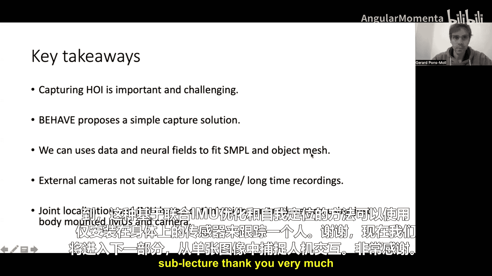

# 023：人类行为捕捉 🎬

在本节课中，我们将学习如何捕捉人类行为。我们将首先了解如何在静态场景中捕捉人类，然后探讨如何捕捉动态的人与物体交互，最后，我们将介绍一种在大型空间（如包含多个房间的建筑）中捕捉人类行为的方法。

## 概述

捕捉人类行为与建模人类外观类似，存在两个相互交织的问题。首先，我们需要能够捕捉人类，即在人类执行动作时，重建其与3D场景相结合的3D运动。其次，我们需要生成与场景一致的人类动作，这是一个日益重要的课题，具有广泛的应用前景。本节课我们将重点介绍捕捉部分，而动作合成部分将在下一讲（第12讲）中详细讨论。

## 为什么关注人与物体交互？🤔

大多数有趣的人类活动都涉及与他人或环境的交互。我们通过改变环境来实现特定目标，例如搬运箱子、坐在桌椅、钉钉子或打开盒子。当然，与其他人互动也是一种非常重要的交互类型，但由于时间有限，本讲将不涵盖人与人之间的交互。

在应用方面，机器人可以从人类动作中学习，首先需要能够将人类行为与环境一起数字化。此外，人类也可以在虚拟环境中学习有用技能，例如在无实际危险的情况下学习操作工具和机器。另一个有趣的应用是虚拟助手，它可以帮助你更好地导航世界。虚拟教学也是一个潜在应用领域，例如让著名人物如爱因斯坦在共享虚拟空间中教授相对论课程。特别是在疫情期间，人们对这种能够提供共享空间感的虚拟交流方式兴趣大增。

## 如何捕捉真实世界中的人与物体交互？📹

首先，我们需要捕捉3D场景。计算机视觉技术在传感器和算法方面都取得了显著进步，我们现在拥有的3D数据比7到10年前要多得多。一种方法是使用深度传感器（如Kinect）扫描房间，并将所有深度帧融合成一个连贯的3D场景。也可以使用激光扫描仪或基于立体视觉/结构光的扫描仪来重建场景。

当这些3D场景可用时，一些研究工作应运而生。例如，ICCV 2019的PROX工作提出，在从图像估计人体姿态和形状时，结合3D场景信息可以改善结果，因为我们可以利用“人体不应与场景相交”等物理约束。PROX的基本思想是使用类似SMPL的技术估计人体模型，同时加入约束，确保模型不穿透3D场景，并且特定部位（如脚）与场景保持接触。这通过惩罚模型顶点与场景的穿透，并鼓励接触顶点（手动标注）靠近场景来实现，本质上是一个优化问题。PROX证明了如果预先知道3D场景，结果可以得到改善。

## 如何捕捉动态场景交互？🔄

捕捉动态交互更具挑战性。仅使用单张图像非常困难，因为存在大量模糊性，同时追踪人和物体极具挑战性。一种选择是使用高质量但昂贵、记录空间有限且难以扩展到大型空间的**光学标记捕捉系统**。另一种方法是在身体上佩戴**惯性测量单元（IMU）**传感器，这种无摄像头系统易于扩展且无空间限制，但存在传感器漂移问题，数据质量通常不如光学系统。

## BEHAVE：一种折中的捕捉方案 ⚖️

BEHAVE工作提出了一种介于两者之间的方案。它使用一个便携式系统，具有良好的定位能力且不会随时间漂移。该系统包含四个校准的Kinect传感器，记录了8名受试者在5个不同地点与各种日常物品（如箱子、椅子、桌子、背包）的交互。BEHAVE既是一个数据集，也是一个算法，旨在捕捉以SMPL模型表示的人体运动以及物体的3D网格。

初始阶段，为了获得高质量数据，研究采用了包含手动标注的复杂流程。标注者需要在图像中点击物体的关键点，以便更准确地重建物体姿态。然后，结合深度点云、来自OpenPose的2D关键点检测以及物体分割信息，通过优化使SMPL模型的3D关节投影与2D检测匹配，并使3D物体点与图像中标注的2D关键点匹配，从而联合估计人体姿态和物体姿态。

为了自动化这一过程，研究训练了一个模型，能够从四个深度视图自动恢复SMPL模型和物体。关键思想是找到能从输入点云直接提取的、能使优化行为更好的特征`F`。具体来说，模型预测3D场景中每个点到SMPL模型的对应关系以及距离场。

*   **人体距离场** `U_H(p)`：对于空间中的点`p`，预测其到人体模型网格`M`的距离。网络被训练为忽略物体。
*   **物体距离场** `U_O(p)`：预测点到物体网格的距离。网络被训练为忽略人体。
*   **对应场** `C(p)`：对于空间中的点`p`，预测其在SMPL模型上最近的表面点。

利用这些场，可以通过优化使SMPL顶点与人体距离场一致，物体顶点与物体距离场一致，并利用对应场使网格与神经网络的预测保持一致。优化目标包括：
1.  最小化人体距离场的差异：`|dist(p_i, M(c_i)) - U_H(p_i)|`。
2.  确保物体顶点位于物体距离场的零水平集上：最小化`|U_O(v_j)|`。
3.  满足接触约束：对于距离人体和物体都小于2厘米的接触点，要求物体顶点与SMPL模型上的对应点`M(c_j)`匹配。

通过这种方法，BEHAVE能够获得与半自动方法质量相近的结果。BEHAVE数据集已公开供研究使用。

## 在大型场景中捕捉：Human POSEitioning System (HPS) 🏢

BEHAVE无法捕捉涉及大型场景的所有可能交互，因为外部摄像头对记录空间大小和时间长度都有限制。IMU传感器则非常适合长时间、大范围的记录。

HPS工作的目标是在大型场景和长时间（可达一小时或更久）记录中，仅使用可穿戴传感器（IMU和头戴式摄像头）来恢复人体3D姿态并在3D场景中自我定位。其核心思想是结合基于IMU的姿态估计和视觉定位（自定位）。

**视觉定位**是一个经典的计算机视觉问题：给定一个预先扫描的3D场景和一张由头戴摄像头拍摄的测试图像，确定这张图像是在3D场景中的哪个位置拍摄的。通常步骤包括：从测试图像和用于重建3D场景的多视角图像中提取特征（如关键点）；进行特征匹配，检索出与测试图像最相似的场景视角；最后优化相机姿态，使特征匹配。

仅使用IMU和初始视觉定位，重建的人体可能会漂移或与场景（如地板）相交。因此，HPS通过联合优化来整合物理约束：
*   **视觉定位项**：匹配头戴摄像头图像与3D场景。
*   **场景接触项**：当IMU检测到脚部与地面接触时（通过加速度骤变判断），强制对应的人体模型顶点与场景接触。
*   **平滑项**：确保运动不抖动。
*   **姿态项**：使SMPL姿态与IMU测量的姿态匹配。

通过这种联合优化，HPS能够仅使用身体佩戴的传感器在大型场景中追踪人体。这项研究展示了在元宇宙兴起的背景下，在3D环境中记录人体运动并实时定位的巨大潜力和重要性。当前方法尚未解决与动态物体的交互问题，这是正在研究的方向。

## 总结 📝

本节课我们一起学习了人类行为捕捉。捕捉人与物体的交互非常重要且充满挑战，是当前的研究热点。BEHAVE提出了一种基于深度相机的简易捕捉方案，展示了神经场与经典优化结合是一种有前景的方法。对于长时间、大范围的记录，外部摄像头并不适用，可以使用IMU并结合视觉自定位技术。HPS方法通过联合IMU优化和自定位，实现了仅使用身体佩戴传感器对人物的追踪。这些技术为虚拟现实、机器人学习等应用奠定了基础。

接下来，我们将在下一小节中学习如何从单张图像中捕捉人与物体的交互。