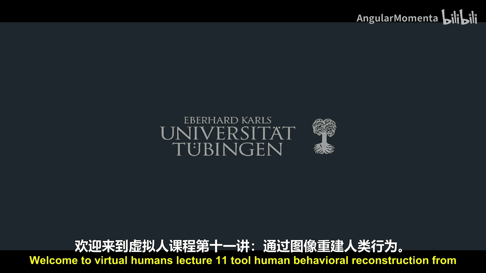
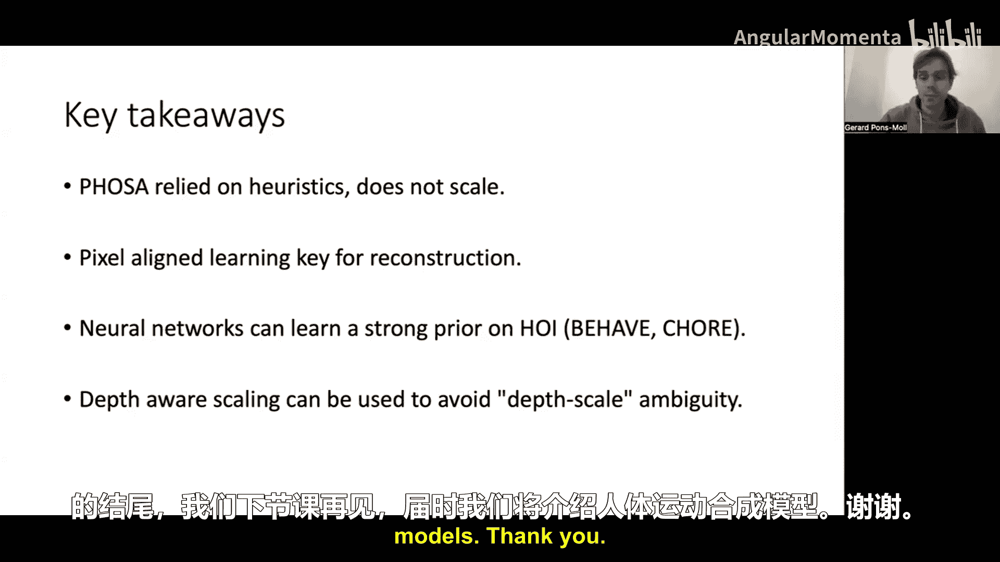

# 024：从图像重建人体与物体交互 👥➡️🖼️



在本节课中，我们将学习如何从单张图像中重建人体与物体的三维交互。我们将探讨基于优化的经典方法，以及如何利用学习到的先验知识来获得更优的结果。核心在于理解**像素对齐**的概念，并学会处理重建中的深度模糊问题。

---

## 动机与应用

上一讲我们讨论了人体交互的重要性。图像和视频中大多数有趣的内容都涉及人与人、或人与环境的交互。在虚拟现实、增强现实和机器人技术等领域，理解这些交互具有广泛的应用价值。

因此，我们面临的核心问题是：能否仅从单张图像（而非深度相机、多视角系统或惯性传感器）中重建和理解人体与物体的三维交互？这是一个长期的计算机视觉难题。

---

## 早期方法：基于启发式规则的优化

在缺乏大规模三维交互数据集的时代，早期工作主要依赖于手工定义的启发式规则和优化。

**📐 方法：ProOSa**

ProOSa 是首批尝试从单张RGB图像中重建人体（用SMPL模型表示）和物体网格的工作之一。其流程如下：

1.  **定义交互约束**：手动标注人体网格与物体网格之间可能发生接触的顶点对（例如，臀部与长凳的接触面，手与球拍的抓握点）。
2.  **初始估计**：使用当时最先进的方法检测边界框，并估计人体的三维姿态和形状。
3.  **检索物体**：从数据库中找到与图像匹配的物体三维模型。
4.  **优化对齐**：通过优化缩放和位置参数，使人体和物体的位置满足第一步定义的接触约束。

**公式表示**：优化目标是找到人体参数 \(\theta, \beta\) 和物体变换 \(T_{obj}\)，使得投影到图像上的接触点对 \((V_{human}, V_{object})\) 尽可能接近。

**局限性**：这种方法无法枚举所有可能的交互方式（例如，对同一把椅子，可以坐、靠、搬）。因此，它难以对复杂多变的交互进行联合推理。

---

## 现代方法：基于学习的重建

随着数据集的丰富和深度学习的发展，研究者开始利用学习到的先验知识来重建交互。

**🤖 方法：CHORE**

CHORE 方法旨在从单张RGB图像中**联合重建**具有合理空间布局的人体和物体。这非常具有挑战性，因为存在深度模糊、以及人或物体之间的严重遮挡。

在深入CHORE细节之前，我们需要回顾一个关键概念：**像素对齐的隐式函数**。

---

## 关键技术：像素对齐的隐式重建

在神经隐式函数的课程中我们学过，PIFu等方法可以从图像重建出细节丰富的三维网格。其核心思想是：

1.  使用图像编码器提取特征图。
2.  对于图像中的每个像素，发射一条射线进入三维空间。
3.  沿着射线采样三维点 \(X = (x, y, z)\)。
4.  网络根据该**三维点投影回图像平面所对应的像素特征**，以及该点的深度 \(z\)，来判断该点位于表面内部还是外部。

**代码逻辑描述**：
```python
# 伪代码示意
image_features = encoder(image) # 提取图像特征
for pixel in image:
    ray = shoot_ray_from_pixel(pixel)
    for point X along ray:
        # 关键步骤：像素对齐
        feature = sample_feature(image_features, project_to_2d(X))
        # 预测该点是否在表面内
        inside = network(feature, X[2]) # X[2] 即深度 z
```
**核心公式**：网络学习一个函数 \(f(F(p), z) \rightarrow \{0,1\}\)，其中 \(p = \pi(X)\) 是三维点 \(X\) 投影到图像的二维位置，\(F(p)\) 是该位置的图像特征。

**优势**：像素对齐让网络能同时利用全局和局部信息，每个像素都成为一个训练数据点，从而用更少的数据实现更有效的学习，获得前所未有的细节。

---

## 核心挑战：深度-尺度模糊

然而，训练这种像素对齐网络面临一个根本性模糊问题：**不同的三维形状在缩放并放置在合适深度时，可以投影出完全相同的图像**。

根据透视投影公式：
\[
x_{img} = f_x \frac{X}{Z} + c_x, \quad y_{img} = f_y \frac{Y}{Z} + c_y
\]
物体在图像中的大小受三个因素影响：焦距 \(f\)、物体物理尺寸 \((X, Y)\)、以及深度 \(Z\)。在单视角下，这三者相互耦合，难以区分。

**解决方案：固定深度，预测尺度**

为了训练网络，我们需要消除这种模糊。一个巧妙的解决方案是：在预处理阶段，将所有训练数据**归一化到一个固定的深度** \(Z_0\)，同时保持其像素对齐性。

**关键定理**：对网格顶点进行**统一缩放**，不会改变其图像投影。
*   **证明**：设原顶点为 \(V = (V_x, V_y, V_z)\)，缩放后为 \(V' = sV = (sV_x, sV_y, sV_z)\)。
*   其投影坐标 \(p = (f_x V_x / V_z, f_y V_y / V_z)\)。
*   缩放后的投影坐标 \(p' = (f_x \cdot sV_x / (sV_z), f_y \cdot sV_y / (sV_z)) = p\)。
*   因此，缩放因子 \(s\) 在分子分母中抵消，投影不变。

**如何固定深度**：我们希望将网格的平均深度移动到 \(Z_0\)。只需选择缩放因子 \(s = Z_0 / \mu_z\)，其中 \(\mu_z\) 是网格所有顶点深度的平均值。缩放后，新网格的平均深度恰好为 \(Z_0\)，且其图像投影保持不变。

**图形化理解**：这类似于电影中的“滑动变焦”效果，在将物体移向固定深度的同时进行缩放，使其在图像中的大小保持不变。

---

## CHORE 方法流程

解决了数据对齐问题后，CHORE 的训练流程变得清晰：

1.  **数据预处理**：利用上述深度-尺度归一化方法，将所有训练集中的人体-物体交互网格对，归一化到固定深度，并保持与原始图像的像素对齐。
2.  **网络设计**：构建一个端到端网络，输入单张图像，联合预测两个神经隐式场：
    *   一个用于人体。
    *   一个用于物体。
3.  **联合优化**：网络学习从图像特征到三维形状的映射，其内部隐式地建模了人体与物体之间合理的空间布局先验（例如，人坐在椅子上时，臀部与椅面应接触）。
4.  **推理**：给定新图像，通过网络预测得到归一化深度下的神经隐式场，然后通过Marching Cubes等方法提取出三维网格。

**结果**：与基于启发式规则的ProOSa相比，CHORE能够学习到更多样的交互类型，重建结果更加合理和可靠。尽管在严重遮挡或低分辨率图像上仍存在挑战，但该方法标志着从单图像理解三维交互的重要进步。

---

## 总结

本节课我们一起学习了从单张图像重建人体与物体交互的方法演进：

1.  **早期优化方法 (如ProOSa)**：依赖手工定义的交互约束，虽然开创了问题，但可扩展性有限。
2.  **像素对齐隐式重建**：这是获得高质量细节的关键技术，其核心是**利用三维点投影位置的图像特征**来进行预测。
3.  **深度-尺度模糊的解决**：通过**将训练数据统一缩放至固定深度**，可以在保持像素对齐的前提下，简化网络的学习任务。
4.  **基于学习的方法 (如CHORE)**：利用神经网络从数据中学习人体-物体交互的空间布局先验，能够处理更广泛、更复杂的交互情况，是当前的主流方向。



通过结合像素对齐表示和有效的深度归一化策略，我们能够从单张图像中重建出合理的三维人体与物体交互场景，为后续的分析与应用奠定了基础。