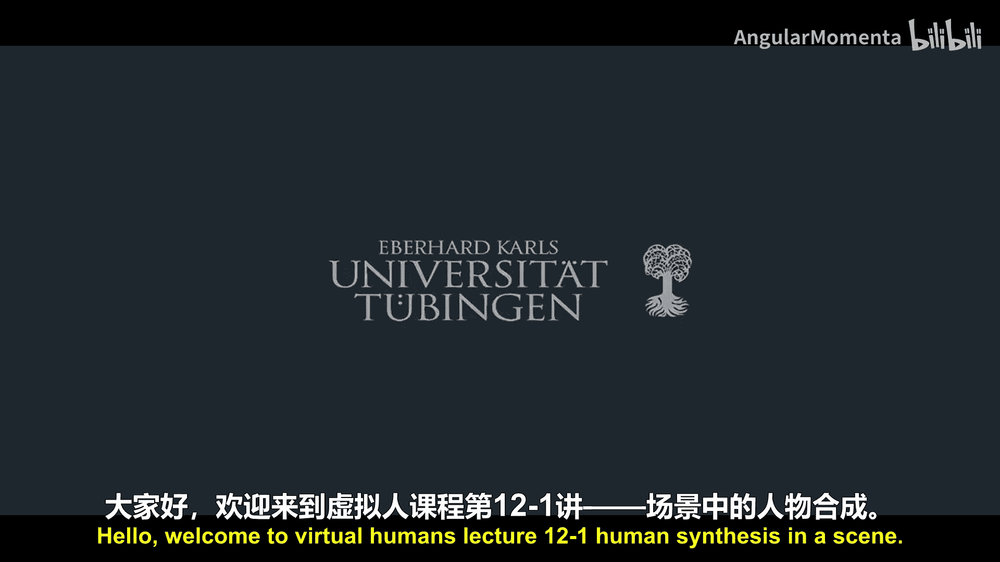
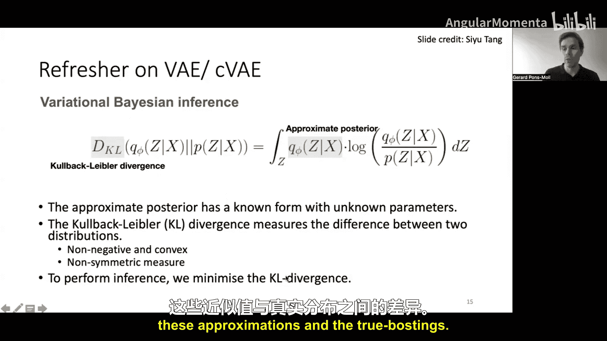

# 025：场景中的人类合成 🧍➡️🏠

在本节课中，我们将学习如何在静态场景中合成静态的人类。我们将了解如何表示人类与场景的接触。我们将快速概述用于根据输入条件生成多种输出的典型模型，这些模型基于变分自编码器和条件变分自编码器。例如，它们可用于根据场景的某些部分合成多种可能的人类姿态。最后，我们将学习如何合成运动，特别是在不平坦地形上的移动。我们将了解如何将地形的三维几何信息整合到一个神经模型中，以产生与此地形一致的人类运动。

在上一讲中，我们看到了感知或捕捉人类、从某种传感器数据重建人类的方法。本讲的主要重点将是在三维几何等条件上生成逼真的人类运动。

捕捉运动的方法，例如捕捉人-物交互的BEHAVE，我们看到了可以从图像中在一定程度上恢复人类运动或姿态以及物体姿态的方法。现在，我们将关注从头开始生成这种人-物或人-场景交互。例如，你可以在三维环境中为虚拟人类制作动画。

我们首先可能会问，为什么这很有趣或很有用？在最高层面上，虚拟人类领域的目标之一是复制真实人类的行为。真实人类可以在三维场景中导航，可以理解周围环境。因此，让智能体具备相同的能力，基本上是人工智能的长期目标之一。

更具体的应用包括游戏，你需要让角色与环境互动，例如坐下或抓取物体。目前视频游戏的运作方式是通过预录制的动作，然后在场景中特定的预定义位置触发这些动作，这看起来有些不自然，正如我们在GTA的例子中看到的那样。

这对于训练机器人与三维环境交互也很有用。例如，在将物理机器人部署到真实空间之前，在虚拟环境中训练虚拟智能体非常有用。当然，对于VR和AR应用也是如此。我们在上一讲中提到过这一点，这非常有用，因为我们谈论的是元宇宙中的共享虚拟空间，生活在那里的虚拟人类（无论是真实的还是虚拟的）需要理解周围的三维场景是什么样子，需要理解他们可以对场景做什么，生成的运动应该与场景一致。例如，对于社交互动也是如此。视频通话中缺少的一点是共享空间，如果你想要共享空间，那么在这些共享空间中的人类渲染应该满足三维世界的物理约束。

希望你已经相信这有非常多的应用。

实际上，合成人-物交互需要什么？我们需要从虚拟人类的视角去理解，需要感知三维场景。我们至少需要推理“可供性”。“可供性”是一个概念，意味着场景中的几何结构提供了特定类型的行动可能性。例如，椅子可供坐下，但也可供站立、抓取和以多种不同方式操纵。这比物体的功能更基本。物体的功能是，例如椅子的主要功能是供人坐下，刀的主要功能是用于切割。但我们抓握刀的方式有很多种，抓握椅子的方式也有很多种，特定物体提供了许多不同的姿态可能性。

理想情况下，算法应该同时推理可供性和功能。当小孩学习环境和学习与环境互动时，通常在真正知道物体功能之前，通过探索环境来学习可供性。因此，一个好的算法应该能够理想地同时推理这两件事。

我们需要在三维场景条件下合成三维人类。让我们看一些例子。这些都是近期的论文，这是一个相对较新的主题，计算机视觉社区对此感兴趣已有多年，但直到最近我们才有技术能够在三维中研究这些事物。

例如，这是在CVPR上发表的工作，它本质上允许你在三维场景中合成静态人类。基本思路是使用三维场景，然后目标是在该场景中以物理上合理的方式合成人类的静态姿态，使人们坐在椅子上或躺在沙发上，而不与环境相交，或者不产生不满足约束的姿态。

我们如何着手解决这个问题？我们看到，首先需要的是数据，所以我们需要一个好的捕捉方法。我希望你现在已经意识到，在捕捉与合成之间，在感知与建模之间，总是存在一个循环。

例如，我们有PROX方法，它允许你在场景条件下重建三维人体姿态。我们看到这带来了更好的结果，解决了与环境的相交等问题。本质上，我们面临的主要问题是，像SMPL这样的当前模型没有考虑场景，你无法让SMPL模型以场景为条件。那么问题是如何让SMPL模型以场景为条件？

一种可能的方法，也是这项名为POSA的工作中所做的，其关键思想是基于人体网格和姿态，预测可能与场景接触的顶点，以及预测哪些物体可能被接触。这是两个预测：首先，神经网络仅基于姿态标记出可能接触的顶点；然后，这种着色显示哪个物体最可能被接触。例如，这里的绿色意味着人体的底部很可能与沙发接触，手的这部分很可能与桌子接触。

当然，这只是一个假设。这个问题是多模态的，因为对于给定的输入存在多种解决方案。

那么这是如何建模的？这是通过一些二元变量来建模的，这些变量指示一个顶点在给定点是否接触，或者指示接触的可能性。例如，`F_c`取值为0或1，1表示有接触，0表示无接触。对于网格中的每个顶点`V_i`，你都有一个这样的二元变量。然后，对于每个顶点，你还有一个矩阵或向量，包含针对每个物体的二元变量（`L`是物体的数量），指示对于给定的姿态，哪个物体可能被接触。

所以问题是：首先，顶点`V_i`是否与场景接触？其次，顶点`V_i`实际接触的是哪个物体类别？我提到存在多种解决方案。例如，我可以坐在沙发上，或者坐在椅子上，或者坐在架子或桌子上。所以存在多种解决方案，我们需要一个能够让我们采样多种解决方案的预测模型。解决这个问题的一种方法是使用生成式神经网络，如变分自编码器或条件变分自编码器。给定一个网格，这个网络可以采样输入并以该网格为条件，然后网络将产生不同的解决方案，指示哪些顶点可能接触，以及对于这些顶点，哪些物体实际上最可能被接触。

现在让我回顾一下变分自编码器，因为这是一种常用于人体建模背景下的技术，例如用于建模姿态流形以及这些接触。

基本上，使用贝叶斯定理，我们通常感兴趣的是知道导致给定观测`X`的因素是什么，这些因素就是我们感兴趣的量。因此，我们通常感兴趣的是获得后验概率，即给定这些观测`X`的这些因素的概率。为了解决这个问题，我们通常使用贝叶斯规则来反转问题，然后我们有一个似然函数，衡量这些测量值由这些因素产生的可能性。然后我们有先验概率，即这个先验实际存在的概率，再除以观测的边际似然。

所以我们有`X`（证据），`Z`（原因或这些潜在变量，即假设）。然后我们有系统的似然，在推理中我们计算后验以推断这些潜在变量`Z`。

在大多数情况下，后验没有封闭形式的解，并且在计算上是难以处理的。这就是变分推断发挥作用的地方，因为你可以使用一个更简单的分布来近似这个后验。

现在，两个问题是我们如何定义这个近似后验，以及我们如何进行这种近似？

我们可以这样看：我们实际上希望这个近似接近真实的未知后验。因此，这个KL散度衡量了两个分布之间的距离。理想情况下，这个距离应该很小。这里，KL散度是衡量一个分布与另一个分布之间差异的度量，在这个例子中是参数化为`φ`的近似分布`Q_φ(Z|X)`（例如，这可以是一个神经网络）与实际感兴趣的后验`P(Z|X)`之间的差异。

KL散度的定义基本上是这个关于潜在变量`Z`的积分，它包含两项：一项是`Q_φ(Z|X)`乘以`log(Q_φ / P)`的对数。

这里需要注意：如果`Q_φ`和`P`相等，那么这个比值等于1，整个式子等于0，距离很小。此外，这里的差异度量（对数项）由`Q_φ`加权。所以，在概率质量高的地方，如果你愿意这么想，代价就更高。注意，在这个积分中，`X`是不变的，我们固定`X`并对`Z`进行积分。所以对于每个不同的`Z`，`X`，我们都有这样一个积分。

KL散度的一些性质是它是非负的并且是凸的。但它是一个非对称度量，因为如果我调换项的位置，把`P`放在这里，把`Q`放在那里，不会得到相同的量。所以它不是数学意义上的对称度量或距离。

为了执行推断，我们基本上需要最小化KL散度。我们希望最小化这个近似与真实后验之间的差异。

在本节课中，我们一起学习了在静态场景中合成静态人类的基础。我们探讨了表示人-场景接触的方法，并回顾了用于多输出生成的条件变分自编码器模型。我们还了解了如何将三维地形几何整合到神经模型中，以生成与地形一致的人类运动，特别是移动。这些技术对于游戏、机器人训练以及VR/AR应用中的虚拟人类动画至关重要。