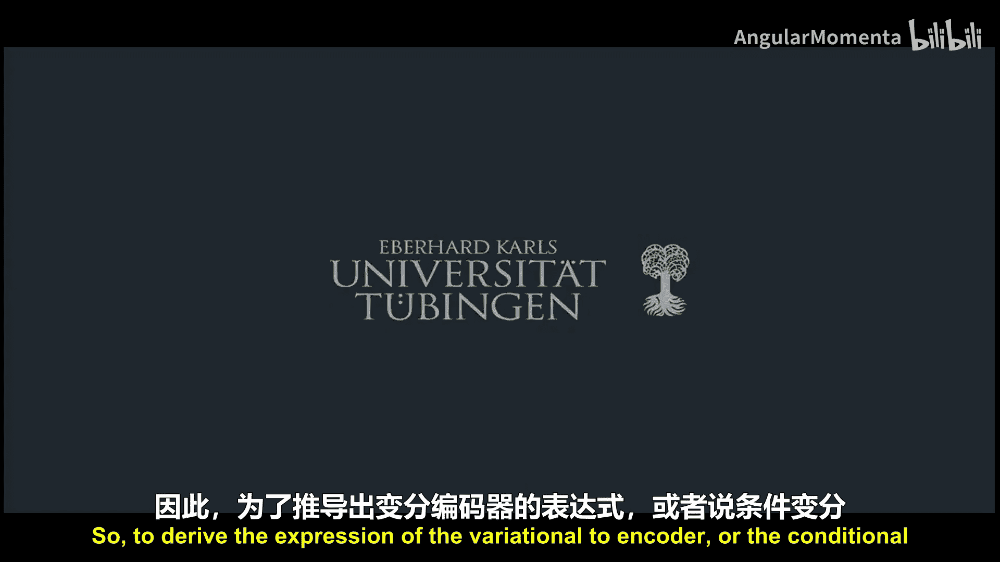
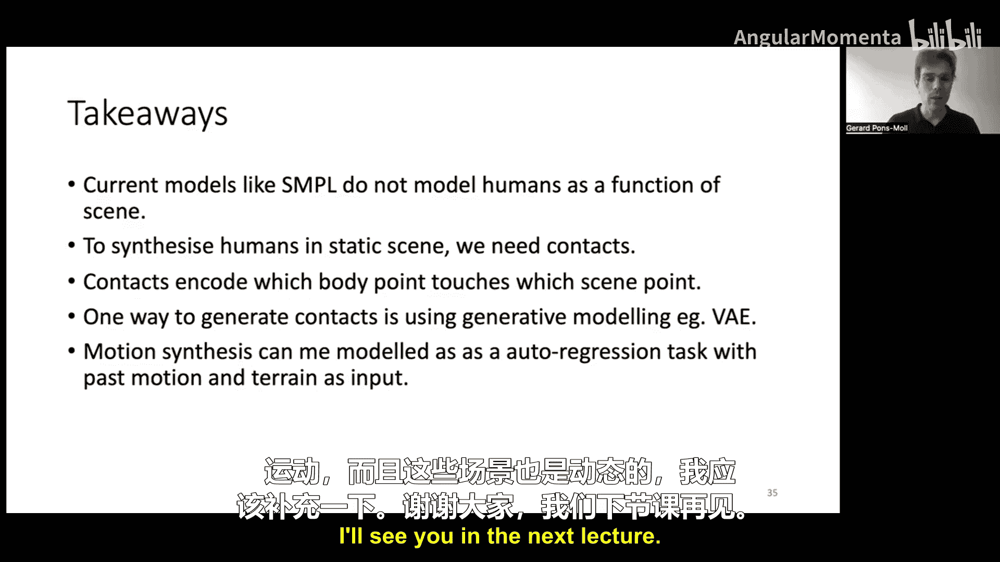
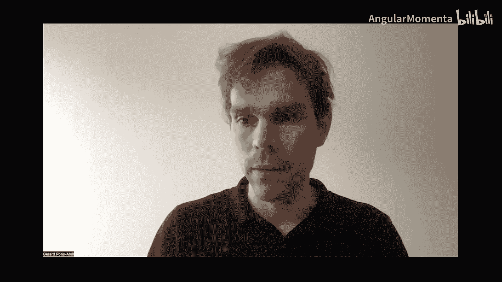

# 026：人体运动合成

在本节课中，我们将学习如何利用变分自编码器进行人体运动合成，特别是如何根据场景条件生成静态姿态和动态运动。我们将从推导条件变分自编码器的核心公式开始，逐步理解其编码、解码过程，以及如何通过重参数化技巧解决训练中的难题。最后，我们将探讨如何将这些技术应用于生成与复杂地形交互的、自然流畅的人体动画。

---

## 变分自编码器公式推导 🧮

上一节我们介绍了变分自编码器的基本概念，本节中我们来看看其核心公式的推导过程。

我们从近似分布 **Q_φ(Z|X)** 与真实后验分布 **P_θ(Z|X)** 之间的KL散度开始。根据定义，我们可以展开这个项。

利用贝叶斯定理，我们可以将 **P_θ(Z|X)** 重写为 **P_θ(X|Z) * P_θ(Z) / P_θ(X)**。然后，利用对数的性质（对数的乘积可以转化为和），我们可以得到三项。

第一项是观测数据 **X** 的对数边际似然 **log P_θ(X)**。第二项是近似分布 **Q_φ(Z|X)** 与先验分布 **P_θ(Z)** 之间的KL散度。第三项是 **Q_φ(Z|X)** 下 **log P_θ(X|Z)** 的期望值。

通过移项，我们得到以下等式：
**log P_θ(X) - KL[ Q_φ(Z|X) || P_θ(Z|X) ] = E_{Z~Q}[log P_θ(X|Z)] - KL[ Q_φ(Z|X) || P_θ(Z) ]**

由于KL散度总是非负的，我们可以推导出证据下界。观测数据的对数似然 **log P_θ(X)** 必然大于或等于右侧的项，即：
**log P_θ(X) ≥ E_{Z~Q}[log P_θ(X|Z)] - KL[ Q_φ(Z|X) || P_θ(Z) ]**
这个右侧的项被称为证据下界。

---

## 编码器与解码器的解释 🤖

现在，我们来理解这个公式在变分自编码器中的具体含义。

在这个框架中，**Q_φ(Z|X)** 是编码器。它接收观测数据 **X**，并输出一个在潜在空间 **Z** 上的分布，这个分布描述了哪些潜在变量可能生成了 **X**。然后，我们从该分布中采样一个潜在变量 **Z**。

**P_θ(X|Z)** 是解码器。它接收采样得到的潜在变量 **Z**，并尝试重建观测数据 **X**，即生成 **X‘**。

因此，最大化证据下界等价于同时优化两个目标：
1.  让重建的 **X‘** 尽可能接近原始 **X**（通过最大化 **E[log P_θ(X|Z)]**）。
2.  让编码器产生的分布 **Q_φ(Z|X)** 尽可能接近我们预设的简单先验分布 **P_θ(Z)**（通过最小化KL散度），这能确保潜在空间具有良好的结构。

在实践中，对于图像或人体网格等数据，重建损失通常使用 **L1** 或 **L2** 距离来衡量生成样本与真实观测之间的差异。

---

## 训练挑战与重参数化技巧 ⚙️

上一节我们理解了目标函数，但在训练时我们遇到了一个难题：如何通过采样操作进行反向传播？

我们希望使用反向传播来优化编码器网络参数 **φ** 和解码器网络参数 **θ**。问题在于，从分布 **Q_φ(Z|X)** 中采样 **Z** 的操作是不可微分的，这阻断了梯度从解码器流向编码器。

解决方案是重参数化技巧。我们假设后验分布 **Q_φ(Z|X)** 是高斯分布。编码器不再直接输出一个样本，而是输出该分布的参数：均值 **μ** 和方差 **σ²**。

然后，我们从一个标准正态分布 **N(0, I)** 中采样一个随机噪声 **ε**。接着，我们通过以下变换得到所需的样本 **Z**：
**Z = μ + σ ⊙ ε**
这里，**⊙** 表示逐元素相乘。

这样做的妙处在于，采样过程的随机性被转移到了噪声 **ε** 上，而 **ε** 与模型参数无关。现在，**Z** 对参数 **φ** 的导数可以通过 **μ** 和 **σ** 来计算（因为 **Z = μ + σ * ε**），从而使得整个流程可微，允许梯度顺利反向传播。

---

## 条件变分自编码器与应用 🎯

有时，我们希望生成过程依赖于某些附加条件 **C**（例如场景信息）。这时可以使用条件变分自编码器。

我们可以让编码器和解码器都以条件 **C** 为输入。在人体运动合成中，这允许我们根据场景（如一个房间）来生成可能的人体接触点（如脚接触地板，手可能接触椅子）。

以下是其工作流程：
1.  **训练阶段**：使用包含人体网格和场景信息的数据对，训练条件变分自编码器。
2.  **推理阶段**：
    *   给定一个观测到的人体姿态，可以通过编码器得到潜在分布，并采样多个 **Z**，再通过解码器生成多种可能的接触点预测。
    *   也可以直接从先验分布中采样 **Z**，结合场景条件 **C**，通过解码器生成全新的人体姿态。

得到预测的接触点后，可以通过优化一个目标函数来生成最终静态摆放在场景中的人体。这个目标函数通常包含：
*   **可达性项**：促使预测为接触的顶点靠近对应的场景物体表面。
*   **穿透惩罚项**：防止人体模型与场景物体发生穿插。
*   **正则化项**：使最终姿态不过分偏离初始姿态。

---

## 从静态到动态：运动合成 🚶

生成静态姿态已经很有用，但生成与场景交互的动态运动则更具挑战性。这需要模型具备一定的“规划”能力。

一个经典工作是《Phase-Functioned Neural Networks for Character Control》这篇论文。它能够根据3D地形和指定的运动类型（如行走），合成出适应地形的连续3D姿态序列。

实现这样的系统面临三大挑战：

**1. 数据获取**
获取人物在复杂地形上运动的真实数据非常困难。该论文采用的解决方案是数据增强：先捕获人物在平面上的行走、上下楼梯等基本运动数据，然后通过算法将不同的地形（用参数化的曲面片表示）适配到人物的脚部轨迹下，从而创造出“人物-地形”配对数据。

**2. 运动与地形的编码**
以下是编码运动与地形信息的方式：
*   **运动编码**：输入包括历史关节位置、关节速度、根节点轨迹和根节点速度。
*   **地形编码**：沿着人物预期的前进轨迹，在固定点采样地形高度值，作为标量输入。
*   **相位变量**：这是一个关键辅助变量，它在0到2π之间循环，代表步行周期的进度（如0为抬脚，π为最高点，2π为落脚）。没有它，神经网络容易产生过度平滑、脚部滑动的结果。相位函数化神经网络能根据相位动态调整网络权重，生成与步伐同步的、更自然的运动。

**3. 推理生成**
系统是一个自回归模型。基于过去帧的运动状态、当前地形采样信息以及相位，预测下一帧的关节位置、速度等。然后递归地使用网络，即可生成连续的运动序列。

这种基于局部几何（高度场）而非高级语义（如“楼梯”）的方法，赋予了模型很好的泛化能力，能适应各种未见过的地形。

---

## 总结与展望 📚

本节课中我们一起学习了如何利用变分自编码器进行人体运动合成。

我们首先推导了变分自编码器的核心公式，理解了其作为生成模型同时优化重建损失和潜在空间正则化的原理。接着，我们探讨了训练中的关键技巧——重参数化，它解决了采样操作不可微的难题。然后，我们将模型扩展到条件生成 setting，使其能根据场景信息预测人体接触点，进而合成静态场景中的人体姿态。最后，我们深入了一个更复杂的动态运动合成模型，它通过编码局部地形、运动历史和步态相位，能够自回归地生成与复杂地形自然交互的人体动画。

当前，简单的生成模型已能根据场景合成静态人体。而通过变分自编码器预测接触点，以及利用自回归系统预测未来运动，我们能够实现更具交互性的动态运动合成。在接下来的课程中，我们将看到更为复杂的模型，用于合成场景中动态、且具有更高级交互行为的人体运动。