# 001：引言 🎯

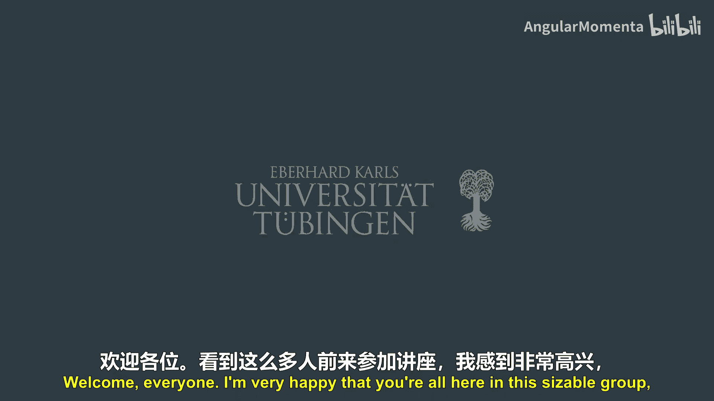

在本节课中，我们将要学习数值算法在机器学习中的核心作用。我们将探讨为什么理解这些“引擎”的内部工作原理对于构建高效、可靠的机器学习系统至关重要，并概述本课程将涵盖的四大主题：线性代数、模拟、积分和优化方法。

## 概述：为什么需要关心数值算法？

机器学习算法是处理数据并生成可用于预测或行动的模型的计算机程序。输入是数据，输出是模型。而在这两者之间发生的，是计算机执行的计算过程。

与基于规则的经典人工智能不同，当代机器学习算法使用**数值算法**作为这些计算的基本单元。经典算法（如最近邻搜索）总是能给出正确答案。而数值算法是**可能出错**的方法，它们用于估计那些没有封闭形式解（或解在合理时间内不可计算）的数学量。

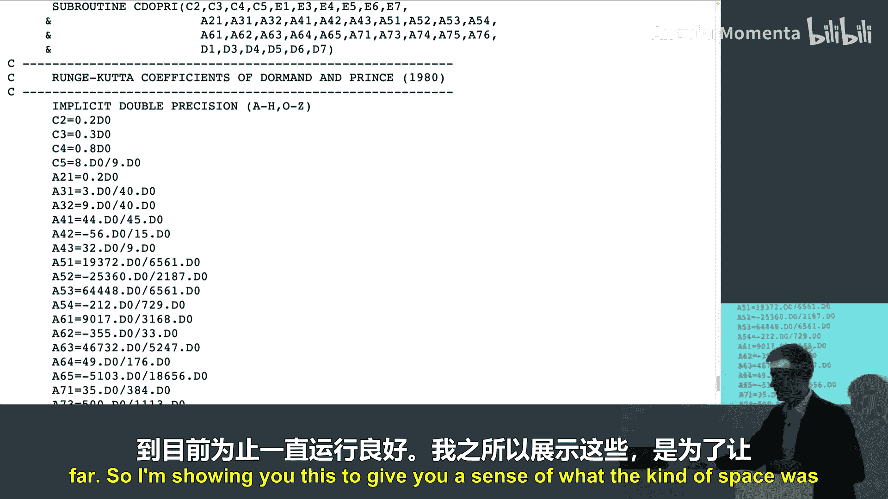

**数值算法**与**原子操作**的关键区别在于：原子操作（如指数函数 `exp(x)`）是“不会出错”的基础函数。而数值算法（如线性代数求解器）是“可能以微妙方式出错”的复杂方法，需要使用者确保其正确运行。

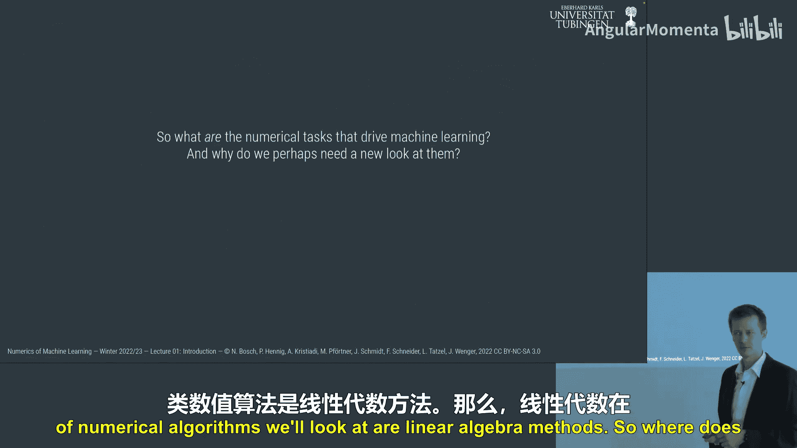

由于这些算法是机器学习的核心，作为机器学习从业者，你必须理解并思考它们。

## 数值算法的特点与挑战

以下是数值算法的一些典型特征：

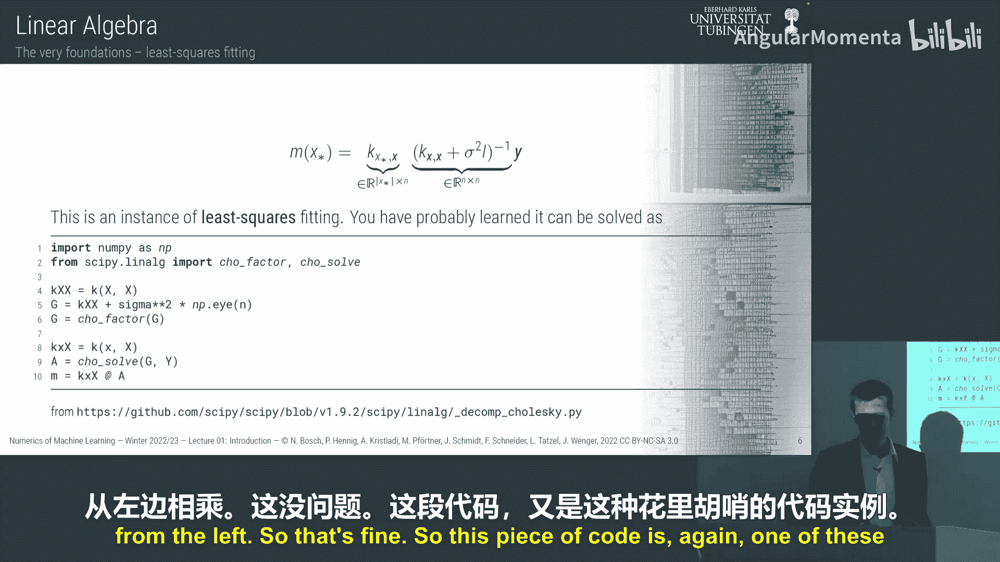

*   **历史悠久**：许多核心算法（如龙格-库塔法）发明于一百多年前（1905年）。
*   **接口复杂**：调用时需要提供大量参数，必须清楚自己在做什么。
*   **结构精密**：算法内部包含许多“魔法数字”，这些数字经过精心推导，任意改动都可能导致算法失效。
*   **黑盒化**：通常以编译库（如Fortran代码）的形式提供，源代码难以查看和修改。

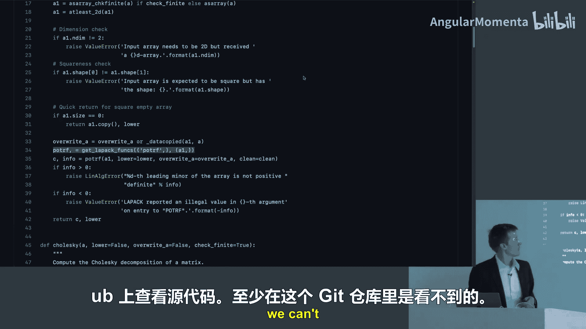

机器学习领域比这些数值方法年轻得多。当机器学习工程师遇到需要数值计算的任务时，他们发现早已存在由数学家、物理学家等领域专家编写的成熟方法。直接使用这些“古董”代码很方便，但也带来了问题：如果我们的任务与算法预设的任务不完全匹配，我们将束手无策。

## 本课程核心内容预览

接下来，我们将通过预览本课程涵盖的四大类数值算法，来理解为什么需要以新的视角看待它们。

### 1. 线性代数方法 🧮

上一节我们介绍了数值算法的普遍特性，本节中我们来看看线性代数在机器学习中的基础作用。

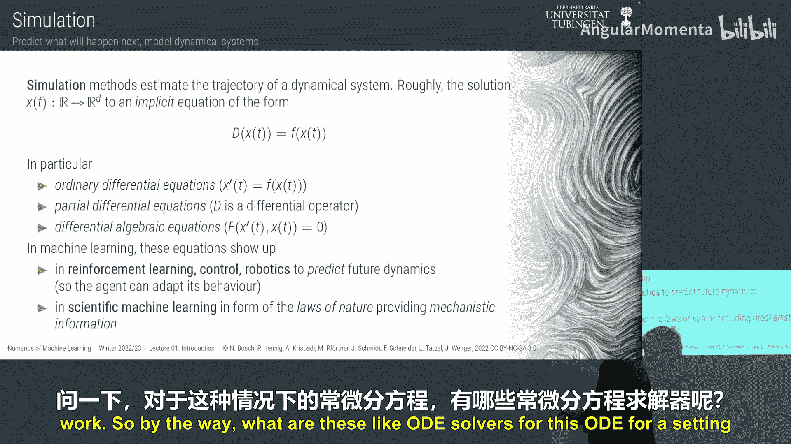

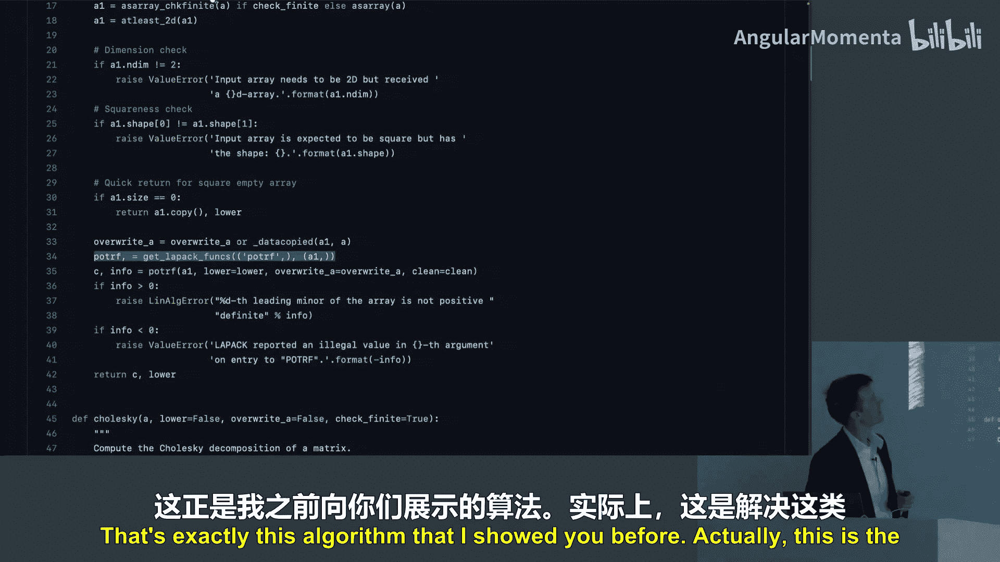

线性代数出现在几乎所有机器学习算法的底层。以高斯过程回归为例，其核心计算涉及求解形如 `(K + σ²I)⁻¹y` 的线性系统，其中 `K` 是核矩阵。直接计算矩阵逆 `np.linalg.inv()` 是错误做法。正确的做法是使用**乔列斯基分解**等数值稳定的方法。

```python
# 正确做法：使用乔列斯基分解求解
from scipy.linalg import cho_factor, cho_solve
L, lower = cho_factor(K + sigma_sq * np.eye(N))
alpha = cho_solve((L, lower), y)
```

然而，`scipy.linalg.cho_factor` 底层调用的是BLAS/LAPACK库中的Fortran代码，对我们而言是一个黑盒。这导致了一个严重问题：对于 `n` 个数据点，乔列斯基分解的计算复杂度是 **O(n³)**。对于百万级的数据集，计算将变得完全不可行。因此，人们常认为核方法无法扩展到大数据集。

但在本课程中，Marvin 和 Jonathan 将讲授，如果了解数据的结构（如稀疏性、低秩性），或者接受近似解，我们可以使用更高效的迭代求解器（如共轭梯度法），将复杂度从 O(n³) 显著降低，甚至达到接近线性的复杂度。理解算法内部原理，才能突破“核方法太慢”的固有认知。

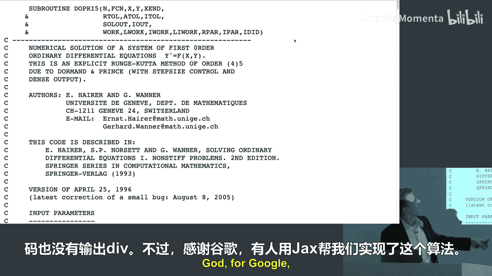

### 2. 模拟方法 🎮

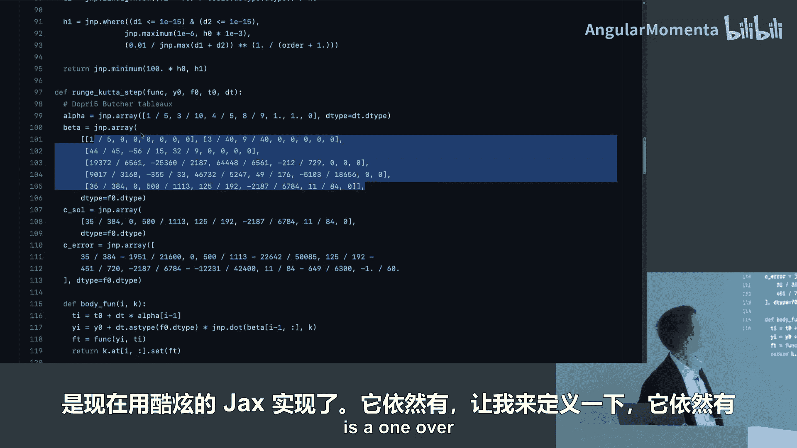

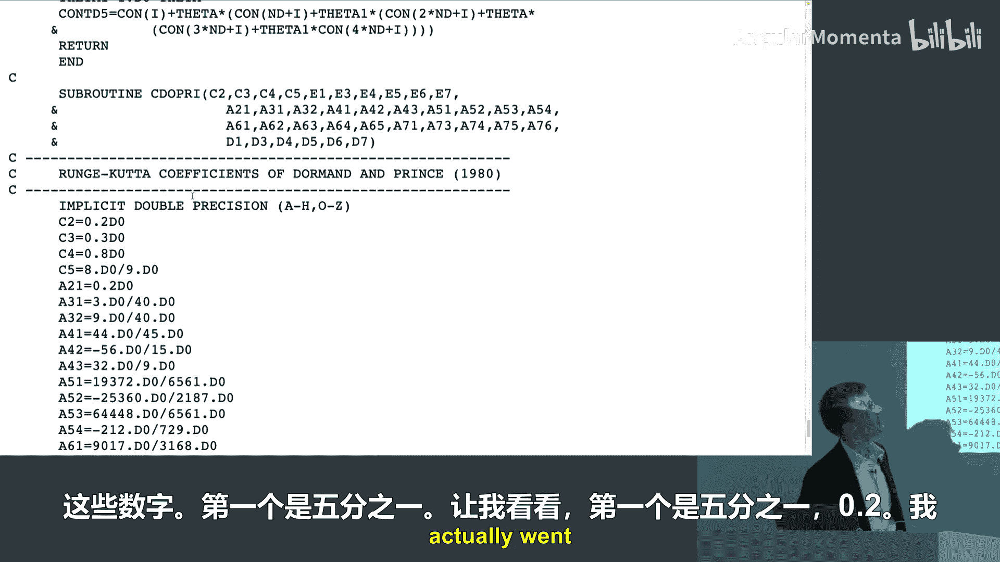

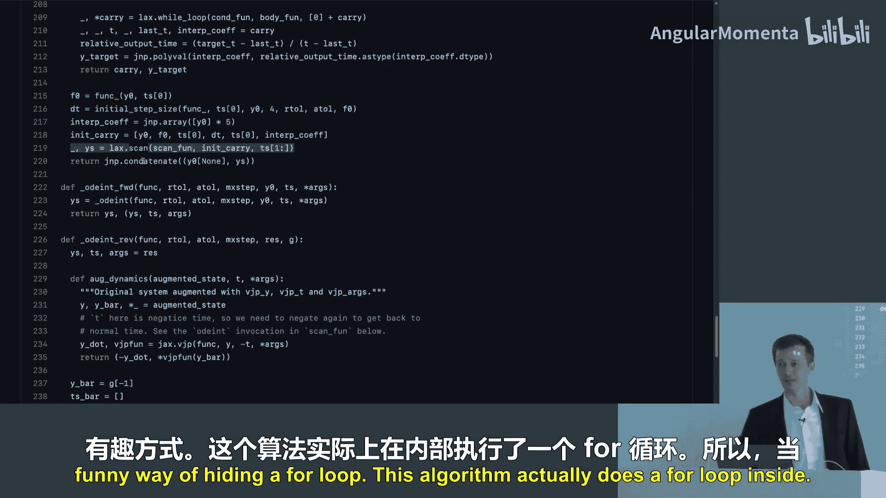

上一节我们探讨了线性代数中的效率问题，本节中我们转向模拟方法，即求解动力系统轨迹的算法。

模拟方法解决的是微分方程，形式如 `D[x](t) = f(x(t), t)`，其中 `D` 是微分算子。这包括常微分方程（ODE）、偏微分方程（PDE）等。在机器学习中，模拟方法出现在两个领域：1）需要预测未来的智能体（如机器人、强化学习）；2）将物理知识编码为微分方程的科学机器学习。

一个典型例子是预测COVID-19病例。单纯用深度神经网络或高斯过程进行曲线拟合外推效果很差。我们需要利用机制性知识，例如SIR传染病模型：
```
dS/dt = -β * I * S / N
dI/dt = β * I * S / N - γ * I
dR/dt = γ * I
```
这里 `β`（接触率）和 `γ`（恢复率）是未知参数。传统ODE求解器（如龙格-库塔法）是一个初始值问题，要求方程完全已知。它无法直接利用观测数据来实时推断像 `β(t)` 这样的时变参数。

尽管现代框架（如JAX）重新实现了这些ODE求解器，并支持自动微分，但其核心算法（及内部的“魔法数字”）依然来自上世纪的Fortran代码。为了同时拟合数据和求解方程，我们不得不采用“模拟推断”的方法，在优化参数的外循环中，反复调用整个ODE求解器（内循环），计算效率低下。

Younès 和 Nathanaël 将讲授一种新思路：将模拟过程构建为一个**马尔可夫链**，其状态是概率分布。我们可以向这个链中插入不同的**信息算子**，例如“ODE成立”的算子，或“轨迹经过观测数据点”的算子。这样，我们可以在单次前向计算中，同时利用物理机制和观测数据，非参数地推断时变参数 `β(t)` 并预测未来。这种基于概率推断的框架比古老的、僵化的黑盒算法更灵活、更强大。

### 3. 积分方法 📊

上一节我们看到了如何将模拟重构为概率推断，本节中我们简要看看积分方法。

积分是概率推断中的基本操作，例如计算边缘分布 `p(y) = ∫ p(y, z) dz`。标准的做法是马尔可夫链蒙特卡洛（MCMC）方法。可以说，MCMC是“最普适”也是“在多数情况下效率最低”的算法。

在本课程中，我们将探讨在低维或具有特殊结构的问题中，存在更高效、性质更好的积分算法（如高斯积分、贝叶斯求积法）。理解这些算法有助于我们认识经典数值方法与基于概率的新计算范式之间的联系。

### 4. 优化方法 ⚙️

上一节我们提到了积分，本节我们来到机器学习最核心的数值操作：优化。

现代机器学习的基础模板是经验风险最小化：`min_θ Σ_i L(θ; y_i)`。对于可微程序（如深度神经网络），我们通过自动微分计算梯度并使用优化算法（如SGD、Adam）求解。

有趣的是，优化领域已经发生了变化。机器学习界发现，像BFGS这样的经典优化器（无需学习率、自动停止）在大规模深度学习中不再流行。取而代之的是SGD及其变体，但我们需要手动调整学习率、监控训练过程。


这是因为在实践中，没人直接优化整个损失函数。由于数据量 `N` 极大，我们使用**随机批量**来估计梯度和损失：
`∇̂L(θ) ≈ (1/M) Σ_{j in batch} ∇L(θ; y_j)`
此时，我们得到的梯度 `g` 是一个**随机变量**，其均值是我们关心的真实梯度，但还存在**方差** `Σ`。


然而，当前的主流框架（如PyTorch）只返回梯度的均值（期望），而忽略了其方差（不确定性）信息。计算方差在技术上并不昂贵（只需对已有梯度张量进行平方和求和），但当前的优化器设计哲学仍停留在“处理确定值”的经典数值分析时代，没有将梯度视为一个随机变量来设计更新规则。

Frank, Lucas, Agustinus 和 Julia 将讲授，如果我们正视计算中的这种随机性，并利用梯度的方差等统计量，我们可以更深入地理解深度网络的训练动态，构建更稳定、自动化的训练方案，甚至无需额外成本地为网络输出提供不确定性估计（贝叶斯深度网络）。我们需要将优化重新构想为：利用随机变量探针，寻找一个泛化良好的点，而不仅仅是寻找一个函数的极小值。

## 核心理念：作为学习机器的数值算法

贯穿以上所有例子的一个共同主题是：**数值算法本身就是一种学习机器**。

我最初将数值算法定义为“估计一个可能出错的未知量的方法”。它们估计一个隐变量 `z`（如最小值的位置、积分的值、模拟的解），通过评估一些易处理的观测值 `c`（如积分点处的函数值、矩阵向量积、批量梯度）来进行估计。

这与**贝叶斯推断**完全同构：在给定观测数据 `c` 的条件下，估计隐变量 `z` 的后验分布。唯一的区别在于，数据的来源不是硬盘，而是**处理器（CPU/GPU）**。数值算法将计算机作为数据源。

因此，我们可以且应该用机器学习的语言（概率、推断、不确定性）来理解和设计数值算法。这类新算法被称为**概率数值算法**。它们将计算任务表述为概率分布，将CPU/GPU作为数据源来改进对解的估计，并返回一个包含不确定性的后验分布。


## 课程总结与特点

本节课中我们一起学习了数值算法对于机器学习的基础性作用，并预览了本课程将如何以全新的视角对待它们。

本课程不是传统的数值分析课：

*   **视角独特**：我们将数值算法视为学习机器，使用机器学习的语言进行思考。
*   **注重实践**：你将编写大量代码（Python/Julia），通过实践理解算法。
*   **前沿探索**：这是全球首个专注于“机器学习数值方法”的课程之一，你将接触到该领域最新的思想。
*   **专家教学**：课程由该领域深入研究的博士生们主讲，你可以向他们提出最深入的问题。


通过拥抱“计算即学习”这一观点，我们可以构建出运行更快、更可靠、更易于使用且能提供丰富信息的机器学习解决方案。我们不会抛弃经典的数值算法（那是超过100年的宝贵积累），但我们将摆脱经典数值分析的固有视角，转而采用机器学习的视角，将这些算法本身视为需要理解和改进的学习机器。


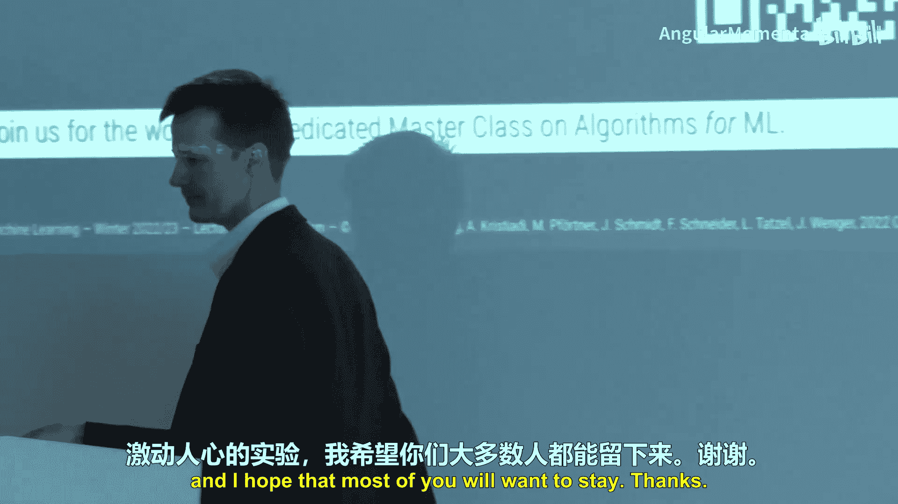


希望你能加入我们，共同参与这次激动人心的探索。