# 002：数值线性代数

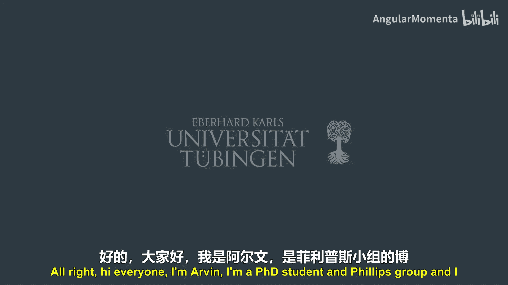

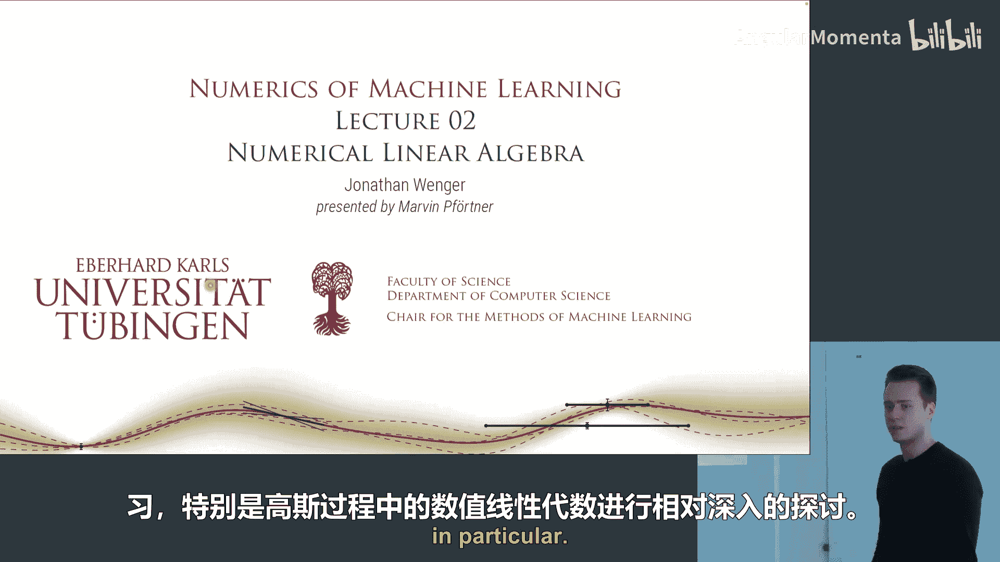

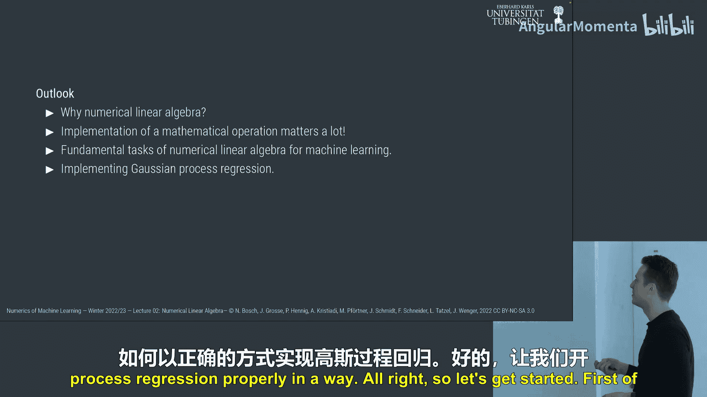

在本节课中，我们将学习数值线性代数在机器学习中的核心作用。我们将首先探讨为何需要关注数值线性代数，然后介绍一些对机器学习至关重要的基本任务。最后，我们将通过一个实际例子，学习如何正确实现高斯过程回归，并了解算法实现细节对性能的巨大影响。

## 为何关注数值线性代数？

数值线性代数是机器学习的基石，是工具箱中最基础的工具集之一。从幻灯片上展示的众多不同领域可以看出，这个概念非常重要。

以下是几个快速示例，用以说明数值线性代数在机器学习中的普遍性：

*   **基础概率论**：多元正态分布的概率密度函数中，已经包含了协方差矩阵的**逆**和**行列式**。这两个概念是本节课的重点。
*   **一般线性模型**：在线性回归中，若使用平方损失并求解相应的优化问题，会出现矩阵的逆。这个矩阵通常具有特定结构（如对称正定），并且是外积形式。
*   **主成分分析**：其核心是计算截断特征分解，即将数据协方差矩阵分解为三个具有特定结构的矩阵。这里也涉及**矩阵向量积**这一基本操作。
*   **高斯过程**：这是一种用于回归的贝叶斯非参数方法。其核心公式中同样涉及矩阵的逆。这里的矩阵（核矩阵）具有生成性信息（由一个函数生成每个元素）、对称性和正定性。
*   **微分方程**：线性偏微分方程的解可以表示为无限维函数空间中的线性系统。通过离散化，可以将其转化为有限维线性系统，该矩阵通常很大且高度结构化。
*   **优化**：大多数局部优化方法（如牛顿法）的更新规则涉及矩阵（如海森矩阵或其逆）与向量（如梯度）的乘积。在深度学习中，由于使用小批量数据，这些矩阵和向量通常是带噪声的估计。
*   **深度学习**：前馈神经网络的定义中包含矩阵向量积。反向传播本质上是高效的向量-雅可比积计算。在贝叶斯深度学习中，拉普拉斯近似需要计算并反转神经网络参数的海森矩阵。

## 机器学习中的核心线性代数任务

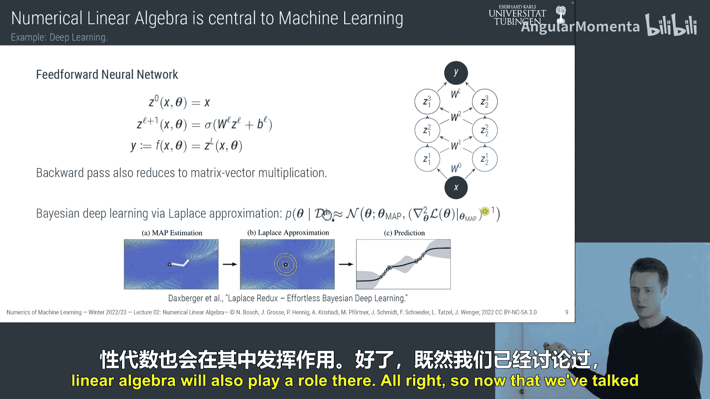

从上述例子可以看出，有四个基本线性代数操作在机器学习中无处不在，至关重要：

1.  **矩阵向量乘法**：在深度学习和优化中需要大量使用，要求计算时间和内存高效。
2.  **线性系统求解**：出现在高斯密度、高斯过程、线性回归、优化和牛顿方法中。
3.  **矩阵分解**：用于解决PCA等问题，将矩阵分解为具有特定结构的矩阵（如下三角和上三角矩阵的乘积、奇异值分解、QR分解）。这对于高效进行高斯过程推断和卡尔曼滤波至关重要。
4.  **对数行列式**：在高斯密度和高斯过程回归中需要。对于对称正定矩阵，对数行列式可以转化为矩阵对数的迹。这在GP超参数优化中尤其重要。

## 算法实现的重要性

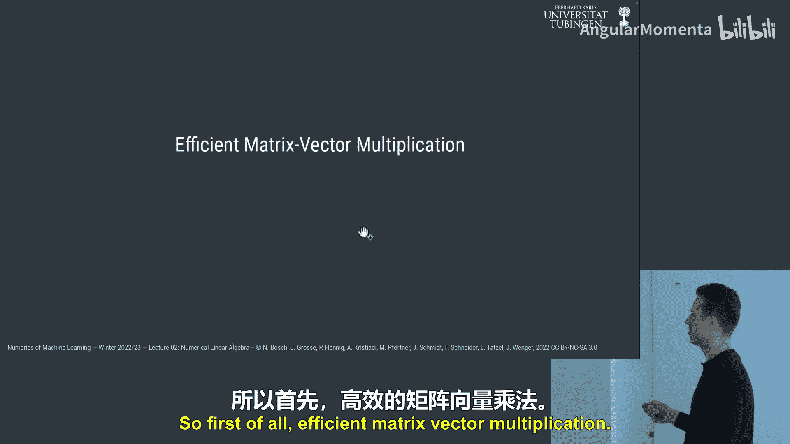

在计算机上实现数值运算的方式至关重要。即使对于看似简单的任务，错误的实现也可能导致严重问题。

考虑一个任务：给定矩阵 **A** ∈ ℝ^(n×k)（其中 n >> k）和向量 **x** ∈ ℝ^k，计算 **(A A^T) x**。

一个直接的Python实现可能是 `A @ A.T @ x`。然而，由于运算符的从左到右结合性，这会先计算 **A A^T**（一个 n×n 矩阵），然后再与 **x** 相乘。当 n 很大时（例如 10^5），这个中间矩阵将占用约 80 GB 内存，这是不可行的。

正确的实现是利用结合律：`A @ (A.T @ x)`。这样先计算 **A.T @ x**（得到一个 k 维向量），再与 **A** 相乘，内存消耗仅为 O(nk)，计算也快得多。

这个例子说明，**实现数学运算的算法对性能、稳定性和内存消耗有巨大影响**。

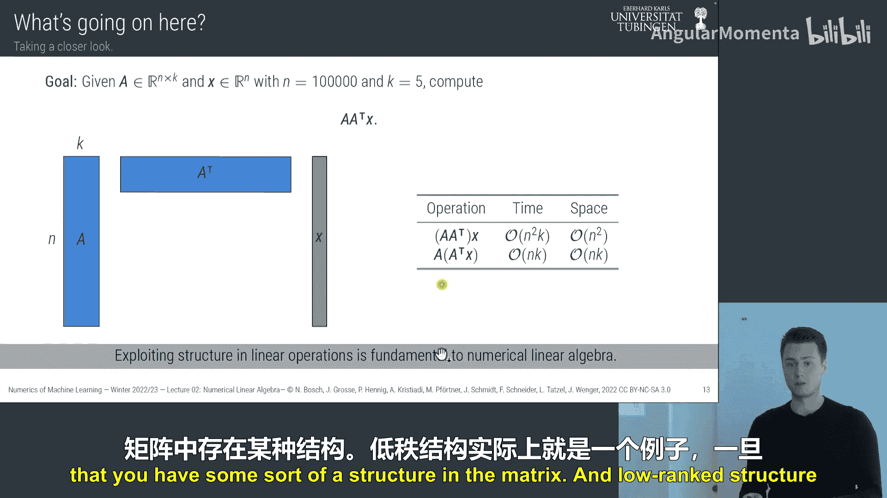

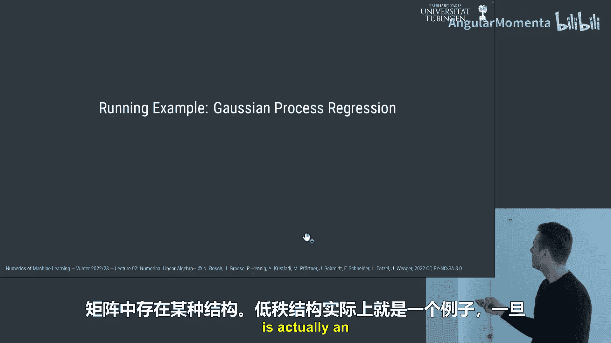

从图形角度看，**A A^T** 是一个**低秩矩阵**（秩最多为 k）。对于低秩矩阵，存在比先形成完整矩阵再相乘更高效的方法。

这引出了一个更重要的观点：**如果你知道矩阵的结构，就应该利用它**。算法本身无法自动识别结构，需要你告知算法或使用专门的方法。

## 利用矩阵结构

低秩结构只是一个例子。一旦计算出了完整的 **A A^T**，再想事后识别其低秩结构是昂贵的。因此，如果你知道矩阵是低秩的，就应该使用专门处理低秩矩阵的方法。

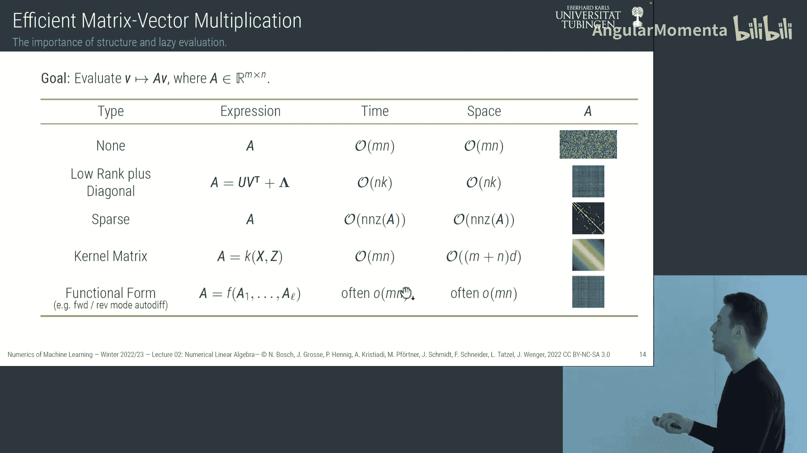

矩阵结构多种多样，以下是一个不完整的列表：

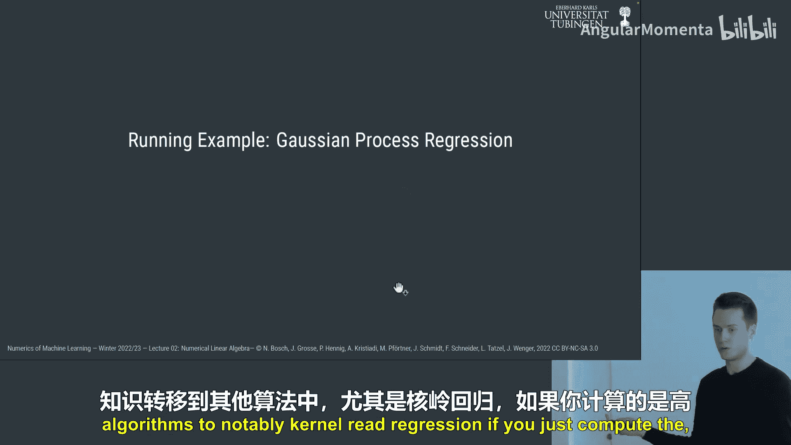

*   **一般矩阵**：无特殊结构。矩阵向量积的时间和空间复杂度至少为 O(mn)。
*   **低秩+对角矩阵**：例如，带有 L2 正则化的回归问题中会出现。复杂度可降至 O(nk)，其中 k 是低秩部分的秩。
*   **稀疏矩阵**：复杂度取决于非零元素的数量。表示方式也会影响空间需求。
*   **核矩阵**：具有生成性信息（由核函数生成）、对称性和正定性。虽然矩阵向量积的时间没有加速，但可以节省大量内存（存储数据点和核函数，而非整个矩阵，空间复杂度从 O(n²) 降至 O(nd)，其中 d 是输入维度）。
*   **计算图相关的矩阵**：如神经网络中的雅可比矩阵。在特定假设下，可以加速计算。

## 高斯过程回归：一个具体案例

现在，我们聚焦于一个具体算法：高斯过程回归。本节内容也适用于其他方法，如核岭回归。

### 问题回顾

目标是学习一个未知函数 f*: ℝ^d → ℝ。作为一种贝叶斯回归方法，我们在未知函数上放置一个先验（高斯过程），其均值函数为 μ，核函数为 k。我们观测到带噪声的函数值数据 **y**。应用贝叶斯规则后，我们得到后验高斯过程，其后验均值和协方差函数如下：

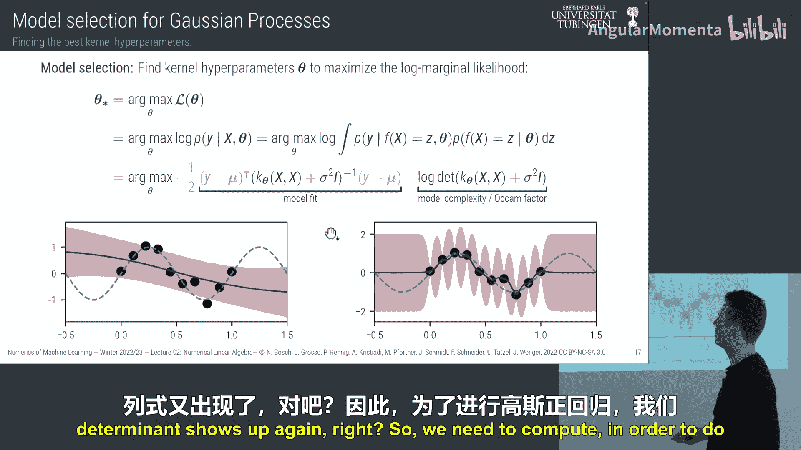

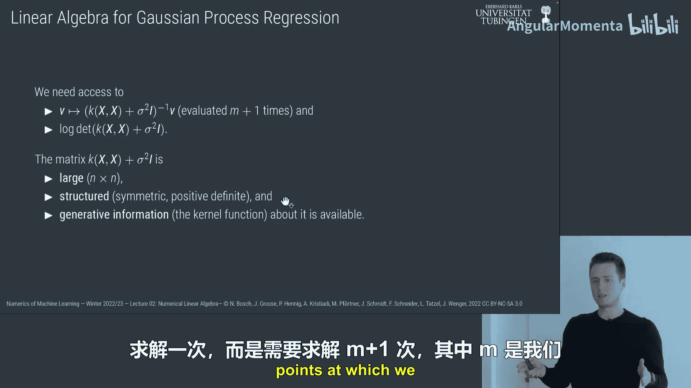

**后验均值**: μ* = **K*** (**K** + σ² **I**)^(-1) **y**
**后验协方差**: k* = **K**** - **K*** (**K** + σ² **I**)^(-1) **K***^T

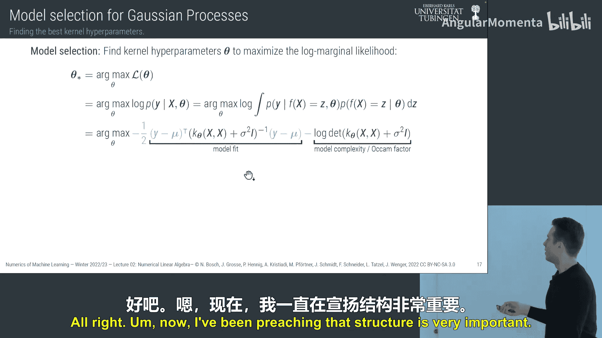

其中，**K** 是训练数据点之间的核矩阵，**K*** 是训练点与测试点之间的核矩阵，**K**** 是测试点之间的核矩阵。

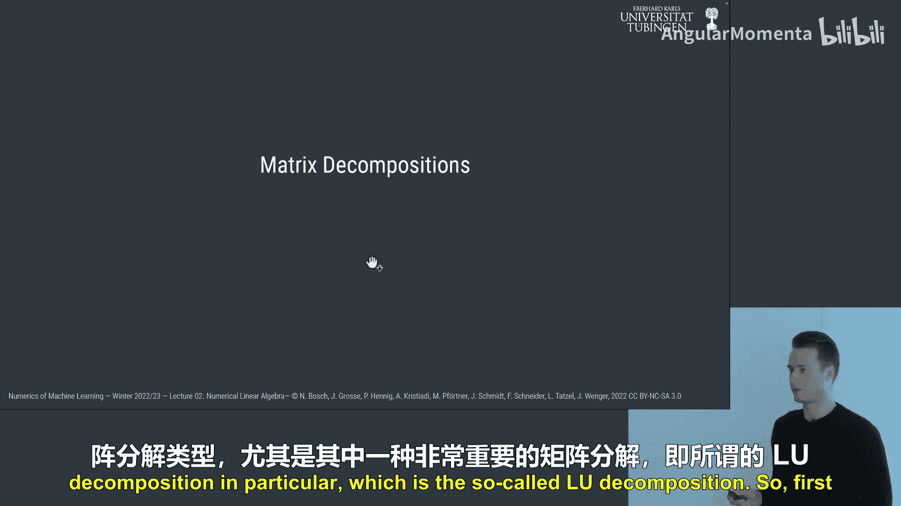

为了进行超参数优化，我们还需要计算**对数边际似然**（用于模型选择）：
log p(**y** | θ) = -1/2 [ **y**^T (**K** + σ² **I**)^(-1) **y** + log det(**K** + σ² **I**) + n log(2π) ]

这里，**θ** 代表核函数的超参数（如输出尺度、长度尺度）。

### 计算挑战与所需操作

进行高斯过程回归需要：
1.  求解线性系统：(**K** + σ² **I**) **w** = **y** （一次求解，用于后验均值）。
2.  求解线性系统：(**K** + σ² **I**) **W** = **K***^T （M 次求解，M 是测试点数量，用于后验协方差）。
3.  计算 log det(**K** + σ² **I**) （用于超参数优化）。

### 利用结构：核矩阵的性质

我们的核矩阵 **K** + σ² **I** 是对称正定的，并且具有生成性信息。对于大规模数据集，我们需要利用这些结构来设计高效算法。

## 矩阵分解：LU 与 Cholesky

求解线性系统的基础是矩阵分解。我们首先介绍 **LU 分解**。

### 前向与后向替换

假设我们要解 **L y = b**，其中 **L** 是下三角矩阵。我们可以使用**前向替换**算法（递归/分治法）：
1.  将 **L** 和 **b** 分解为块形式。
2.  递归求解较小的下三角系统。
3.  回代求解最后一个变量。
其时间复杂度为 O(n²)。类似地，对于上三角矩阵 **U x = y**，可以使用**后向替换**。

### LU 分解

对于一般可逆方阵 **A**，我们可以将其分解为 **A = L U**，其中 **L** 是单位下三角矩阵（对角线为1），**U** 是上三角矩阵。分解过程也采用递归：
1.  选取一个主元（通常是左上角元素）。
2.  计算该列下方的乘子向量 **l**。
3.  更新右下角的子矩阵：**A' = A' - l u^T**。
4.  递归地对子矩阵进行 LU 分解。

如果主元为零，需要进行**部分选主元**（行交换），以确保数值稳定性。通常选择绝对值最大的元素作为主元。加上行交换后，分解可表示为 **P A = L U**，其中 **P** 是置换矩阵。

LU 分解的计算成本约为 (2/3)n³ 次浮点运算。

### 利用 LU 分解求解和计算行列式

一旦得到 **A = L U**，求解 **A x = b** 就转化为：
1.  解 **L y = P b** （前向替换，O(n²)）。
2.  解 **U x = y** （后向替换，O(n²)）。

对于多个具有相同矩阵 **A** 但不同右侧向量 **b** 的线性系统，我们只需支付一次 O(n³) 的分解成本，之后每个系统只需 O(n²) 的替换成本。这在高斯过程回归中非常有用。

此外，利用 LU 分解可以高效计算行列式：
det(**A**) = det(**L**) det(**U**) = (∏ᵢ Lᵢᵢ) (∏ᵢ Uᵢᵢ) = ∏ᵢ Uᵢᵢ
因为 **L** 是单位下三角矩阵，其行列式为 1。计算成本为 O(n)。

### Cholesky 分解：针对对称正定矩阵

对于对称正定矩阵（如 **K** + σ² **I**），有更高效的 **Cholesky 分解**：**A = L L^T**，其中 **L** 是下三角矩阵。

构造方式与 LU 分解类似，但利用了对称性。由于矩阵正定，所有主对角元都为正，因此**不需要选主元**。Cholesky 分解的计算成本约为 (1/3)n³，比 LU 分解快一倍，并且更节省内存（只需存储 **L**）。

### 应用于高斯过程回归

使用 Cholesky 分解 **K** + σ² **I** = **L L^T**，后验均值和协方差的计算变为：
*   **后验均值**：μ* = **K*** (**L^T** \ (**L** \ **y**))。这里需要一次前向替换和一次后向替换。
*   **后验协方差**：类似地，利用分解进行计算。
*   **对数行列式**：log det(**K** + σ² **I**) = 2 ∑ᵢ log Lᵢᵢ。

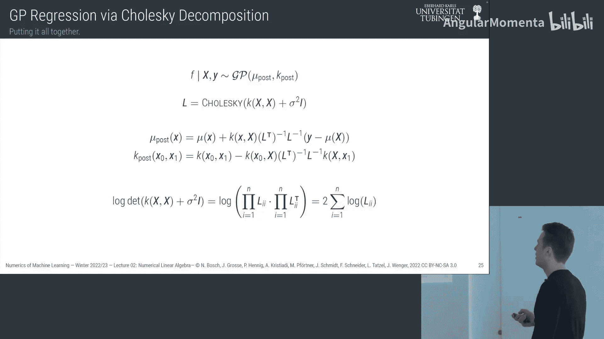

## 扩展到大规模数据集

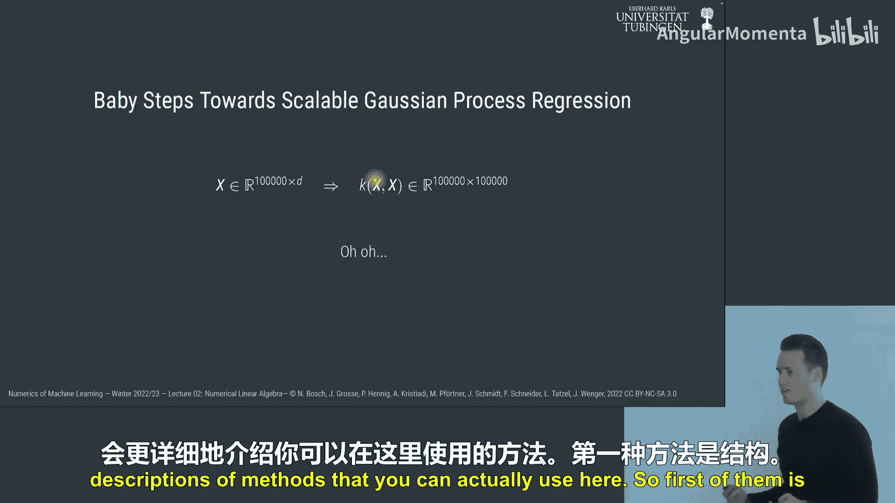

当数据集很大（例如 n=100,000）时，核矩阵无法放入内存，直接 Cholesky 分解（O(n³)）也不可行。有两种主要思路来解决这个问题。

### 方法一：利用核结构（精确方法）

选择具有特殊结构的核函数，使得线性代数运算大大简化。

例如，使用**参数化先验**（有限维特征映射）。假设我们有 p 个特征函数（p << n），权重先验为 **w** ~ N(0, Σ)。那么对应的核函数为 k(x, x') = φ(x)^T Σ φ(x')。此时的核矩阵为：
**K** = Φ Σ Φ^T
其中 Φ 是 n×p 的特征矩阵。那么 **K** + σ² **I** 具有“低秩 + 对角”的结构。

为了高效求逆，可以使用 **矩阵求逆引理**（Woodbury 恒等式）：
(**Φ Σ Φ^T** + σ² **I**)^(-1) = (1/σ²) **I** - (1/σ²) Φ [ Σ^(-1) + (1/σ²) Φ^T Φ ]^(-1) Φ^T (1/σ²)

关键点在于，括号内的矩阵是 p×p 的，而 p 很小。因此，求逆成本从 O(n³) 降为 O(np² + p³)。我们甚至不需要显式形成整个核矩阵。类似地，**矩阵行列式引理**可以高效计算对数行列式。

### 方法二：近似求逆（迭代/近似方法）

另一种思路是进行近似。观察 Cholesky 分解算法，它迭代地处理数据点，逐行生成下三角因子 **L**。我们可以提前终止算法，得到一个**低秩近似**。

然而，按原始顺序处理数据点，近似的收敛速度可能很慢。解决方案是**选择处理数据点的顺序**。这类似于在 Cholesky 分解中引入完全选主元（同时进行行和列置换），称为**带主元的 Cholesky 分解**。

通过智能地选择顺序（例如，基于空间覆盖或不确定性），我们可以用更少的迭代步数获得更好的低秩近似。这可以看作一个在线学习或主动学习问题：在每一步，根据当前已获得的信息，选择下一个最具信息量的数据点进行处理。

这种低秩近似不仅可以用于加速求解，还可以用于从后验分布中**高效采样**（因为 **L** 本身就是一个矩阵平方根）。

## 总结

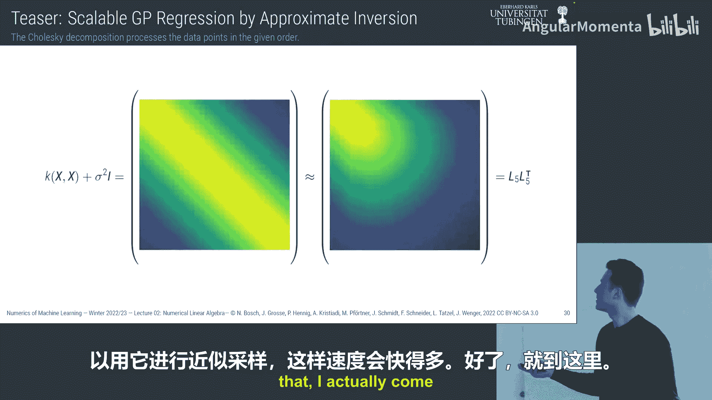

本节课我们一起学习了以下内容：

1.  数值线性代数是机器学习的基石，出现在几乎所有机器学习算法中。
2.  作为机器学习从业者，我们需要关心数值实现，因为利用结构可以极大提升算法速度，并且实现细节需要非常小心。
3.  我们重点讨论了四个核心任务：
    *   高效的矩阵向量乘法。
    *   线性系统求解。
    *   矩阵分解（如 LU、Cholesky）。
    *   对数行列式和矩阵平方根的计算（用于超参数优化和采样）。
4.  我们通过多个例子看到，**利用矩阵结构**对于设计快速的机器学习算法至关重要。
5.  我们以高斯过程回归为例，深入探讨了如何应用这些线性代数工具，并讨论了将其扩展到大规模数据集的两种思路：利用核的精确结构和使用近似方法。

在接下来的课程中，我们将继续探索结构如何影响高斯过程回归及其他机器学习模型。

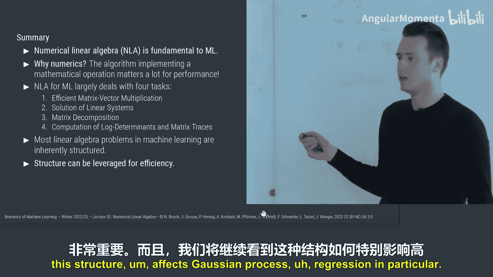

感谢观看，下节课见。

