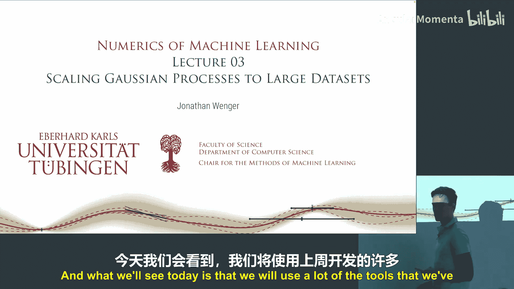

# 003：高斯过程的扩展 🚀

在本节课中，我们将学习如何将高斯过程扩展到大型数据集。我们将看到，通过使用迭代方法求解线性系统，可以显著降低计算复杂度，从立方时间降至平方时间，甚至在线性时间内完成推理。

---

## 高斯过程回顾 📚

上一节我们介绍了使用楚列斯基分解求解线性系统的教科书方法，并将其应用于高斯过程回归。本节中，我们将探讨解决此类核矩阵线性系统的现代方法，并将其应用于扩展高斯过程。

回归的主要目标是学习一个未知函数 `f*`。我们期望模型能够：
*   **泛化**到未见过的数据。
*   **简单可解释**，便于理解模型所学内容。
*   提供**不确定性估计**，以了解预测的可信度。
*   计算**快速高效**。

高斯过程能同时满足以上所有要求。然而，正如上周所学，其训练和推理的计算成本非常高。高斯过程后验的均值和协方差计算都涉及对大小为 `n x n` 的格拉姆矩阵求逆，其中 `n` 是数据点数量。

对于模型选择（如优化核超参数），我们需要计算**对数边际似然**及其梯度，这同样涉及矩阵求逆和行列式计算。

楚列斯基分解可以精确计算这些量。然而，对于大型数据集（例如 `n=10,000`），形成核矩阵需要约 80 GB 内存，而分解本身在标准 CPU 上可能需要超过 80 小时。显然，楚列斯基分解在时间和空间上对于我们所关心的大型数据集都是不可行的。

---

## 迭代方法作为替代方案 🔄

为了应对上述挑战，我们将讨论**迭代方法**，目标是**将复杂度降低到数据点数量的平方级别**。

我们之前看到的楚列斯基分解的迭代形式，在提前停止时，可以得到核矩阵的低秩近似。但对于高斯过程回归，我们需要的是**逆矩阵的近似**，而非核矩阵本身的近似。

关键问题是：我们能否修改迭代楚列斯基算法，使其在构建矩阵近似 `L_i L_i^T` 的同时，也构建一个逆矩阵的近似 `C_i`，使得 `C_i b ≈ A^{-1} b`？

答案是肯定的。通过追踪额外的量，我们可以递归地构建一个同样低秩的逆矩阵近似 `C_i`。其每轮迭代的复杂度仍然是 `O(n^2)`，与仅近似矩阵本身的开销渐近相同。

让我们看看将其应用于高斯过程推理的效果。我们只需用逆近似 `C` 替换精确的核矩阵逆 `K^{-1}`。

以下是使用部分楚列斯基（迭代3次）的示例，其中我们按顺序选择了前三个数据点（蓝色点）。可以看到，近似效果并不理想，它本质上类似于只在这三个数据点上进行高斯过程回归。

**选择哪些数据点（即“动作”或“枢轴”）至关重要**。如果随机选择数据点，即使同样迭代10次，后验均值和不确定性的近似效果也会好得多。

因此，可以将选择数据点的过程视为一种**学习行为**：一个更智能的策略能让我们更快地收敛到真实的后验。

---

## 共轭梯度法：更智能的“动作”选择 ⚡

上一节我们看到了选择不同“动作”对近似速度的影响。本节中，我们来看看一种名为**共轭梯度法**的方法，它最初就是为求解对称正定线性系统（如高斯过程回归中的系统）而设计的。

我们的目标是求解 `A x = b`，其中 `A` 是核矩阵。我们希望用尽可能少的矩阵-向量乘法（每次 `O(n^2)`）来快速近似后验。

这个问题可以重新表述为一个二次优化问题：最小化函数 `f(x) = (1/2) x^T A x - b^T x`。其梯度为 `∇f(x) = A x - b`，设梯度为零即等价于求解 `A x = b`。我们定义残差 `r = b - A x`，它也是当前点的负梯度方向。

如果使用最速下降法（沿负梯度方向），收敛路径可能会呈“之”字形。共轭梯度法的核心思想是：选择一组**共轭方向**（在由 `A` 诱导的内积下正交），使得算法能在最多 `n` 步内收敛（精确算术下）。

共轭梯度法可以解释为一种**学习逆矩阵的算法**。它同样会构建一个低秩的逆矩阵近似 `C_i`，其更新形式为外积 `d_i d_i^T` 的求和，其中 `d_i` 是共轭方向。

与部分楚列斯基法对比，两者结构相似：
*   都选择一个“动作”向量（楚列斯基选单位向量，共轭梯度选残差）。
*   都对该动作进行修正以获得搜索方向。
*   都通过低秩更新（秩1）来估计逆矩阵。

对于高斯过程推理，共轭梯度法（使用残差作为动作）通常收敛得更快。因为残差向量 `r` 会全局地探测所有数据点，其大小反映了当前估计与数据的差距，这正是一个高效的探索策略。

---

## 收敛速度与预条件处理 🏎️

上一节我们直观地看到共轭梯度法收敛更快。本节中，我们具体分析其收敛速度，并介绍加速技巧——**预条件处理**。

共轭梯度法的收敛速度取决于矩阵 `A` 的**条件数** `κ(A)`，即最大特征值与最小特征值之比。条件数越接近1，收敛越快。

对于高斯过程中的矩阵 `K + σ^2 I`，其特征值为 `λ_i + σ^2`。其条件数为 `(λ_max + σ^2) / (λ_min + σ^2)`。
*   当观测噪声 `σ^2` 很小时，条件数接近 `λ_max / λ_min`。对于大多数核函数，这个值可能非常大（病态），导致收敛缓慢。
*   当 `σ^2` 很大时，条件数接近1，但这也意味着我们假设观测噪声很大，从数据中学到的东西变少。

这就形成了一个权衡：更小的噪声有助于学习，但会使数值问题更难解。为了解决病态问题，我们引入**预条件处理**。

其思想是：我们有一个易于求逆的矩阵 `P` 来近似 `A`。我们求解等价的线性系统 `P^{-1} A x = P^{-1} b`。如果 `P` 选得好，新系统的条件数 `κ(P^{-1} A)` 会远小于原系统的条件数 `κ(A)`，从而极大加速共轭梯度法的收敛。

几何上，预条件子 `P` 的作用是“扭曲”空间，使二次型的等高线更接近圆形，从而优化路径更直接。

预条件子可以视为关于问题的**先验知识**。对于核矩阵，一个有效的预条件子是使用部分楚列斯基分解得到的低秩加对角矩阵 `P = L L^T + σ^2 I`。由于其结构特殊，我们可以利用矩阵求逆引理高效计算 `P^{-1}`。

实践表明，即使是使用随机选取数据点构建的简单部分楚列斯基预条件子，也能显著加速共轭梯度法。例如，对于一个 `n=100,000` 的数据集，使用预条件的共轭梯度法可以在约7分钟内将残差降到很低，而精确的楚列斯基分解则需要83小时。

---

## 超参数优化：对数行列式与迹估计 📈

到目前为止，我们主要讨论了如何求解线性系统以获得后验均值。但对于超参数优化，我们还需要计算**对数边际似然**及其**梯度**。

对数边际似然的梯度包含两项：一项涉及线性系统求解（我们已经能用共轭梯度法处理），另一项涉及**迹**的计算：`tr(K^{-1} ∂K/∂θ)`。

直接计算迹需要 `O(n^3)` 复杂度。我们希望用少量 `O(n^2)` 的矩阵-向量乘法来近似它。迹可以写成 `tr(A) = sum_i e_i^T A e_i`，其中 `e_i` 是单位向量。但这仍需要 `n` 次矩阵-向量乘法。

我们采用**随机化迹估计**。其核心思想是：如果 `z` 是一个零均值、协方差为 `I` 的随机向量，那么 `tr(A) = E[ n * (z^T A z) ]`。因此，我们可以通过蒙特卡洛方法，用少量随机向量 `z_i` 的平均来估计迹：`tr(A) ≈ (n/L) * sum_{i=1}^L z_i^T A z_i`。

然而，简单的蒙特卡洛估计器方差较大，可能需要数万个随机向量才能达到可接受的精度，这同样代价高昂。

解决方案依然是利用**预条件子**。我们可以将对数行列式重写为：
`log det(K) = log det(P) + tr( log(K) - log(P) )`
其中 `P` 是我们的预条件子。第一项 `log det(P)` 可以精确计算（例如，对于楚列斯基分解的 `P`，就是其对角线乘积的对数）。我们只需要估计第二项的迹。由于 `P` 接近 `K`，`log(K) - log(P)` 是一个小量，因此其迹的估计方差会大大降低，从而可以用少得多的随机向量（例如几十个）达到高精度。

这种预条件化的随机迹估计策略，与预条件共轭梯度法加速线性求解的思路一脉相承，都是通过注入关于问题的先验知识（预条件子）来提升效率。现代高斯过程库（如GPyTorch）正是使用这种组合方法来实现大规模数据集的超参数优化。

---

## 线性时间方法：变分近似与诱导点 🏃

上一节我们实现了平方时间复杂度的推理。本节最后，我们简要探讨能否达到**线性时间复杂度** `O(n)`。

其核心思想是：数据集中往往存在大量冗余或相似的点。我们可以尝试将数据集压缩成一个更小的**诱导点集** `Z`（大小为 `m << n`），用它来总结原始数据。

这通过**变分近似**实现：我们直接用一个依赖于诱导点 `Z` 的、不同的高斯过程来近似真实后验。这个近似后验的形式与标准高斯过程后验类似，但所有涉及 `n x n` 矩阵的操作都被替换为涉及 `m x m` 矩阵或 `m x n` 矩阵的操作。

我们需要优化三个量来使变分分布接近真实后验：
1.  诱导点的位置 `Z`。
2.  一个类似于观测值的向量 `μ`。
3.  一个校正不确定性的项 `Σ`。

通过最小化变分分布与真实后验之间的KL散度，我们可以优化这些参数。其主要计算成本为 `O(m^2 n)`，当 `m` 固定时，即为 `O(n)`。

这种方法（如随机变分高斯过程）速度极快，并且适合使用随机梯度下降进行优化。然而，它有一个潜在问题：**不确定性量化可能不准确**。特别是在远离诱导点的区域，近似后验的不确定性可能与真实高斯过程后验相差甚远。

与迭代方法不同，变分方法需要预先设定诱导点数量 `m`，这决定了近似的“容量”。而迭代方法（如共轭梯度）允许我们随时根据计算预算停止，并得到一个在相应计算量下的最优近似，其不确定性估计通常更可靠。

---

## 总结 🎯

本节课我们一起学习了如何将高斯过程扩展到大型数据集：

1.  **近似是必需的**：精确计算在内存和时间上对于大数据集都不可行。
2.  **迭代方法是核心工具**：如部分楚列斯基法和共轭梯度法，它们允许我们以平方时间复杂度 `O(n^2)` 近似后验并进行超参数优化。
3.  **算法即学习器**：这些迭代方法中选择“动作”（如探测哪些数据点）的过程，可以解释为一种主动学习算法。更智能的动作选择能带来更快收敛。
4.  **预条件处理即先验知识**：通过向求解器注入关于问题的近似信息（预条件子），可以显著加速迭代方法，无论是线性求解还是迹估计。
5.  **存在更快的线性时间方法**：如变分高斯过程，通过诱导点总结数据，实现 `O(n)` 复杂度推理。但其不确定性估计可能需要仔细评估。

最终，我们留下一个开放问题：**能否设计一种方法，在获得线性时间复杂度的同时，还能提供可靠的不确定性量化？** 这将是未来研究的一个方向。

下节课，我们将更深入地探讨这些数值方法本身如何被理解为“学习机器”，从而统一优化与学习的视角。