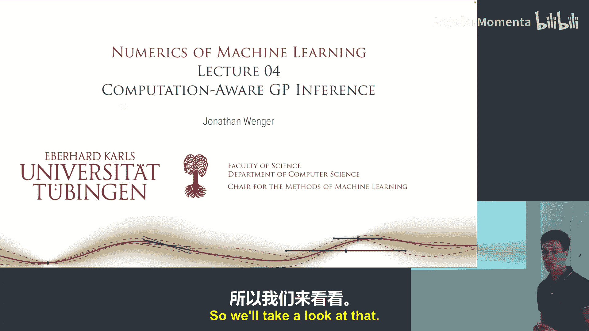
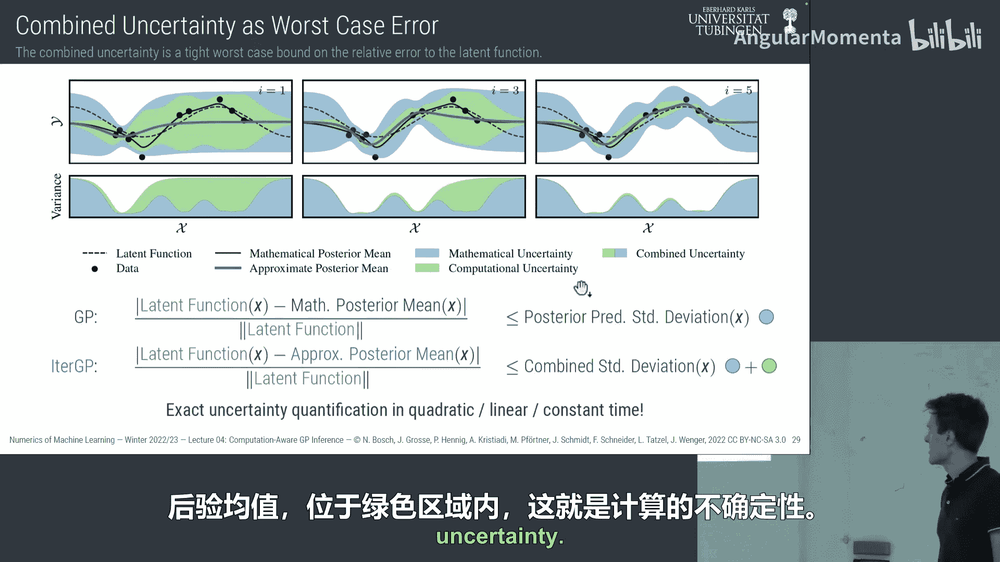

# 004：计算感知高斯过程

在本节课中，我们将学习如何为高斯过程回归构建一种计算感知的近似方法。这种方法的核心在于，无论投入多少计算资源，我们都能精确地量化近似带来的不确定性。我们将从一个新的视角——概率数值计算——来重新审视迭代求解算法，并将其视为一个“学习代理”，从而实现对近似误差的跟踪和量化。

---

## 快速回顾：高斯过程与迭代近似

上一讲我们深入探讨了用于高斯过程的迭代近似算法。我们了解到，精确计算高斯过程后验涉及对核矩阵 **K** 进行求逆，其计算复杂度为 **O(n³)**，在大规模数据场景下代价高昂。

为了应对这个问题，我们引入了迭代算法，例如部分 Cholesky 分解和共轭梯度法。这些算法通过每次迭代执行一次矩阵-向量乘法（复杂度 **O(n²)**），来构建对精度矩阵 **K⁻¹** 的低秩近似。

一个关键发现是，**行动**（即算法在每次迭代中选择关注的数据点或方向）的选择至关重要。它类似于机器学习中的主动学习：在信息量更大的位置进行“观测”，能更快地降低我们对真实函数认知的不确定性。

然而，这些快速近似方法（如基于诱导点的稀疏近似）存在一个显著问题：它们提供的不确定性估计可能是**失准的**。在数据稀疏的区域，模型可能过于自信；而在数据密集的区域，近似后验均值可能偏离真实值，但模型给出的不确定性却很低。这违背了使用高斯过程的初衷之一——获得可靠的不确定性量化。

那么，我们能否在享受计算效率的同时，修复这种不确定性失准的问题呢？这就是本节课要回答的核心问题。

---

## 核心思想：将权重估计视为学习问题

让我们重新审视高斯过程后验均值的表达式：

**μ*(x) = k(x, X) · v***

其中，**v* = K⁻¹y** 被称为**表征权重**。后验均值可以理解为一系列以数据点为中心的核函数 **k(x, x_j)** 的线性组合，而 **v*** 就是这些组合的权重。

当我们使用迭代求解器时，我们得到的是表征权重 **v*** 的一个近似值 **v_i**。这导致我们的后验均值预测 **μ_i(x) = k(x, X) · v_i** 也是近似的。

**核心思路**：如果我们能以概率化的方式，量化近似权重 **v_i** 与真实权重 **v*** 之间的误差，并将此误差融入到我们的预测不确定性中，那么即使在近似计算下，我们也能获得校准良好的不确定性估计。

---

## 构建概率学习算法

为了实现上述思路，我们为真实表征权重 **v*** 建立一个高斯先验信念。这个信念包含一个均值估计 **v_i**（我们当前的猜测）和一个协方差矩阵 **Σ_i**（对我们猜测的不确定性的度量）。**Σ_i** 越大，表示我们认为 **v_i** 可能离 **v*** 越远。

我们如何更新这个信念呢？我们无法直接观测 **v***，但可以间接地通过计算**残差**来获取信息。在第 i 步，我们选择一个“行动”向量 **s_i**。我们可以计算一个标量观测值：

**r_i = s_iᵀ K (v* - v_{i-1})**

这个观测值本质上衡量了在当前行动方向 **s_i** 上，我们的猜测与真实解之间的距离。这正是一个经典的**线性高斯推断**问题：我们有一个关于 **v*** 的高斯先验，并通过一个线性变换 **s_iᵀ K** 观测到了带有噪声（这里噪声为0）的数据 **r_i**。

利用高斯推断的公式，我们可以更新对 **v*** 的信念。更新后的后验均值 **v_i** 会朝着真实解方向移动，而后验协方差 **Σ_i** 会减小，反映出我们获得了新的信息。

这个更新过程在数学形式上，与此前见过的部分 Cholesky 和共轭梯度算法惊人地相似。行动 **s_i** 的选择（例如，选择单位向量或残差向量）直接决定了具体是哪种算法。

---

## 解决先验难题与不确定性传播

现在出现了一个循环论证：为了初始化对 **v*** 的信念，我们需要一个先验协方差 **Σ_0**。合理的先验应该是 **Σ_0 = K⁻¹**，但这恰恰是我们试图避免计算的矩阵！

关键的突破点在于，我们最终的目标不是 **v*** 本身，而是高斯过程的后验预测。当我们对 **v*** 具有高斯信念时，后验均值 **μ*(x) = k(x, X) v*** 就是一个高斯随机变量的线性变换。

因此，我们可以将关于 **v*** 的不确定性（即计算误差）**边缘化**到预测中。令人惊喜的是，在最终的预测协方差表达式里，所有需要 **K⁻¹** 的项都相互抵消了。我们最终得到的**组合协方差**为：

**k_*(x, x) = k(x, x) - k(x, X) C_i k(X, x) + σ²**

其中 **C_i** 是我们的算法在迭代中自然构建的、对 **K⁻¹** 的低秩近似矩阵。我们**完全不需要显式计算 K⁻¹**。

这个组合协方差包含两部分：
1.  **数学不确定性**：源于数据有限，即使精确计算也无法消除的不确定性。
2.  **计算不确定性**：源于我们使用近似算法而非精确解所引入的额外不确定性。

随着迭代次数增加，**C_i** 越来越接近 **K⁻¹**，计算不确定性逐渐减小，组合协方差收敛到精确的数学后验协方差。

---

## 算法：InterGP 与不同行动策略

我们将这个框架实例化为一个名为 **InterGP** 的算法。其步骤与共轭梯度法等类似，但多了一个显式维护不确定性估计 **Σ_i**（通过 **C_i** 体现）的视角。

不同的行动策略 **s_i** 会生成 InterGP 的不同变体：

*   **单位向量行动**：恢复为**部分 Cholesky** 或子集数据方法。计算集中在选定的数据点上，不确定性降低是局部的。
*   **残差向量行动**：恢复为**共轭梯度法**。计算更全局，通常能以更少的迭代次数接近真实解。
*   **核向量行动**：行动 **s_i** 是一个核函数值向量，类似于稀疏高斯过程中诱导点的思想。这可以修复传统稀疏方法不确定性失准的问题，但每次迭代仍需 **O(n²)** 计算。

---

## 控制计算成本与哲学视角

一个重要的实践发现是：如果我们设计的行动向量 **s_i** 是稀疏的（即大部分元素为零），那么算法中所有涉及 **K** 的矩阵-向量乘法的计算成本，就只取决于行动向量非零元素的数量 **k**，复杂度变为 **O(k²)**。

这意味着我们可以通过设计行动策略，来**自由控制每次迭代的计算预算**，同时依然保持精确的不确定性量化特性。从某种意义上说，这模糊了“数据”和“计算”的界限：只有那些被我们的计算行动“处理”过的数据，才真正影响了我们的后验信念。这提供了一个更贴合实际计算场景的建模视角。

---

## 理论保证：精确的不确定性量化

InterGP 方法不仅直观，更有坚实的理论保证。它提供的**组合标准差**，可以作为预测误差的可靠上界。

具体来说，对于任何可能生成观测数据的潜在真实函数 **g**，其函数值 **g(x)** 与我们近似后验均值 **μ_i(x)** 之间的差距，几乎必然被我们的组合标准差所界定。这确保了：

1.  真实函数几乎必然落在由“近似后验均值 ± 组合不确定性”构成的区间内。
2.  精确的数学后验均值几乎必然落在由“近似后验均值 ± 计算不确定性”构成的区间内。

因此，我们实现了最初的承诺：**在任意给定的计算预算下，进行精确的不确定性量化**。我们可以像信任精确高斯过程一样，信任 InterGP 提供的不确定性估计。

---

## 总结

本节课中，我们一起学习了一种为高斯过程回归构建计算感知近似的方法——InterGP。核心要点如下：

*   **新视角**：将迭代求解器重新诠释为对表征权重的概率化学习算法。
*   **误差量化**：该框架能自然跟踪并量化由近似计算引入的误差（计算不确定性）。
*   **不确定性传播**：通过边缘化，将计算不确定性融入最终预测，得到组合不确定性。
*   **灵活性**：通过选择不同的行动策略，可以恢复经典算法（如 CG），也可以设计新算法，并能控制每次迭代的计算成本。
*   **理论保证**：该方法提供的不确定性估计是校准良好的，为预测误差提供了可靠上界。

这种方法弥合了高效计算与可靠统计推断之间的鸿沟，是概率数值计算思想的一个成功范例。下一讲，我们将探讨如何将物理定律等先验知识融入到高斯过程建模中。