# 005：状态空间模型

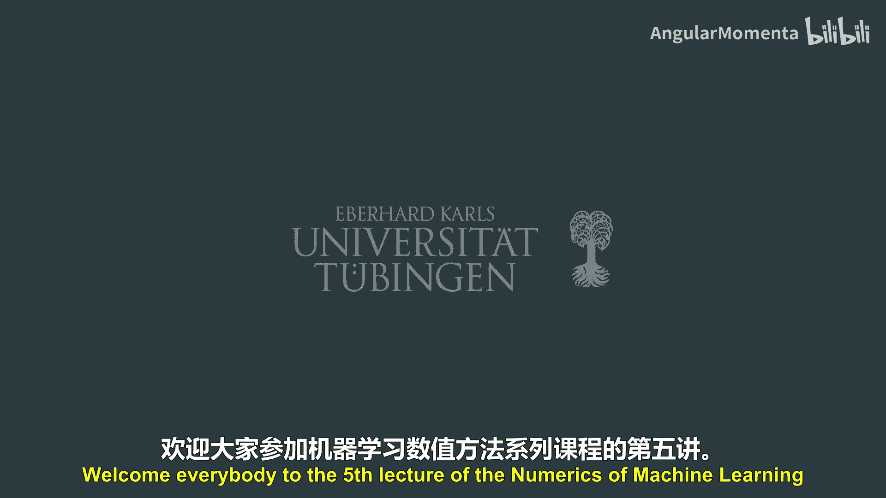


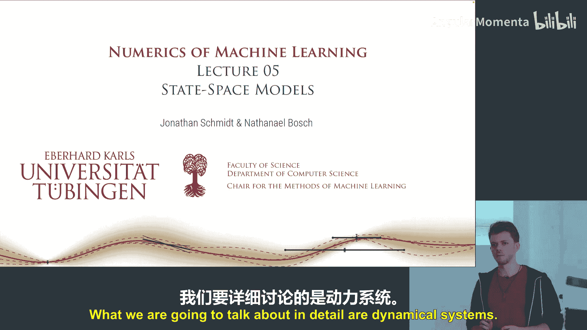

在本节课中，我们将要学习一种用于描述和估计动态系统的强大工具——状态空间模型。我们将从基本概念开始，逐步构建一个完整的算法框架，用于从观测数据中在线估计系统的隐藏状态。

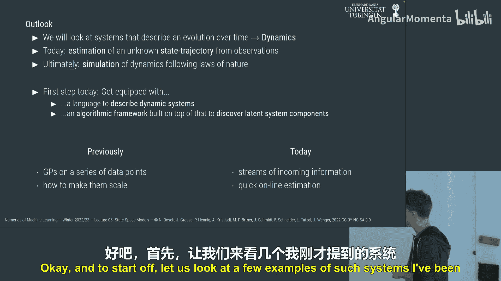

## 概述：什么是动态系统？

上一讲我们学习了高斯过程，它用于描述固定数据集上的函数。本节中，我们将开启新的篇章，探讨**动态系统**。动态系统是指状态随时间演化的系统。我们的核心任务是：从观测数据中，估计这种动态系统随时间的演化过程。

我们最终的目标是能够**模拟**这样的系统。为了实现这个目标，我们首先需要建立一套描述动态系统的语言和算法框架。

## 动态系统的例子与核心特征

以下是几个动态系统的例子，从中我们可以提取出状态空间模型需要具备的关键特征：

*   **COVID-19疫情模型**：我们每天可以观测到新增感染病例数（红色曲线），但无法直接测量人群的接触率（β参数）。这体现了系统的**部分可观测性**。
*   **智能手机方向估计**：手机内置的加速度计等传感器会持续产生数据流，我们需要快速、在线地更新对手机方向的估计。这体现了**在线估计**的需求。
*   **流体动力学模拟**：这是一个非常复杂的时空动态系统，其动力学可能是**高度非线性**的。

从这些例子中，我们总结出状态空间模型的关键特征：
1.  **时间演化**：系统状态随时间变化。
2.  **部分可观测性**：我们只能观测到系统状态的一部分。
3.  **在线估计**：需要算法能够基于最新到达的数据流快速更新估计。
4.  **可能包含复杂非线性**：系统的动态可能非常复杂。

## 状态空间模型：建模语言

现在，我们来看看如何用概率模型来描述这样的系统。我们将使用**概率图模型**来直观表示。


图中白色节点 `X_k` 代表系统在时刻 `k` 的**状态**。状态的定义是：**一组物理量，其规格完全决定了系统的演化**。例如：
*   对于钟摆系统，状态可以是 `[角度， 角速度]`。
*   对于疫情模型，状态可以是 `[易感者数量， 感染者数量， 康复者数量， 接触率]`。
*   对于手机追踪，状态可以是 `[X位置， Y位置， X速度， Y速度]`。

我们通过观测变量 `Y_k` 来获取关于状态 `X_k` 的信息，但通常只能观测到状态的一部分（例如，只能测位置，不能直接测速度）。

从该图模型中，我们可以读出两个核心性质：
1.  **马尔可夫性质**：当前状态 `X_k` 只依赖于前一个状态 `X_{k-1}`，与更早的历史无关。用公式表示为：
    `p(x_k | x_{1:k-1}) = p(x_k | x_{k-1})`
2.  **条件独立观测**：当前观测 `Y_k` 只依赖于当前状态 `X_k`，与过去和未来的状态及观测无关。即：
    `p(y_k | x_{1:k}, y_{1:k-1}) = p(y_k | x_k)`

基于以上性质，我们可以正式定义**概率状态空间模型**。它包含三个部分：
1.  **初始分布**：`p(x_0)`
2.  **动态模型（状态转移模型）**：`p(x_k | x_{k-1})`。这定义了状态如何随时间演化。
3.  **测量模型（似然函数）**：`p(y_k | x_k)`。这定义了给定状态下观测数据的分布。

这个三元组 `{p(x_0), p(x_k | x_{k-1}), p(y_k | x_k)}` 就是我们描述动态系统的建模语言。

## 贝叶斯滤波：在线状态估计

有了模型，我们想要解决什么问题？在在线估计的设定下，我们主要计算四种分布：

1.  **预测分布**：`p(x_k | y_{1:k-1})`。基于过去所有观测，预测当前状态。
2.  **滤波分布**：`p(x_k | y_{1:k})`。基于包括当前观测在内的所有过去观测，估计当前状态。这是我们在线估计的核心目标。
3.  **数据似然**：`p(y_k | y_{1:k-1})`。计算当前观测数据的概率，在计算过程中自然得到。
4.  **平滑分布**：`p(x_k | y_{1:T})`。基于全部数据（包括未来数据）重新估计过去某一时刻的状态。这通常在数据收集完成后进行，能得到更优的估计。

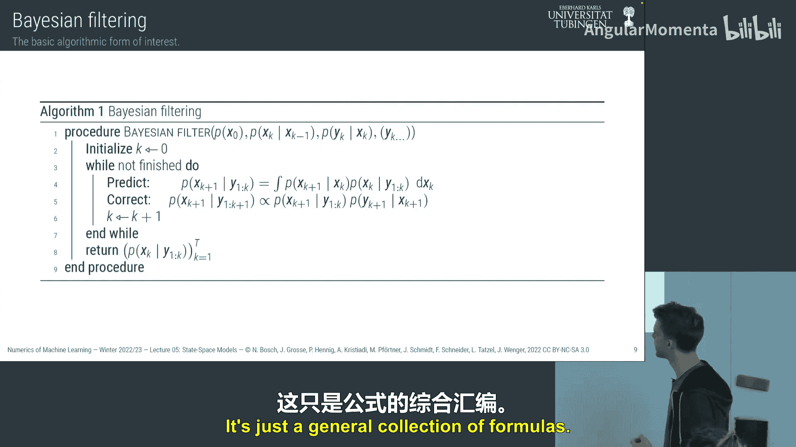

滤波和预测分布是递归计算的。我们从初始状态 `p(x_0)` 开始。

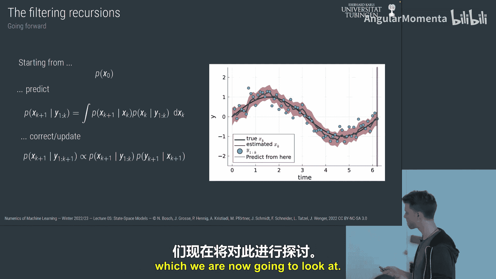

**预测步骤**：从上一时刻的滤波分布 `p(x_{k-1} | y_{1:k-1})` 出发，预测当前状态。
`p(x_k | y_{1:k-1}) = ∫ p(x_k | x_{k-1}) p(x_{k-1} | y_{1:k-1}) dx_{k-1}`
这个积分方程称为 **Chapman-Kolmogorov 方程**。

**校正（更新）步骤**：当新的观测 `y_k` 到达时，我们用它来更新预测。
`p(x_k | y_{1:k}) ∝ p(y_k | x_k) p(x_k | y_{1:k-1})`
这本质上是贝叶斯定理：后验 ∝ 似然 × 先验。其中先验就是预测分布，似然就是测量模型。归一化常数就是数据似然 `p(y_k | y_{1:k-1})`。

将这两个步骤结合起来，就得到了**贝叶斯滤波算法**的伪代码：

```
初始化： p(x_0)
循环（对于每个新观测 y_k）：
    预测：计算 p(x_k | y_{1:k-1}) （使用 Chapman-Kolmogorov 方程）
    校正：计算 p(x_k | y_{1:k}) = η * p(y_k | x_k) * p(x_k | y_{1:k-1}) （使用贝叶斯定理）
    返回滤波分布序列 {p(x_k | y_{1:k})}
```

这是一个前向递归算法，只使用当前和过去的信息，非常适合在线估计。

## 卡尔曼滤波：线性高斯情形

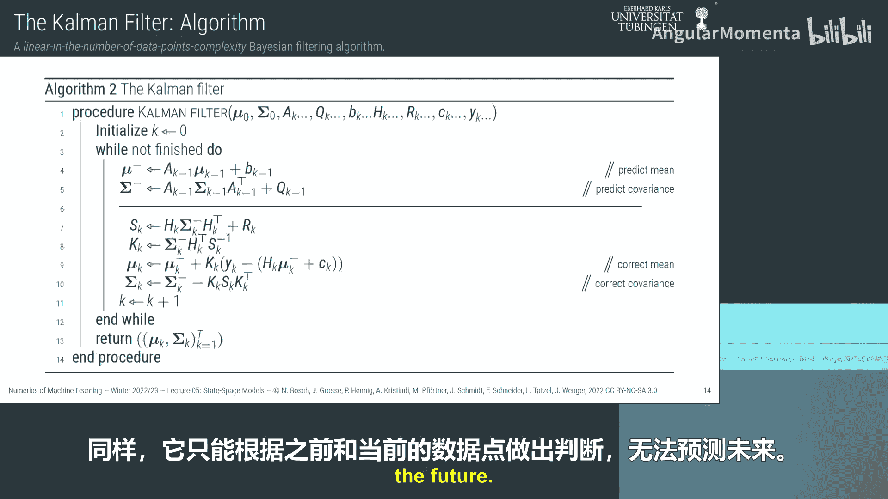

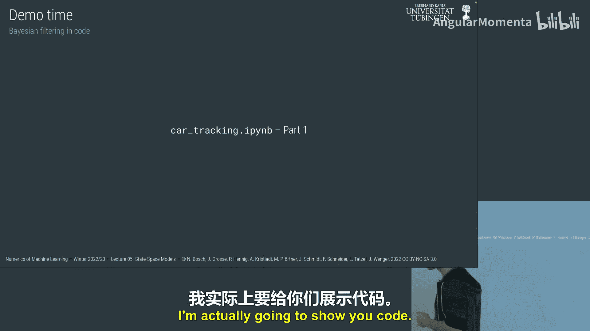

上述贝叶斯滤波公式中包含积分，对于一般模型很难计算。为了使计算可行，我们引入一个具体的模型假设：**线性高斯状态空间模型**。

我们假设：
*   初始分布：`x_0 ~ N(μ_0, Σ_0)`
*   动态模型：`x_k = A * x_{k-1} + b + q_k`，其中 `q_k ~ N(0, Q)`。`A` 称为状态转移矩阵，`Q` 称为过程噪声协方差矩阵。
*   测量模型：`y_k = H * x_k + c + r_k`，其中 `r_k ~ N(0, R)`。`H` 称为观测矩阵，`R` 称为观测噪声协方差矩阵。

在线性高斯假设下，所有的预测、滤波、平滑分布都仍然是高斯分布。我们只需要递归地计算它们的均值向量和协方差矩阵即可。这就是著名的**卡尔曼滤波**算法。

以下是卡尔曼滤波的方程：

**预测步骤**：
`μ_k^- = A * μ_{k-1} + b`
`Σ_k^- = A * Σ_{k-1} * A^T + Q`

**校正步骤**：
1.  计算观测预测：`ŷ_k = H * μ_k^- + c`
2.  计算新息协方差：`S_k = H * Σ_k^- * H^T + R`
3.  计算卡尔曼增益：`K_k = Σ_k^- * H^T * S_k^{-1}`
4.  更新状态估计（均值）：`μ_k = μ_k^- + K_k * (y_k - ŷ_k)`
5.  更新不确定性（协方差）：`Σ_k = Σ_k^- - K_k * S_k * K_k^T`

卡尔曼增益 `K_k` 是一个关键矩阵，它决定了我们应该在多大程度上信任新的观测数据。残差 `(y_k - ŷ_k)` 代表了新观测与我们的预测之间的差异。

数据似然也自然地得到了：`p(y_k | y_{1:k-1}) = N(ŷ_k, S_k)`。

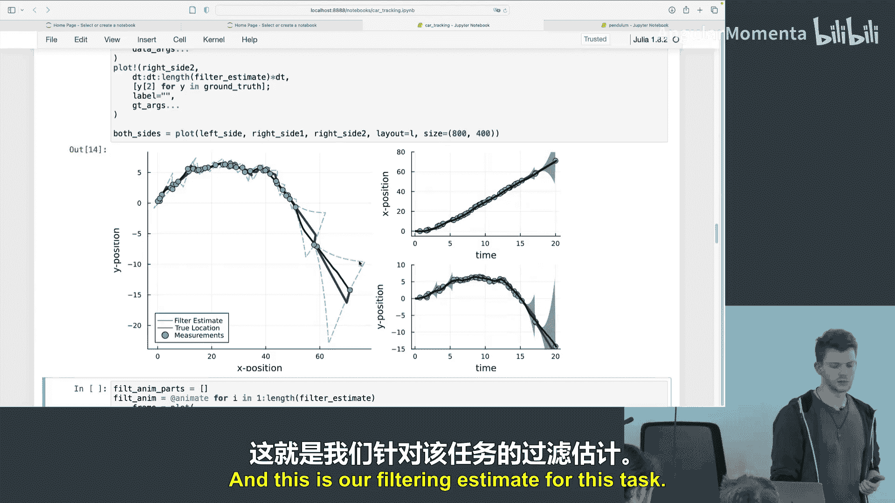

卡尔曼滤波算法伪代码如下：
```
初始化： μ_0, Σ_0
循环（对于每个新观测 y_k）：
    # 预测
    μ_k^- = A * μ_{k-1} + b
    Σ_k^- = A * Σ_{k-1} * A^T + Q
    # 校正
    ŷ_k = H * μ_k^- + c
    S_k = H * Σ_k^- * H^T + R
    K_k = Σ_k^- * H^T * inv(S_k) # 实践中应避免直接求逆，而应解线性系统
    μ_k = μ_k^- + K_k * (y_k - ŷ_k)
    Σ_k = Σ_k^- - K_k * S_k * K_k^T
    保存 (μ_k, Σ_k)
返回滤波轨迹 {(μ_k, Σ_k)}
```

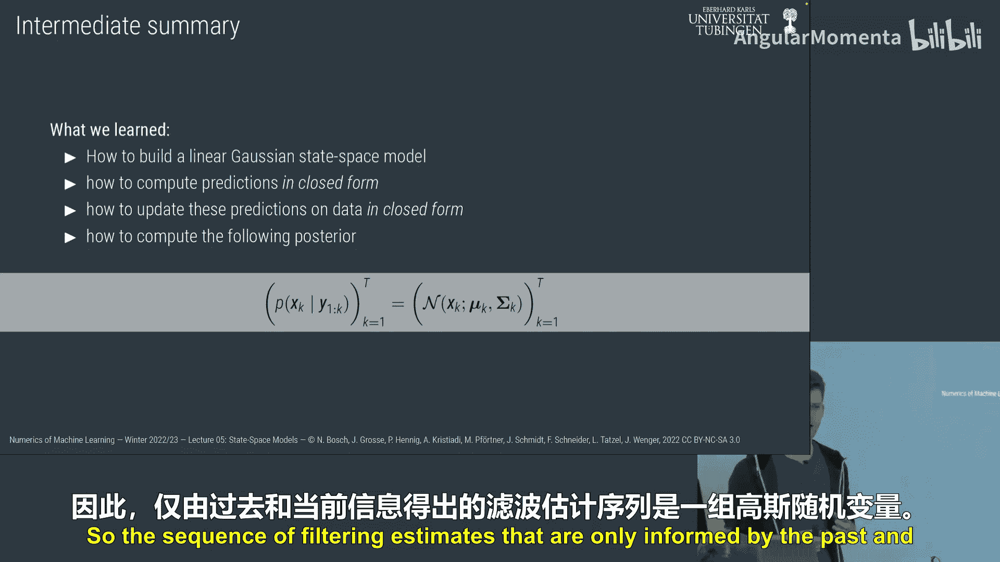

## 实例演示：卡尔曼滤波用于车辆追踪

让我们通过一个具体例子来理解卡尔曼滤波。假设我们要追踪一辆在二维平面上行驶的汽车。

*   **状态**：`x = [位置_x, 位置_y, 速度_x, 速度_y]^T`
*   **观测**：`y = [位置_x, 位置_y]^T` （例如来自GPS，带有噪声）
*   **动态模型**：假设汽车近似匀速运动（速度可能缓慢变化），用线性模型加噪声来描述。
*   **测量模型**：观测矩阵 `H` 是一个从4维状态中选取前2维（位置）的矩阵。

我们按照卡尔曼滤波的步骤编写代码，使用模拟的汽车轨迹和带噪声的观测。运行滤波算法后，我们可以看到：
*   在两次观测之间，滤波器的预测（基于运动模型）会形成一条直线轨迹，并且不确定性（协方差）会随时间增长。
*   当新的GPS观测到达时，滤波器会迅速“修正”其估计，将状态拉向观测值，同时不确定性显著降低。
*   最终，我们得到一条平滑的、考虑了所有历史观测的估计轨迹，它比单纯的观测数据更接近真实轨迹。

## 从滤波到平滑：利用全部数据

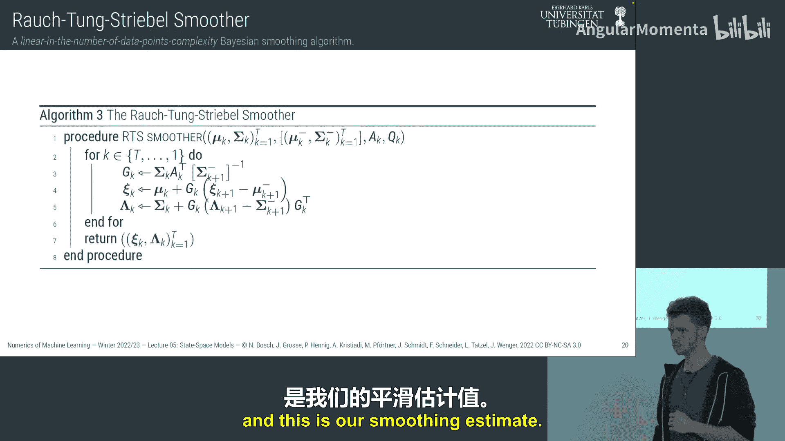

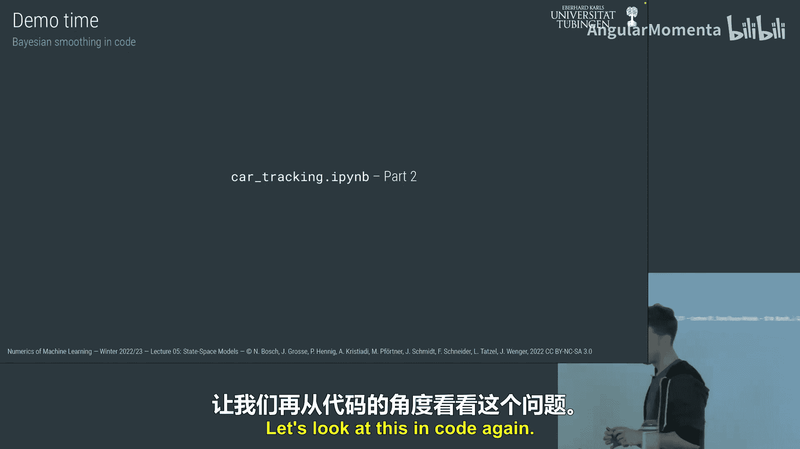

卡尔曼滤波给出了在线的最优估计，但它只使用了当前和过去的数据。如果我们已经收集完一段时间内的所有数据（例如汽车已到达目的地），我们就可以利用**未来**的数据来改进对**过去**某一时刻状态的估计。这个过程称为**平滑**。

平滑分布为：`p(x_k | y_{1:T})`，其中 `T > k`。

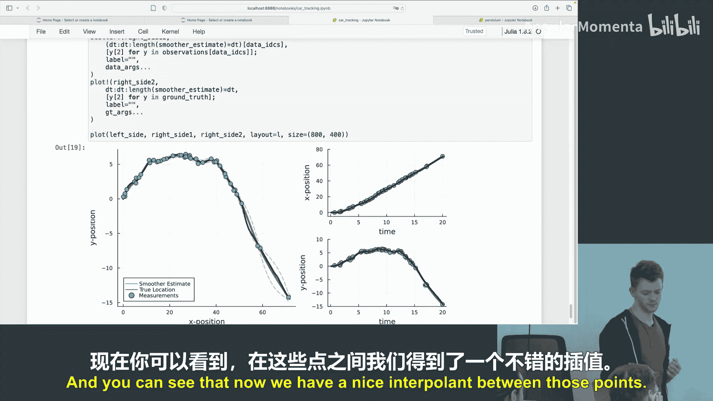

对于线性高斯模型，平滑也可以通过高效的递归算法（**Rauch–Tung–Striebel smoother**）完成，而且平滑分布也是高斯的。平滑是一个**后向递归**过程：

1.  我们从最后一个时间点 `T` 开始，此时平滑分布等于滤波分布：`p(x_T | y_{1:T})`。
2.  然后我们向后迭代（`k = T-1, T-2, ..., 1`），利用以下关系更新：
    `p(x_k | y_{1:T})` 可以通过 `p(x_k | y_{1:k})`（滤波分布）、`p(x_{k+1} | x_k)`（动态模型）和 `p(x_{k+1} | y_{1:T})`（下一时刻的平滑分布）计算出来。

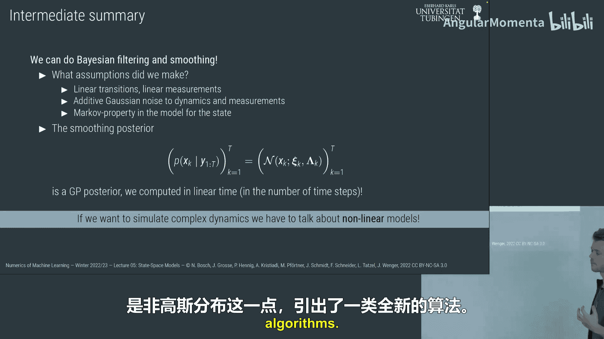

具体更新方程涉及一个平滑增益矩阵，其形式与卡尔曼增益类似。平滑算法的伪代码如下：
```
初始化： μ_T^s = μ_T, Σ_T^s = Σ_T # 从最终滤波结果开始
循环（k 从 T-1 到 0）：
    # 计算平滑增益
    G_k = Σ_k * A^T * inv(Σ_{k+1}^-)
    # 更新平滑均值和协方差
    μ_k^s = μ_k + G_k * (μ_{k+1}^s - μ_{k+1}^-)
    Σ_k^s = Σ_k + G_k * (Σ_{k+1}^s - Σ_{k+1}^-) * G_k^T
返回平滑轨迹 {(μ_k^s, Σ_k^s)}
```

对车辆追踪例子应用平滑算法后，我们可以看到估计轨迹变得更加平滑和准确，尤其是在观测稀疏的区域，平滑算法利用了整个时间序列的信息进行了更好的插值。

有趣的是，对于线性高斯状态空间模型，平滑后得到的序列 `{x_0, x_1, ..., x_T}` 的联合后验分布，恰好是一个**高斯过程**在离散时间点上的边际分布。这意味着我们通过一次前向滤波和一次后向平滑，以线性时间的复杂度，计算出了这个高斯过程后验。

## 扩展卡尔曼滤波：处理非线性

现实中的动态系统往往是非线性的。例如，钟摆的运动方程就是非线性的。当动态模型 `f` 或测量模型 `h` 是非线性函数时，`f(x)` 或 `h(x)` 的分布就不再是高斯分布，卡尔曼滤波的闭合形式解也就不再成立。

**扩展卡尔曼滤波** 是解决此问题的一种常用方法。其核心思想是：**对非线性模型进行局部线性化，然后在线性化点附近应用卡尔曼滤波公式**。

线性化通过一阶泰勒展开实现。对于非线性函数 `g(x)`，在点 `χ` 处的线性化近似为：
`g(x) ≈ g(χ) + J_g(χ) * (x - χ)`
其中 `J_g(χ)` 是 `g` 在 `χ` 处的雅可比矩阵（导数矩阵）。

EKF 的巧妙之处在于线性化点的选择：
*   在**预测步骤**，我们在上一时刻的滤波均值 `μ_{k-1}` 处线性化动态模型 `f`。
*   在**校正步骤**，我们在当前时刻的预测均值 `μ_k^-` 处线性化测量模型 `h`。

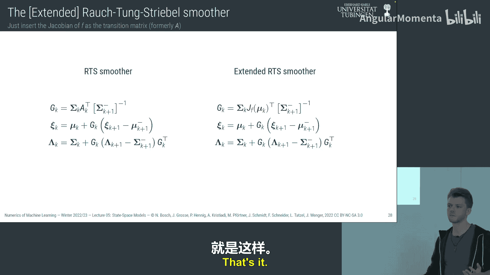

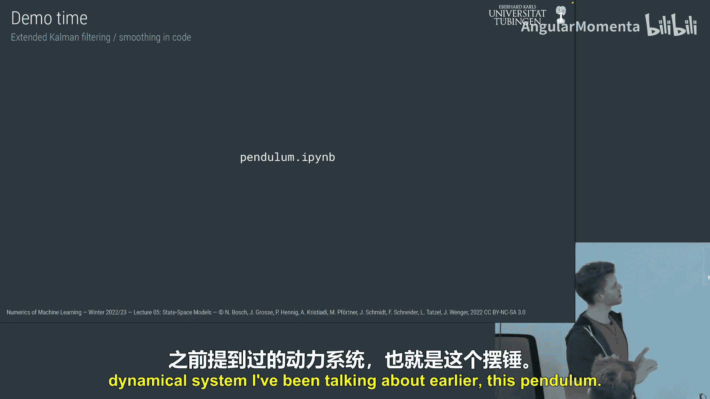

这样选择后，EKF 的方程与 KF 非常相似，只需做如下替换：
*   将 KF 中的线性变换 `A * μ_{k-1} + b` 替换为非线性函数求值 `f(μ_{k-1})`。
*   将 KF 中的矩阵 `A` 和 `H` 替换为相应非线性函数在对应线性化点处的雅可比矩阵 `J_f` 和 `J_h`。

EKF 的预测和更新方程如下：

**预测**：
`μ_k^- = f(μ_{k-1})`
`Σ_k^- = J_f(μ_{k-1}) * Σ_{k-1} * J_f(μ_{k-1})^T + Q`

**校正**：
`S_k = J_h(μ_k^-) * Σ_k^- * J_h(μ_k^-)^T + R`
`K_k = Σ_k^- * J_h(μ_k^-)^T * S_k^{-1}`
`μ_k = μ_k^- + K_k * (y_k - h(μ_k^-))`
`Σ_k = Σ_k^- - K_k * S_k * K_k^T`

同样，也存在扩展卡尔曼平滑器，只需在平滑增益计算中用雅可比矩阵替换原来的转移矩阵 `A` 即可。

## 实例演示：EKF用于钟摆跟踪

我们用一个阻尼钟摆的例子来演示EKF。
*   **状态**：`x = [角度 θ, 角速度 θ_dot]^T`
*   **观测**：`y = θ + 噪声` （只能观测到带有噪声的角度）
*   **动态模型**：`f(x)` 由物理方程给出，包含 `sin(θ)` 等非线性项。
*   **测量模型**：`h(x) = θ`，这里是线性的。

我们编写代码实现EKF。在预测步骤，我们使用自动微分来计算动态模型 `f` 在 `μ_{k-1}` 处的雅可比矩阵 `J_f`。运行EKF后，我们可以看到：
*   预测轨迹不再是一条直线，而是体现了钟摆的振荡行为。
*   在缺乏观测的时间段，不确定性会迅速扩大。
*   当新的角度观测到达时，估计值会被修正。
*   应用平滑器后，我们得到了一条非常漂亮且准确的钟摆运动轨迹估计。

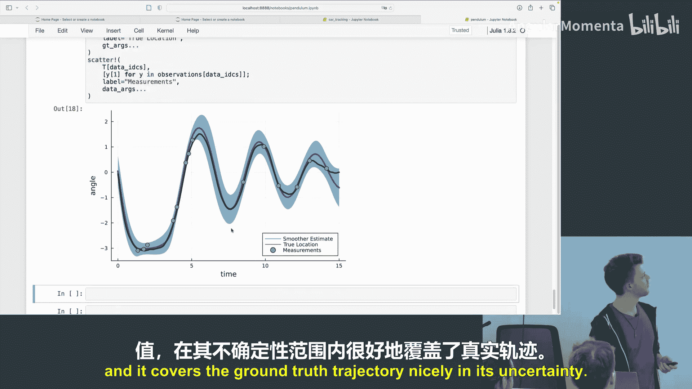

## 其他滤波方法简介


EKF通过线性化来近似非线性模型。还有其他方法：
*   **无迹卡尔曼滤波**：UKF采用不同的策略。它不线性化模型，而是通过精心选择一组称为“Sigma点”的确定性样本点来近似状态的分布。将这些点通过真实的非线性函数传播，然后用传播后的点来拟合一个高斯分布。UKF通常比EKF更稳定，尤其对于高度非线性系统。
*   **粒子滤波**：当系统不仅是非线性的，而且噪声也是非高斯的时候，我们需要更强大的工具。粒子滤波是一种序列蒙特卡洛方法。它用一组随机样本（粒子）来近似后验分布，每个粒子都有权重。通过重采样等步骤，粒子滤波可以处理非常一般的非线性非高斯模型，但计算成本也更高。

## 总结

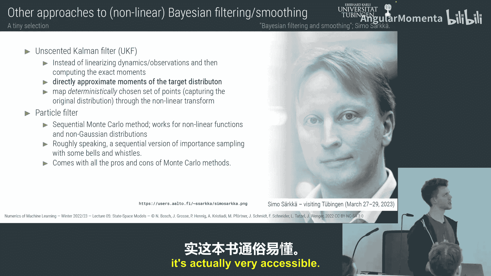

本节课中我们一起学习了状态空间模型这一用于描述动态系统的强大语言。我们的学习路径是：
1.  我们首先建立了**概率状态空间模型**的基本框架，明确了马尔可夫性和条件独立观测两个核心假设。
2.  我们推导了**贝叶斯滤波**的一般原理，包括预测（Chapman-Kolmogorov方程）和校正（贝叶斯定理）两个递归步骤。
3.  在线性高斯的特殊情形下，贝叶斯滤波简化为高效且解析的**卡尔曼滤波**算法，我们详细推导了其方程。
4.  我们通过**车辆追踪**的实例演示了卡尔曼滤波的应用。
5.  为了利用全部数据改进估计，我们介绍了**平滑**的概念和Rauch–Tung–Striebel平滑算法。
6.  为了处理现实中的非线性系统，我们引入了**扩展卡尔曼滤波**，其核心是通过一阶泰勒展开进行局部线性化。
7.  我们通过**钟摆跟踪**的实例演示了EKF的应用。
8.  最后，我们简要介绍了**无迹卡尔曼滤波**和**粒子滤波**等其他高级方法。

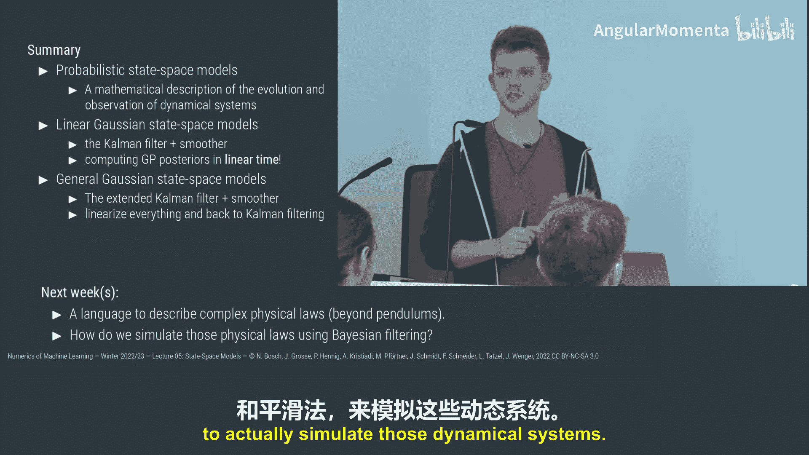


下节课，Nathaniel将深入讲解如何用数学语言（如微分方程）来描述动态系统本身的物理规律。而在再下一节课，我们将把今天学习的滤波/平滑技术与下一节课的动力学描述结合起来，探索如何使用概率数值方法（贝叶斯滤波与平滑）来**模拟**复杂的动态系统。敬请期待！