# 006：常微分方程解法

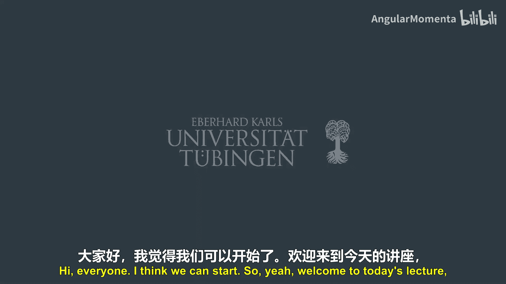

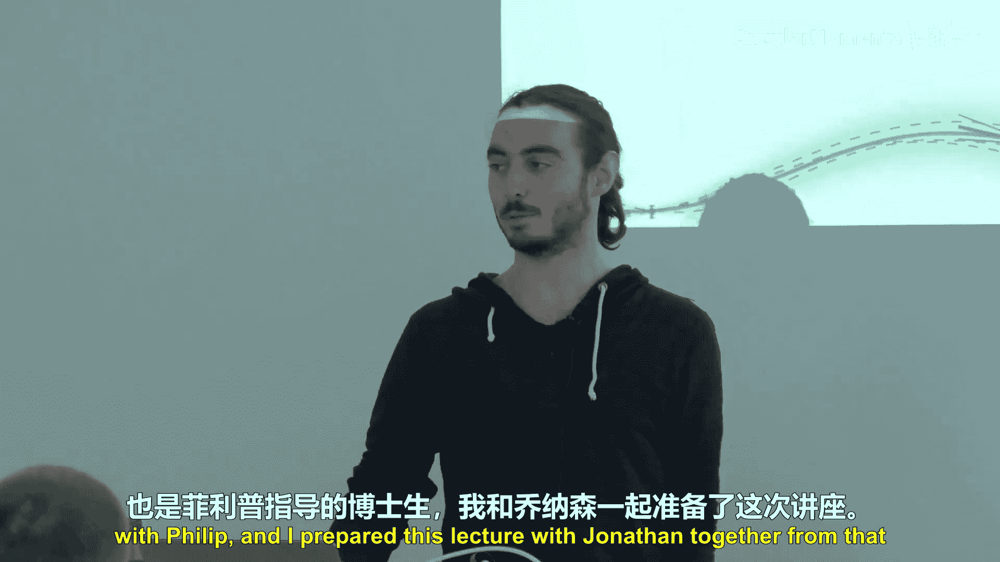

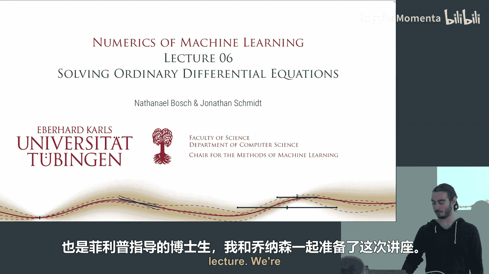

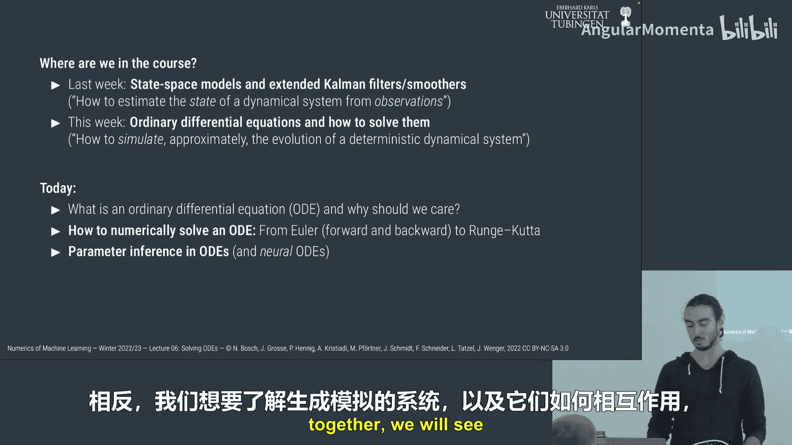

## 概述

在本节课中，我们将学习常微分方程（ODEs）及其在机器学习中的应用。我们将探讨如何数值求解ODEs，并了解如何从数据中推断ODE模型的参数。课程内容从ODE的基本定义开始，逐步深入到数值求解算法，最后讨论参数推断问题。

---

## ODE简介与机器学习应用

上一节我们概述了课程内容，本节中我们来看看常微分方程（ODE）的正式定义及其在机器学习中的几个关键应用场景。

一个常微分方程（ODE）通常写作：
```
ẋ(t) = F(x(t), t)
```
其中 `x` 是未知函数（可理解为状态），`F` 被称为向量场，它描述了状态 `x` 在时间 `t` 处的导数。我们通常关注的是在给定初始值 `x(0) = x₀` 下的初值问题。

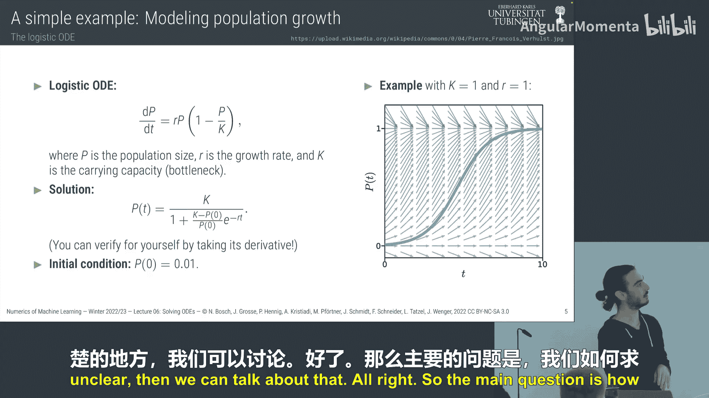

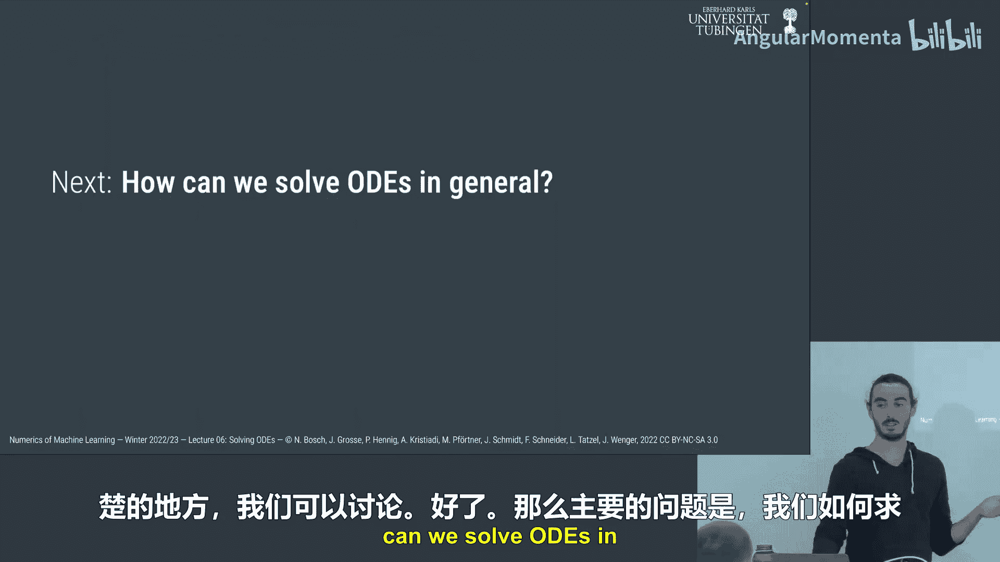

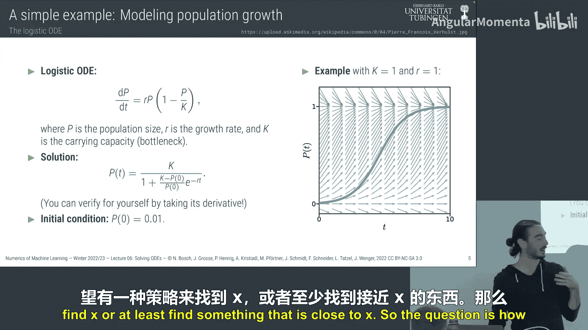

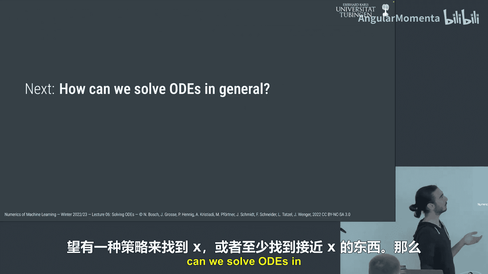

ODE在机器学习中有着广泛的应用，以下是几个核心例子：

*   **扩散模型**：这类生成模型的核心依赖于（随机）微分方程来描述从噪声到数据的映射过程。
*   **标准化流**：用于建模复杂概率分布，常通过ODE实现从简单分布到复杂分布的连续变换。
*   **神经常微分方程**：将残差神经网络重新解释为一个连续动力系统的离散化，引发了大量相关研究。
*   **梯度流**：为理解梯度下降等优化算法的行为提供了一个连续的视角。
*   **参数推断**：当我们拥有描述数据生成过程的先验知识（例如物理、生物模型）时，可以通过拟合ODE参数来从数据中学习更有意义的结构。

---

## 如何数值求解ODE？

上一节我们介绍了ODE及其应用，本节中我们来看看如何数值求解它们。对于大多数ODE，我们无法得到解析解，因此需要数值方法。

求解初值问题的核心思想是逐步外推。假设我们在时间 `t` 有一个近似解 `x̂(t)`，目标是计算 `t + h` 时刻的解。根据积分形式：
```
x(t+h) = x(t) + ∫[t, t+h] F(x(τ), τ) dτ
```
数值方法的关键在于如何近似计算这个积分。

### 欧拉方法

首先，我们介绍两种最基本的数值方法：前向欧拉法和后向欧拉法。它们都源于对积分中被积函数的零阶泰勒近似。

**前向欧拉法（显式）**：
在积分区间内，用起点 `t` 处的函数值近似整个区间。这导出了显式更新公式：
```
x̂(t+h) = x̂(t) + h * F(x̂(t), t)
```

**后向欧拉法（隐式）**：
在积分区间内，用终点 `t+h` 处的函数值近似。这导出了隐式方程：
```
x̂(t+h) = x̂(t) + h * F(x̂(t+h), t+h)
```
该方程需要额外的数值方法（如求根算法）来求解 `x̂(t+h)`。

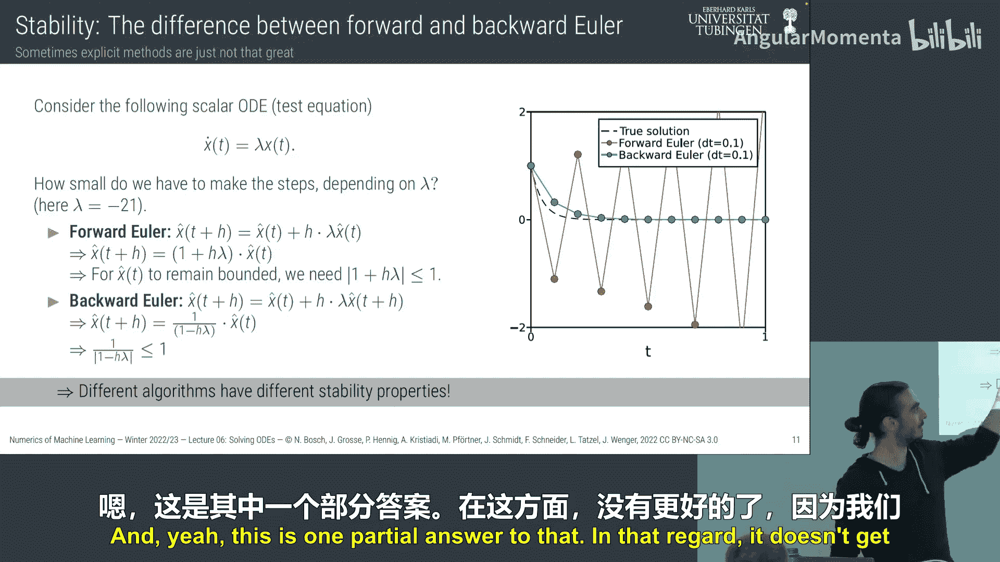

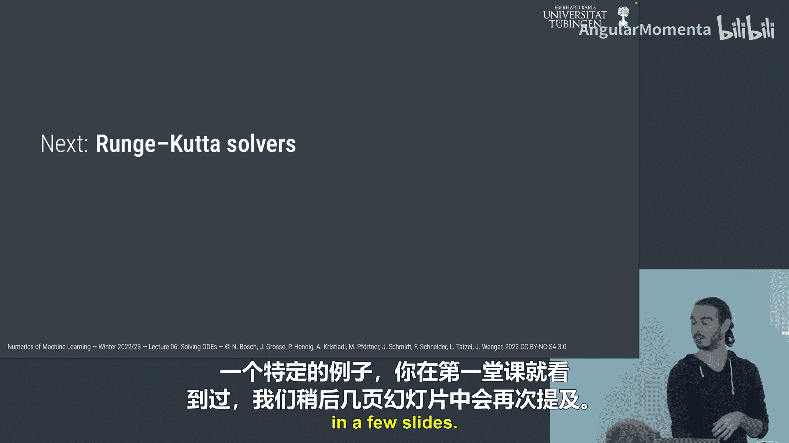

隐式方法（如后向欧拉）通常比显式方法（如前向欧拉）具有更好的**稳定性**。稳定性意味着当步长 `h` 较大或系统本身变化剧烈（刚性系统）时，算法解不会无界地偏离真实解。一个简单的测试方程 `ẋ = λx` (λ < 0) 可以清晰地展示这一特性：前向欧拉法在步长过大时会发散，而后向欧拉法则能保持稳定。

---

## 龙格-库塔方法

上一节我们介绍了基础的欧拉方法，本节中我们来看看更强大和通用的一类算法：龙格-库塔方法。

龙格-库塔方法的动机来源于数值积分（求积法）。它通过计算向量场 `F` 在多个中间点（求积节点）的值，并以特定权重（求积权重）进行组合，来更精确地近似积分。

一个通用的 `s` 级显式龙格-库塔方法步骤如下：

1.  计算中间斜率：
    ```
    k₁ = F(x̂(t), t)
    k₂ = F(x̂(t) + h * a₂₁ * k₁, t + c₂ * h)
    ...
    k_s = F(x̂(t) + h * (a_{s,1}*k₁ + ... + a_{s,s-1}*k_{s-1}), t + c_s * h)
    ```
2.  组合斜率进行更新：
    ```
    x̂(t+h) = x̂(t) + h * (b₁*k₁ + b₂*k₂ + ... + b_s*k_s)
    ```

系数 `a_{ij}`, `b_i`, `c_i` 通常用一个称为**布彻表**的三角形表格来简洁表示。

以下是几个重要的龙格-库塔方法：

*   **前向/后向欧拉法**：它们都是一级龙格-库塔法。
*   **显式中点法**：一个二级方法，先使用半步长的欧拉步来估计中点斜率，再用该斜率进行更新。
*   **经典四阶龙格-库塔法**：一个广泛应用的四阶方法，在精度和计算成本之间取得了良好平衡。
*   **Dormand-Prince 5(4) 方法**：这是一个**自适应步长**方法的例子。它同时计算一个五阶和一个四阶的解，两者的差异用于估计局部误差，进而自动调整步长 `h` 以满足用户指定的精度要求。SciPy 中的 `solve_ivp` 等求解器默认使用此类方法。

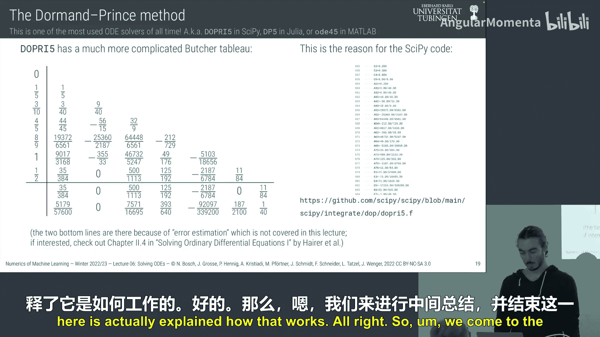

**方法阶数**：一个方法的**阶数** `p` 描述了其局部截断误差如何随步长缩小而减小，为 `O(h^{p+1})`。高阶方法通常单步更精确，但计算量也更大，且不一定在所有问题上都更稳定或高效。

---

## 参数推断：从数据中学习ODE

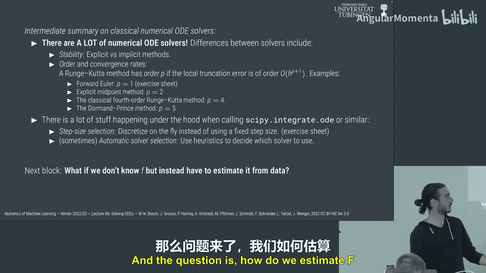

上一节我们讨论了如何模拟已知的ODE系统，本节中我们来看看一个更常见的问题：如何从观测数据中学习未知的ODE参数（甚至方程本身）。

我们假设数据由以下隐式生成模型产生：
1.  状态 `x` 由含参数 `θ` 的 ODE 演化：`ẋ(t) = F(x(t), t; θ)`, `x(0) = x₀(θ)`。
2.  我们在时间点 `t_i` 观测到带有噪声的数据：`y_i = H * x(t_i) + ε_i`, `ε_i ~ N(0, Σ)`。

目标是基于观测数据 `{y_i, t_i}` 推断参数 `θ`。一种直接的方法是寻找**最大似然估计**，即最小化负对数似然。由于真实解 `x(t_i; θ)` 无法精确计算，我们用数值解 `x̂(t_i; θ)` 替代：

```
L(θ) = -log p({y_i} | θ) ≈ ∑_i || y_i - H * x̂(t_i; θ) ||_Σ²
```

这本质上是一个最小二乘问题，可以通过优化算法（如L-BFGS）求解。优化过程的内循环需要调用ODE数值求解器来计算当前参数 `θ` 下的轨迹 `x̂` 和损失。

### 示例：SIRD流行病模型

我们用一个简化的流行病模型（SIRD：易感者-感染者-康复者-死亡者）演示参数推断。模型包含参数：接触率 `β`、康复率 `γ`、死亡率 `η` 以及初始感染人数 `I₀`。给定模拟生成的带噪声数据，我们可以成功优化这些参数，使模型轨迹很好地拟合数据，并且得到的参数具有明确的物理解释。

### 扩展：时间相关参数与神经ODE

为了建模更复杂的动态（如COVID-19疫情中随时间变化的接触率），我们可以将常数参数 `β` 替换为一个函数，例如一个神经网络 `β(t; θ)`。这时的推断问题就变成了同时学习神经网络的参数 `θ`。虽然这种方法能提供参数的点估计，但缺乏不确定性量化，且结果严重依赖于神经网络的结构和优化过程。

这引出了下节课的主题：**概率数值ODE求解器**。我们将结合高斯过程等概率模型，在求解和推断ODE时，不仅能得到预测，还能提供可靠的不确定性估计。

---

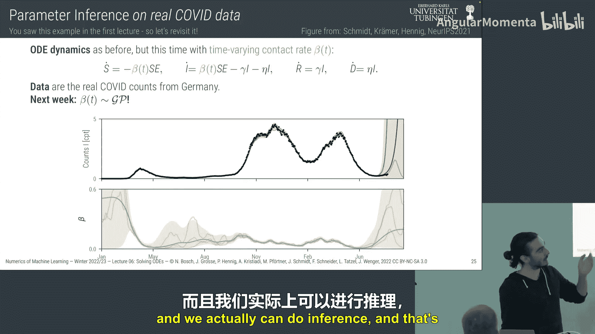

## 总结

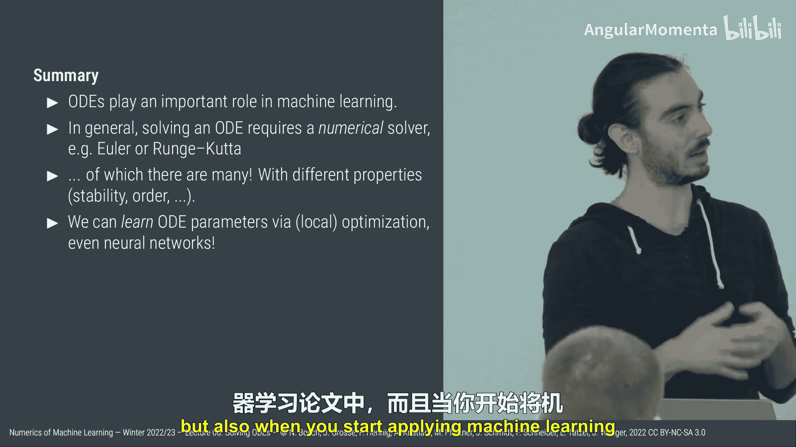

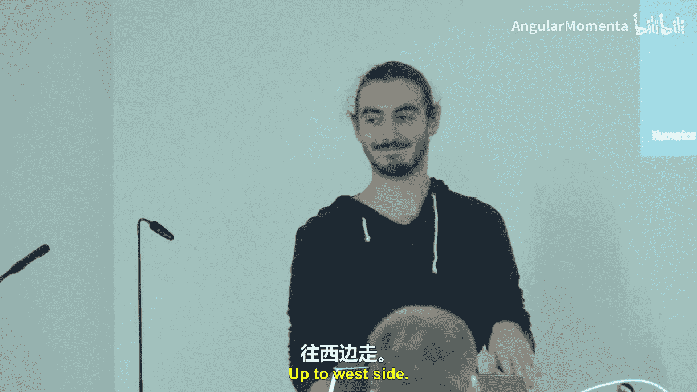


本节课中我们一起学习了常微分方程在机器学习中的重要性。我们探讨了数值求解ODE的基本原理，从简单的欧拉法到更复杂的龙格-库塔法，并了解了显式与隐式方法在稳定性上的差异。最后，我们将ODE模拟与参数推断相结合，展示了如何从数据中学习具有物理意义的模型参数，并简要提到了更复杂的模型（如神经ODE）及其挑战。下节课，我们将从概率视角重新审视ODE求解问题。