# 007：概率数值常微分方程求解器

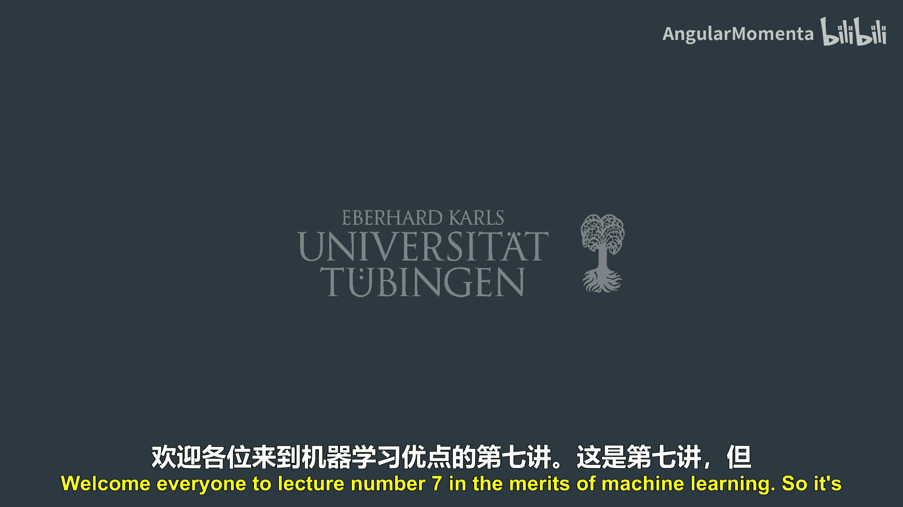

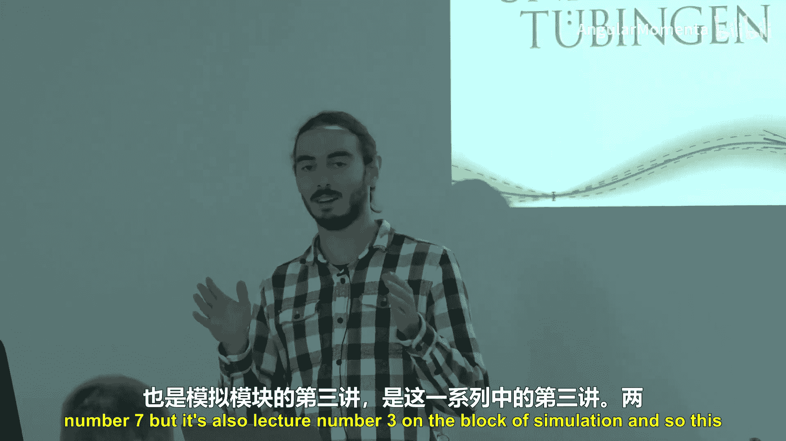

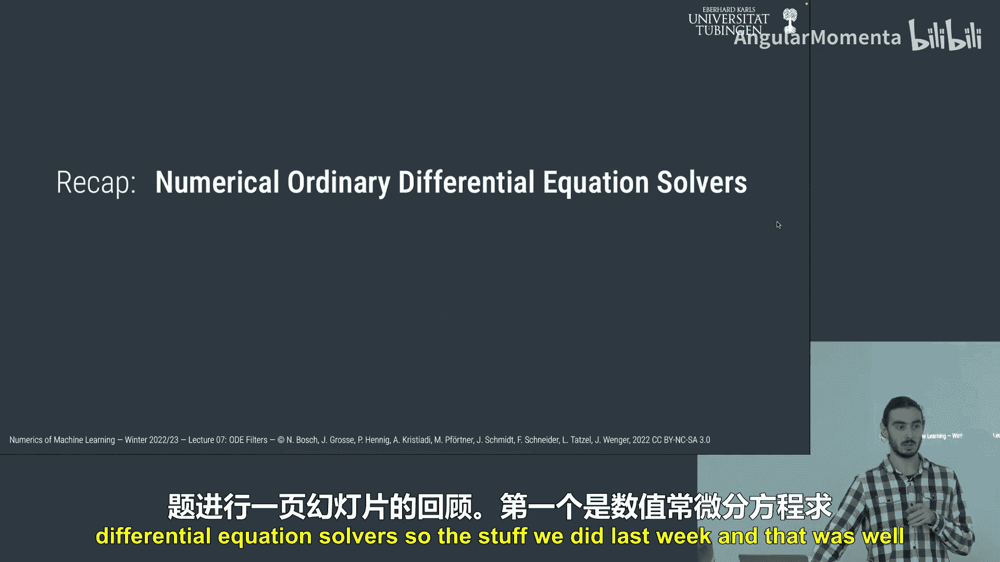

## 概述

在本节课中，我们将学习如何将常微分方程求解问题重新表述为一个贝叶斯状态估计问题。我们将结合前两周关于状态估计和经典ODE求解器的知识，构建一个概率数值ODE求解器。这种求解器不仅能提供近似解，还能给出解的不确定性量化。

---

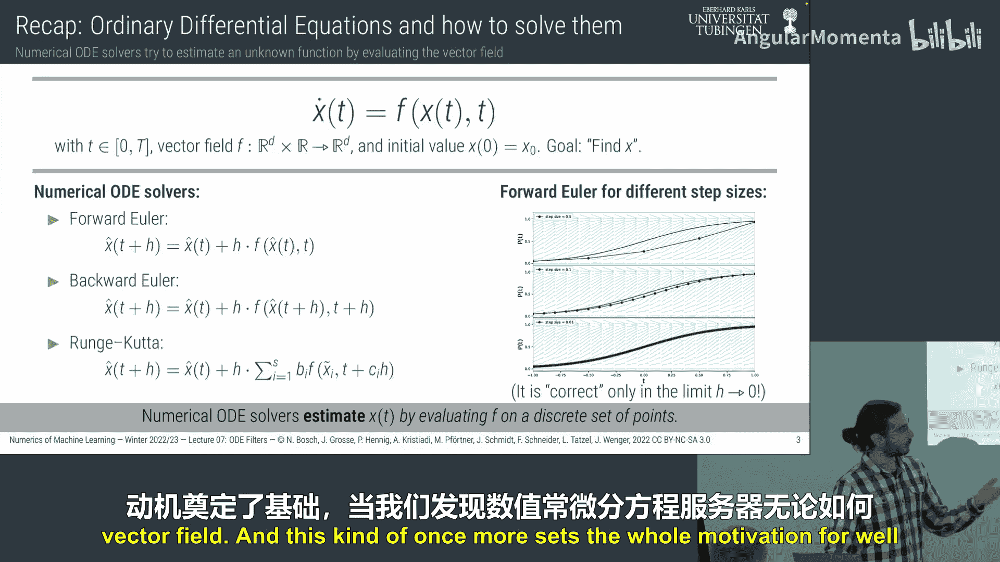

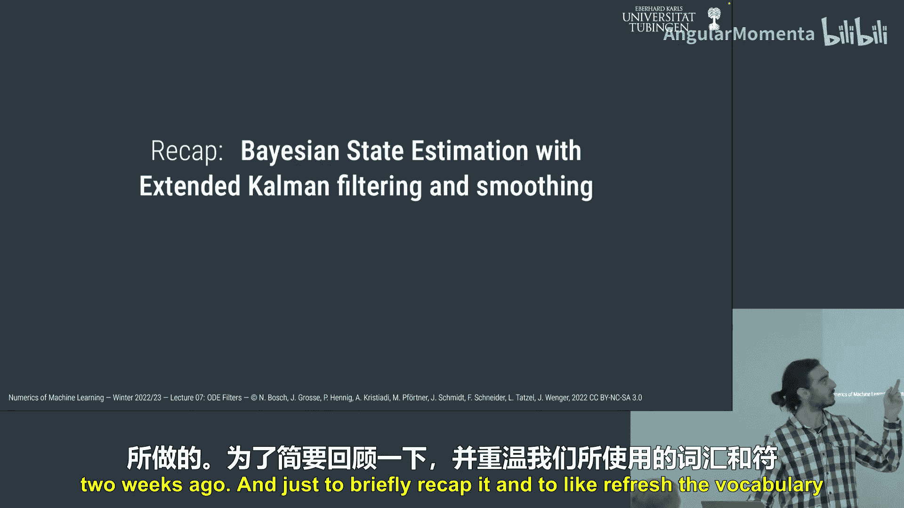

## 数值ODE求解回顾

上一节我们介绍了状态估计的框架，本节我们首先回顾一下经典的数值ODE求解方法。

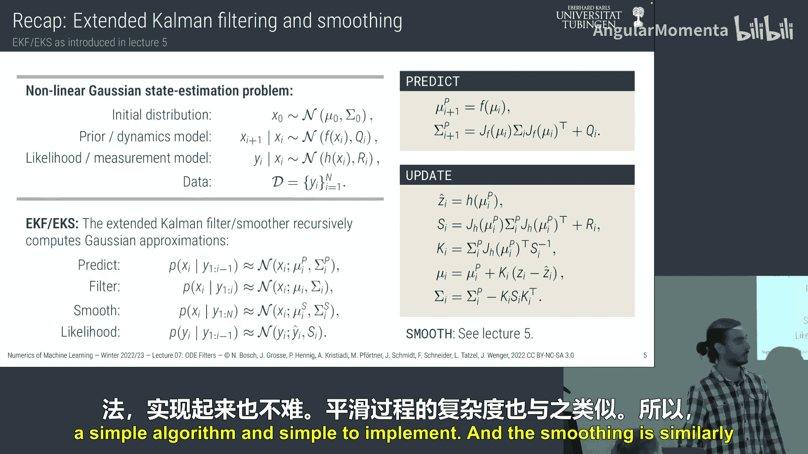

我们考虑一个常微分方程初值问题：
$$
\dot{x}(t) = f(x(t), t), \quad x(t_0) = x_0
$$
其中，\( x(t) \) 是我们希望找到的解，\( f \) 是向量场。

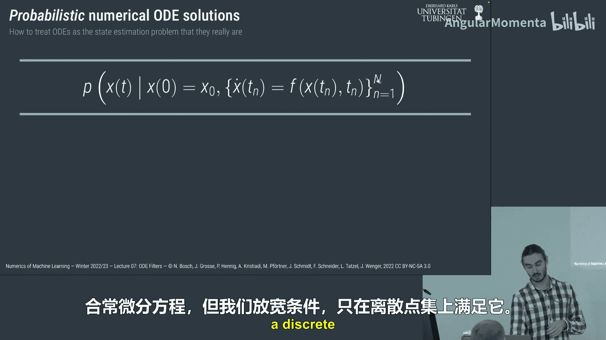

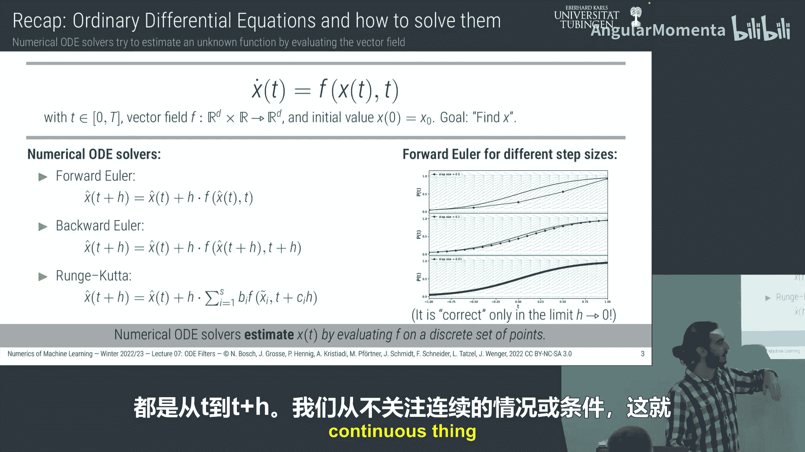

数值方法（如欧拉法、龙格-库塔法）的目标是：给定初始估计 \( \hat{x}_0 \)，通过评估向量场 \( f \) 来生成未来时间点的估计 \( \hat{x}_{t+h} \)。

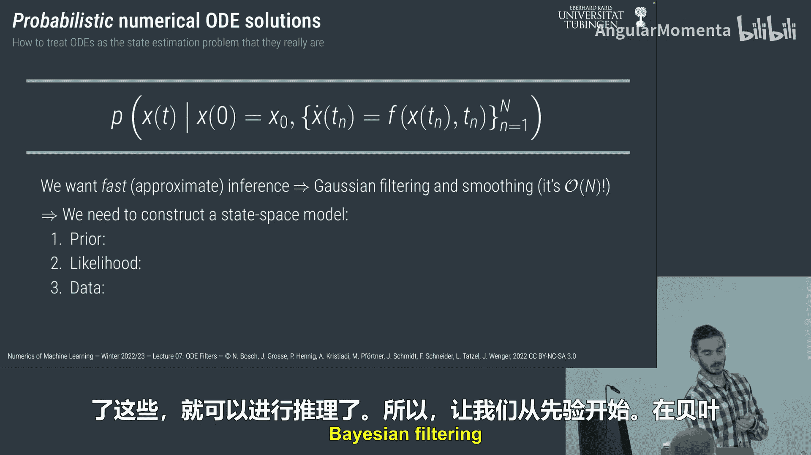

然而，这些方法本质上是**估计**真实解 \( x(t) \)。它们总会引入误差，误差大小通常取决于步长 \( h \)。即使步长很小，误差也总是存在。

既然数值ODE求解器本质上是在进行估计，我们很自然地会想：能否将其明确地构建为一个估计问题，并利用我们已有的强大估计工具（如卡尔曼滤波器）来解决它？

---

## 贝叶斯状态估计回顾

在构建ODE求解的状态估计模型之前，我们先简要回顾一下相关的工具。

我们之前研究的是非线性高斯状态估计问题。我们有一个状态 \( x \) 和观测 \( y \)。生成模型包括：
1.  描述状态如何随时间演化的**动态模型**（先验）。
2.  描述观测如何依赖于状态的**观测模型**（似然）。

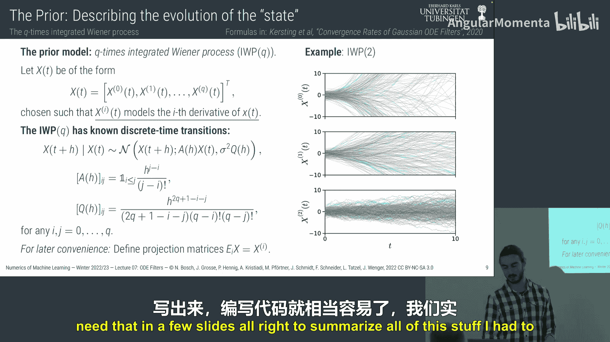

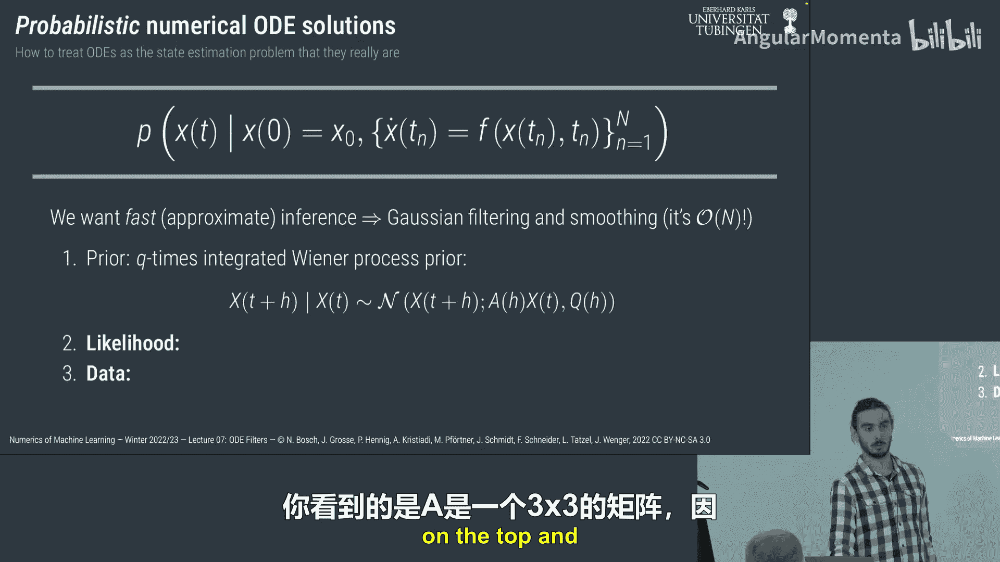

给定一些数据后，我们的任务是进行**推断**，即计算在给定观测数据条件下状态的后验分布。主要任务包括：
*   **滤波**：估计当前状态，给定截至当前的所有信息。
*   **平滑**：估计所有时间点的状态，给定全部数据。

我们可以使用**扩展卡尔曼滤波器**和**扩展卡尔曼平滑器**等算法来计算这些后验分布。这些算法包含预测步和更新步，概念简单且易于实现。

---

## 结合两种思路：概率数值ODE求解器

现在，我们将结合上述两种思路。我们将常微分方程视为一个状态估计问题，并使用贝叶斯滤波和平滑工具来解决它。

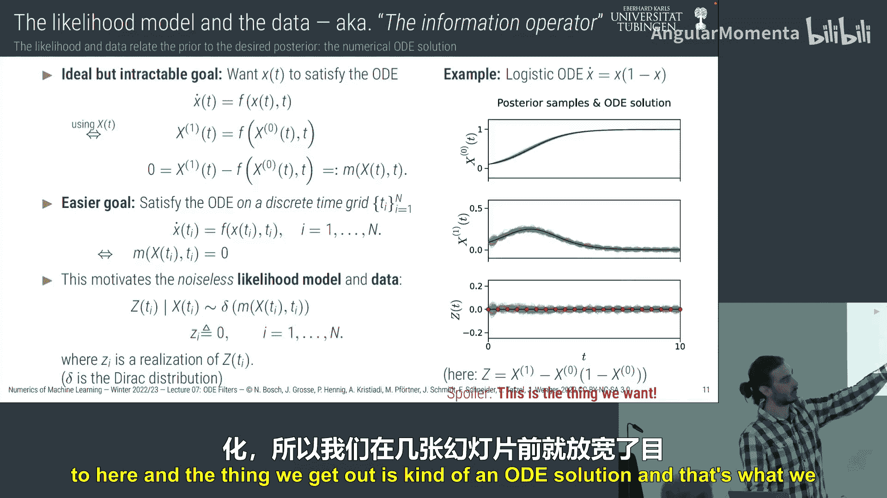

我们的目标不再是寻找一个精确满足ODE的 \( x(t) \)，而是计算一个**后验分布** \( p(x(t) | \text{数据}) \)。这里的“数据”包括：
1.  初始条件 \( x_0 \)。
2.  ODE在离散时间点上的信息（即 \( \dot{x}(t_i) = f(x(t_i), t_i) \)）。

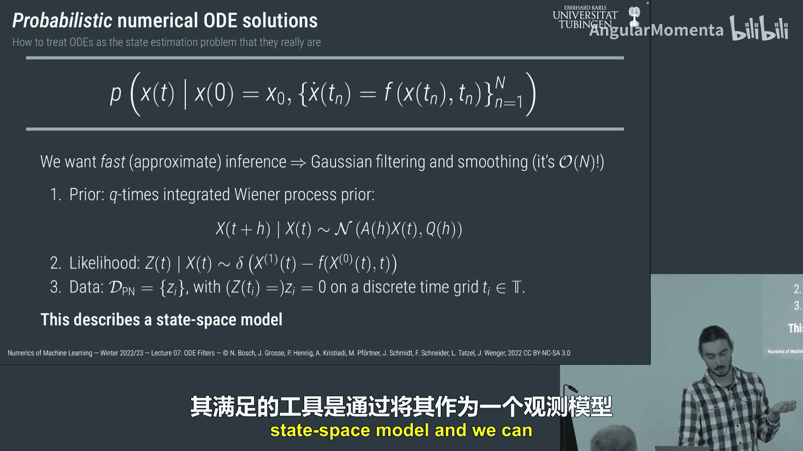

因此，问题被重新表述为：在给定初始条件和ODE在离散点上定义的“观测”下，推断状态 \( x(t) \) 的后验分布。

为了使用高效的高斯滤波与平滑算法（其计算复杂度为 \( O(n) \)），我们需要构建一个**状态空间模型**。这包括定义先验模型、似然模型和数据。

---

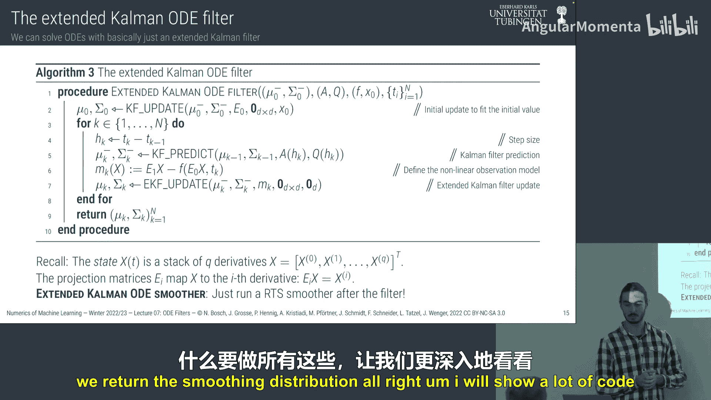

## 构建先验模型

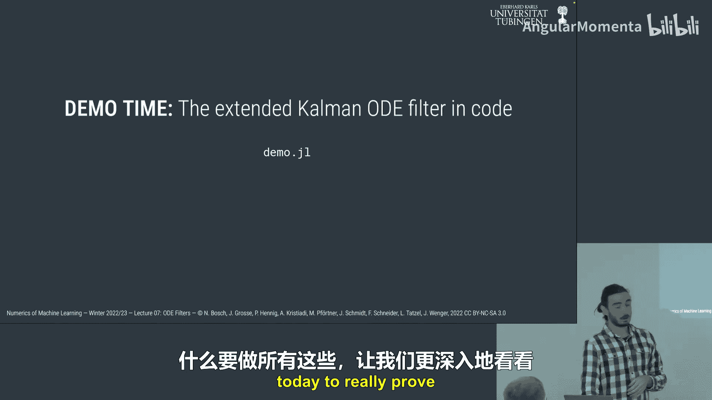

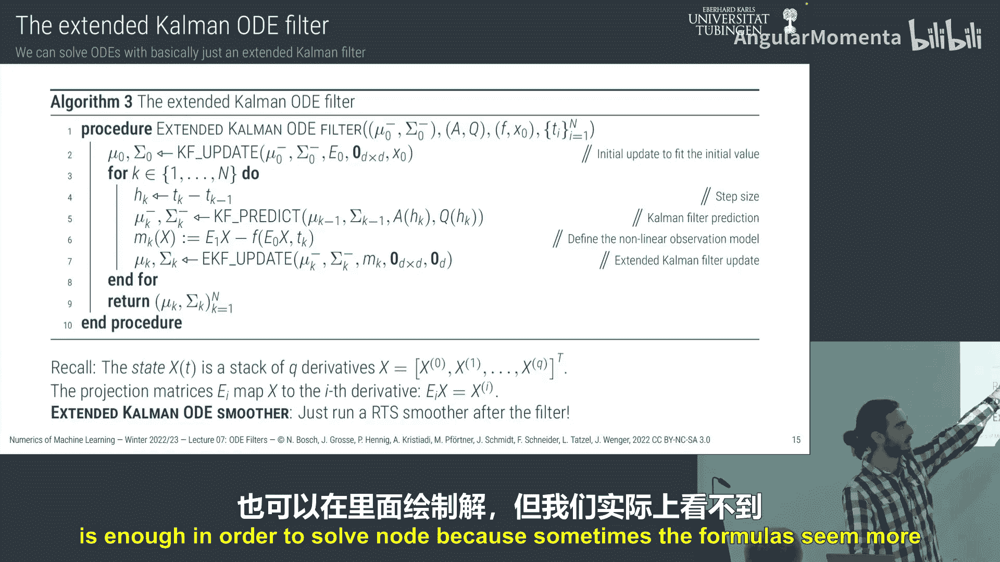

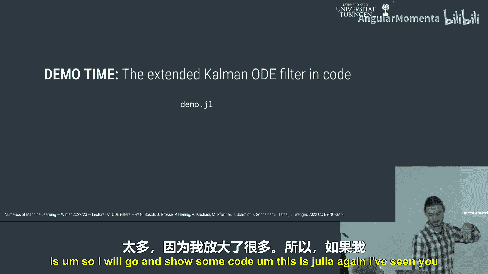

首先，我们需要定义状态 \( X(t) \) 是什么。在ODE中，仅仅知道 \( x(t) \) 的当前值不足以完全描述系统；理想情况下，我们需要知道所有阶导数。受泰勒级数展开的启发，我们选择跟踪状态的前 \( q \) 阶导数作为我们的状态向量：
$$
X(t) = [x^{(0)}(t), x^{(1)}(t), ..., x^{(q)}(t)]^T
$$
其中 \( x^{(k)} \) 表示 \( x \) 的第 \( k \) 阶导数。

当我们用有限项 \( q \) 截断泰勒级数时，会引入一个误差项。为了得到一个概率模型，我们将这个误差项建模为一个随机变量。这就引出了一类称为 **\( q \) 次积分维纳过程** 的先验模型。

在离散时间设置下，这个先验具有高斯转移密度的形式：
$$
X_{t+h} | X_t \sim \mathcal{N}(A(h) X_t, Q(h))
$$
其中矩阵 \( A(h) \) 和 \( Q(h) \) 有闭合形式。例如，对于 \( q=2 \)（跟踪函数值、一阶导和二阶导），\( A(h) \) 是一个上三角矩阵，包含泰勒级数系数 \( 1, h, h^2/2 \)。

这个先验是高斯-马尔可夫过程，易于处理。我们可以从中采样来可视化其性质：第 \( q \) 阶导数是一个维纳过程（布朗运动），对其积分得到低阶导数。

---

## 构建似然与数据模型

先验定义了状态的演化，但尚未包含ODE本身的信息。现在，我们构建似然模型来编码ODE。

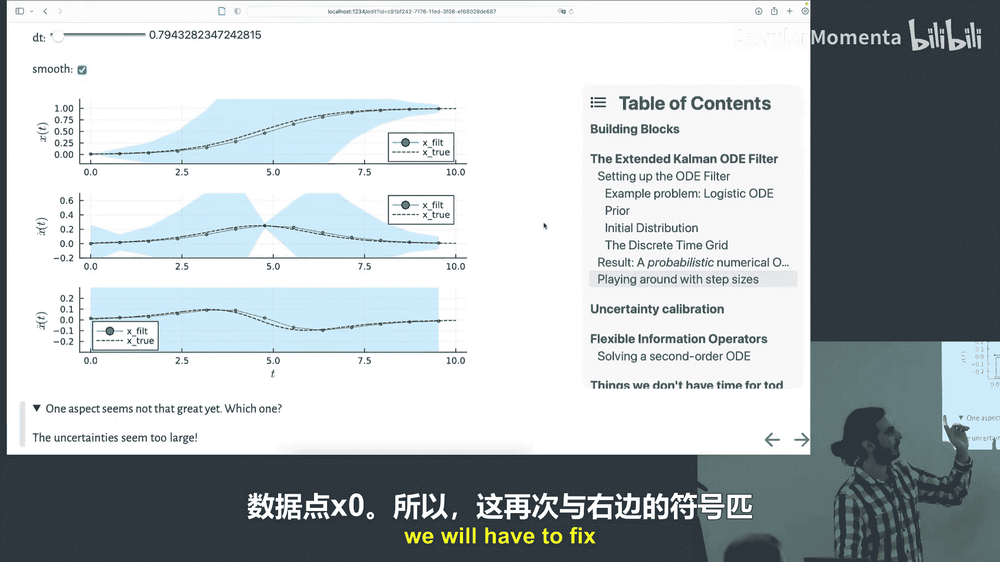

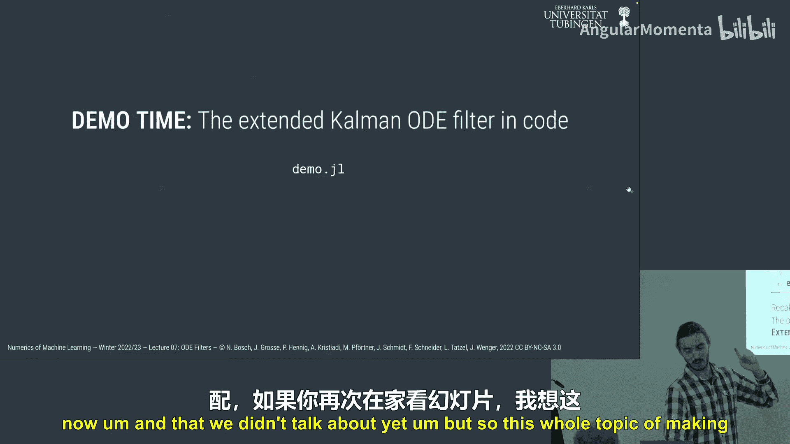

原始的ODE是 \( \dot{x}(t) = f(x(t), t) \)。利用我们定义的状态 \( X(t) \)，我们可以将其等价地写为：
$$
x^{(1)}(t) - f(x^{(0)}(t), t) = 0
$$
我们定义一个**测量函数**（或信息算子）：
$$
\mathcal{H}(X(t), t) = x^{(1)}(t) - f(x^{(0)}(t), t)
$$
在理想情况下，对于真实解，应有 \( \mathcal{H}(X(t), t) = 0 \) 对所有 \( t \) 成立。

由于我们只在离散时间点 \( t_i \) 上进行计算，我们放松要求，只希望在这些点上满足：
$$
\mathcal{H}(X(t_i), t_i) = 0, \quad i = 1, ..., N
$$
这引导我们定义以下似然模型：我们引入“观测”变量 \( Z_i \)，并定义
$$
Z_i | X(t_i) \sim \mathcal{N}(\mathcal{H}(X(t_i), t_i), R)
$$
其中 \( R \) 是观测噪声协方差。然而，由于我们**想要**精确满足ODE（而不是有噪声的观测），我们将其设为一个无噪声似然，即令 \( R = 0 \)。数据点则是 \( z_i = 0 \)。因此，我们是在以 \( \mathcal{H}(X(t_i), t_i) = 0 \) 为条件进行“观测”。

最后，我们还需要纳入**初始条件** \( x(t_0) = x_0 \)。这可以通过另一个无噪声的“观测”来实现：
$$
\mathcal{H}_0(X(t_0)) = x^{(0)}(t_0), \quad \text{数据为 } x_0
$$

---

## 完整的状态空间模型与算法

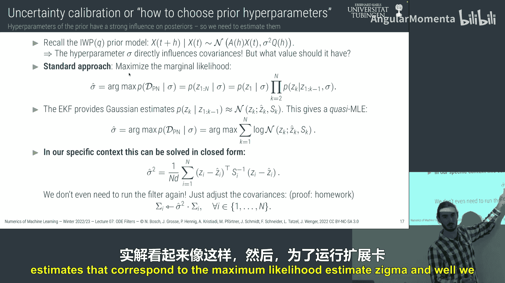

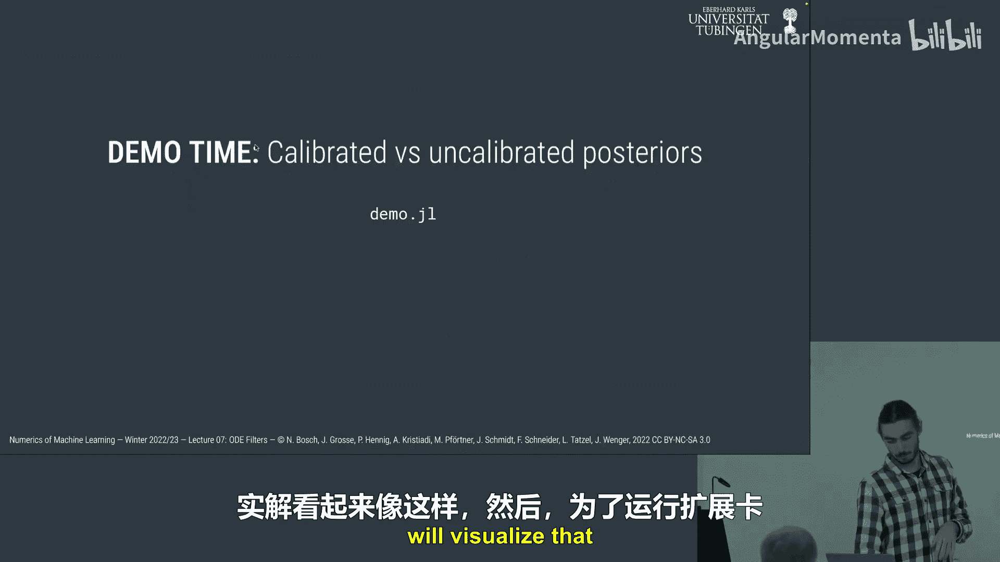

现在，我们拥有了完整的状态空间模型：
*   **先验（动态模型）**： \( q \) 次积分维纳过程，定义了 \( X(t) \) 的演化。
*   **似然1（初始条件）**： \( \mathcal{H}_0(X(t_0)) = x^{(0)}(t_0) \)，数据为 \( x_0 \)。
*   **似然2（ODE）**： \( \mathcal{H}(X(t_i), t_i) = x^{(1)}(t_i) - f(x^{(0)}(t_i), t_i) \)，数据为 \( 0 \)。

有了这个模型，我们可以直接应用**扩展卡尔曼滤波器（EKF）** 和**平滑器**来进行推断。算法步骤大致如下：
1.  初始化：使用初始条件似然更新先验分布。
2.  循环每个时间步：
    *   **预测步**：使用先验动态模型将状态估计向前推进一步。
    *   **更新步**：使用ODE定义的似然模型（测量函数 \( \mathcal{H} \)）更新状态估计，以“观测”到的 \( 0 \) 为条件。
3.  （可选）进行平滑以获得更优的轨迹估计。

通过实现上述算法，我们得到了一个概率ODE求解器。它不仅输出解的估计（均值轨迹），还输出表示不确定性的协方差。代码实现相对简洁，核心是EKF的预测和更新步骤。

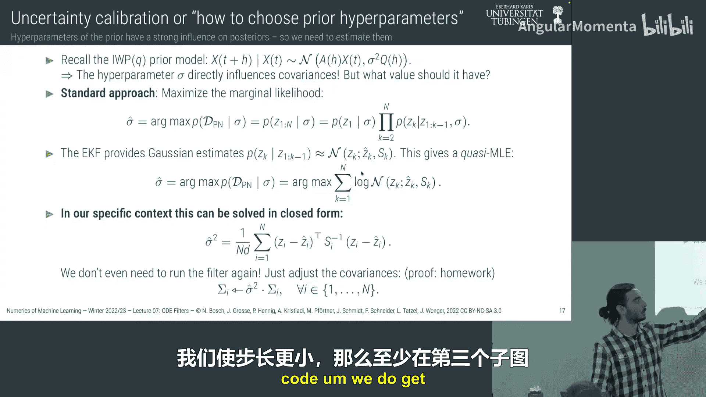

---

## 不确定性校准

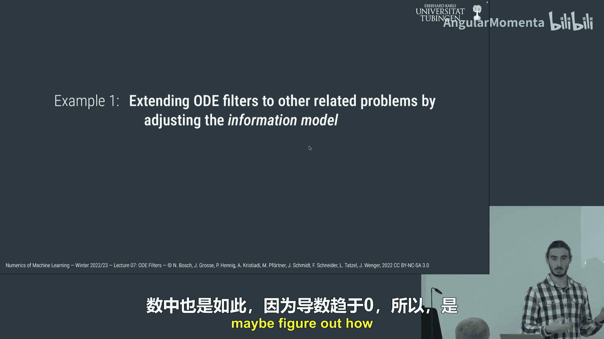

初始实现的概率求解器给出的不确定性估计通常过于保守（即置信区间过大）。这是因为先验模型中包含一个缩放超参数 \( \sigma^2 \)（类似于高斯过程中的输出尺度），它直接影响过程噪声的大小，而我们尚未对其进行设置。

为了获得有意义的、校准良好的不确定性估计，我们需要优化这个超参数 \( \sigma \)。这类似于高斯过程中的超参数学习。

在状态估计的框架下，我们可以通过**最大化边缘似然**来估计 \( \sigma \)。边缘似然是在给定超参数下观测到所有数据（即所有 \( z_i = 0 \)）的概率。对于扩展卡尔曼滤波器，我们可以近似计算这个量。

有趣的是，对于我们的特定模型，最大似然估计 \( \hat{\sigma} \) 可以有闭合形式的解。更重要的是，可以证明，在EKF推断后对协方差进行简单的重新缩放 \( \Sigma_{\text{new}} = \hat{\sigma}^2 \Sigma_{\text{old}} \)，等价于使用最优 \( \hat{\sigma} \) 重新运行整个推断。

因此，校准步骤可以高效地完成：先运行一遍EKF，计算残差，得到 \( \hat{\sigma} \)，然后直接重新缩放输出的协方差矩阵。经过校准后，不确定性带能够更紧密地反映真实误差，变得更有信息量。

---

## 方法的灵活性与扩展性

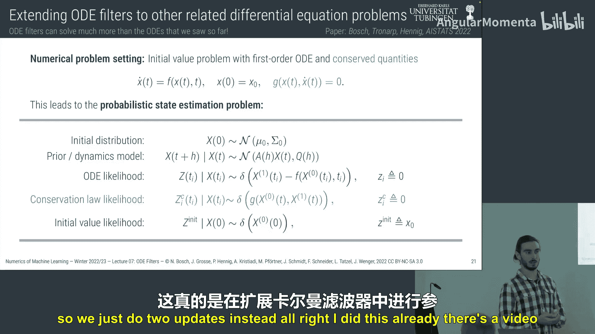

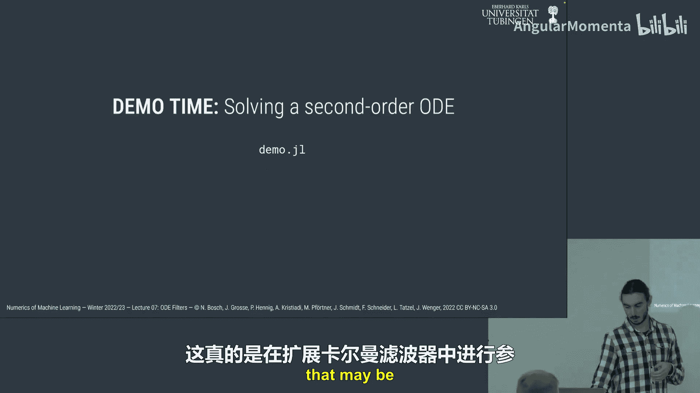

概率ODE求解框架的强大之处不仅在于提供不确定性量化，还在于其**灵活性**。我们可以通过修改状态空间模型，用几乎相同的算法解决各种相关问题。

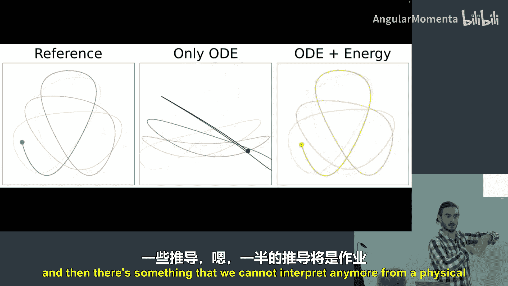

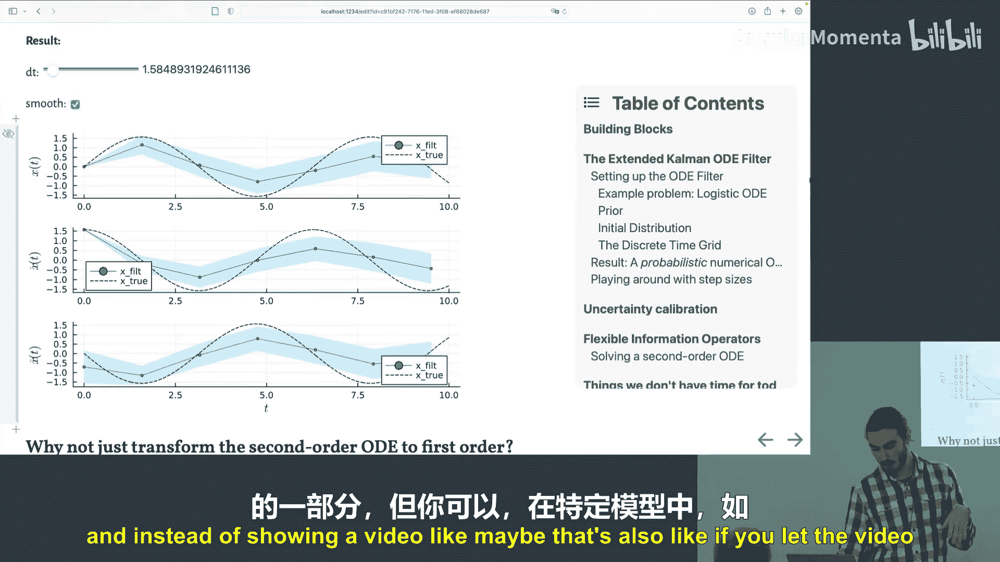

以下是几个例子：

1.  **二阶ODE**： 许多物理系统由二阶方程 \( \ddot{x} = f(x, \dot{x}, t) \) 描述。我们只需调整测量函数为 \( \mathcal{H}(X(t_i), t_i) = x^{(2)}(t_i) - f(x^{(0)}(t_i), x^{(1)}(t_i), t_i) \)，并同时加入初始位置和初始速度的条件。算法核心无需改变。

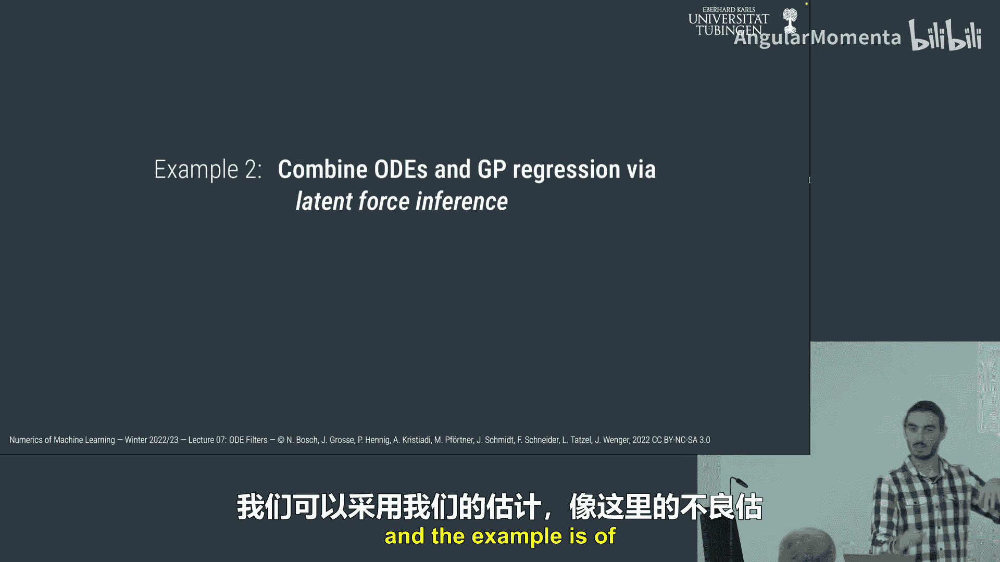

2.  **微分代数方程（DAE）**： 形式为 \( M \dot{x} = f(x, t) \)，其中 \( M \) 是奇异矩阵。我们可以定义相应的测量函数来编码这个方程，然后同样使用EKF求解。

3.  **带守恒量的ODE**： 如果系统存在守恒量（如能量）\( g(x, t) = \text{常数} \)，我们可以将其作为额外的“观测”添加到模型中。在算法上，这相当于在每个时间点进行两次更新步：一次针对ODE，一次针对守恒量。这有助于数值解更好地保持系统的物理特性。

4.  **隐力推断与数据同化**： 我们可以将ODE求解与外部数据拟合结合起来。例如，在流行病学SIRD模型中，将传染率 \( \beta(t) \) 建模为一个高斯过程（潜变量）。状态 \( \tilde{X}(t) \) 现在同时包含ODE解 \( [S, I, R, D] \) 和潜变量 \( \beta \)。测量函数同时编码ODE、初始条件以及实际观测数据（如感染人数）。通过一次EKF平滑，我们可以同时推断出模型的轨迹和时变的传染率。

这种灵活性表明，贝叶斯滤波与平滑提供了一个统一的框架，用于表述和解决结合了物理知识（ODE）与观测数据的动态系统推断问题。

---

## 总结

本节课中，我们一起学习了如何从概率视角看待常微分方程求解。

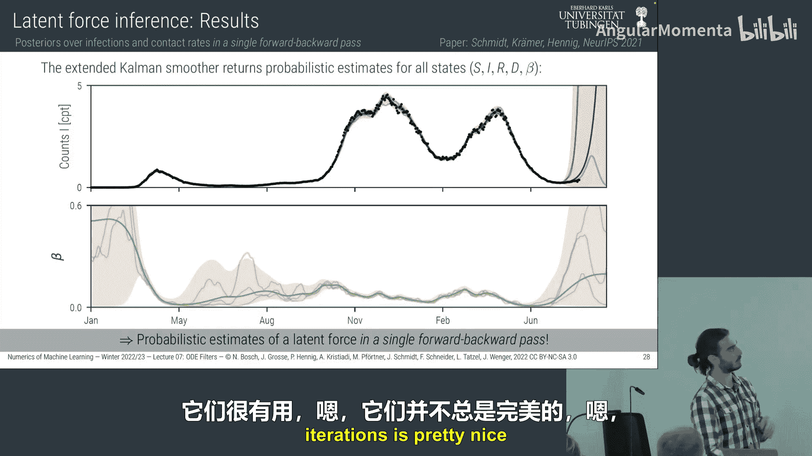

*   我们认识到，经典数值ODE求解器本质上是进行点估计，而贝叶斯方法允许我们进行分布估计，从而提供不确定性量化。
*   我们构建了一个状态空间模型，其中先验是 \( q \) 次积分维纳过程，似然编码了ODE和初始条件。
*   我们使用扩展卡尔曼滤波器和平滑器作为推理算法，得到了一个概率数值ODE求解器。
*   我们讨论了通过最大化边缘似然来校准不确定性估计的重要性，以获得有信息量的置信区间。
*   最后，我们探讨了该框架的强大灵活性，它可以轻松扩展到求解二阶ODE、DAE、带守恒量的系统，以及进行复杂的潜力推断和数据同化问题。

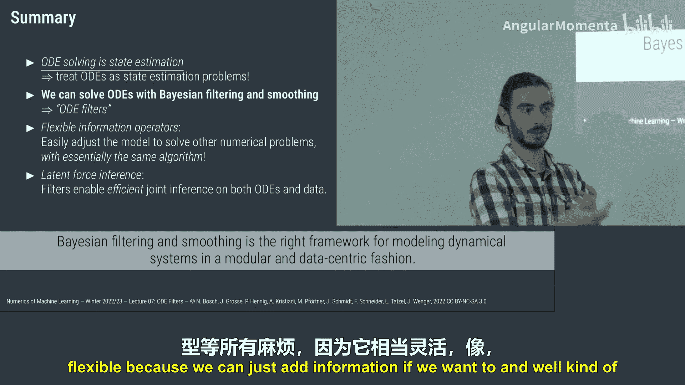

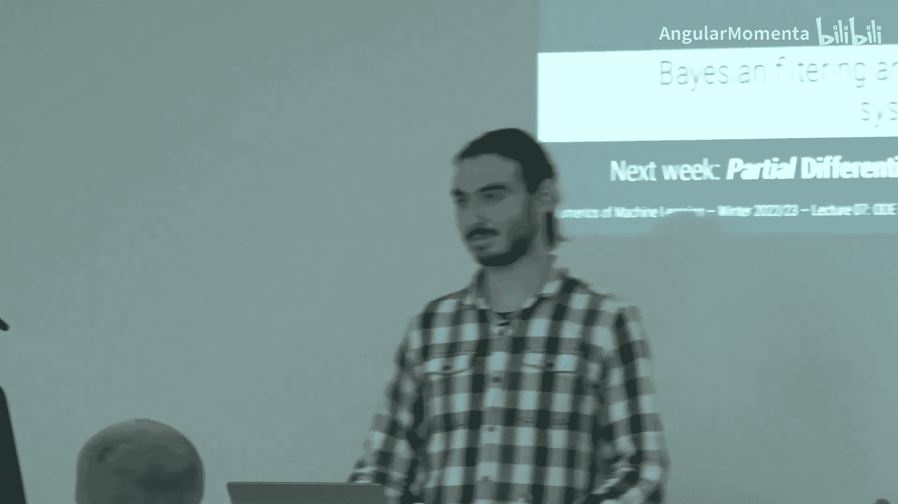

总之，贝叶斯状态估计为我们提供了一个强大、灵活且统一的工具，用于处理涉及动态系统和不确定性的各种数值计算和推理任务。