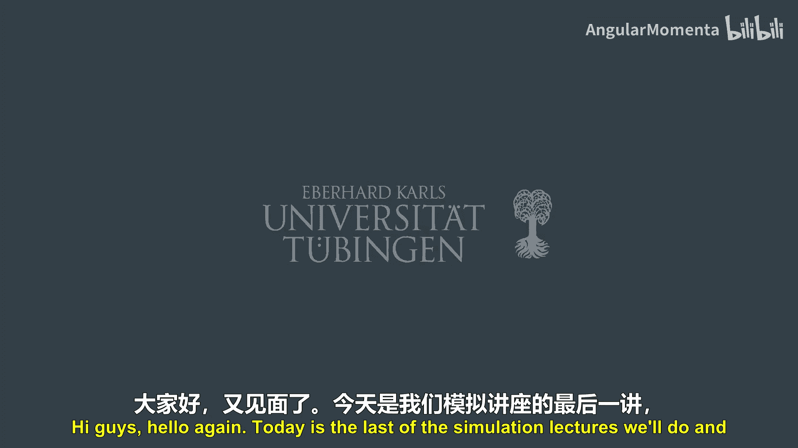
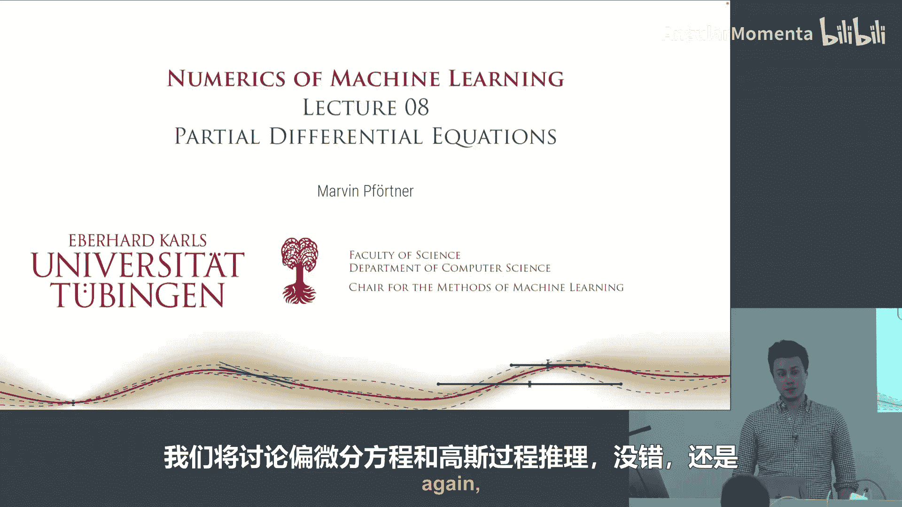

# 008：偏微分方程

在本节课中，我们将学习偏微分方程，并探讨如何将基于PDE的模型整合到机器学习，特别是概率机器学习模型中。我们将通过一个实际的建模示例来使内容更加直观。

## 什么是偏微分方程及其重要性

首先，我们来明确什么是偏微分方程，以及为什么这些方程很重要。

PDE被用作描述机制性知识的语言。机制性模型描述了生成数据的底层机制。例如，在现实世界或金融市场中，我们可能不知道两个质子如何具体相互作用，但我们知道它们会相互排斥，并且知道这种力的强度。这就是机制性知识。

另一个由PDE描述的物理系统是流体力学领域，即对各种流体的描述。实际上，气候模型和天气模型也基于这些PDE。这里一个非常重要的PDE系统是纳维-斯托克斯方程，用于模拟天气、气候、海洋等系统，例如预测海啸何时会袭击海岸。

从这些情况可以看出，这些模型通常规模非常大，例如模拟整个地球气候或海洋，并且在实际中求解也非常困难。

PDE是一个有趣的话题，因为即使在经过一个世纪甚至更长时间的研究后，PDE的理论和实践仍然是一个高度活跃的研究领域。实际上，著名的千禧年难题之一就是关于纳维-斯托克斯方程，即仅仅证明这组方程是否有解以及解的平滑性如何。这或许已经让你对处理这些模型的难度有了一些了解。

由于非线性或一般的PDE通常很难理解，在本讲座中，我们将稍微限制自己，只讨论一个更简单的类别，即线性PDE。即使我们限制在这个类别，它仍然是一个非常强大的建模语言。例如，我们周围的许多物理过程仍然可以通过线性PDE相当准确地描述。

*   **热传导**：热量在金属中的扩散由所谓的**热方程**描述，这是一个线性PDE。
*   **电磁现象**：质子相互作用等由一组称为**麦克斯韦方程组**的线性PDE描述。
*   **波动力学**：水波和空气中传播的波可以非常近似地由**波动方程**描述，这也是一个线性方程。
*   **布朗运动**：布朗运动中粒子的速度分布由所谓的**福克-普朗克方程**或**柯尔莫哥洛夫方程**描述。
*   **金融市场**：数学金融中著名的**布莱克-舒尔斯方程**也是这样一个方程。

最后，在实际中处理非线性偏微分方程时，我们可以使用这些非线性方程的线性近似，例如通过迭代线性化进行数值模拟。

## 将PDE模型与机器学习结合

有了这些动机，我们通常使用这些模型来描述现实世界系统的行为。我们事先并不知道该系统的确切行为，但正如我所说，我们知道系统背后的机制是如何工作的。

我特意将本讲座的目标表述为一个图模型，因为我们希望将已知的概率模型与这些机制性模型、机制性知识融合起来，以便在实践中获得机器学习的一些优势。这有时也被称为**混合建模**，因为我们有来自观测数据的经验知识，也有机制性知识，它们可以很好地结合在一起。

我们知道机制，并希望推断系统行为。然而，PDE通常有一组参数，我们通常事先并不知道这些参数。这里有几个例子：

*   **强度和分布**：例如热源强度、电荷分布。
*   **材料参数**：例如热量通过特定材料扩散的速度，或经典力学中的力。

我们通常不知道这些参数，但可以测量它们。这些测量通常是有噪声的。由此我们已经可以看到，我们的模型实际上需要能够处理观测噪声。而这些东西的经典描述通常处理得不太好。

我们拥有这些系统参数的测量值。为了求解系统行为，也需要知道这些系统参数，因为方程是由这些参数控制的。

有时，我们也有系统本身的测量值。例如，在热分布模拟中，我们可能在模拟的某个点放置一个温度计来测量温度。但我们可以在模拟的每个点都这样做。这就是为什么我们实际上需要机制性知识来在我们的测量点之间进行插值。

这取决于具体情况。有时可以直接测量力，有相应的测量设备。有时测量这些东西实际上更困难，在这种情况下，你可以使用这些测量值，并将知识反向传播到系统参数，这被称为**反问题**。Natan在ODE讲座中已经详细讨论过这个问题。所以，这实际上是我们在这里所做工作的另一面，即不仅仅是模拟系统做什么，还要推断其背后的因果机制是什么。

我们在这里的方法，实际上也是本讲座的目标，是使用**贝叶斯统计估计**来融合我们所知道的东西（例如我们知道的机制）、这些测量数据，以及可能包含在大多数系统参数中的不确定性。

为什么使用贝叶斯统计估计？因为我们有所有这些不确定性，并且实际上将我们不知道的所有东西传播到解中会是一件很好的事情，这样我们就可以为我们所做的预测提供一些置信度。

## 线性偏微分方程的定义

现在，让我们真正进入PDE的世界，首先回答一个问题：我们所说的线性PDE实际上是什么意思？

首先，考虑我们想要模拟一个物理系统。通常，物理系统具有某种空间范围。如果它是一个随时间演化的系统，我们还有一个想要模拟的时间跨度。首先，我们定义这个集合 **D**，它被称为**定义域**。然后我们寻找一个描述物理系统的函数，例如温度分布或一组电荷产生的力。这实际上就是未知函数 **u**，这是我们想要模拟的系统的描述。

在这些基于PDE的模型中，机制性知识实际上由这个方程给出：**D u = f**。其中 **D** 是一个所谓的**线性微分算子**，我稍后会展示一些例子。但一般来说，这只是未知函数 **u** 的偏导数的线性组合。我们不知道函数 **u**，但我们规定了一个固定值 **f**，称为方程的**右侧项**。事实证明，这是描述许多物理过程的一种非常优雅的方式。

现在，线性微分算子的一些例子：

*   最著名的可能是**拉普拉斯算子**，它只是所有二阶偏导数的和，本质上是Hessian矩阵的迹。
*   线性PDE的另一个例子实际上是一个**一阶常微分方程**。在函数只有一个输入变量而不是D个输入变量的情况下，我们可以构造这个微分算子，它只包含我们可以用这个函数构建的一个导数，以及另一个线性项。然后，如果你重新排列方程中的项，就会得到一个一阶常微分方程的向量场。从某种意义上说，一阶常微分方程是线性PDE的一个特例。一般来说，ODE是PDE的一个特例。这样思考并不总是有帮助，因为PDE往往更难模拟，但这只是一个闭合论证。

## 实际应用中的挑战

现在，谈谈如果我们要在实际中应用这些方程会遇到的一些问题。

首先，通常我们得不到解析解。这对于我们考虑的许多ODE来说已经如此。但在这里，从某种意义上说，因为它是一类更广泛的模型，我们实际上继承了这些问题。

因此，我们需要使用**数值求解器**来实际得到这里的未知函数。由于函数 **u** 实际上是一个无限维对象，这将固有地引入**离散化误差**，除非你对问题有所了解。我们稍后会讨论这个问题。

其次，我们已经讨论过，PDE有参数，我们现在可以更准确地指出这些参数是什么。右侧函数 **f** 是这些参数之一，例如，当我提到热源、电荷时，这些通常由方程的右侧描述。而材料参数等，则是函数 **u** 的偏导数线性组合中的系数。我们通常并不确切知道这些。

最后，在过去一个世纪中发展起来的经典求解器有时很难嵌入到计算流程中，原因在于参数通常并不确切已知，但我们需要一个点估计。因此，用这些求解器传播这些不确定性往往相当困难，而这正是我们在这里采取的贝叶斯方法旨在解决的问题。

## 边界条件与唯一性

这里还有一个问题，因为PDE本身通常不能唯一地确定其解。对于ODE，我们已经看到我们还需要表述初值问题，因为本质上涉及一个积分常数。对于PDE，情况没有太大不同，但我们需要施加的附加条件的类型比ODE情况要复杂一些。

但让我们先看一个例子。我们来看所谓的**泊松方程**，它只是函数的拉普拉斯算子等于一个规定值。现在，让我们考虑这个方程的一个解候选，它只是一个线性函数。我们可以看到，如果我们将拉普拉斯算子应用于这个线性函数，由于这是一个线性函数，Hessian矩阵是0，没有二阶项。所以这正好是0，这意味着线性函数实际上在这个微分算子的核中。因此，对于泊松方程的任何解，我们都可以直接添加一个线性项，仍然得到一个解。因为，我稍后会谈到，这个微分算子实际上是线性的。

因此，通常，也许本着你在ODE情况下所做的精神，唯一性可以通过要求一个额外的条件来实现，这通常是一个**边界条件**，或者在这种情况下，为了保持一切线性，是一个线性边界条件，其中我们再次有一个线性算子。我稍后会详细讨论这一点。

从物理直觉来看，为什么我们要规定模拟域边界上发生的事情？实际上，如果你考虑你正在模拟的问题，可能有来自模拟域外部的相互作用进入你的系统。如果你不模拟这些外部影响，即如果你没有在你的数学框架中对它们建模，那么本质上任何事情都可能发生。例如，如果你模拟一块金属的热分布，有一辆卡车冲进来，那么会发生什么？你不知道。因此，你本质上需要模拟模拟域外发生的一切，通过总结外部如何与你在边界上的模拟相互作用，因为这是你实际上可以施加影响的唯一方式。

一个PDE，连同**一组边界条件**，通常被称为一个**边值问题**。

现在，这种边界条件的一个具体例子是**狄利克雷边界条件**，它本质上规定函数在边界上的值。如果你考虑函数 **u** 是某块材料中的热分布，那么这只是说我们知道边界处的温度是多少。在物理类比中，这可能就像你有一个巨大的冰水桶，无论域内发生什么，它的温度都不会改变，所以你知道你的域边界将始终保持为0。

## 函数空间与线性算子

好的，我已经围绕这一点讨论了一段时间。但PDE实际上是关于函数的陈述。所以我们有一个未知函数 **u**，而函数通常是无限维对象。你可能已经知道，如果涉及无限，你需要小心一点。

但事实证明，函数具有相当方便的结构，因为事实证明，函数或函数空间（在特定条件下）实际上是向量空间。从线性代数课程中，你可能非常熟悉向量空间 **R^N**，本质上是N维列向量的空间。你知道，你可以将它们相加，可以用标量乘以它们。对于函数，你可以做本质上相同的事情，只需说两个函数的和以及函数与标量的乘积只是逐点定义的。这就是这里所设定的。

我们具有向量空间结构，但这也带来了向量空间的所有便利。在这些向量空间中可以有基。它只是一组基向量的线性组合。对于函数空间，你有一组基函数的线性组合。通常，至少对于我们这里关心的函数空间，这些空间实际上是无限维的，有时甚至不存在于这种形式中。这就是我说的需要小心的意思。但对于本讲座，这些空间存在，它们是无限维的，并且本质上作为一系列向量存在。

你也有线性映射，从有限维向量空间我们知道，我们可以用矩阵表示线性映射。线性性质意味着我们可以将矩阵拉入和式中，并且可以将标量从矩阵向量积中拉出来。

无限维向量空间，特别是函数空间中的线性映射，被称为**线性算子**。这实际上也是“线性微分算子”这个术语的由来。因为微分算子将一个函数映射到其导数。所以它是函数向量空间之间的一个映射，具有这种线性性质。本质上，因为你有求导的和法则，并且可以将标量从导数中拉出来。

这实际上就是我们谈论线性方程和线性微分算子的原因。通过应用这些知识，你可以看到线性PDE只不过是无限维向量空间中的一个线性系统。因此，在本讲座中，我们将实际应用从Unhan讲座中发展起来的求解线性系统的相当多的直觉来处理PDE的情况。这实际上是一个很好的类比，在处理这些系统时你总是可以想到。

还有两个细节。你可以在向量空间上定义范数。例如，这里我们有 **R^N** 上的最大范数或无穷范数。本质上，对于某些函数类，也存在这种范数的类比。你可以直接取函数的上确界，然后事实证明它是一个范数。如果我们有范数，我们也可以谈论收敛性。如果这些空间中的每个序列都收敛，我们可以谈论巴拿赫空间。我们知道带有无穷范数的 **R^N** 是一个巴拿赫空间，但实际上，某个集合上k次连续可微函数的空间，在这个特定范数下，实际上也是一个巴拿赫空间。所以我们再次可以将有限维情况下的许多直觉带到无限维情况下，但也许并不总是如此。所以我们必须再次在这些意义上小心。

实际上，对于内积和希尔伯特空间也是如此，但有一些注意事项，我现在不打算深入讨论。只需注意，通常这些转换涉及将列向量中的索引替换为函数求值，然后将求和替换为积分。这是一种非常直接的推导这些类比的方式。

## 一个实际建模示例：CPU热分布

好的，让我们转向一个更实际的话题，这实际上是一个玩具示例，将作为介绍我们将要使用的方法的主要动机示例。这是一个计算机中央处理器中热分布的简单模型。

现在，这是典型的CPU外观。实际上，顶部的这块金属片不是芯片本身，它只是一个盖子，用于从芯片中提取热量。实际的硅片只是这个小黑芯片。这些组件特别受其散发的热量限制。如果有电流通过，由于内部电阻等原因，芯片会产生大量热量。如果这些系统过热，它们可能会损坏或无法正常工作。我们希望避免这种情况。因此，在实践中了解芯片中的温度分布实际上是一件好事。

你可能已经猜到，这个东西实际上非常薄。因此，我们可以将其建模为一个二维物体。现在，我们实际上将自己限制在二维建模，即这个系统的数学建模。这是我们谈论的空间域。在这种情况下，它只是芯片长度和宽度的区间笛卡尔积。但实际上，由于这里有一些均匀的几何形状，为了本讲座的简单起见，我们甚至将自己限制在仅模拟这条穿过芯片的线上的温度分布。我们实际上将在讲座接近尾声时看到一个二维示例，并且我们将看到对于这个特定情况，这实际上是一个相当好的模型假设。

但现在，让我们转向从物理模型转向数学。首先，我们已经定义了我们将要处理的空间域，它只是从0到CPU长度的这个区间。现在，我们知道当我们想要模拟涉及热的问题时，我们实际上需要知道热量来自哪里，即什么在我们的系统中产生热量。现在，我们实际上假设CPU内置的GPU实际上处于空闲状态，它什么也不做。而计算核心实际上正在计算一些非常困难的东西。所以CPU的计算核心正在工作并产生热量。同时，这些系统通常以某种方式内置在计算机中，顶部有一个散热器，将芯片产生的所有热量带走，以防止其过热。

实际上，这个草图可能有点误导。散热器通过挤压所谓的导热界面材料（一种膏状物）来提取热量。在这些边缘周围，你可以假设它从芯片表面的所有部分均匀地提取热量，所以热量通过其表面离开芯片。

因此，如果我们实际上想要模拟芯片中的热源在哪里，以及散热器在哪里（热量离开系统的地方），我们可以看一个像这样的函数。我们在核心本身上放置了三个高斯斑点，它们是热源。你可以看到这里的单位是瓦特每立方毫米，所以本质上是每单位体积的热量。然后在这些高斯斑点上叠加了另一个负常数函数，它模拟了散热器，即所有从CPU中被拉出的热量。

现在你可能想知道，我们在这里谈论PDE。那么实际模拟这个系统的PDE是什么？我已经谈过热方程。它就在这里。它是一个线性PDE，也是二阶的。为什么是二阶？因为拉普拉斯项包含非混合二阶偏导数，正是如此。这就是二阶的由来。我稍后会谈谈这些单独项实际上意味着什么。但现在请注意，这个函数 **u** 将是我们芯片中的温度分布。

我们可以看到这里有一个时间变量的导数。为了使事情对我们来说更简单，一个合理的假设是假设温度分布随时间保持不变，这最终会在一个持续运行的CPU中发生，并且当散热器的风扇控制达到一个稳定点时。所以我们要做的是假设，在某个时刻，我们实际上将达到一个稳定的温度分布。你可以通过说，如果温度不变化，那么这个时间导数正好是0，温度没有变化，至少不再有温度变化，从而将其纳入这个模型。在这种情况下，我们得到了稳态热方程，你只需将整个第一项设置为0，就可以从这个方程得到它。

由于我们在这里将自己限制在CPU的这个一维子集，即这条线，这实际上变成了这个方程。在D=0的情况下，拉普拉斯算子只是一个二阶导数。现在，这是什么？我们实际上已经在本讲座中看到过这个方程。它让你想起了什么？它只是一个ODE。因为我们限制自己处理一维问题，它是一个ODE。你可能会说，在这里谈论PDE有什么意义？这只是为了让本讲座的内容更直观一些。我们接下来要讨论的一切实际上也适用于多维情况，我们在这里没有任何针对一维情况的专门化。

## 将机制性知识注入统计模型

现在，我们如何将从这个微分方程中获得的机制性知识注入到我们的统计模型中？

思考这些PDE的一种方式实际上是将其解释为对这个未知函数 **u** 的观测。这本质上与我们处理ODE情况的方式非常相似。有一个未知量。我们不知道关于这个函数 **u** 的任何信息，但我们可以观察到一个导出量。我们可以观察它在微分算子下的像。并且我们知道，因为我们希望PDE在我们的系统中成立，这个微分算子的像（暂时将其视为微分）必须是一个特定值，即右侧函数的值。

在物理学中，很多最基本的定律实际上都是守恒定律。它们描述了能量、质量、动量、电荷等一些基本物理量的守恒。事实证明，这些通常被表达为PDE。我们刚刚讨论的热方程（实际上我将一项移到了另一边）是一个关于能量守恒，特别是热能的陈述。这个左侧项与温度的变化（温度的时间变化）成正比。实际上，这也与热能的变化成正比。如果温度变化，热能变化。请注意，温度和热能实际上不是一回事，但在这种情况下，它们通过这些材料参数彼此成正比。我们说过，热能的每一次变化都必须通过热源（即 **Q_dot_V** 实际上是一个热源）来解释，本质上，已知的热量在任何点进入系统；或者必须通过热传导从周围环境流入某一点来解释。这实际上是有道理的，因为拉普拉斯算子计算了函数的某种曲率估计。在一维中，它实际上是曲率，就是二阶导数。如果你有一个类似抛物碗的情况，那么你会期望，因为中心点周围的温度比中心点本身更高，热量会流入那里，因为温度倾向于随时间达到平衡。这个陈述是，能量的每一次变化要么由来自周围环境的传导解释，要么由那里存在的热源解释。所以，除了我们能解释的之外，没有能量损失或增加。

这是一个局部陈述，因为涉及所有这些导数，它们是在该域的每个点计算的。

我已经说过，通常，或者抽象地说，这只是一个局部数学性质。所以导数在某个点的规定值。

我们实际上可以写出这个方程。首先，这只是一个符号上的事情。但我们可以将其写为微分算子减去右侧等于0。我们将其定义为函数 **I** 或算子 **I**，在概率数值方法中也被称为**信息算子**。对于仅仅是导数的情况，你实际上已经在ODE讲座中见过这些信息算子。这正是我们在概率ODE求解器中条件化的东西。所以这只是一个更一般的框架。它不仅适用于微分方程，而且你本质上可以用这样的信息算子表达任何信息。你可以将其视为数据点概念的扩展。PDE本身可以说不是一个数据点，但它仍然为你提供了关于你试图解决的问题的信息。所以它是数据或信息的广义概念。

## 使用高斯过程求解PDE

好的，现在我们实际上想要求解这个微分方程。我们有一个未知函数 **u**。那么，如果我们在贝叶斯统计中有一个未知量，我们该怎么做？我们只需在其上放置一个先验。在这种情况下，不出所料，它是一个高斯过程先验 **u**。你实际上可以在上面看到那个先验。它是一个Matérn 7/2核，以及一个常数均值函数。

而观测，它取代了常规普通高斯过程推断中的正常点观测，现在是信息算子。我们要求微分方程在域的每个点都成立，现在我们将解候选替换为高斯过程。

现在，我们实际上如何做到这一点？首先，我们如何将这样的微分算子应用于高斯过程？我们从那得到什么样的对象？换句话说，我们如何取高斯过程的导数？其次，我们现在如何实际计算后验？我们如何对这个信息进行条件化？

这就是，哦，实际上，事实证明这两个对象又是高斯过程。所以我们有一个在高斯过程下线性观测的某种闭合性质。

我们仍然有点问题，因为这实际上是一组无限的观测，因为我们希望PDE在域的每个点都成立。而域通常像一个区间，例如，它是不可数无限的。因此，在计算上，这将是一个相当大的挑战。对于一般情况，这基本上是不可能的，除非你对你要解决的问题有解析上的了解。

因此，我们通过本质上说，我们不希望它在域的每个点都成立，而只是在一组有限的训练点 **X** 上成立，来放松这个信息。这些点由于类似于此的经典方法而被称为配置点，我认为Natan在ODE讲座中也谈到过这个。所以这本质上是我们ODE讲座中采用的方法，只是我们这里不使用状态估计，而是使用实际的高斯过程。

现在，事实证明，这些对象非常类似于如果你对一个有限维高斯随机变量进行线性观测条件化所得到的形式。这实际上已经出现在关于高斯过程的讲座中，它本质上只是高斯推断定理在 **R^D** 上的应用。但现在回想一下，我们实际上说过，函数也是向量空间，所以我们可以将高斯过程视为函数空间上的概率测度，或者类似于函数空间上的随机变量。我们只是在这里使用某种高斯过程先验。然后和以前一样，我们选择一个线性算子。在这种情况下，它实际上是一个将高斯过程的样本路径映射到 **R^N** 的线性算子，即对该高斯过程的N个线性观测。我们在这里引入某种噪声变量，它独立于高斯过程，这只是独立的高斯噪声，就像有限维情况一样。

现在，事实证明，先验预测分布，即高斯过程在这个线性算子下的像，实际上由一个正态分布给出。其中均值由高斯过程均值函数通过该线性算子的像给出。协方差矩阵与我们实际在有限维情况下得到的协方差矩阵非常相似，只是在这里我们不能真正应用矩阵乘积，因为这是一个线性算子，而不是矩阵。而且这不是一个线性算子本身，也是一个函数。但在函数空间中，这个 **A Σ A^T** 类比的本质是首先将线性算子应用于核函数的第一个参数。所以固定核函数的第二个参数，然后你有一个关于 **x** 的单变量函数，它返回一个实数值。这实际上正是我们可以输入到那个微分算子的东西，因为，嗯，那是它定义的空间。然后之后，再次将其视为 **x** 的函数，现在它从空间域 **X** 映射到 **R**。这又是一个我们可以输入到微分算子的函数。所以我们现在再次应用它。你稍后会看到一个带有具体微分算子的具体例子，这将使一切更加清晰。

而这个事件的后验实际上也具有类似的结构。本质上，我们只是用将线性算子应用于函数来替换矩阵向量乘法。我们用我们已经在这里看到的那个东西来替换这个 **A Σ A^T** 对象，即那个基础矩阵。我在这里省略了很多理论细节。我们将在讲座结束时至少以某种模糊的方式回到这一点，但要知道，涉及的内容远不止写下这些方程。由于涉及所有这些无限性，在做这件事时你需要非常小心。

## 应用示例：配置点与边界条件

现在，如果我们实际上想要计算这个对象，它看起来是什么样子？对于这个线性算子的具体选择，有人有想法吗？它只是某个固定的 **x**，比如3。所以它只是，你知道，你对一个参数求导，然后你对另一个参数求导。就这么简单。只是用这种标准线性算子符号表达起来有点困难。所以首先，将第二个参数固定为某个值，然后将线性算子应用于核函数（现在它只是第一个参数的函数），意味着我对第一个参数求导一次，然后将 **x** 代入其中。然后现在我将其视为第二个参数的函数，然后我对其求导。对于微分算子来说，这实际上很容易做到。然后，如果你这里有多个 **x** 点，那么你只需构建所有这些点之间两两导数的矩阵，本质上是为了得到这个对象。它实际上是一个矩阵。

实际上，为了进入你刚才提到的情况，即我们实际上不进行点求值，而是有一个函数空间之间的适当线性算子，我们也定义这些协方差核。这是一个核函数，这些是互协方差函数。它们本质上与我们上面定义的相同，只是我们实际上将其视为我们之后想要对其求导的点的函数。你可以证明，通过应用你刚刚在前一张幻灯片上学到的知识，如果你有这样一个算子，并且它满足某些条件（我们稍后会讨论），那么该算子下的高斯过程的像就又是一个高斯过程。本质上，根据定义。这就是你如何得到高斯过程的导数，例如，如果这只是一个导数算子，例如对于标量高斯过程，只求导一次。然后你对均值求导，并对两边的核函数求导，本质上，以得到一个对称函数。例如，你可以这样看它。然后那又是一个高斯过程，在某些条件下。

现在，让我们将其应用到我们的PDE案例中。所以我们回到同样的高斯过程先验和观测。我们已经说过，我们已经看到将微分算子应用于高斯过程又是一个高斯过程，具有特定的后验矩形式。你实际上可以在这里看到那个高斯过程。所以在这种情况下，是那个二阶导数或缩放后的二阶导数，因为那是我们正在处理的微分算子。你可以看到这种情况的发生，因为样本实际上不那么平滑。通过对这些函数求导，我们失去了可微性的阶数。这也是你知道你正在使用Matérn核而不是像平方指数核这样的东西的原因，因为平方指数核的样本实际上是平滑的，所以是无限次可微的。

现在，既然我们已经看到了这一点，我们也可以将相同的定理或相同的表格应用于这个问题，其中我们的线性算子现在是，首先应用 **D**，然后在点集处求值。我们可以计算后验。在这种情况下，我们知道它现在是一个高斯过程。如果我们实际将其应用于这个问题，那么我们首先定义一组配置点。这里的蓝色虚线就是这些 **x** 点。然后，观测由这个黑色函数给出，因为本质上这是PDE的右侧空间，一旦我们应用了微分算子，高斯过程必须与右侧函数匹配。这就是为什么这些观测在这个变换空间中的 **y** 值只是由右侧函数的点求值给出。你可以看到，在这个空间中，我们本质上只有一个普通的高斯过程回归问题。但我们实际上将我们从那里获得的知识传播回这个原始的高斯过程，它通过微分算子连接。我们可以看到它对此有所反应，但似乎并没有真正起作用。仍然有很多不确定性。那么问题出在哪里？

想想我说的关于PDE不能唯一求解的问题。边界条件缺失了。

它实际上确实有效。从某种意义上说，它没有坏。你可以看到所有单独的样本，你也可以从这个图中看到，所有样本都近似地求解这个方程。只是存在PDE没有固定的自由度。这实际上正是我所说的线性自由度。所以这个高斯过程的每个样本，至少近似地，彼此之间相差一个添加的线性函数。只是，你知道，只是缩放或倾斜，实际上正是通过这一项。

既然这个后验现在又是一个高斯过程。如果我们，例如，施加狄利克雷边界条件，即我们规定这个温度分布在区间边界点（左和右边界点）的值，从物理上你可以将其解释为你可能在那里连接的温度计的测量值。那么，我们只有一个普通的高斯过程回归问题，因为前一个问题的后验是一个高斯过程，你可以直接将其作为普通高斯过程回归问题的先验。你只是在边界处观测两个值，这没有什么特别的。

所以，我们这里仍然有一些不确定性。实际上观察到右侧基本上没有变化，所以本质上和以前一样。但现在不确定性崩溃了。你在这里看到的剩余不确定性只是近似误差。我们没有实际要求PDE在域的每个点都成立，只是在这些配置点成立。但这实际上也反映在高斯过程的置信度估计中。它好像在说，我不确定，因为我没有获得所有信息。

## 模型改进：更现实的边界条件与参数不确定性

所以让我们稍微回顾一下。我们做了什么？我们已经看到，广义形式的高斯过程推断实际上可以产生我们在这里表述的这个边值问题的近似解。并且我们得到了一个通常很难处理的近似误差的估计。

现在，我们实际上回到了开头的图模型，如果你还记得的话。所以我们有一个物理系统的描述，我们最初并不知道，但我们对其条件化，基于我们拥有的一些关于系统的机制性知识的观测。在这种情况下，我们测量CPU在边界处的温度值，并且我们知道热量如何通过一块硅片流动。

现在，关于这一点有点不现实的是，边界值在部署中通常是未知的。如果你的系统中有CPU，这些温度计并不存在。CPU上有温度计，但不在边界处。所以我们需要摆脱这一点，以便实际拥有一个现实的模型。其次，这些热源，这些热源的值也不确切知道。

我们建模的方式是，好吧，如果核心实际上在计算什么，那么让我们用高斯斑点来近似热源分布。但你不知道它实际上是一个高斯斑点。我们没有测量过。

为了解决这个问题，实际上很酷的一点是能够对边界值和这个热源分布的确切值都添加不确定性，因为这些也不是确切已知的。

好的，让我们回到我们只对PDE进行条件化的情况。对于这个情况，什么是更现实的边界条件？至少是更实用的边界条件。事实证明，我已经说过，我们知道热量大致均匀地从CPU的整个表面提取，实际上这些边界点就是这个盒子的侧面部分，这个盒子是CPU的理想化表示。所以从物理上，你实际上可以对这些边界条件建模。所以关于有多少热量从表面提取的信息转化为所谓的诺伊曼边界条件，它不是设置边界点的值，而是说边界点的一阶导数。如果有大量热量被提取，那么你可以假设温度分布在边界处以一个相对陡峭的下降斜率移动。如果有大量热量进入，那么它是一个正斜率，至少在右侧斜率上是这样。

所以如果我们实际这样做，我们对该导数的未知值进行建模，因为我们不知道确切有多少热量通过边界离开，但我们可以添加一些正负不确定性。

所以我们用另一个高斯分布来建模，在这种情况下是一个高斯过程。但实际上，它只是一个高斯分布，因为它只是两个值而不是一个函数。我们添加一个额外的信息算子，它由边界处的那个导数给出。不要担心这个。这是一个方向导数，因为通常，如果你有一个多维域，例如像一个平面，它不仅仅是导数，而是边界法线方向上的导数。所以本质上，有多少热量通过那个法线方向流出表面。但现在就把它想成一阶导数。

这是一个描述诺伊曼边界条件的信息算子。在这种情况下，它也不再是一个普通的高斯过程回归问题，因为我们有通过另一个线性算子的观测，它只是与PDE的微分算子不同的一个算子，是我们之前看到的这个边界算子 **B**。

如果我们实际这样做，哦，对不起，我们看到我们摆脱了一个自由度。所以不是存在一个线性自由度，我们可以有一个额外的斜率，我们固定了斜率，但这个高斯过程样本中唯一剩余的自由度是偏移量，即平移自由度。这有点道理，因为我们只是说了热量流向哪里和从哪里流出，而不是系统在什么绝对尺度上运行。

所以这可能是一个在1000摄氏度下运行的系统，也可能是在零下200度。我们实际固定那个绝对尺度的方式是通过CPU上实际包含的温度计，只是不在边界上，而是在CPU核心的中心。所以我们有来自这些传感器的测量值，热读数，这些传感器被称为数字热传感器，沿着这条穿过CPU的线有三个点。我们实际上添加了这些。这使不确定性崩溃，但没有完全崩溃，因为这些温度计存在测量不确定性。所以我们只能做这么多。本质上，我们可以从这三个测量的绝对尺度中学到什么。

现在，我们再次说过，我们实际上并不知道热源项。应该对它有一些不确定性。这只是对可能发生的情况的粗略估计。那么我们如何解决这个问题？也许，甚至很琐碎，只需添加另一个高斯过程。所有东西都是高斯过程。

所以与其说这个PDE的右侧是某个固定函数，我们不如说，好吧，它只是某个高斯过程。它是一个概率测度，一个对我们实际上应该知道的函数的不确定估计。所以我们用另一个高斯过程来建模我们对该函数实际是什么的先验信念。我们可以使用相同的推断技术。但这里有点问题，因为问题的物理实际上，首先，我们之前使用的这个确定性右侧函数是精心选择的，使其实际上积分为0。这是有道理的，因为如果它不积分为0，那么总体上，进入系统的热量将多于离开的热量。在这种情况下，我们将永远达不到热平衡。系统只会持续加热，因为总是有更多的能量进入系统。所以我们需要选择这个右侧函数使其积分为0。

但是你如何用高斯过程做到这一点？如果你只是向那个单一估计添加高斯噪声，那么其中一些样本将持续位于我们用作右侧函数原始估计的均值之上。那么，它们将具有更大的积分。那么我们如何解决这个问题？我们如何本质上保证这个高斯过程在其所有样本中面积为1？积分是一个线性算子。积分是线性的，因为两个函数和的积分是两个函数积分的和。

所以我们实际上可以表述另一个线性观测，即线性信息算子，它正好表述了这个特定条件，我称之为稳态条件，因为它指的是热稳态。实际上，你还必须加入边界效应，因为虽然有热量通过边界离开，但通过边界离开的热量，加上内部离开的热量（由右侧函数中的那个负项建模），再加上CPU核心产生的所有热量，需要为0，本质上需要平衡。

因此，通过实际添加这个额外的约束（它现在实际上并不首先影响我们的函数 **u**，它只是右侧函数和边界函数 **Q_V** 和 **Q_A**），对这些函数的先验发生了变化。如果你仔细观察，你可以看到，开始时低于均值的样本（均值实际上已经积分为0），实际上最终会持续高于它。然后它们以这样的方式发生，使得这个积分为零的条件对所有样本路径都成立。

现在，我们可以将这些信息算子应用于这个联合高斯过程先验。这实际上现在是一个多输出高斯过程先验，以得到这个系统。

我认为，就其对问题所做的假设而言，这是一个比我们开始时更现实的模型。

你可以看到，仍然有一些不确定性，这是有道理的，因为我们没有确定的右侧函数，没有确定的边界条件，也没有确定的测量值。所以所有这些不确定性都贡献给了解的后验不确定性。但你可以看到，红色阴影区域，实际上，我意识到很难分辨，这里的红色阴影区域本质上持续位于这个蓝色阴影区域内。蓝色阴影区域是关于右侧函数的不确定性。所以本质上，我们的大多数估计，或者说我们的大多数估计，对于高斯过程在微分算子下的像的曲率，与关于右侧的不确定性是一致的。

## 扩展到多维与时间相关问题

所以这很有道理。好的，让我们再次回顾一下。我们已经看到，这种高斯过程方法，结合信息算子的概念，使我们能够整合关于系统行为的先验知识（表述为高斯过程，例如Matérn核所做的假设），注入机制性知识（以我们表述的这个线性PDE的形式），处理不确定的边界条件和右侧（这在实际中经常出现，特别是在反问题的背景下），并使用有噪声的经验测量来消除我们从不确定边界条件、右侧和近似不确定性中得到的一些不确定性。所有这些都在我们提供近似误差的量化时发生，这个误差来自于我们没有要求PDE在域的每个点都精确成立。我们得到了从这些系统参数（右侧、边界条件）的不确定估计中传播而来的误差。

这背后的更大故事是，所有这一切之所以可能，是因为我们不仅仅给出解的点估计，而是实际上稍微放松了这一点，说我们只是用一个由概率测度加权的无限解候选集来回答。本质上，这只是贝叶斯推断承诺的另一种形式。但它非常强大。与其使用该函数的点估计，不如使用函数上的概率测度，它可以给你置信度，可以给你样本，所有这些样本在这种情况下都精确满足你施加的条件。

而且它可能也更诚实，因为与其说我们实际上知道这是我们想要解PDE的右侧函数，你承认这些估计中几乎总是存在不确定性。你几乎从不知道确切的值。这是实际建模这一点的一种方式。

现在，我已经看到，你实际上也可以在二维中模拟完全相同的模型。这种方法完全相同，只是你将一维点网格替换为二维点网格，并稍微改变先验。你可以看到它有效。实际上，因为这里沿Y轴的温度几乎相同，你可以认为一维模型实际上一开始就是一个相当好的模型，因为没有太多变化。通过以我们所做的方式设定这个一维模型，我们说沿那个维度的温度本质上是相同的，所以可能这样建模是可以的，只是作为这里的一个概念证明。

现在，与ODE讲座相比，我们在这里并没有真正讨论时间。但时间除了只是另一个空间维度之外，还有什么？你可以争论，时空域，本质上。你可以将完全相同的方法应用于热方程的一维版本。所以现在是实际的热方程，不是我们将时间导数设置为0的那个，现在这个轴是时间轴。正如我所说，它只是另一个空间维度。这是我们的一个空间变量。现在你可以看到，从某种意义上说，这很像一个具有无限维状态空间的ODE。所以你可以将状态变量视为每个空间域点的状态变量。然后你有一个ODE部分，它描述了这种随时间演化。

如果你切片穿过这个函数随时间的变化，并实际动画显示发生了什么，那么你会得到一个热扩散的物理上合理的模拟，它也具有所有这些不确定性，因为它是一个高斯过程。这里没有太多不确定性，因为我没有向右侧和边界条件添加不确定性，并且我使用了一个相对密集的网格。但最终，你可以看到网格指定了，特别是在边缘有更多不确定性。

所以你也可以通过本质上说时间没有什么特别的，时间只是另一个输入维度，来用这种方法模拟时间相关问题。

## 与经典数值方法的联系

好的，所以我谈了一点关于这些PDE的经典数值方法，这些方法在过去一个世纪中发展起来。那么这种方法如何融入其中？当所有这些东西都已经发展起来时，使用高斯过程可能看起来有点奇怪。但事实证明，我们一直在发展的这种方法的后验均值，假设你不添加任何不确定性（即你有精确的边界条件和精确的PDE右侧），正是某些经典方法产生的点估计。在这种情况下，它被称为对称配置法，这也是为什么这些点被称为配置点。

所以这只是一种方法。那么其他众多方法在哪里？更一般地说，我们实际上已经表明（不是在本讲座中），但你可以实际证明，所有所谓的加权残差法都可以实现为高斯过程的后验均值，只是没有不确定性量化，显然，而一些配置法实际上是这些方法的一个实例。但也有有限体积法，你可能听说过。还有一大类所谓的伽辽金或彼得罗夫-伽辽金方法，其中包含可能最著名的求解PDE的方法，即有限元法，以及谱方法。

你得到这些方法的方式本质上是通过改变你离散化方程的方式。记住，在这里我们取这个PDE残差 **D u - f**，然后只在几个点处求值。但你为什么只要求值？你本质上可以投影到任何其他函数上，因为你通常有一个希尔伯特空间。所以你有一个函数上的内积，你可以直接在那里放入另一个函数。通过以这种方式实现它，通过仔细选择你投影的函数和你工作的先验，你可以得到所有这些其他不同的方法。

通过一个有点不同的方案，你实际上也可以证明PDE的有限差分离散化可以通过高斯过程推断实现。这是我们小组的另一篇论文。

现在你可能想知道，为什么你甚至要在这一系列其他方法中使用高斯过程，或者除此之外？我们得到了