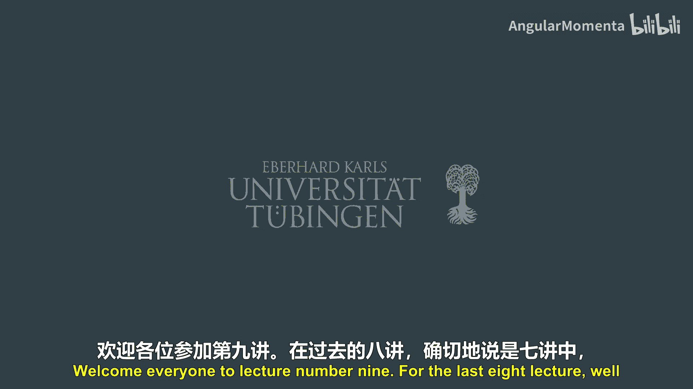
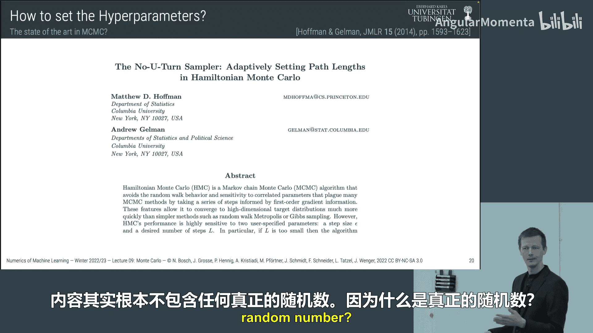
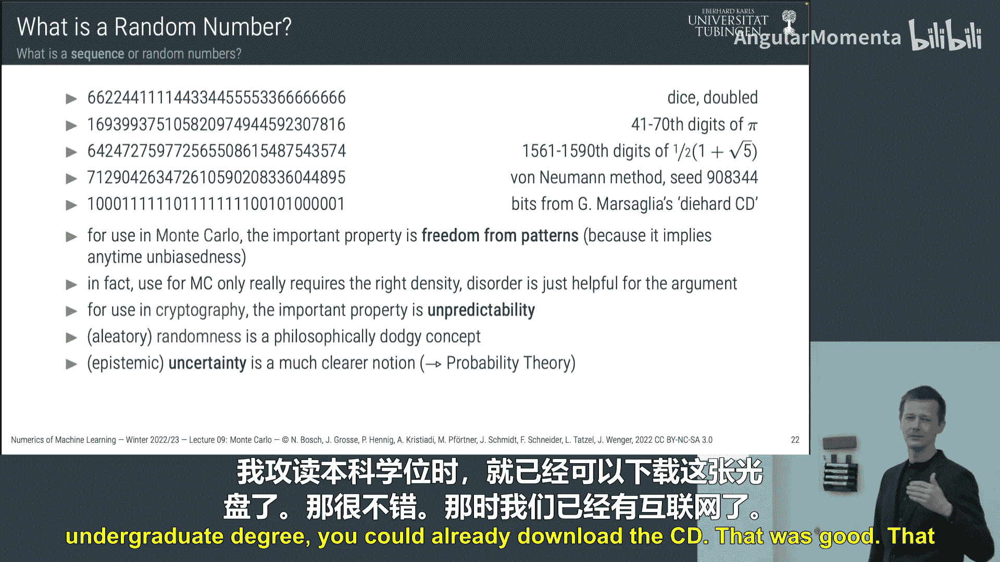
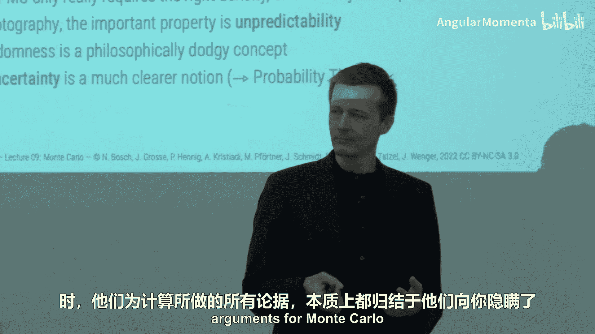

# 009：蒙特卡洛方法




## 概述

在本节课中，我们将学习一种称为蒙特卡洛的数值积分方法。我们将从它的基本思想、历史起源开始，探讨其数学原理，并介绍其核心算法——马尔可夫链蒙特卡洛及其高级变体。我们还将反思蒙特卡洛方法在计算中的本质及其局限性。

---

## 历史起源与基本思想

上一节我们介绍了数值模拟的复杂性。本节中，我们来看看如何通过模拟来解决积分问题，这源于一个历史性的需求。

蒙特卡洛方法起源于第二次世界大战期间，由斯坦尼斯瓦夫·乌拉姆和约翰·冯·诺依曼等人在曼哈顿计划中提出。他们面临一个核心问题：如何计算核裂变链式反应中中子的预期密度？这是一个积分问题。

他们提出了一个开创性的想法：**用求和来近似积分**。具体来说，如果我们想计算某个函数 `φ(x)` 在分布 `P(x)` 下的期望值，即积分 `∫ φ(x) P(x) dx`，我们可以通过从 `P(x)` 中独立抽取 `S` 个样本 `x_s`，然后用样本均值来近似：

`φ̂ = (1/S) * Σ_{s=1}^{S} φ(x_s)`

当时，他们甚至没有现代计算机，而是使用了一种叫做“费米模拟计算机”的模拟装置，配合骰子来生成随机数，手动模拟中子的随机路径，从而估算积分。

---

## 简单蒙特卡洛：原理与性质

从历史回到数学，我们来分析这个简单蒙特卡洛估计器的性质。

**无偏性**：该估计器是无偏的。因为样本 `x_s` 独立同分布于 `P`，所以估计器的期望值等于真实积分值：
`E[φ̂] = (1/S) * Σ_{s=1}^{S} E[φ(x_s)] = ∫ φ(x) P(x) dx = φ`

**收敛速率**：估计器的方差决定了其误差。可以证明，其均方误差为：
`Var(φ̂) = Var(φ(x)) / S`
这意味着误差以 `O(1/√S)` 的速率衰减。从统计学角度看，这是无偏估计器可能达到的最优速率。但从数值分析角度看，这个 `1/√S` 的收敛速度相对较慢。

**维度影响**：一个常被提及的观点是，蒙特卡洛的误差常数 `Var(φ(x))` 表面上与问题维度 `D` 无关。然而，对于某些精心构造的高维函数，这个方差可能会随维度急剧增大（例如指数增长）。但在许多实际应用中，例如计算均值或方差时，蒙特卡洛方法对高维问题依然相对稳健，这是其相对于下周将介绍的方法的一个关键优势。

---

## 蒙特卡洛实践：示例与局限

为了直观理解，我们来看一个经典示例：用蒙特卡洛方法估算圆周率 π。

方法是：在单位正方形 `[0,1]×[0,1]` 内均匀随机采样点 `(x, y)`。判断点是否落在单位圆扇形（`x² + y² ≤ 1`）内。落在扇形内的概率是 `π/4`。因此，用频率估计概率，再乘以4即可得到 π 的估计值。

以下是核心代码逻辑：
```python
# 伪代码示例
samples = uniform_random(size=(N, 2))
inside = sum(samples[:,0]**2 + samples[:,1]**2 <= 1)
pi_estimate = 4 * inside / N
```
绘制误差随样本数 `N` 变化的曲线，可以清晰地看到误差以 `1/√N` 的速率下降。

这个例子揭示了蒙特卡洛方法的本质：
*   **优点**：对于难以直接计算的积分，它能提供一种相对容易实现的近似方案，快速给出一个粗略估计。
*   **局限**：若要获得高精度结果，则需要极其大量的样本，计算代价高昂。

因此，在机器学习中进行贝叶斯推断时，如果只想要一个下午就能得到的粗略答案，蒙特卡洛是个好主意。但如果需要精确结果，则需要考虑其他方法。

---

## 从简单蒙特卡洛到马尔可夫链蒙特卡洛

简单蒙特卡洛的前提是能够直接从目标分布 `P(x)` 中采样。然而在实践中，`P(x)` 往往非常复杂，无法直接采样。因此，我们需要构建一个算法，来生成近似服从 `P(x)` 分布的样本。

标准方法是**马尔可夫链蒙特卡洛**。它通过构建一个马尔可夫链，使其平稳分布恰好是我们的目标分布 `P(x)`。当链运行足够长时间后，其状态就可以被视为来自 `P(x)` 的近似样本。

最著名的MCMC算法是**Metropolis-Hastings算法**。其步骤如下，我们用一个简短介绍来引入：

以下是Metropolis-Hastings算法的单步流程：
1.  给定当前状态 `x_t`。
2.  从某个提议分布 `Q(x' | x_t)`（例如以 `x_t` 为中心的高斯分布）中抽取一个候选点 `x'`。
3.  计算接受概率 `α = min(1, [P(x')Q(x_t | x')] / [P(x_t)Q(x' | x_t)])`。若 `Q` 对称（如高斯），则简化为 `α = min(1, P(x')/P(x_t))`。
4.  以概率 `α` 接受候选点，令 `x_{t+1} = x'`；否则拒绝，令 `x_{t+1} = x_t`。

该算法满足**细致平衡**条件：`P(x_t) T(x_{t+1} | x_t) = P(x_{t+1}) T(x_t | x_{t+1})`，这保证了 `P(x)` 是其平稳分布。在一定的遍历性条件下，马尔可夫链最终会收敛到该平稳分布。

然而，MCMC的收敛速度可能很慢。对于病态（长宽比大）的分布，链可能需要 `O((L/ε)²)` 量级的步数才能有效遍历分布，其中 `L` 和 `ε` 分别是分布最长和最短的长度尺度（类似于协方差矩阵的最大和最小特征值）。这导致有效样本量很低，估计方差很大。

---

## 进阶MCMC方法：哈密顿蒙特卡洛

为了克服随机游走行为导致的慢速混合问题，人们发展了更先进的MCMC算法。其中，**哈密顿蒙特卡洛**（HMC）是一个典范，它巧妙地利用了物理模拟和ODE求解器的思想。

HMC的核心思想是引入辅助变量——动量 `p`，将采样问题转化为在扩展的`(x, p)`相空间中模拟一个哈密顿动力学系统。假设目标分布为 `P(x) ∝ exp(-E(x))`（`E(x)` 称为势能）。我们定义哈密顿量 `H(x, p) = E(x) + K(p)`，其中动能通常取 `K(p) = pᵀp / 2`。相应的哈密顿动力学方程为：
`dx/dt = ∂H/∂p = p`
`dp/dt = -∂H/∂x = -∇E(x)`

这个系统有两个关键性质：
1.  **哈密顿量守恒**：`H(x, p)` 在演化过程中保持不变。
2.  **相空间分布**：联合分布 `π(x, p) ∝ exp(-H(x, p)) = exp(-E(x)) exp(-K(p))` 恰好可分离为目标分布 `P(x)` 和一个标准高斯分布 `N(p|0, I)`。因此，从 `π(x, p)` 中得到的 `x` 边际分布就是 `P(x)`。

HMC算法交替进行以下步骤：
1.  **动量重采样**：从 `N(0, I)` 中抽取新的动量 `p`。
2.  **动力学模拟**：从当前 `(x, p)` 出发，沿哈密顿方程模拟一段轨迹（使用如蛙跳法等辛积分器），得到提议的 `(x*, p*)`。由于模拟误差，`H` 可能不严格守恒。
3.  **Metropolis接受步骤**：以概率 `min(1, exp(-H(x*, p*) + H(x, p)))` 接受新状态 `(x*, p*)`。

由于辛积分器能近似保持 `H`，接受率通常很高。更重要的是，动力学模拟允许提案在梯度方向上移动很远的距离，而不是随机游走，从而能更有效地探索分布，尤其对于具有强相关性的高维分布。其探索距离与模拟步数 `L` 成线性关系 `O(Lε)`，优于随机游走的 `O(√L ε)`。

HMC的性能依赖于两个关键参数：积分步长 `ε` 和模拟步数 `L`。设置不当会导致低效的“U型转弯”轨迹。**No-U-Turn Sampler (NUTS)** 是一种自适应调整 `L` 的HMC变体，它通过同时向前和向后运行轨迹来自动确定合适的模拟长度。



---


## 反思：蒙特卡洛中的“随机性”与算法选择

在介绍了主要算法后，让我们退一步思考蒙特卡洛方法的哲学基础。

蒙特卡洛方法的核心理论保证（如无偏性、收敛性）都建立在所使用的数是“真随机”的这一假设上。然而，在实际计算中，我们使用的是**伪随机数生成器**（PRNG）。PRNG产生的是确定性的、可重复的序列，只是看起来随机。一旦随机数种子被固定或公开，整个计算过程就完全是确定性的。

那么，我们为何还要使用基于“随机性”的论证呢？这引出了一个关键点：蒙特卡洛的“无偏性”是针对我们注入的随机性而言的。我们用一个确定性的PRNG来近似理想的随机性，并希望其性质足够好，使得理论论证大致成立。



这带来了蒙特卡洛方法，特别是MCMC的利弊权衡：
*   **优点**：易于使用和实现；对于复杂的、高维的分布，通常能给出一个可运行的基准方案；理论框架成熟。
*   **缺点**：收敛速度慢（`O(1/√N)`）；实际应用中难以诊断是否已收敛；其理论保证依赖于理想化的随机性假设。

因此，选择蒙特卡洛方法，通常意味着我们接受较慢的计算速度，以换取实现的简便性，将复杂的数学工作转化为计算机的耗时运行。对于许多问题，这是合理的权衡。但是，对于需要高精度结果或计算资源受限的情况，我们需要考虑其他数值积分方法，例如下周将要学习的那些具有多项式甚至指数级更快收敛速度的确定性或准蒙特卡洛方法。这些方法通常需要更多数学上的努力来构造，但一旦成功，计算效率会高得多。





---

## 总结

本节课中，我们一起学习了蒙特卡洛数值积分方法。
1.  我们从其历史起源——曼哈顿计划中的物理模拟——开始，理解了用样本均值近似积分期望的基本思想。
2.  我们分析了简单蒙特卡洛估计器的**无偏性**和 `O(1/√N)` 的**收敛速率**，并讨论了其对问题维度的敏感性。
3.  针对无法直接采样的复杂分布，我们引入了**马尔可夫链蒙特卡洛**（MCMC）框架，详细讲解了经典的 **Metropolis-Hastings算法** 及其收敛挑战。
4.  为了提升效率，我们介绍了**哈密顿蒙特卡洛**（HMC），它通过引入物理动力学模拟和ODE求解，实现了更高效的探索，并简要提到了其自适应变体NUTS。
5.  最后，我们对蒙特卡洛方法中“随机性”的本质进行了反思，指出其理论保证与伪随机数实践之间的张力，并总结了蒙特卡洛方法易用但收敛慢的特点，为学习更高效的数值积分方法做好了铺垫。


蒙特卡洛是贝叶斯推断等机器学习任务中强大的工具，但理解其局限性能帮助我们在面对积分问题时，做出更明智的算法选择。