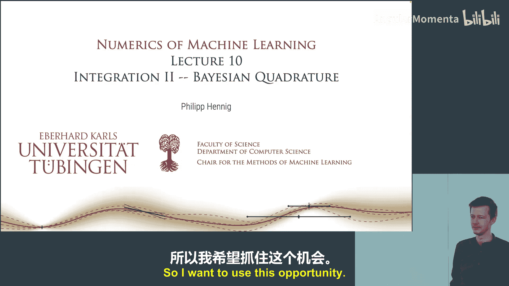
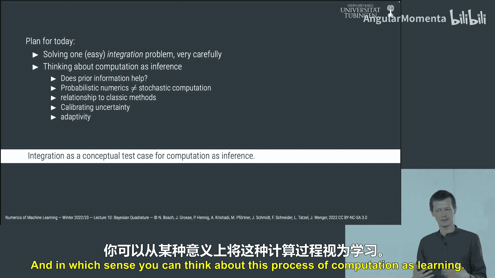
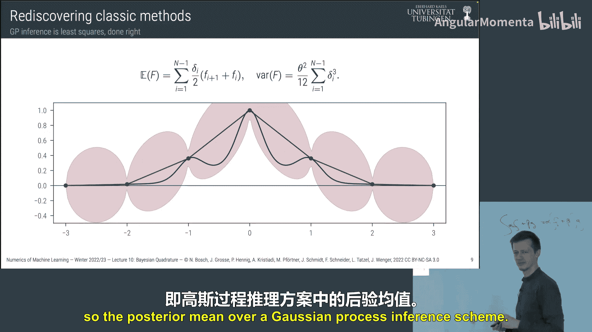
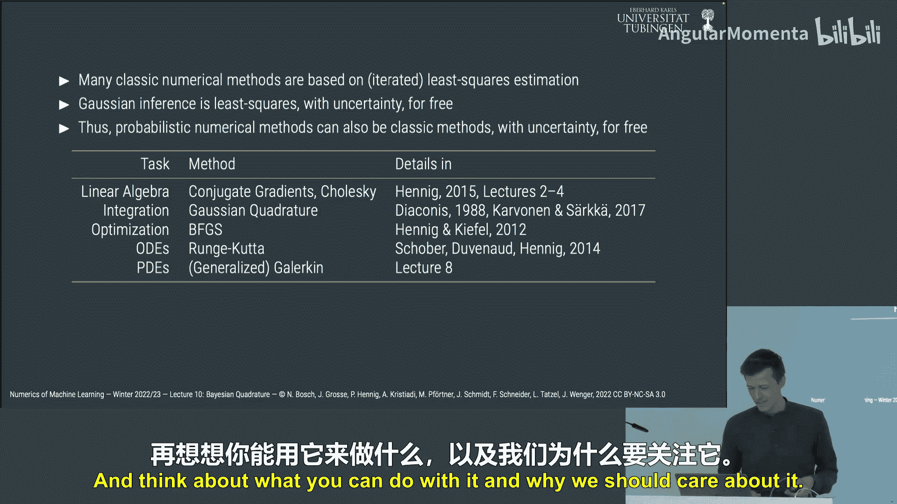
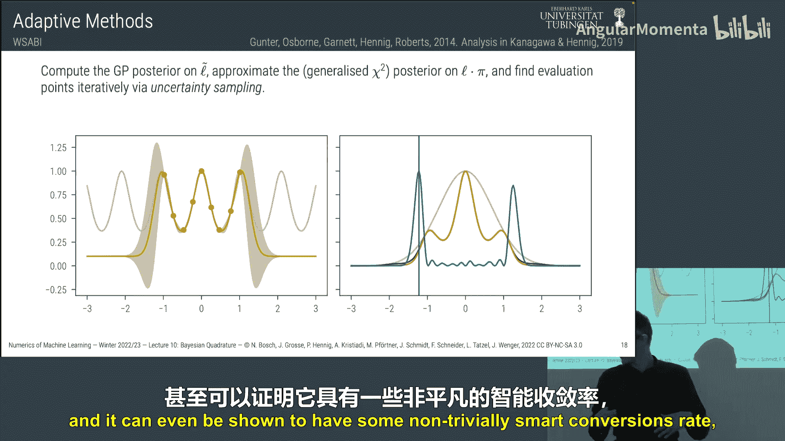
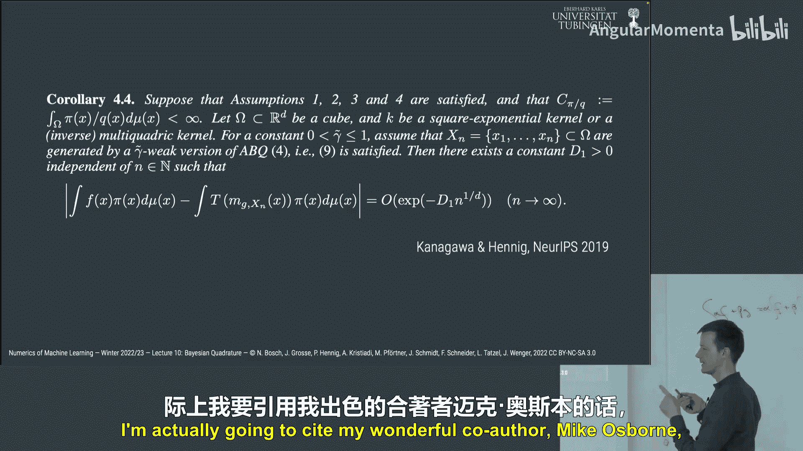
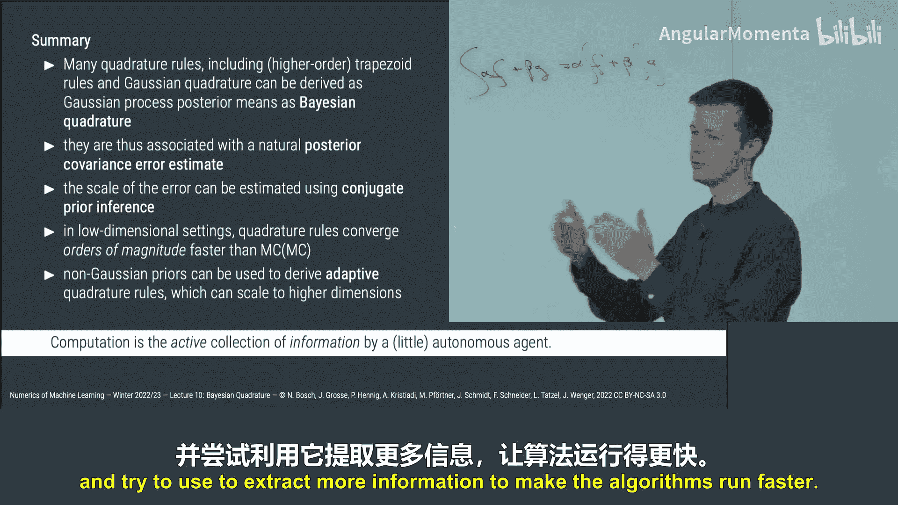
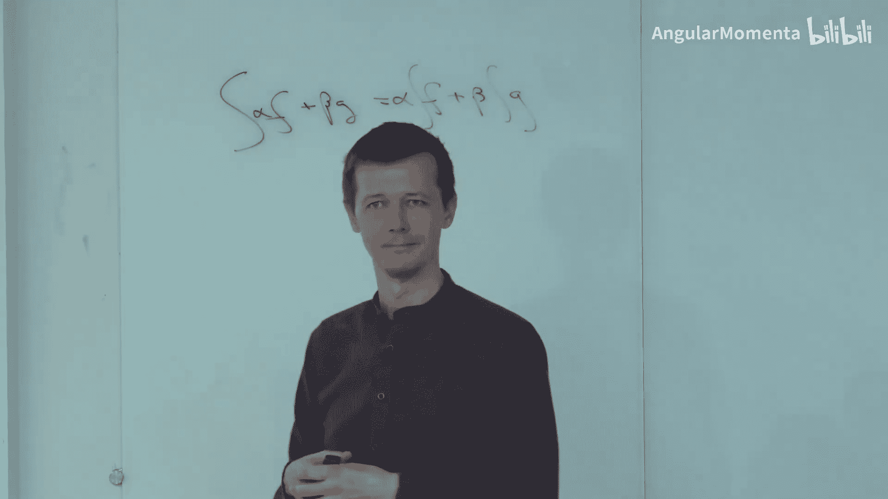

# 010：贝叶斯积分

## 概述

在本节课中，我们将学习如何将积分问题视为一个贝叶斯推断问题。我们将从一个具体的积分例子出发，探讨如何通过高斯过程先验来构建积分算法，并理解经典数值积分方法（如梯形法则）如何作为特定先验下的贝叶斯后验均值估计出现。我们还将讨论如何通过信息论准则选择评估点，以及如何通过引入更多先验知识来获得更高效、更自适应的算法。

---

## 问题引入：一个具体的积分

我们考虑一个具体的积分问题。函数 `f(x)` 定义为：

**f(x) = exp(-sin²(3x) - x²)**

这是一个实值函数，定义在实数域上。其图像是一个被高斯钟形曲线包络的振荡函数。

我们关心的量是定积分：

**F = ∫₋₃³ f(x) dx**

虽然函数 `f(x)` 被唯一确定，但其积分 `F` 的值对我们而言是未知的。我们无法从积分表中找到它，也没有现成的库函数可以直接计算它。因此，我们对 `F` 存在不确定性。

然而，我们并非一无所知。我们可以推断出 `F` 的一些性质：
*   函数 `f(x)` 非负，因此 `F ≥ 0`。
*   函数 `f(x) ≤ 1`，积分区间长度为6，因此 `F ≤ 6`。
*   函数 `f(x)` 被高斯函数 `exp(-x²)` 上界约束，后者的积分（从-∞到∞）是 `√π`。在有限区间 `[-3, 3]` 上，高斯函数的积分是 `√π * erf(3) ≈ 1.77`。因此，我们有更紧的界：`0 ≤ F ≤ 1.77`。

这表明，即使对于一个未知的计算结果，我们通常也能获得一些先验信息。这启发我们可以将计算积分视为一个贝叶斯推断问题：为未知量（积分 `F`）和可计算量（函数值 `f(x)`）设置先验，然后进行贝叶斯推断。

---

## 回顾：蒙特卡洛方法

在深入贝叶斯观点之前，我们先回顾上节课讨论的蒙特卡洛方法。对于我们的积分问题，可以使用重要性采样。

**方法**：从一个已知解析积分的提议分布（例如高斯分布或均匀分布）中抽取样本 `x_i`，然后计算估计值：
**F_MC ≈ G * (1/N) Σ [f(x_i) / g(x_i)]**
其中 `G` 是提议分布 `g(x)` 在积分区间上的积分。

蒙特卡洛估计的误差以 `O(1/√N)` 的速率收敛，这是无偏估计器的最佳可能速率。然而，这个速率相对较慢。本节课的目标是探索能否显著超越这个速率。

---

## 贝叶斯积分：高斯过程框架

现在，让我们忘记传统的积分知识，尝试将积分构建为一个贝叶斯推断问题。我们将可计算的函数值 `f(x)` 视为数据，将待求的积分 `F` 视为潜变量。

我们首先在函数 `f` 上放置一个高斯过程先验。高斯过程由均值函数 `m(x)` 和协方差函数（核函数）`k(x, x')` 定义。

高斯过程有一个优美的性质：作用于该函数的任何**线性算子**，都会诱导出另一个高斯分布。积分正是一个线性算子。因此，如果 `f` 服从高斯过程，那么积分 `F` 也服从一个高斯分布（如果考虑不定积分，则是一个高斯过程）。

假设我们已经在一系列点 `X = [x₁, ..., x_N]` 上观测到了函数值 `y = f(X)`。那么，高斯过程的后验均值和协方差为：
**μ(x) = m(x) + k(x, X) k(X, X)⁻¹ (y - m(X))**
**σ²(x, x') = k(x, x') - k(x, X) k(X, X)⁻¹ k(X, x')**

我们对积分 `F` 的后验分布感兴趣。根据线性性质，`F` 的后验均值是后验均值函数的积分，后验方差是核函数的双重积分：
**E[F|y] = ∫ μ(x) dx**
**Var[F|y] = ∬ σ²(x, x') dx dx'**

注意，这些表达式只涉及对核函数 `k` 的积分，而不涉及对未知函数 `f` 的积分。因此，只要我们能够解析地计算所选核函数的积分，就能进行贝叶斯积分推断。

---

## 选择核函数：从维纳过程到梯形法则

我们需要选择一个能进行解析积分的核函数。一个简单的选择是**维纳过程核**（也称为线性核或最小核）：
**k(x, x') = min(x, x') - c**
其中常数 `c` 用于确保正定性，可以设为小于积分区间左端点的值（例如，对于区间 `[-3, 3]`，设 `c = -3`）。同时，我们设先验均值 `m(x) = 0`。

对于这个核函数，我们可以解析地计算其“核均值嵌入”和双重积分。具体公式如下（`a` 和 `b` 为积分上下限）：
**∫ₐᵇ k(x, x') dx = 1/2 (x² - a²) + (x - b - a)c**
**∬ₐᵇ k(x, x') dx dx' = (b-a)³/12**

现在，我们可以实现这个贝叶斯积分算法了。当我们在一系列点上评估函数并更新后验时，会发现一些有趣的现象。

**核心发现**：使用维纳过程先验和均匀网格评估点，积分 `F` 的贝叶斯后验均值估计，恰好等于经典的**梯形法则**的估计结果。

梯形法则是用分段线性函数来近似被积函数，并计算这些梯形面积之和。我们的贝叶斯框架不仅复现了这个经典算法，还额外提供了一个后验方差，作为积分估计的不确定性度量。

---

## 算法实现与计算效率：卡尔曼滤波视角

你可能会担心高斯过程推断的计算成本。然而，对于维纳过程这类特定的高斯过程，其推断可以通过**卡尔曼滤波**高效实现，计算复杂度与蒙特卡洛方法同阶。

我们可以将状态空间定义为包含函数值 `f` 和积分值 `F` 的向量。维纳过程对应于一个简单的随机微分方程。将其离散化后，我们得到卡尔曼滤波的预测模型和观测模型。

**更新方程**：在每一步，我们评估函数得到一个观测值 `y_i`，然后更新积分估计：
**F_new = F_old + (Δx/2) * (y_i + y_{i-1})**
这正是梯形法则的递推形式！同时，我们也能更新积分估计的不确定性（方差）。

因此，整个贝叶斯积分算法可以像蒙特卡洛一样高效运行，只是将随机求和替换为按特定规则（梯形法则）的求和，并附带不确定性估计。

---

## 更广泛的启示：经典算法作为贝叶斯估计

这个例子揭示了一个更深层次的模式：许多经典数值算法都可以解释为某种贝叶斯后验估计。
*   **线性代数求解器**（如共轭梯度法）可以视为关于解或矩阵的最小二乘估计（高斯估计的特例）。
*   **优化方法**（如拟牛顿法）可以视为关于损失函数海森矩阵的高斯估计。
*   **常微分方程求解器**（如龙格-库塔法）可以视为单步内ODE解的特定高斯后验估计。
*   **偏微分方程求解器**（如广义伽辽金法）也可以在高斯过程推断的框架下理解。

这意味着，经典数值计算在某种意义上已经是“贝叶斯式”的，它提供了点估计（后验均值）。而概率化数值计算的观点则更进一步，它免费提供了这些估计的不确定性（后验方差），因为我们计算后验均值时已经得到了所需的所有量。

---

## 评估点的选择：信息论准则

在之前的演示中，我们使用了均匀网格。为什么？这可以通过信息论来证明。

我们希望后验分布的不确定性（熵）尽快减小。对于高斯分布，熵由协方差矩阵的行列式决定。在我们的问题中，积分 `F` 的后验方差是：
**Var[F] = (θ²/12) Σ (Δx_i)³**
其中 `θ` 是核的尺度参数，`Δx_i` 是评估点之间的步长。

如果我们要求评估点必须覆盖积分区间的两端，那么通过最小化后验方差（即最小化熵），可以推导出最优策略是让所有内部的 `Δx_i` 相等，即使用**均匀网格**。

这展示了我们可以将计算过程视为一个智能体的决策过程：它遵循一个最大化信息增益的策略来选择下一步计算哪里。在这个简单例子中，策略的结果是均匀网格，但在更复杂或更高维的问题中，策略可能产生非平凡的自适应采样方案。

---

## 不确定性校准与先验假设的局限性

我们的贝叶斯积分算法提供了一个误差估计（后验标准差）。然而，在之前的图中，这个估计误差（红色虚线）远大于真实的积分误差（黑色点），并且以更慢的速率 (`O(1/N)`) 收敛，而真实误差以 `O(1/N²)` 收敛。

**问题出在哪里？** 问题在于我们的**先验假设**。我们使用的维纳过程先验，其样本路径是几乎处处不可导的、非常粗糙的函数。我们告诉算法：“你要积分的函数可能极其不规则。” 因此，算法变得非常保守，给出了很大的不确定性估计。

然而，我们实际要积分的函数 `f(x) = exp(-sin²(3x) - x²)` 是无限次可导的，非常光滑。算法在每次评估时都发现函数比它预期的要光滑得多，但它的先验在每个尺度上都假设了粗糙性，因此误差估计始终过于悲观。

**启示**：如果一个算法被设计用于处理非常广泛的问题类别（如粗糙函数），那么它在任何一个具体问题（如光滑函数）上的表现通常不会是最优的。如果你有一个具体的、重要的计算问题，值得根据该问题的特定知识（如光滑性）来设计或选择算法。

---

## 改进：学习尺度参数与使用更合适的先验

我们可以通过**共轭先验推断**来在线估计核的尺度参数 `θ`。对于高斯分布，方差的共轭先验是伽马分布（作用于精度）。通过证据优化，我们可以更新 `θ` 的后验分布，而计算所需的关键量（`yᵀ K⁻¹ y`）在计算后验均值时已经得到。这使我们能获得一个学生t分布下的积分估计，其误差估计有所改善，但根本性的阶次不匹配问题依然存在，因为先验的平滑性假设没有改变。

要获得更快的收敛速度，我们需要使用更符合函数真实性质的先验。例如，对于光滑函数，可以使用基于**正交多项式**的高斯求积法则。

**高斯求积法则**（如高斯-勒让德、高斯-切比雪夫求积）是一类高效的积分方法，它们对应于在特定多项式函数空间上的最小二乘估计（即贝叶斯估计）。这些方法可以达到指数级或超多项式级的收敛速度，但前提是函数足够光滑。

这些经典求积法则也可以解释为贝叶斯求积，但需要针对特定的评估点数量专门设计核函数，使得在该数量点处后验方差恰好为零。这虽然在点估计上极其高效，但在不确定性量化方面不太自然。

---

## 高维挑战与自适应贝叶斯求积

一维积分问题已有成熟高效的解法。真正的挑战在于**高维积分**。基于网格或多项式展开的方法会遭受“维数灾难”，所需评估点数量随维度指数增长。

然而，机器学习中的积分通常具有特殊结构：它们常是某个函数在概率分布下的期望值。概率分布往往具有“集中性”，即大部分概率质量集中在空间的某个小区域内。

蒙特卡洛方法（如MCMC）通过在高概率区域花费更多时间来自适应这种结构，但其收敛速率 `O(1/√N)` 较慢，且该速率与维度无关。这看似是优点，实则意味着它对问题结构利用不足。

我们可以构建**自适应的贝叶斯求积**方法。例如，通过一个“扭曲”的高斯过程先验（如对高斯过程取平方以确保非负性），我们可以得到一个后验，它不仅在函数值上，也在其不确定性上依赖于观测数据。这允许算法计算一个依赖于数据的“效用函数”（如不确定性），并选择最大化该函数的点进行评估。这样的算法会主动探索可能具有高函数值的区域，并自适应地细化这些区域的估计。

这类自适应算法可以扩展到中等维度（如10-50维），并且被证明具有优于蒙特卡洛的收敛速率。在维度极高（如数千维）且问题缺乏结构时，蒙特卡洛仍然是可行的选择，但我们也将在后续课程中看到其他可能更优的确定性方法。

---

## 总结

本节课中，我们一起学习了如何将数值积分视为一个贝叶斯推断问题。

1.  **贝叶斯框架**：我们通过为未知量（积分）和可计算量（函数值）设置联合先验，将计算问题概率化。高斯过程先验与积分的线性性质相结合，产生了贝叶斯求积算法。
2.  **经典算法的贝叶斯解释**：我们发现，经典的梯形法则对应于使用维纳过程先验的贝叶斯后验均值估计。许多其他经典数值算法也都可以理解为某种贝叶斯估计。
3.  **不确定性量化**：贝叶斯方法免费提供了点估计的不确定性（后验方差），尽管其校准程度取决于先验假设的合理性。
4.  **先验知识的重要性**：算法的性能强烈依赖于先验假设。过于保守的先验（如假设函数粗糙）会导致性能下降和误差估计不准。利用问题的具体知识（如光滑性、非负性、集中性）可以设计出更高效、更自适应的算法。
5.  **作为智能体的计算**：数值算法可以被视为在其计算环境中行动的自主智能体，它可以根据信息论准则（如最大化信息增益）来决定下一步计算什么。这种观点为设计自适应算法提供了原则性指导。

核心思想是：**计算不应被视为机械的符号操作，而应被视为一个从有限信息中学习未知量的过程。** 通过明确地使用先验知识并量化不确定性，我们可以构建出更强大、更可靠、有时甚至是革命性的数值方法。