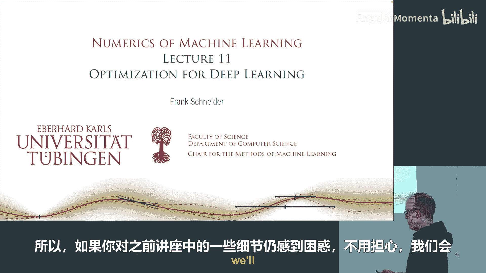
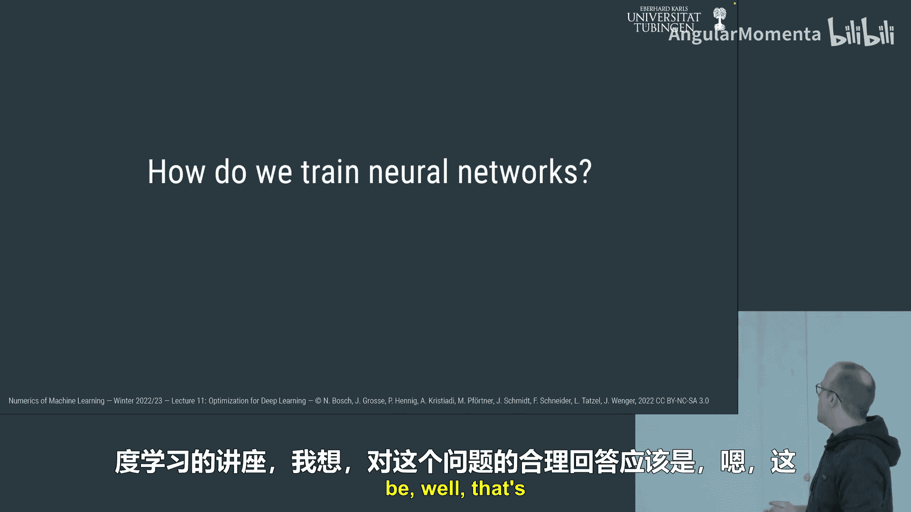
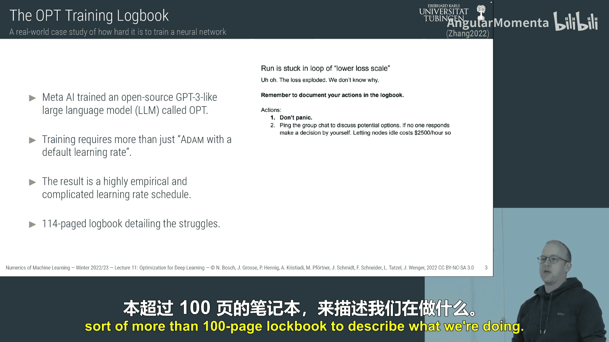
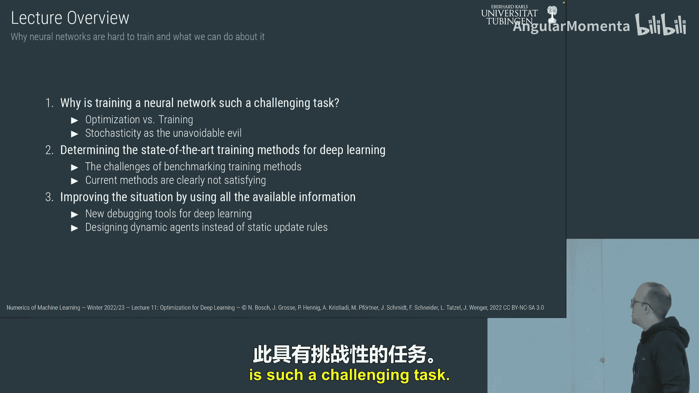
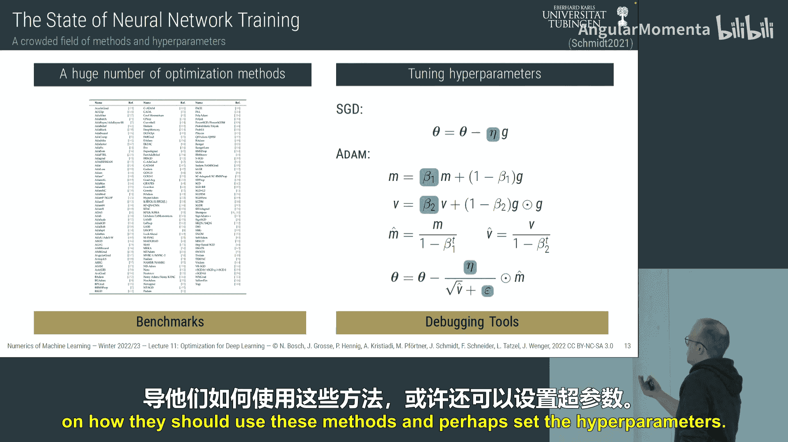
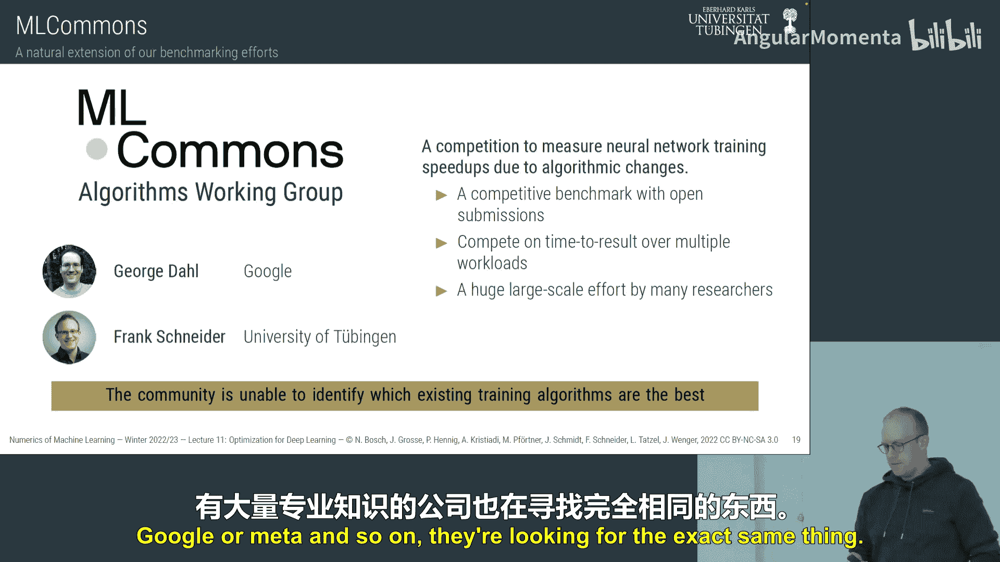
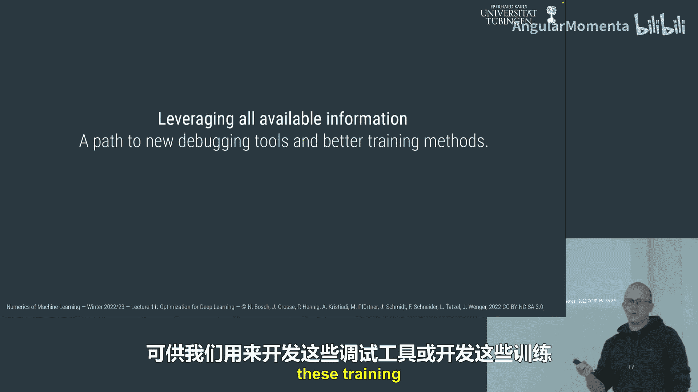
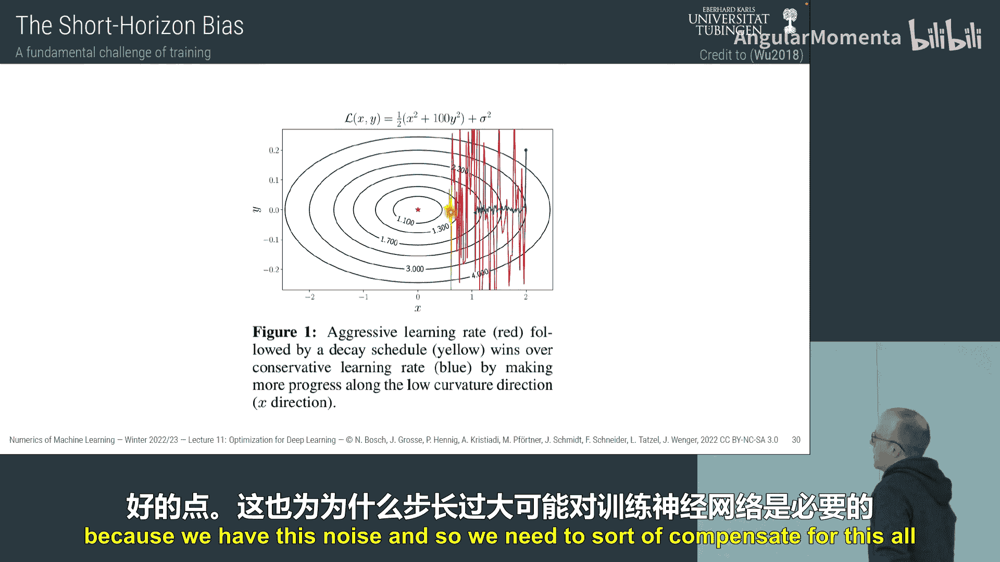
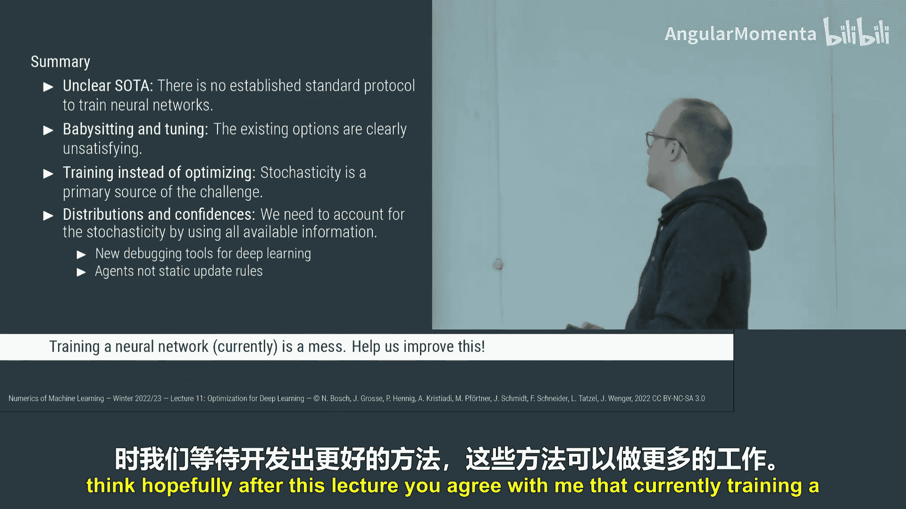
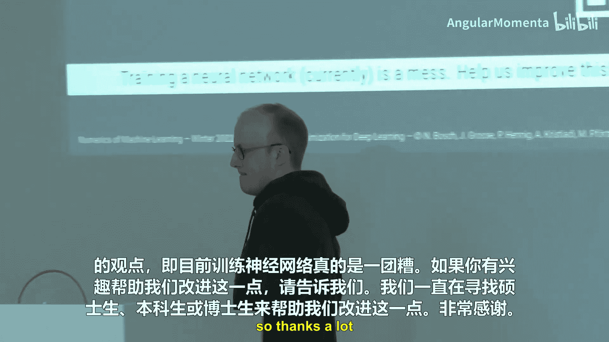

# 011：深度学习优化 🧠

在本节课中，我们将要学习深度学习中的优化问题。我们将探讨为什么训练神经网络如此具有挑战性，当前有哪些训练方法，以及如何通过基准测试和调试工具来改进训练过程。

## 概述：为什么训练神经网络如此困难？ 🤔

上一节我们介绍了机器学习优化的基本概念，本节中我们来看看深度学习训练的特殊性。训练神经网络远非简单地选择一个优化器（如Adam）和一个默认学习率那么简单。现实世界中的例子，如Meta训练大型语言模型OPT的过程，表明这需要复杂的超参数调整、精心设计的学习率调度，以及大量的试错。目前，深度学习社区尚未就“最佳”训练方法达成共识，这使得训练过程充满了不确定性和挑战。

## 机器学习 vs. 优化：核心区别 🔄

在深入探讨训练方法之前，我们需要理解一个核心概念：**机器学习不等同于优化**。

在监督学习设置中，我们有一个由参数 $\theta$ 参数化的神经网络。给定输入 $x$，模型预测输出 $\hat{y}$。我们的目标是让预测 $\hat{y}$ 尽可能接近真实目标 $y$，这通过损失函数 $L$ 来衡量。

我们真正关心的是最小化模型在**真实数据分布**上的**期望损失**（真实风险）：
$$R(\theta) = \mathbb{E}_{(x,y) \sim P_{data}}[L(f(x; \theta), y)]$$

然而，我们无法访问无限的真实数据分布。我们只能访问一个有限的**训练数据集** $D_{train} = \{(x_i, y_i)\}_{i=1}^N$。因此，我们实际操作的是**经验风险**（经验损失）：
$$\hat{R}(\theta) = \frac{1}{N} \sum_{i=1}^{N} L(f(x_i; \theta), y_i)$$

更常见的是，我们使用**小批量**（mini-batch）进行训练，每次只计算一小部分数据（大小为 $B$）的梯度：
$$\hat{R}_B(\theta) = \frac{1}{B} \sum_{i=1}^{B} L(f(x_i; \theta), y_i)$$

因此，我们优化的目标（经验风险）与我们最终关心的目标（真实风险）是不同的。这导致了过拟合、泛化等复杂问题。优化器（如SGD、Adam）旨在最小化经验风险，而我们的目标是获得一个在未见数据上表现良好的模型。因此，更准确的说法是，我们使用**训练算法**（Training Algorithms）来“训练”网络，而不仅仅是“优化”一个损失函数。

## 训练算法的现状：一片混乱的海洋 🌊

上一节我们明确了训练与优化的区别，本节中我们来看看当前可用的训练算法。由于上述的复杂性，研究人员提出了大量不同的训练算法。

以下是几种经典算法的更新公式示例：

*   **随机梯度下降（SGD）**:
    $$\theta_{t+1} = \theta_t - \eta \nabla \hat{R}_B(\theta_t)$$
    其中 $\eta$ 是学习率。

*   **带动量的SGD（Momentum）**:
    $$v_{t+1} = \rho v_t + \nabla \hat{R}_B(\theta_t)$$
    $$\theta_{t+1} = \theta_t - \eta v_{t+1}$$
    其中 $\rho$ 是动量参数。

*   **Adam**:
    $$m_t = \beta_1 m_{t-1} + (1-\beta_1) \nabla \hat{R}_B(\theta_t)$$
    $$v_t = \beta_2 v_{t-1} + (1-\beta_2) (\nabla \hat{R}_B(\theta_t))^2$$
    $$\hat{m}_t = m_t / (1-\beta_1^t), \quad \hat{v}_t = v_t / (1-\beta_2^t)$$
    $$\theta_{t+1} = \theta_t - \eta \cdot \hat{m}_t / (\sqrt{\hat{v}_t} + \epsilon)$$
    其中 $\beta_1, \beta_2$ 是衰减率，$\epsilon$ 是稳定项。

目前存在超过150种不同的训练算法变体。问题不仅在于选择哪个算法，还在于如何为每个算法设置其超参数（如学习率、动量参数等）。例如，Adam就有学习率、$\beta_1$、$\beta_2$ 和 $\epsilon$ 四个主要超参数需要调整。这种复杂性使得确定一个通用的、最优的训练“配方”变得极其困难。

## 基准测试的挑战：如何比较训练算法？ 📊

面对如此多的算法，一个自然的想法是通过基准测试来找出最优者。然而，对深度学习训练算法进行公平、全面的基准测试本身就是一个巨大的挑战。

以下是基准测试面临的主要问题：

1.  **定义“更好”**： “更好”可能意味着更快的训练速度、更高的最终精度、对超参数更鲁棒、或需要更少的调参。
2.  **随机性**： 深度学习训练具有固有的随机性（如权重初始化、数据打乱）。单次运行的结果可能是噪音。需要多次重复运行以获得统计显著性，这极大地增加了计算成本。
3.  **泛化性**： 一个算法在某个特定任务（如CIFAR-10图像分类）上表现好，不代表它在其他任务（如语言建模、强化学习）上也表现好。需要在多样化的任务上进行测试。
4.  **超参数交互**： 算法的性能严重依赖于其超参数设置。比较时必须考虑公平的调优预算。此外，最佳学习率调度（如常数、余弦衰减、热身重启）也会与算法产生交互。
5.  **算法家族 vs. 具体实例**： 像“SGD”或“Adam”是一个算法家族，包含无数超参数设置的具体实例。我们只能比较具体的、完全定义的算法实例。

一项大规模基准测试研究尝试了15种流行算法，在8个不同任务上，使用4种调优预算和4种学习率调度进行组合测试，总共进行了超过5万次独立训练运行。结果显示，**并没有一个算法在所有任务和设置下 consistently 表现最佳**。像Adam这样的流行算法表现稳健，但某些任务上其他算法（如RMSprop）可能更好。这证实了当前缺乏一个明确的、通用的“最先进”训练协议。

## 利用额外信息：从梯度分布到调试工具 🛠️

既然没有“银弹”算法，我们如何改善训练体验呢？一个策略是挖掘训练过程中未被充分利用的**额外信息**，并用它来构建更好的工具或算法。

目前，训练算法只使用了小批量梯度的**均值**：
$$g_{batch} = \frac{1}{B} \sum_{i=1}^{B} \nabla L(f(x_i; \theta), y_i)$$

然而，我们实际上计算了每个样本的独立梯度 $\nabla L(f(x_i; \theta), y_i)$。这些独立梯度包含了关于梯度估计**噪声**或**不确定性**的宝贵信息（例如，它们的方差）。这些信息目前被框架（如PyTorch）在求平均后丢弃了。

通过工具（如`Backpack`库），我们可以高效地访问这些独立梯度及其统计信息（如方差）。这为理解和控制训练过程打开了新的大门。

一个关键的应用是构建**深度学习调试工具**。传统的调试器对于检查代码逻辑很有用，但对于诊断训练效率低下（如错误的学习率、数据未归一化、有问题的模型架构）帮助有限。我们需要能压缩高维训练状态（如数百万权重的轨迹）成为人类可理解的、有意义的“状态报告”的工具。

工具`Cockpit`就是这样一个概念验证。它像飞机驾驶舱一样，为训练过程提供了一系列“仪表盘”：

*   **步长信息**： 例如，$\alpha$ 指标。它衡量当前步长相对于该方向局部最优步长是过小（负值，欠步）还是过大（正值，过冲）。$\alpha$ 是一个标量，高效可计算，能直接提示是否应调整学习率。
*   **梯度信息**： 显示梯度范数、梯度元素分布直方图、以及基于样本梯度的噪声估计（如梯度方差），这有助于判断批量大小是否合适。
*   **曲率信息**： 提供损失函数局部曲率的见解（将在后续讲座详细讨论）。

这些工具可以帮助发现不同类型的“训练Bug”：
*   **数据Bug**： 例如，输入数据未正确归一化，这在像素级视觉检查中难以发现，但梯度直方图会显示出异常分布。
*   **模型Bug**： 例如，使用某些激活函数导致梯度在深层网络消失，通过逐层的梯度直方图可以清晰看到。
*   **超参数Bug**： 例如，学习率设置不当。$\alpha$ 指标显示持续负值（欠步）是学习率过小的明确信号。

有趣的是，基准测试和`Cockpit`的分析都表明，**在每一步都追求局部最优（$\alpha \approx 0$）通常并不是最佳策略**。由于梯度噪声的存在，适度的“过冲”（$\alpha > 0$）有时能带来更好的长期性能和泛化能力。这再次强调了“训练”与“优化”的根本区别：在随机环境下，短视的最优步长可能导致长期性能下降。

## 总结与展望 🎯

本节课中我们一起学习了深度学习优化的核心挑战与现状。

我们首先明确了**机器学习训练不等同于损失函数优化**，因为我们操作的是有噪声的经验风险，而目标是未知数据上的泛化性能。

接着，我们看到了当前训练算法的**现状是一片“混乱的海洋”**，存在海量算法且缺乏明确的最佳实践，训练过程仍需大量人工调参和“保姆式”监控。

然后，我们探讨了进行公平**基准测试的巨大挑战**，以及现有大规模测试表明尚无一个算法能通用地统治所有任务。

最后，我们提出了一条改进路径：**利用训练过程中未被充分利用的额外信息**（如梯度分布）。这既能用于构建像`Cockpit`这样的**调试工具**，帮助实践者更高效地诊断问题，也为未来开发更**自动化、更智能的训练算法**奠定了基础，以期最终将人们从繁琐的超参数调整中解放出来。

总之，当前神经网络的训练仍然是一个复杂且尚未完全解决的挑战，但通过更严谨的评估和更深入的系统性分析，我们正在朝着建立更可靠、更高效的训练方法学迈进。