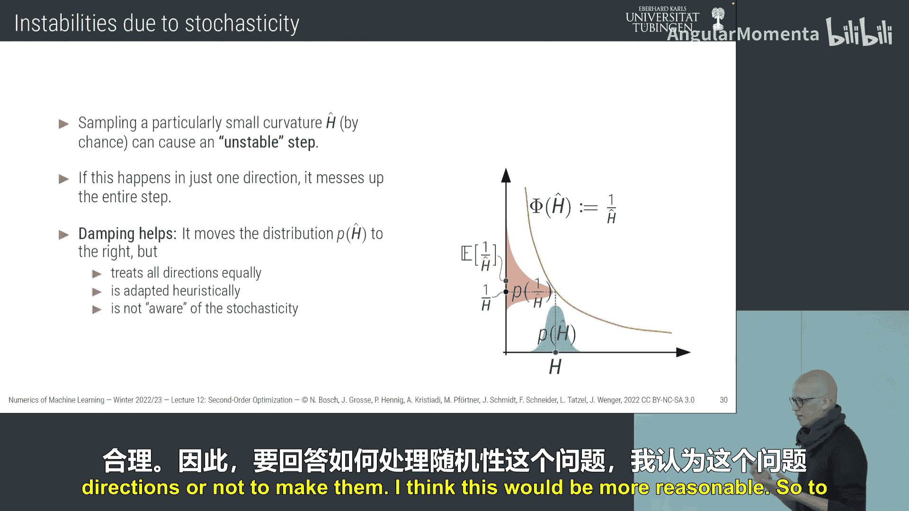

# 012：深度学习的二阶优化

在本节课中，我们将要学习深度学习中二阶优化的基本概念、优势以及面临的挑战。我们将从一阶优化方法的问题出发，介绍牛顿法等二阶方法的核心思想，并探讨其在非凸、高成本和随机性环境下的应用策略。

---

## 概述

上周的课程和练习中，我们了解到使用一阶方法（如SGD和Adam）训练神经网络是一个耗时、昂贵且不稳定的过程。本节课，我们将学习另一类优化器——二阶优化方法。这类方法至少可以避免一阶方法的一些问题，但同时也带来了新的挑战和未解决的难题，特别是在深度学习领域。

## 回顾：深度学习优化问题

在深入探讨二阶方法之前，我们先快速回顾一下深度学习优化的基本框架。

我们拥有训练数据，即输入 `x` 和输出 `y` 的样本，它们来自一个数据生成分布 `P_data`。我们假设这些样本是独立同分布的。

我们有一个神经网络模型 `f(θ, x)`，它基于参数向量 `θ` 和输入 `x` 产生一个 `C` 维的输出向量（例如，`C` 是类别数）。

我们通过损失函数 `ℓ(ŷ, y)` 来比较预测值 `ŷ` 和真实标签 `y` 之间的差异。我们的目标是找到最小化**期望风险**的参数 `θ`：

`R(θ) = E_{(x,y) ~ P_data}[ℓ(f(θ, x), y)]`

由于我们无法直接访问真实分布 `P_data`，我们转而最小化其蒙特卡洛估计量，即**经验风险**：

`R_emp(θ) = (1/N) Σ_{i=1}^{N} ℓ(f(θ, x_i), y_i)`

梯度下降法通过沿负梯度方向更新参数来最小化目标函数：

`θ_{k+1} = θ_k - α * ∇R(θ_k)`

其中 `α` 是学习率。在深度学习中，我们通常使用其随机版本——随机梯度下降（SGD），它使用小批量数据计算梯度的无偏估计：

`θ_{k+1} = θ_k - α * ĝ(θ_k)`, 其中 `ĝ(θ_k) = (1/|B|) Σ_{i in B} ∇ℓ(f(θ, x_i), y_i)`

## 一阶方法的局限性：条件数问题

梯度类方法的效率受到目标函数**条件数**的严重影响。条件数 `κ` 定义为最大曲率 `L` 与最小曲率 `μ` 之比：

`κ = L / μ`

当 `κ` 接近1时（各方向曲率相近），梯度方向指向最小值，收敛迅速。当 `κ` 很大时（存在平坦和陡峭方向），梯度方向不佳，收敛速度会变得非常慢。梯度下降法的收敛定理表明，其收敛速度与 `(κ - 1)/(κ + 1)` 相关，当 `κ` 很大时，这个因子接近1，意味着每一步的进展微乎其微。

为了消除对条件数的依赖，我们需要引入**逆曲率**信息来重新缩放梯度。这直接引向了二阶优化方法。

## 二阶方法的核心：牛顿步

二阶方法的核心思想是利用曲率或其逆来改进更新步长。其核心是**牛顿步**。

牛顿步基于在当前迭代点 `θ_k` 处的损失函数二次泰勒近似：

`Q(θ) = R(θ_k) + ∇R(θ_k)^T (θ - θ_k) + 1/2 (θ - θ_k)^T H(θ_k) (θ - θ_k)`

其中 `H(θ_k)` 是海森矩阵（二阶导数矩阵）。我们假设 `H` 是正定的。

牛顿法的思想是直接跳到这个二次近似函数的最小值点。通过求解 `∇Q(θ) = 0`，我们得到牛顿更新公式：

`θ_{k+1} = θ_k - H(θ_k)^{-1} ∇R(θ_k)`

与线性收敛的一阶方法不同，在适当条件下（如初始点足够接近最优解，且海森矩阵 Lipschitz 连续），牛顿法可以实现**局部二次收敛**，速度远快于线性收敛。

## 牛顿法的优势与挑战

上一节我们介绍了牛顿步的推导，本节我们来看看牛顿法相比一阶方法的优势，以及将其应用于深度学习时面临的核心挑战。

**优势总结：**
1.  **对病态问题鲁棒**：通过逆海森矩阵重新缩放梯度，消除了对条件数的依赖。
2.  **收敛速度快**：在最优解附近可实现二次收敛。
3.  **自然的步长**：理论上不需要像梯度下降那样手动调整学习率（`1/L`）。
4.  **广泛应用**：是许多科学计算领域的默认选择。

**核心挑战：**
尽管牛顿法看起来很完美，但在深度学习中却很少使用，主要因为三个问题：
1.  **非凸性**：深度学习损失函数通常是非凸的，海森矩阵可能不定（有正有负特征值），导致牛顿步无定义（二次模型无最小值）。
2.  **成本**：海森矩阵的维度是参数数量 `d` 的平方（`O(d^2)`），存储和求逆（`O(d^3)`）对于百万级参数的神经网络来说计算上不可行。
3.  **随机性**：我们只能基于有限数据（小批量）估计梯度和海森矩阵，这种随机性会带来偏差和不稳定性。

接下来，我们将逐一探讨这些挑战的应对策略。

## 应对挑战一：非凸性

上一节我们提到非凸性导致海森矩阵不定。本节中我们来看看如何通过寻找正定的曲率代理和使用阻尼技术来解决这个问题。

### 使用正定曲率代理：GGN 和 Fisher 矩阵

我们可以用其他保证正定（或半正定）的矩阵来替代海森矩阵。

**1. 广义高斯-牛顿矩阵**
GGN 矩阵基于将损失函数分解为模型输出 `f(θ, x)` 和损失函数 `ℓ` 的组合。通过链式法则推导海森矩阵，并忽略模型中二阶导数项（即假设模型在参数上是线性的），我们得到 GGN 矩阵 `G`：

`G(θ) = E[J(θ)^T H_ℓ(f(θ, x), y) J(θ)]`

其中 `J(θ)` 是模型 `f` 关于参数 `θ` 的雅可比矩阵，`H_ℓ` 是损失函数 `ℓ` 关于其第一个参数（模型输出）的海森矩阵。对于常见的损失函数（如均方误差、交叉熵），`H_ℓ` 是正定（或半正定）的，因此 `G` 也是正半定的。

**2. Fisher 信息矩阵**
当损失函数可以写成负对数似然形式时（例如使用 softmax 和交叉熵损失），我们可以定义 Fisher 信息矩阵 `F`：

`F(θ) = E[∇ log p(y | x; θ) ∇ log p(y | x; θ)^T]`

其中 `p(y | x; θ)` 是由模型参数定义的条件概率分布。Fisher 矩阵也是正半定的。使用 Fisher 逆乘以梯度的更新，可以解释为在分布空间（使用 KL 散度作为度量）的最速下降。

在许多情况下（如使用交叉熵损失的分类问题），GGN 和 Fisher 矩阵是相等的。它们都提供了有意义的曲率代理。

### 使用阻尼控制更新保守性

即使使用正定曲率矩阵，二次模型也可能在远离当前点时变得不准确。**信赖域**方法通过限制更新步长在一个可信半径 `R` 内来解决这个问题。这等价于在曲率矩阵中添加一个阻尼项 `δI`：

`θ_{k+1} = θ_k - (G(θ_k) + δI)^{-1} ∇R(θ_k)`

通过调整阻尼参数 `δ`，我们可以在牛顿步（`δ=0`）和梯度下降步（`δ` 很大）之间平滑插值。常用的启发式方法（如 Levenberg-Marquardt）会根据实际损失下降与模型预测下降的比率来动态调整 `δ`。

## 应对挑战二：高计算成本

上一节我们解决了非凸性问题，本节我们来看看如何应对海森矩阵（或其代理）存储和求逆的巨大计算成本。我们将介绍三种主流的近似方法。

### 1. 拟牛顿法：BFGS 和 L-BFGS

核心思想是**逐步从梯度观测中学习逆海森矩阵的近似**，而不显式构造或存储海森矩阵。

*   **基础：BFGS**：它基于“割线方程” `H_k s_k = y_k`，其中 `s_k = θ_{k+1} - θ_k`，`y_k = ∇R(θ_{k+1}) - ∇R(θ_k)`。BFGS 通过迭代更新一个满足对称性、正定性和最小变化条件的逆海森近似矩阵 `B_k`。更新公式仅涉及向量 `s_k` 和 `y_k`。
*   **内存优化：L-BFGS**：标准的 BFGS 需要存储稠密的 `d×d` 矩阵 `B_k`。L-BFGS 的改进在于，它发现 `B_k` 可以由初始矩阵 `B_0`（通常设为 `βI`）和最近的 `m` 对向量 `{s_i, y_i}` 递归构造。通过只保存最近的 `m` 对向量（`m` 通常很小，如 20），L-BFGS 大幅降低了内存消耗，并且有高效算法计算 `B_k * g`。

### 2. Hessian-Free 优化

核心思想是使用**共轭梯度法**来近似求解牛顿步 `H^{-1}g`，因为 CG 法只需要计算**矩阵-向量乘积** `H * v`，而无需显式构造或存储 `H`。

*   **实践**：在深度学习中，通常使用 GGN 矩阵 `G` 作为曲率矩阵。计算 `G * v` 可以通过高效的自动微分技巧实现，无需构造庞大的雅可比矩阵 `J`。技巧在于利用方向导数的定义：`J * v = ∂/∂ε f(θ + εv) |_{ε=0}`，这可以通过一次前向传播的高阶模式（如 `torch.autograd.grad`）高效计算。
*   **优势与局限**：内存占用小，更接近“纯”牛顿步。但需要多次 CG 迭代，计算可能仍很耗时，并且通常需要较大的批量大小，这可能与批归一化层不兼容。

### 3. K-FAC：克罗内克因子分解近似曲率

核心思想是针对 Fisher 信息矩阵 `F`，利用神经网络的结构特性进行两种近似，使其易于求逆。

1.  **块对角近似**：假设 Fisher 矩阵是块对角的，每个层对应一个块。这忽略了层间的曲率相互作用。
2.  **期望与克罗内克积交换近似**：对于线性层，每个块可以精确写为两个小矩阵的克罗内克积的期望。K-FAC 将期望与克罗内克积运算交换，近似为两个期望的克罗内克积：`E[A ⊗ B] ≈ E[A] ⊗ E[B]`。

经过这两种近似，每个块 `F_i` 近似为 `Ā_i ⊗ B̄_i`。其逆矩阵可以轻松计算：`(Ā_i ⊗ B̄_i)^{-1} = Ā_i^{-1} ⊗ B̄_i^{-1}`。由于 `Ā_i` 和 `B̄_i` 的维度很小（与层的输入输出维度相关），存储和求逆成本极低。

**方法对比总结：**
以下是三种方法的简要对比：
*   **BFGS/L-BFGS**：动态低秩近似。是小规模确定性问题的默认选择，在参数少、噪声小的问题上可能很快。
*   **Hessian-Free**：更接近经典牛顿步，内存需求小，但计算可能更顺序化，且受批量大小限制。
*   **K-FAC**：轻量级 Fisher 矩阵表示，广泛使用。但有研究表明其性能可能很大程度上依赖于启发式阻尼，而非精确的曲率信息。

## 应对挑战三：随机性

上一节我们讨论了降低计算成本的方法，本节我们来看看最棘手的挑战：随机性。当我们只能使用小批量数据估计梯度和曲率时，即使估计是无偏的，牛顿步本身也会产生**偏差**。

### 随机牛顿步的偏差问题

假设我们有梯度的无偏估计 `ĝ` 和海森矩阵的无偏估计 `Ĥ`。我们希望的更新是 `H^{-1}g`。但我们实际计算的是 `Ĥ^{-1}ĝ`。即使 `ĝ` 和 `Ĥ` 各自无偏，`Ĥ^{-1}ĝ` 的期望也**不等于** `H^{-1}g`。核心原因在于：**求逆运算不是线性运算**。

**一维直观解释**：
假设梯度估计完美（`g=1`），问题简化为比较 `E[1/ĥ]` 和 `1/E[ĥ] = 1/h`。由于 `ĥ` 是一个随机变量（分布如图），而函数 `φ(x) = 1/x` 在 `x>0` 时是凸函数。根据詹森不等式，`E[φ(ĥ)] ≥ φ(E[ĥ])`，即 `E[1/ĥ] ≥ 1/h`。这意味着**逆曲率的估计在期望上是偏大的**。特别是当 `ĥ` 的分布接近零时，求逆会严重扭曲分布，产生重尾，将期望值拉高。

**多维影响**：
这种偏差对不同方向的影响不同。在高曲率方向（`h` 值大），分布远离零，偏差较小。在低曲率方向（`h` 值小），分布可能接近零，求逆带来的偏差会被放大，导致该方向的更新步长在期望上过长。最终，整个牛顿步的方向和大小都可能被严重扭曲。

### 不稳定性问题

除了系统性偏差，随机性还会导致**不稳定性**。纯粹由于随机采样，我们可能偶然得到一个非常接近奇异的曲率估计 `Ĥ`。对其求逆会导致更新步长异常巨大，从而使优化过程崩溃。

### 阻尼的作用与局限

添加阻尼 `δI` 是缓解这些问题的一种方法。它将曲率估计的分布向右移动（远离零），从而减轻求逆带来的偏差放大效应和不稳定性。

然而，阻尼只是**一个标量**，平等地对待所有方向，这可能过于简化。此外，阻尼值通常通过启发式方法调整。理想情况下，我们需要更智能的算法，能够在求逆过程中就**意识到估计的不确定性**，并据此决定在不同方向上采取何种更新。

## 总结与展望

本节课我们一起学习了深度学习中二阶优化的核心内容。

我们首先回顾了一阶优化方法（如SGD）在训练深度神经网络时存在的耗时、昂贵和对病态条件敏感的问题。二阶方法（以牛顿法为代表）通过引入逆曲率信息，提供了对病态问题鲁棒、收敛速度更快的潜力。

然而，将二阶方法直接应用于深度学习面临三大挑战：
1.  **非凸性**：我们介绍了使用正定曲率代理（如GGN和Fisher矩阵）和阻尼技术来获得定义良好且保守的更新步长。
2.  **高计算成本**：我们探讨了三种主流近似方案：BFGS/L-BFGS（动态低秩近似）、Hessian-Free优化（使用CG和矩阵-向量积）以及K-FAC（基于网络结构的块对角克罗内克因子近似）。它们各自在内存、计算精度和适用性上有不同的权衡。
3.  **随机性**：我们深入分析了基于随机估计的牛顿步存在的固有偏差和不稳定性问题。阻尼是当前主要的缓解手段，但这问题在根本上尚未完全解决，可能需要能够利用估计值分布信息而不仅是点估计的新算法。

尽管存在挑战，曲率信息仍然是理解优化问题、设计新算法以及进行不确定性量化（下节课主题）的宝贵工具。二阶优化方法为改进深度学习训练效率提供了重要的思路和部分解决方案。