# 014：结论 🎓

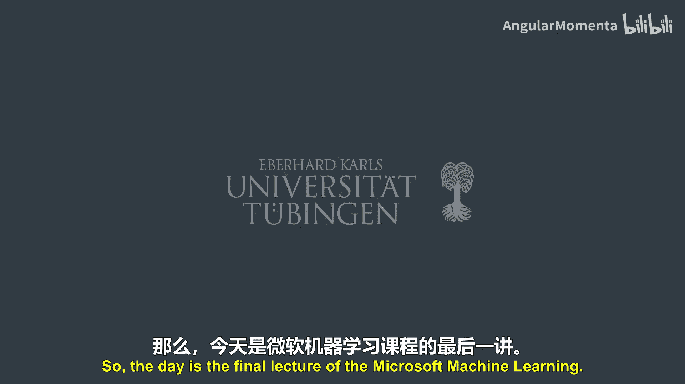

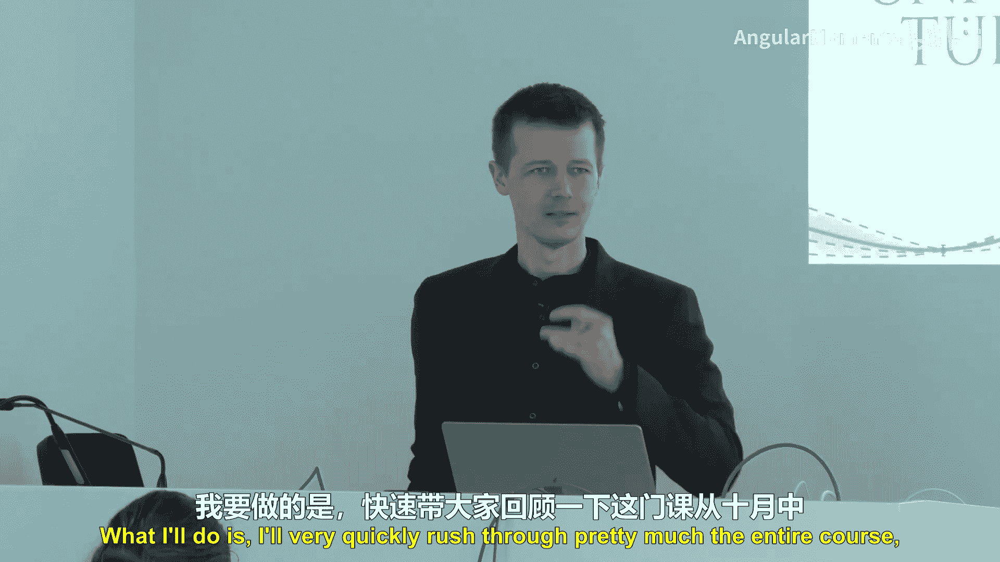

在本节课中，我们将回顾整个课程的核心内容，从线性代数到优化问题，探讨数值计算在机器学习中的核心地位。我们将看到，机器学习中的计算本质上是信息的管理与推断。

---

## 课程回顾与核心思想

这是本课程的最后一讲。我将快速回顾整个课程的内容，从十月中旬至今，涵盖了几乎所有讲座的核心思想。本次回顾旨在帮助大家为周一的考试做准备，同时也让我们退一步思考，在这个学期里我们究竟学到了什么。

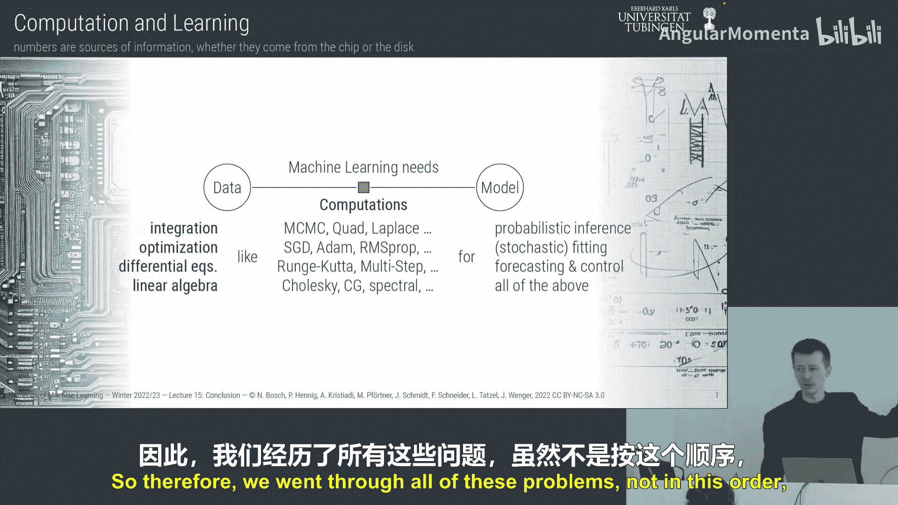

机器学习本身就是数值计算。机器在学习过程中所执行的操作，本质上是在解决一个数值问题。这与经典AI（如算法与数据结构中的算法）不同。在机器学习中，我们需要解决那些**没有闭式解**的数学问题，这些问题正是经典数值分析所研究的。

这些问题主要包括（并非完全按课程顺序）：
*   **积分**：用于贝叶斯推断。当需要衡量假设空间中剩余的不确定性体积时，就需要解决积分问题。
*   **优化**：用于训练深度神经网络或任何通过最小化正则化经验风险来构建点估计的模型。
*   **微分方程**：出现在智能体与数据源交互（如强化学习、机器人学）或科学定律建模等场景中，用于预测系统演化。
*   **线性代数**：因为线性代数无处不在，它是解决上述所有问题（如高斯积分、二次优化、线性微分方程）的基础。

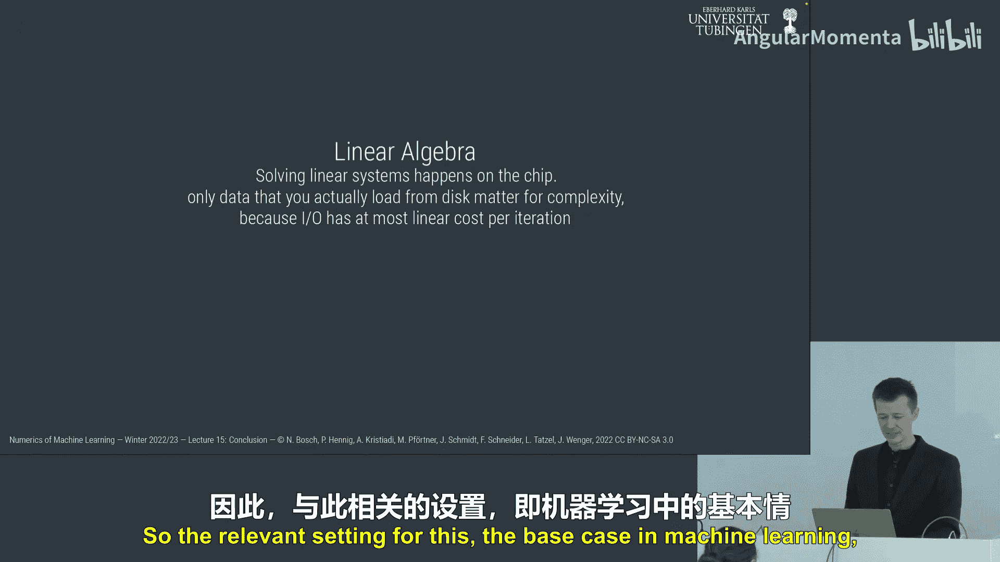

因此，我们逐一探讨了这些问题。我们首先从线性代数开始。

---

## 线性代数：计算的核心 🧮

上一节我们介绍了机器学习中数值问题的多样性。本节中我们来看看作为这一切基础的线性代数。

对我而言，线性代数部分的高级要点可以概括为：进行线性代数**计算**（这个动词）发生在你的处理单元（CPU或GPU）上，而你的数据存储在磁盘上。因此，当你考虑涉及数据集的线性代数计算的复杂度时，你实际上需要考虑的是从磁盘读取了多少数据并在芯片上进行了多少处理，而不仅仅是磁盘上有多少数据。

这一点之所以重要，是因为完整读取一次数据的成本与数据大小成**线性**关系。而线性代数中昂贵的操作与读取数据无关，而与你在芯片上对读取的数字所做的处理有关。这意味着我们实际上并不总是需要加载整个数据集。

机器学习中的一个基础案例是**高斯过程回归**，它在本课程中扮演了双重角色：一方面，它是最简单的监督机器学习算法之一；另一方面，它也是我们为课程后续部分构建数值算法的模型类。

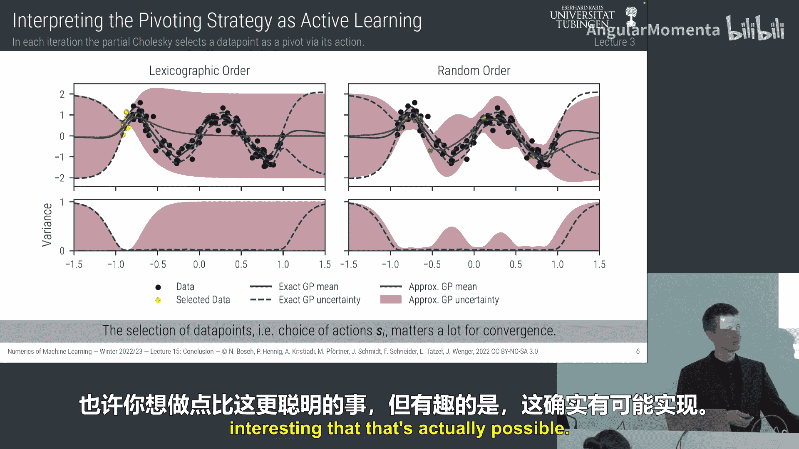

以下是第2讲（由Marvin讲授，Unnaan准备）中的幻灯片。为了得到这个预测分布（包含均值μ*和协方差Σ*），我们需要求解一个线性方程组，通常写作矩阵求逆乘以向量的形式：`(K(X*, X) * (K(X, X) + σ²I)^(-1) * y)`。

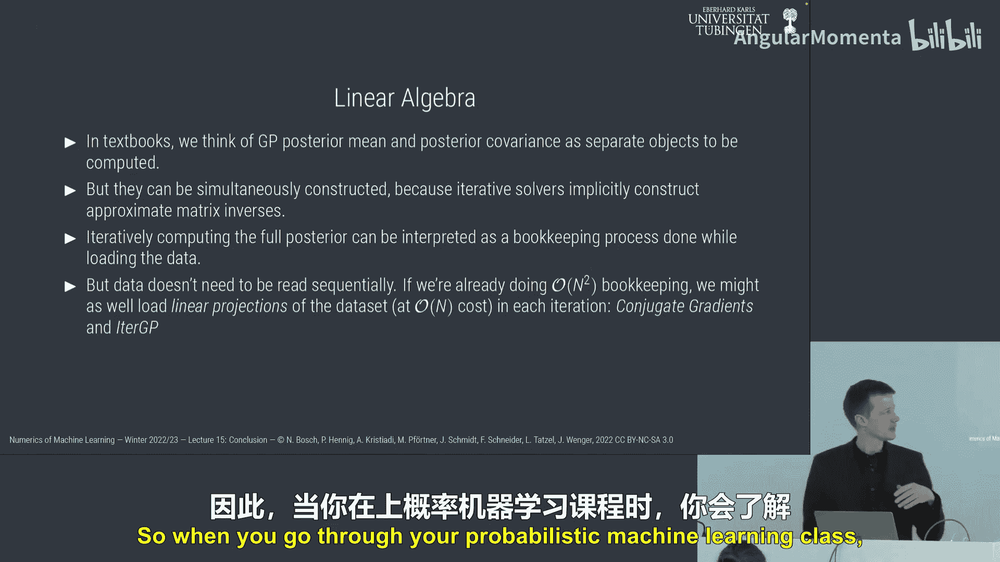

这种表示法隐藏了许多有趣的结构。它只是告诉我们“需要什么”，而没有说明“如何计算”。在像深度学习这样的其他机器学习算法中，这一点尤为重要。因为可以写出这样的方程，人们就认为这就是高斯过程回归所需的全部，从而认为它计算昂贵（因为教科书上说求解此类问题是O(n³)的）。而对于深度学习，我们无法写出这样的方程，人们甚至不会开始思考训练深度神经网络的复杂度到底有多高。

我们注意到，同样的问题（矩阵求逆）会出现两次，只是每次乘以的向量不同。在第2讲和随后的第3讲中，Marvin和Jonathan指出，求解此类线性方程组有多种算法。

经典的算法是**Cholesky分解**，通常被当作一个“黑箱”呈现。但实际上，我们可以将这个算法视为一个迭代过程：它逐行/逐列加载大矩阵，每一步的操作成本最初是线性的，但随着已处理步骤的增加，会有一个二次的修正步骤。最终，因为运行了n步，总成本是立方的O(n³)。

这个幻灯片揭示的一个关键点是：你可以将Cholesky分解不仅视为最终构造一个矩阵，实际上在过程的**每一步**都可以停止，并返回一个对所需逆矩阵的估计（即矩阵C）。这引发了一些有趣的讨论。

为什么这很有趣？首先，你可能会想，我可以提前停止算法并使用这个近似。当然，你需要担心这个近似是否足够好。在那次讲座中我们看到，如果数据是按某种顺序处理的，并且数据本身是有序的，那么你在某些区域会得到好的近似，在其他区域则不然，因为你还没有读取那些数据。你也可以**随机顺序**遍历数据，最终可能得到一个相当不错的后验分布近似。

一种理解方式是，这本质上就像“忘记”了磁盘上还有其他数据，只是不断加载数据块，而不关心其他部分。显然，这种方法的成本最多是数据量的线性关系，加上一个与我们已查看数据量相关的二次项。

这听起来可能有点平淡，因为你为什么要把所有数据留在磁盘上呢？也许你想做更聪明的事。但有趣的是，这确实是可行的。

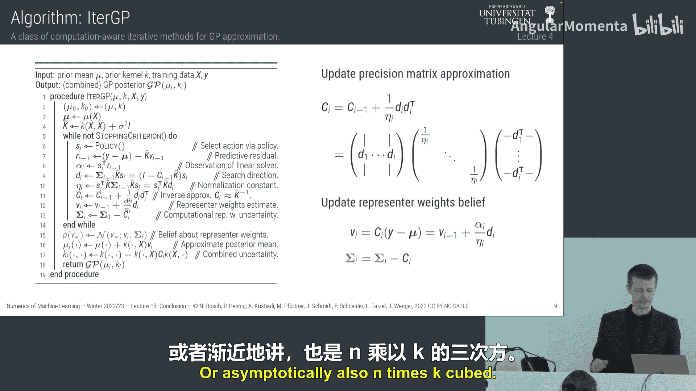

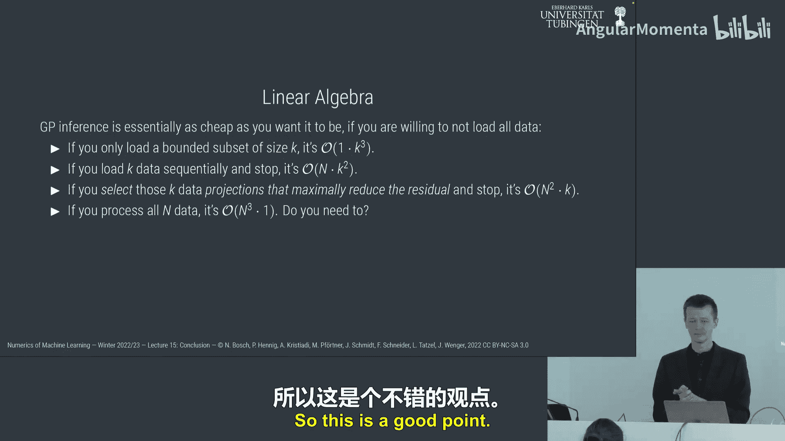

---

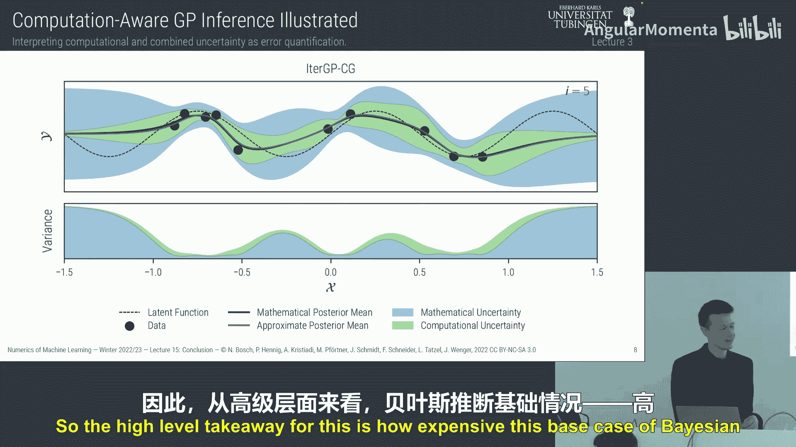

### 线性代数的高级洞见

这里有一个更深入的洞见，它在论坛上引发了一些讨论。当你在概率机器学习课程中学习时，你会知道要求解高斯过程回归，需要解决两个问题：求后验均值和后验协方差。如果你有中间矩阵的Cholesky分解，你就可以高效地解决这两个问题。所以，某种意义上你只需要做一件事：计算Cholesky分解。

然后，有人可能会说Cholesky太贵了，对于大数据集，你应该使用迭代线性求解器，比如我们在第3讲讨论的**共轭梯度法**。但共轭梯度法在教科书中通常被呈现为一种解决二次优化问题的方法，而不是矩阵分解。

如果你使用这种方法，似乎这里有两个不同的优化问题（A*x1 = b1 和 A*x2 = b2），你需要运行两次算法。实际上，共轭梯度法和Cholesky一样，也是一种在估计特定线性方程组解的同时，也估计矩阵逆的方法。只是Cholesky的性质在谈论它试图解决的那个线性问题的解时特别好。

这意味着我们实际上可以**使用共轭梯度法同时完成这两件事**。我们只需在其中一个问题上运行它，然后利用它构造的数字来直接估计一个逆矩阵，进而用于估计后验不确定性。

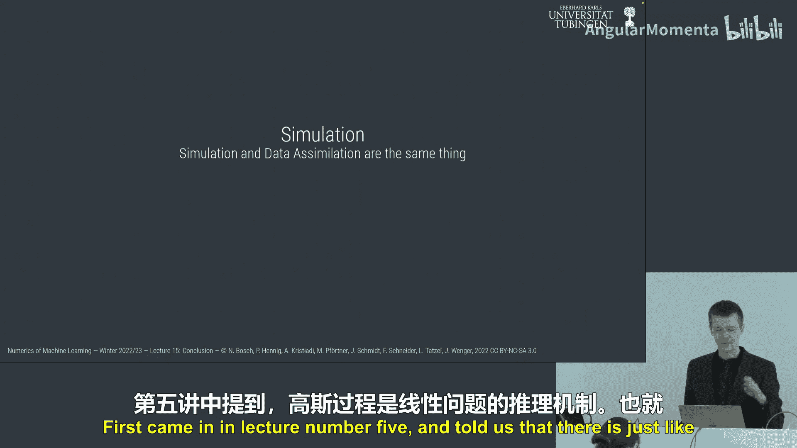

当我们这样做时，会出现一个非常有趣的结构：这个算法同时在做两件事。它从数据中学习，最终给出关于真实函数的有限不确定性；同时，它也在学习这个有限数据集上矩阵的逆。如果你在早期停止，这两者共同告诉你，你应该对整个问题有多不确定。因为你对最终试图估计的函数的误差（图中黑色实线和虚线之间的误差）来自两个不同的不确定性源：一是只有有限数据集，二是只进行了有限次计算（可能少于整个数据集）。

有趣的是，这两者可以同时被追踪，使用的算法看起来很像Cholesky，但更通用。如果策略是按输入空间位置逐个加载数据，你就得到类似Cholesky的算法。如果使用更智能的策略，你可能会收敛得更快，但代价是：智能策略需要规划它要探索数据的所有方向，这意味着该方法的每次迭代成本将是数据集大小的**二次方**，而不是Cholesky的线性成本。

---

### 线性代数部分总结

本节课我们一起学习了高斯过程推理这个基础案例的实际成本，远比教科书上的陈述要微妙。我们发现了非常细致的层次划分：

1.  **如果你决定永远不看整个数据集**：那么你只需加载K个数据点，计算估计的成本是O(K³)。
2.  **如果你决定加载整个数据集，但只进行K次迭代**：你可以构造像Cholesky这样的算法，成本是数据量的线性关系加上迭代次数的二次方，并伴随一个有意义的、能追踪已加载数据信息量的不确定性。
3.  **如果你想要一个能高效加载正确数据的算法以快速收敛**：那么每次迭代会更昂贵，因为每一步都需要查看所有其他数据点来决定加载哪些以及加载多少，每次迭代成本是二次的。
4.  **最后，你也可以直接做完整的Cholesky分解**：不关心迭代，直接加载全部数据并计算，成本是O(n³)。

为什么一定要做出查看整个数据集的强硬决定呢？毕竟之后你仍然会因为只有有限数据集而具有有限的不确定性。数据集的大小通常与你试图解决的问题没有直接关系。因此，当处理非平凡规模的数据时，思考如何操作数据、以何种顺序加载、在每次迭代中投入多少时间和计算资源是有意义的。

这引出了下一个场景：在某种意义上，我们在一个无限维的数据集上操作，我们需要决定评估的频率，并谨慎处理这些信息。

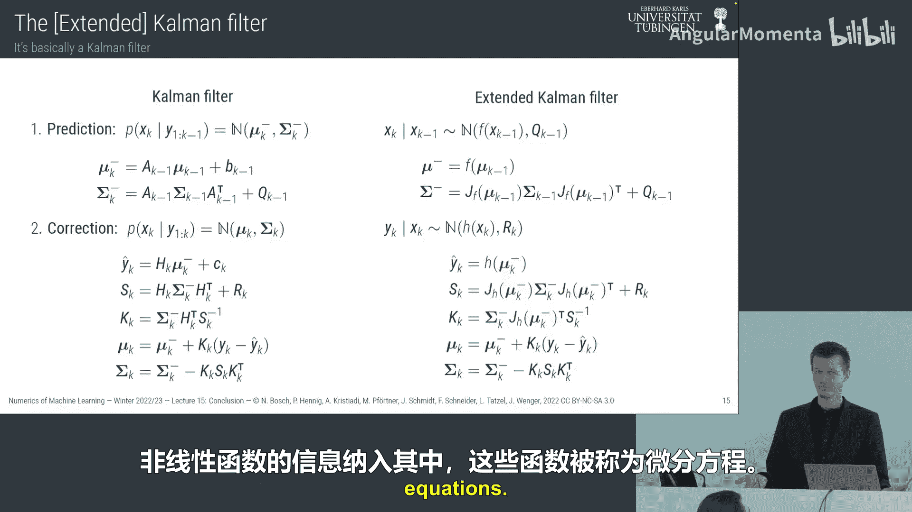

---

## 模拟与微分方程：作为滤波的求解器 ⏱️

上一节我们探讨了有限数据集上的计算。本节中我们来看看对随时间演化的系统进行模拟，这通常与常微分方程相关。

对于这类系统，Jonathan在第5讲中告诉我们，就像高斯过程是线性问题的推断机制一样，对于线性时变或时不变问题（即状态演化是先前状态的线性函数，观测是状态空间的线性变换，且观测具有高斯噪声），也有一个算法，称为**卡尔曼滤波与平滑**。这实际上是高斯过程推断的一个特例。

这个算法非常容易写下来，并且成本是时间步数的**线性**关系（尽管涉及矩阵求逆，所以状态空间元素数量的成本最多是立方的，我们可以应用之前线性代数的所有工具）。在数值计算中，我们经常通过嵌套算法来构建复杂问题的解决方案。因此，了解计算层次结构的底层是有用的，可以用来加速更高层次的计算。

直观上，滤波算法从链的左端开始，带着对初始状态的信念，随时间向前工作，遇到数据点时将其纳入。平滑算法则是一种簿记算法，确保链中所有早期变量与未来所做的观测保持一致。

然后，Nathanael在第7讲中指出，我们可以将这类算法应用于观测不是状态空间的线性高斯变换、状态转移也不是线性高斯函数的场景。这就是**扩展卡尔曼滤波器**，它通过在任何需要的地方进行泰勒近似（计算非线性函数的值及其雅可比矩阵）来“假装”关心的函数是线性的。

我们利用这个机制，将关于状态空间内状态之间非线性关系的信息（特别是当状态空间由函数值及其导数组成时）纳入进来。这些关系就是**微分方程**。

因此，事实证明，存在一种看起来、工作起来、表现起来都像滤波器的算法，可以**求解微分方程**。Nathanael的第7讲展示了这一点（第6讲是Nathanael介绍经典ODE求解器如何工作的插曲）。经典方法（如Runge-Kutta）是写在80年代的、性能极佳、非常稳健的“黑箱”代码，包含了无人敢改的魔法数字（Butcher表）。而这里介绍的滤波器框架则超级灵活，它是一种非常“计算机科学”的模拟方式。

我们首先写下特定的线性高斯系统（一个状态演化的马尔可夫链），然后通过说“在多个时间点上，我观测到状态之间的某些代数关系成立”来纳入关于微分方程的知识。例如，如果我说x在时间t的一阶导数与其零阶导数的某个函数之差为0，那就编码了一个常微分方程。

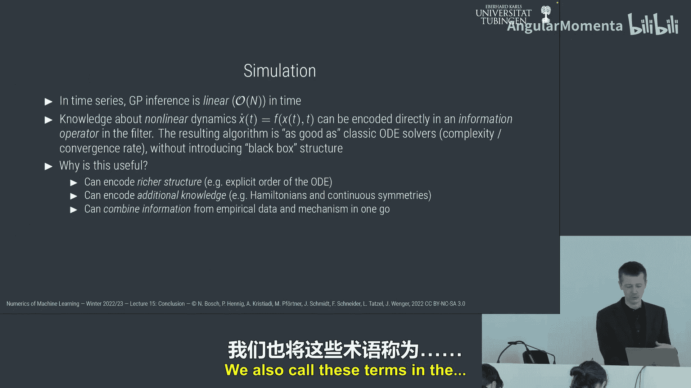

实际上，我可以纳入**任何代数隐式方程**，不仅仅是ODE，还有代数方程、连续对称性、哈密顿量，甚至**偏微分方程**。我们还可以纳入其他信息，例如在多个时间点观测到系统的测量值。这意味着我不需要知道非常复杂的工具箱（Runge-Kutta、几何积分器等）以及何时调用哪个，我只需要使用卡尔曼滤波器即可。

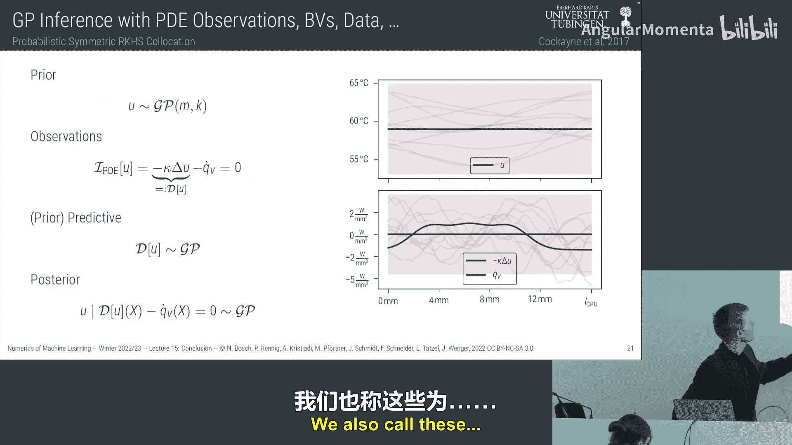

特别是，如果状态空间X中有某些部分没有出现在方程中，我可以使用其他类型的观测来告知算法这些值可能是什么。我们在COVID设置的例子中看到了这一点：如果动力系统中存在一些潜在力（如未知的接触率），那么观测系统轨迹并结合微分方程可以告诉你潜在力是什么（当然，取决于微分方程和潜在力与观测轨迹的交互方式）。

这里的要点是，我们非常明确地将**信息**视为计算的核心对象。这些方法所做的是管理信息。我们称这些项为**信息算子**，它们是更新你对动力系统所知知识的算法部分。信息是来自磁盘、传感器还是程序员写下的代数方程，这并不重要，它只是一个数字。信息算子也充当了算法用户和设计者之间的接口。

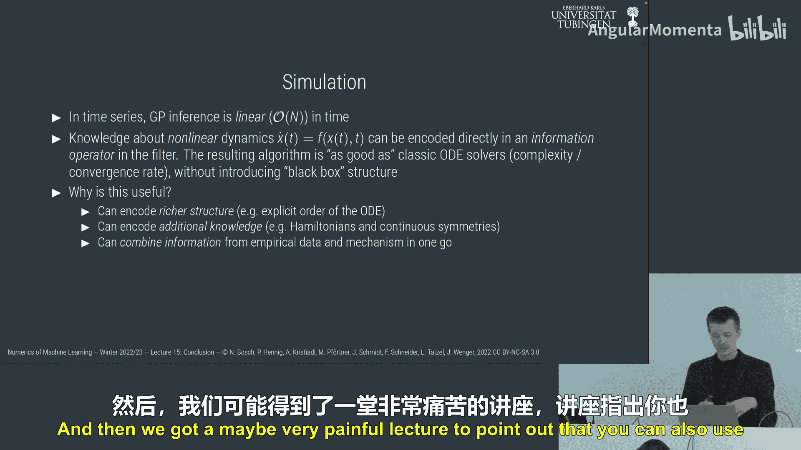

---

## 偏微分方程：高斯过程推断的视角 🌊

上一节我们看到了如何用滤波方法解决常微分方程。本节中我们来看看偏微分方程。

求解偏微分方程本质上是相同的事情。我们有一个方程，通常写作 `D[V(x, t)] = f(V(x, t))` 的形式，其中D是包含许多偏导数的微分算子，V是我们关心的解（依赖于空间和时间的函数）。天气预报方程就长这样。

这其实就是另一个形如 `G(x) = 0` 的方程，只不过现在状态X是随时间变化的函数V。因此，我们必须更小心地进行计算。滤波器不能立即解决所有问题，因为如果我们对空间进行网格离散，然后在时间上使用滤波器求解，当网格点很多时，卡尔曼滤波器中的大逆矩阵仍然会出现并使一切变慢。

Marvin指出，在一个特殊情况下，即当这里的算子是**线性**的时候，这可以作为高斯过程回归的一个实例来解决。我们只是观测了函数V在各种不同算子下的线性投影。这本质上就是高斯过程推断，只不过对象是函数。函数在某种程度上与向量不同，函数空间可能很复杂。Marvin用一张包含复杂定理的幻灯片提供了“许可”，允许我们在某些前提下将函数视为具有无限多项的超长向量。

因此，你可以将此类微分方程视为只是在进行高斯过程推断，只不过有一个非常有趣的观测模型。如果它们不是线性的呢？目前还没有完整的答案，但你可以想象，就像ODE情况一样，尽可能地进行线性化。

你可以写下函数的生成模型（一个高斯过程先验），然后用各种信息源（如某个偏微分方程成立、边界值、传感器测量值）来告知它。所有这些信息算子组合在一起，形成了一个大型高斯过程推断方案，最终归结为一个大型最小二乘线性代数问题。然后，我们又回到了第2讲和第3讲，重新进行线性代数计算，最终得到关于这个动力系统的、带有不确定性量化的表示。

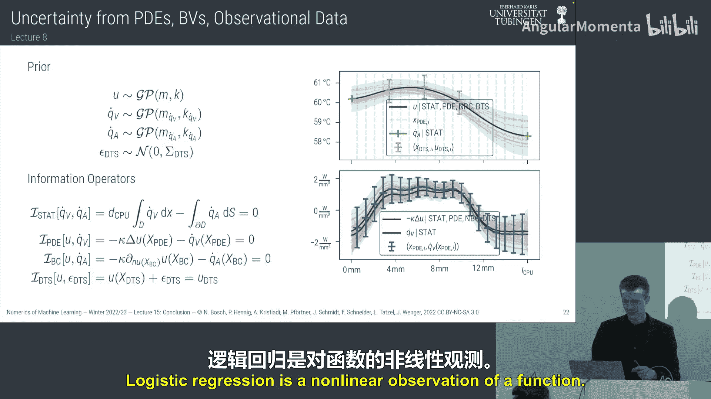

所以，未来当有人在机器学习中提出微分方程时，你不必再害怕它们。它们只是**一种信息源**。从观测一个函数，到观测一个函数的投影，这只是前进了一步。有时它是非线性的，但这不应该成为问题，因为我们在分类等任务中已经经常非线性地观测函数了。

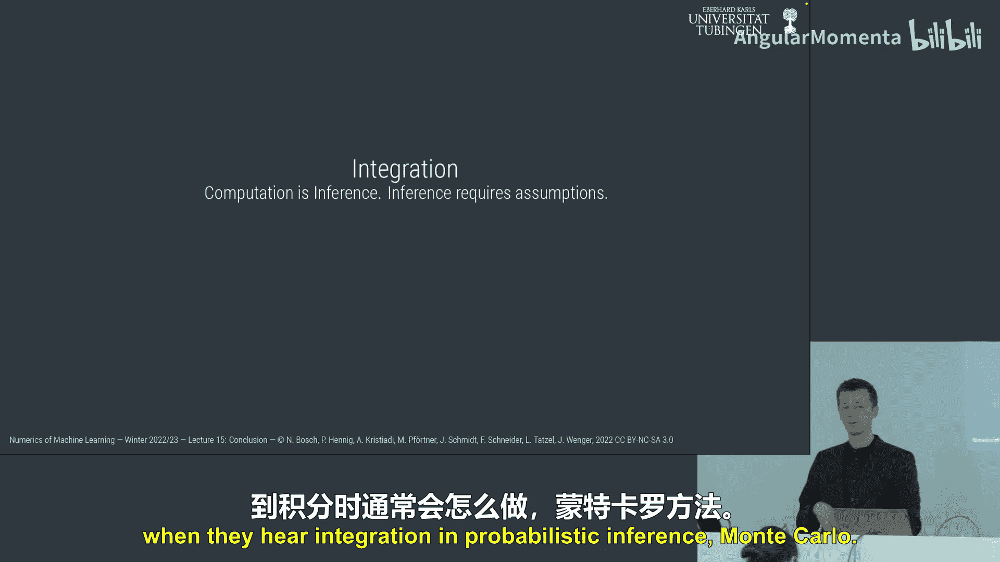

---

## 积分：从蒙特卡洛到贝叶斯求积 📊

上一节我们探讨了微分方程的求解。本节中我们来看看机器学习中的积分问题，特别是在概率推断中。

我们在第9讲开始讨论积分，通常人们会想到**蒙特卡洛**方法。蒙特卡洛是一套优美的算法，它通过从概率分布P中抽取随机数并计算和，将确定性的推断问题转化为随机的统计问题。这种方法的好处是它给出一个无偏估计，并且适用于几乎任何积分问题。但它的代价是收敛速度慢：积分估计值收敛到真值的**最佳速率**是 `O(1/√N)`，其中N是样本数。

在第10讲（圣诞节前），我们研究了另一种截然不同的方法：不是对问题一无所知地随机抽样，而是花尽可能多的时间来精确建模被积函数，然后从精心选择的函数评估中学习其积分。这连接了**贝叶斯求积**的思想。

我们从一个高斯过程先验开始（现在这对你们来说很自然了），它不仅定义了函数，还通过核函数的可积性，定义了关于积分的高斯边际分布。当我们用函数在某些点上的评估值来条件化这个分布时，我们不仅得到了函数的估计，也得到了积分的估计。

这种方法要求我们能够计算核函数及其组合的积分。除此之外，它是一个允许我们进行积分的算法。我们看到，在某些设置下，特别是低维问题中，这类算法可以表现得非常好，收敛速度可以比蒙特卡洛快得多（多项式快，而非平方根快），甚至存在收敛速度超多项式的特殊算法类。

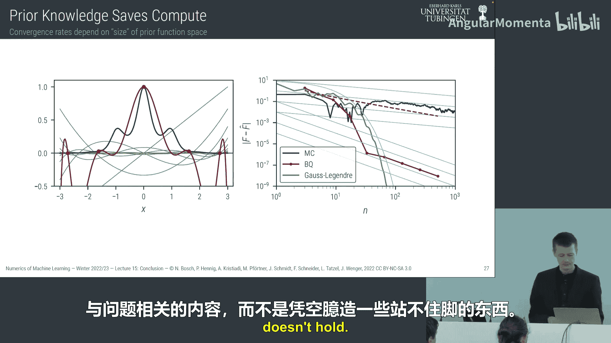

诚然，这主要适用于低维问题，将其扩展到高维问题并保持快速收敛是棘手的。构建在高维上与蒙特卡洛效果相当的版本并不难，但那样做意义不大。

这部分课程的主要收获不是“如果你需要积分，就用贝叶斯求积”，而更像是一个哲学观察：当你使用一个**适用于所有问题**的算法时，它通常在**几乎所有**问题上都表现不佳。你为通用性付出了代价。而如果你构建一个只适用于**很小一类问题**的算法，那么它可能在这类问题的每个实例上都表现得非常好，但一旦超出该类，就可能完全失效。

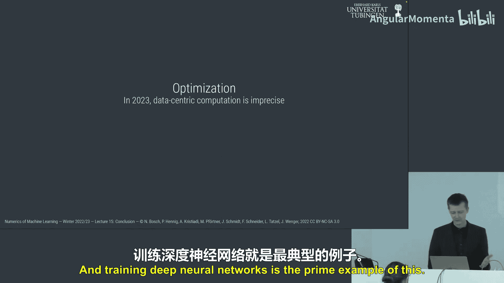

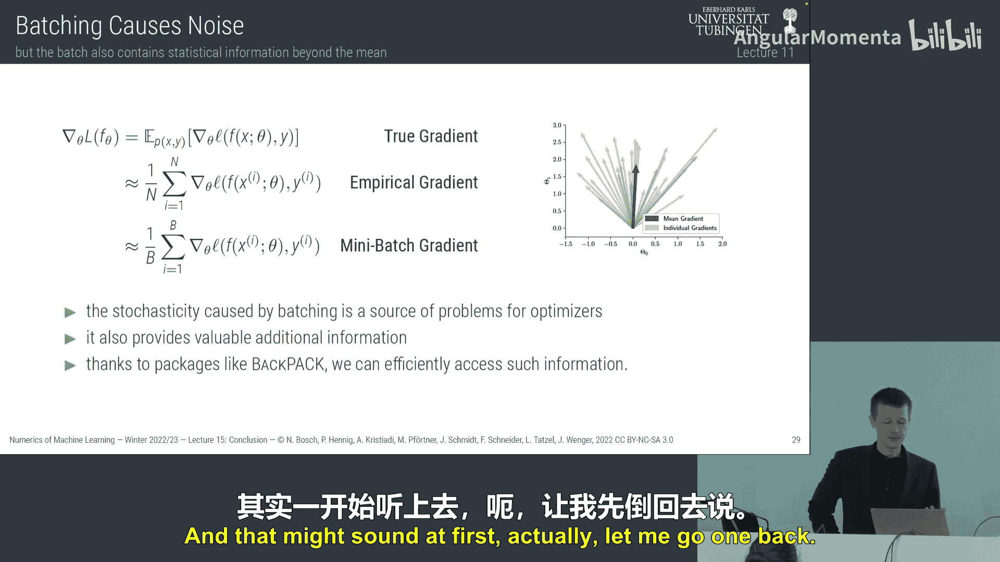

这让人联想到贝叶斯推断：如果一个先验将大量概率质量放在一个小的约束空间上，那么你就不需要太多数据在该空间内进行推断。但如果先验假设是错误的，算法可能完全失效。

这对计算意味着什么？这意味着，从构建算法的理论家的社会角度看，他们受学术体系激励去构建适用于**大类问题**的方法。但在实践中，如果你是为一个商业或科学上有价值的问题构建解决方案，你通常**只有一个问题**要解决。因此，如果你了解情况并构建一个针对你的问题的定制方法，有时可以提高性能。

---

## 深度学习优化：未解的挑战与机遇 🤖

圣诞节后，我们回归课程，步调有所改变，开始探讨当代机器学习中那些**尚无完美解决方案**、但又极其重要的数值问题。训练深度神经网络就是最主要的例子。

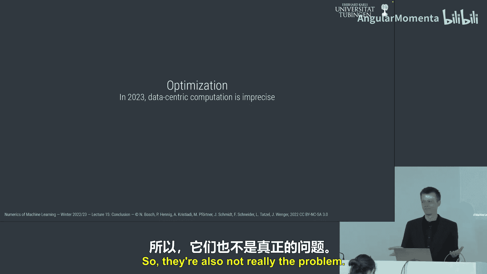

Frank在圣诞后的讲座中向你们展示了超过120种优化器的列表，并论证了它们中的大多数效果都差不多，你大可以使用**Adam**来训练你的深度神经网络。

这乍一听似乎问题已经解决了。但实际上，这些算法从根本上令人沮丧。它们真的很难用，需要“精心照料”、超参数调优、不一定总是有效、需要良好的网络初始化、你甚至需要决定何时停止训练。这与不久以前优化领域研究的情况截然不同。那时，优化讲座会告诉你，有现成的完美算法可以下载使用，你只需以正确的形式写出问题，然后它就能解决。

而现在，在机器学习中，我们面对的是另一个极端。我们有上百人的工程团队训练大语言模型，每周开会决定是否要降低学习率、改变批次大小，或者因为梯度爆炸而回滚到上周的安全状态。我们正处于一个非常有趣的时间点：这些方法并不真正“有效”，它们只是“足够好”到能引起公众注意并获得大量资金，但这并不是对资源的高效利用。

为什么会这样？可能的原因有三个：
1.  **问题规模大**：大语言模型有数十亿参数。但这并非根本原因，因为优化在30-40年前就已处理百万维问题，而且芯片变得更强大。
2.  **问题非凸**：经典优化理论主要适用于凸问题。但早在70年代，人们就已将拟牛顿法应用于非凸问题并使其工作。
3.  **随机性**：这才是问题的核心，也回到了本课程关于计算不确定性的中心。

训练深度神经网络时，你并不是在最小化总体风险（因为数据有限），甚至也不是在最小化经验风险（因为计算也有限）。你实际上是在评估**小批量梯度**，这是一个围绕批次平均梯度分布的对象。这极大地降低了优化算法的性能，因为它引入了非常显著的噪声，实际上噪声可能比信号还大。

典型的批次平均梯度甚至不指向正确的方向。我们不能将其视为小扰动，因为你想计算的东西和你实际计算到的东西之间的扰动，相对于你想计算的东西来说并不小。你真正获得的是一个具有少量结构的随机比特源，游戏的目标是从这些随机变量中获取尽可能多的信息。

Frank在他的讲座中强调了这一点：我们不必对这个设置感到绝望。事实上，它提供了许多有趣的新途径。因为，我们不仅能访问那个红色箭头（平均梯度），还能访问所有金色箭头（每个样本的梯度），它们在训练过程中已经被计算出来了。典型的深度学习库只返回平均梯度，但如果你愿意，你可以访问所有这些信息。突然之间，你有了一个更丰富的信息源——一个数组，而不仅仅是一个向量。你还可以计算这个对象的梯度（曲率估计），使用自动微分。

随后，Michael在第12讲中指出，你或许可以利用这些曲率估计来构建有趣的算法，比如经典的基于牛顿的优化方法。只是需要小心，因为我们现在处于这个“深度”设置中，之前提到的三个问题都适用：模型非常大（曲率矩阵更大）、问题非凸（Hessian不正定）、一切都是随机的。

目前，整个社区（不仅仅是这个讲堂）对此还没有结论性的答案。我个人的预测是，当这样的答案出现时，将会非常激动人心。你会知道它出现了，因为它将使训练深度神经网络的速度**难以置信地加快**，带来数量级上的性能变化，从而改变我们进行机器学习的方式。

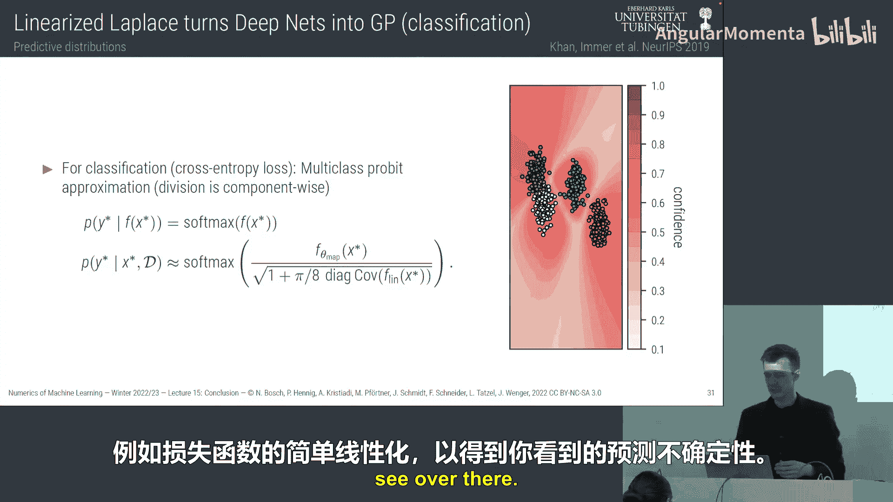

与此同时，我们也可以利用这些量来做训练之外的其他事情。例如，一旦网络训练好，我们想知道它到底知道什么，权重空间的哪些部分受到约束，模型有多不确定。我（基于Ats的工作）做了一次讲座，展示了我们可以使用这些曲率估计，通过**拉普拉斯近似**的思想，以各种轻量级方式为深度神经网络构建不确定性估计。

其思想是：你用你喜欢的方式训练深度神经网络，直到在权重空间找到一个点（即你的最佳猜测）。然后，在该点计算损失函数相对于网络权重的曲率近似。这告诉你在哪个方向上损失是平坦的（在训练数据上），在哪个方向上是陡峭的。平坦的方向意味着不确定性高，陡峭的方向意味着置信度高。我们通过取这个曲率矩阵的负逆，将其转化为一个高斯协方差矩阵，然后可以将其插入到损失函数的简单线性化中，以获得预测不确定性。

这种功能可以用于各种不同的用例，特别是可以与权重空间中的网络线性化相结合，得到一个机制，将任何深度神经网络近似地转化为一个参数化的高斯回归算法后验，仅使用线性代数和自动微分，无需花哨、复杂、昂贵的蒙特卡洛方法，并且可以在训练后完成而不影响算法性能。

---

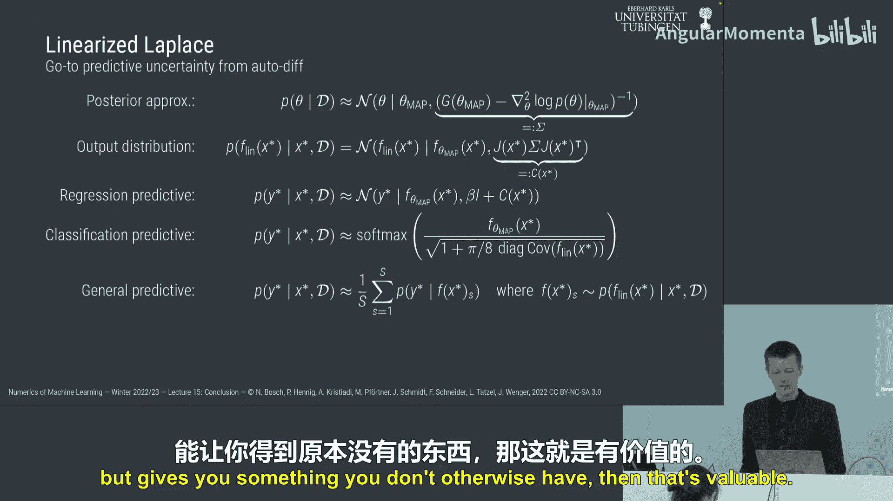

## 总结：计算即推断 🧠

本节课我们一起回顾了整个课程，从线性代数到深度学习优化。现在，让我们来总结一下核心的高级要点。

*   **计算即推断**：所有的计算都是信息的管理和操作。
*   **信息管理**：在芯片上，通过从磁盘加载数据，或者由人类设计者写下可以在不同点评估的自然定律来获取信息。无论数字来自磁盘还是作为信息算子可用，算法都必须决定如何处理它们。
*   **主动代理**：数值计算是智能体与数据源交互的行为。在求解微分方程时，算法必须决定在哪里离散化问题、进行多少次计算，这很明显是主动决策。对于数据也是如此：进行高斯过程回归或深度学习时，思考实际想使用多少数据、加载多少、在其上进行多少计算是有益的。
*   **新模式与新工具**：如果我们认真对待这种联系，就可以构建新的、以数据为中心的计算方式。如果做得对，它们可能更灵活、更易用、更容易推广到不同设置，并提供如信息算子、高斯过程回归、卡尔曼滤波与平滑、拉普拉斯近似等设计模式，可以非常灵活地用于纳入来自各种来源的信息。
*   **数值计算是核心**：最终，这一切都是数值计算。对于构建学习机器的人来说，机器学习就是数值计算。因此，了解数值算法（无论是经典的还是我们重新诠释的）如何工作，能让你成为更好的机器学习工程师。如果不了解，你就只能受限于别人为你制造的工具。

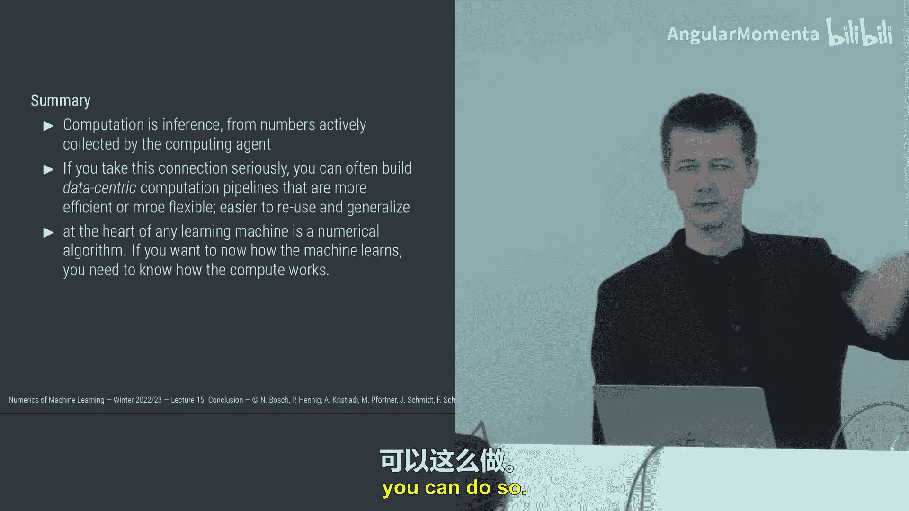

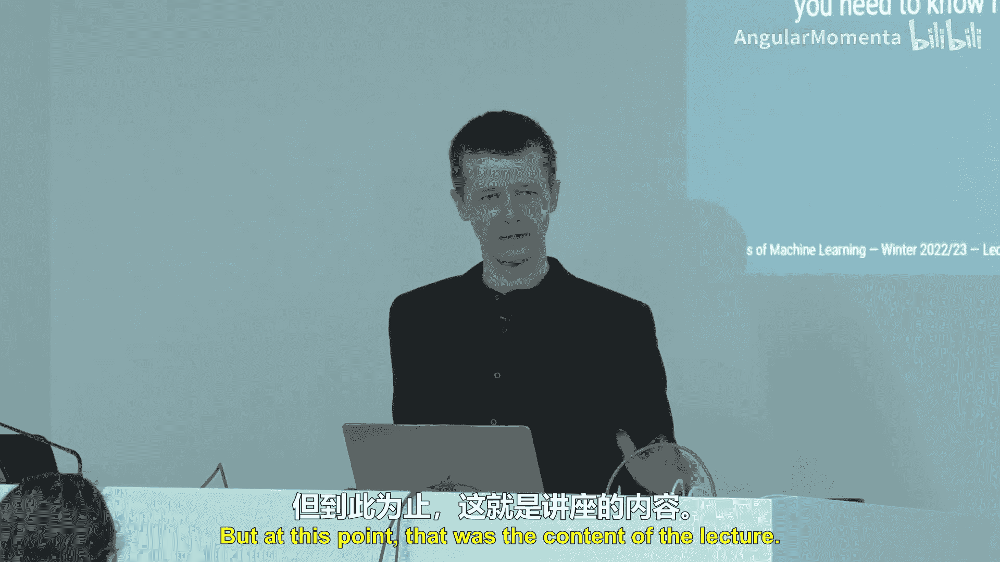

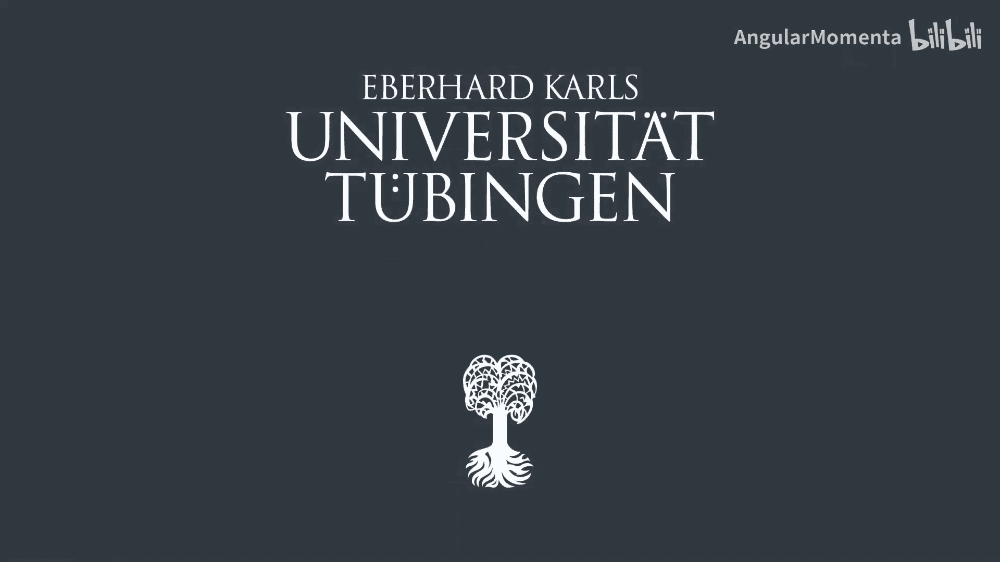

希望这次回顾对你们有所帮助。请记得填写最终反馈表。当然，我们还需要谈谈考试的事情。以上就是本次讲座的全部内容。祝大家考试顺利！