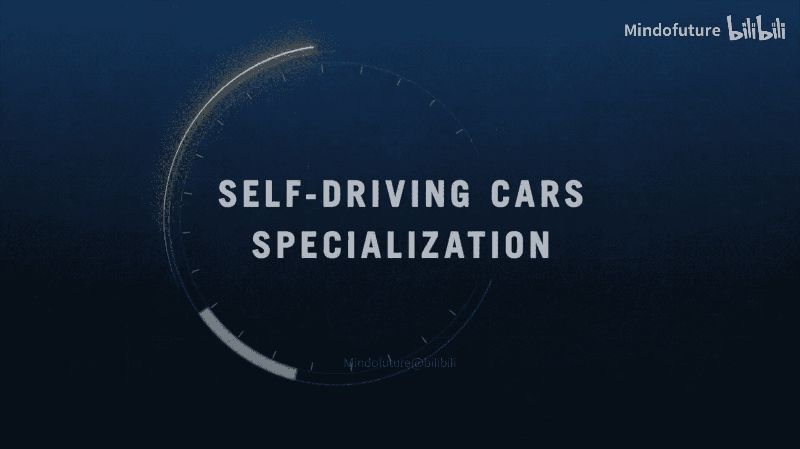
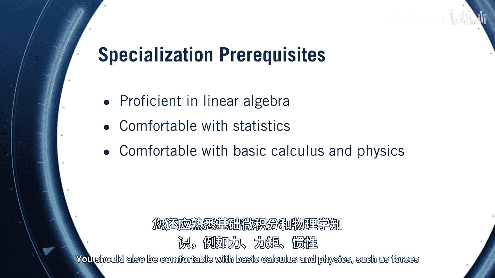
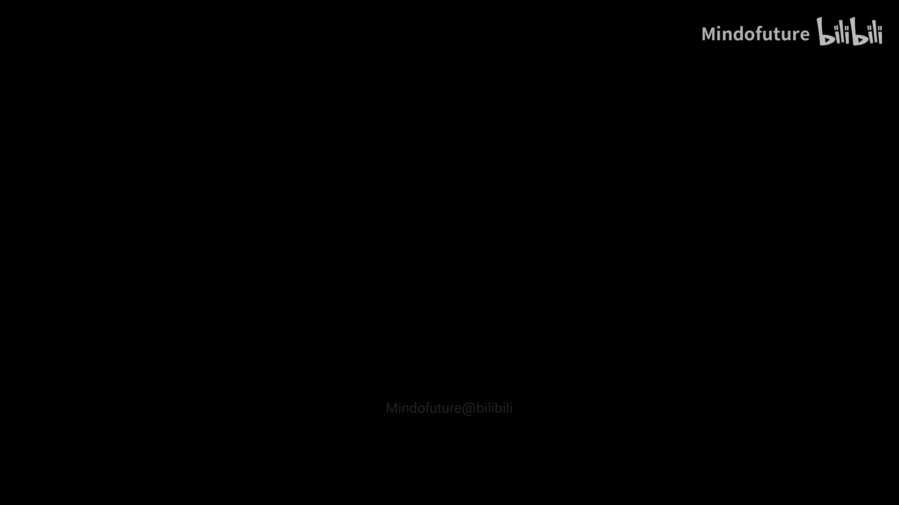

# 001：欢迎来到自动驾驶汽车专项课程

在本节课中，我们将介绍多伦多大学自动驾驶汽车专项课程的概览，包括课程目标、内容结构以及学习所需的基础知识。

---

大家好，欢迎来到多伦多大学的自动驾驶汽车专项课程。我是Steven。我是Jonathan。我们将作为您在整个专项课程中的讲师。自动驾驶汽车是沉睡的巨人，它有能力改变一切。它能提升道路安全，为所有人提供出行便利，同时显著降低驾驶成本。本专项课程将教授您在自动驾驶行业开启职业生涯所需的知识。

无论您来自学术界还是工业界，这些课程都将为您提供基础知识和实践技能，帮助您与自动驾驶汽车共同构建新的未来。在整个课程中，我们将向您展示来自我们研究以及我们自己的自动驾驶汽车（我们称之为“Autonoousose”）的真实世界数据和场景。

经过数十年的应用研究和屡获殊荣的探索，我们多伦多大学团队很高兴向您展示自动驾驶的核心技术细节。本专项课程共包含四门课程。

以下是第一门课程的内容简介。

在第一门课程中，我将向您介绍自动驾驶汽车的软件和硬件架构。到本课程结束时，您将能够设计自动驾驶汽车的基本硬件系统，识别自动驾驶软件栈的主要组件，并为自动驾驶汽车项目制定安全评估策略。

上一节我们介绍了课程概览，本节中我们来看看后续课程的核心内容。

在专项课程的第二门课程中，我将教授您关于自动驾驶汽车的状态估计、感知和定位。到本课程结束时，您将理解参数和状态估计的关键方法，开发并使用典型车辆定位传感器的模型，将扩展卡尔曼滤波器和无迹卡尔曼滤波器应用于车辆状态估计问题，并将激光雷达扫描生成的点云配准到静态环境的3D地图上。

在第三门课程中，我将教授您自动驾驶汽车的视觉感知。完成本课程后，您将能够将3D点投影到相机图像平面上，校准针孔相机模型，应用特征检测、描述和匹配算法进行定位与建图，开发并训练用于目标检测和语义分割的神经网络。您将把这些方法应用于车辆跟踪和可行驶路面估计。

在第四门也是最后一门课程中，我将教授您自动驾驶汽车的运动规划。到本课程结束时，您将能够设计轨迹展开运动规划方法，计算与静态和匀速运动物体的碰撞时间，在复杂的道路网络上规划路线，为车辆定义高级行为及状态转换（例如通过十字路口、绕过停放的车辆和并道），在存在静态障碍物的环境中开发运动学可行的路径，计算满足速度、曲率和移动物体运动规划约束的速度曲线，规划行为并执行操作以安全地在世界中导航，并在CARLA模拟器中获得调试和测试自动驾驶算法的宝贵经验。

因此，到专项课程结束时，您将对自动驾驶软件栈的架构和组件有详细的了解，并将能够编程实现您自己的自动驾驶汽车。

---

由于我们教授的是如何编程实现您自己的自动驾驶汽车，本专项课程有几项先决条件。

以下是学习本课程所需的基础知识列表。

*   您应精通线性代数，并熟悉矩阵、向量、矩阵乘法、秩、特征向量和逆矩阵。这些背景知识将有助于您理解贯穿各课程的控制、状态估计、感知和规划算法。
*   您还应熟悉统计学，特别是高斯概率分布。这些知识对于状态估计和感知非常重要，例如当我们从GPS和惯性测量中估计车辆速度和航向时。
*   您还应熟悉基础微积分和物理学，例如力、力矩、惯性和牛顿定律。

当然，了解如何驾驶汽车是有帮助的，但由于汽车是自动驾驶的，这并非本专项课程的硬性要求。如果您不具备这些必要的先决条件，Coursera上有优秀的机器人学、人工智能、深度学习等课程可以帮助您为此专项课程做好准备。

自动驾驶是一个不断发展和变化的领域，因此不仅跟上自动驾驶知识，还跟上机器人学、人工智能和深度学习的发展，将有助于您保持技术技能的敏锐度。前路漫漫，我们需要先驱者帮助我们到达彼岸。

那么，您准备好开始这段旅程了吗？

---

本节课中我们一起学习了多伦多大学自动驾驶汽车专项课程的总体介绍、四门核心课程的主要内容以及学习所需的基础知识准备。