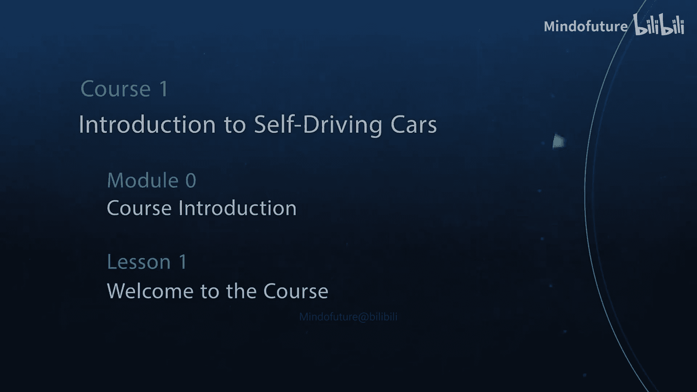
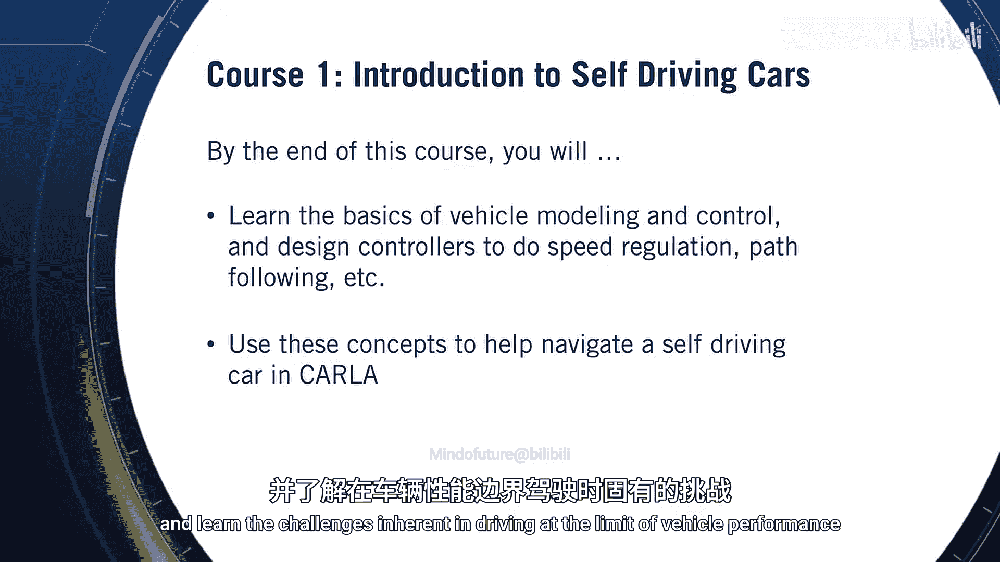
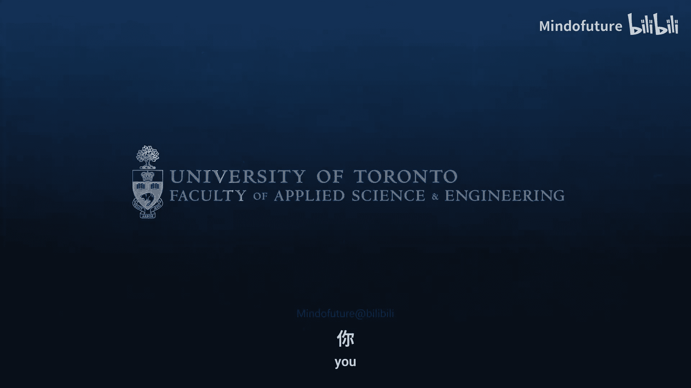

# 002：课程概述与目标 🚗

在本节课中，我们将要学习多伦多大学自动驾驶汽车专项课程的第一门课程。我们将了解课程的整体结构、核心学习目标以及最终的项目实践。

欢迎来到多伦多大学自动驾驶汽车专项课程的第一门课程。我是斯蒂芬，我将担任您在本课程中的讲师。

本课程旨在向您介绍自动驾驶汽车的世界。我们将从定义“驾驶任务”开始，然后列出驾驶的各个要素，即您手握方向盘时会自动执行的所有操作。这包括许多感知任务，例如识别路标、其他车辆和行人，预测他们的行为，以及做出各种决策以在交通中安全行驶。

接下来，我们将探讨设计基本自动驾驶汽车硬件配置的不同方法，讨论一个通用的软件栈，用于将驾驶任务分解为可管理的组件，并讨论如何为决策制定表示感知到的环境。

随后，我们将研究如何在自动驾驶汽车设计中融入安全考量，包括软件和硬件两个方面。从那里，我们将进入车辆建模与控制领域。我们将建立一个捕捉车辆纵向和横向动力学的模型，定义一个调节车辆速度的控制器，定义一个跟踪期望路径的路径跟随控制器，甚至了解用于精确执行具有挑战性机动操作的最先进的模型预测轨迹控制器。

在本课程结束时，您将完成一个实际项目，在CarSim仿真环境中驾驶一辆自动驾驶汽车绕赛道行驶。您将测试控制设计的极限，并了解在车辆性能极限下驾驶所固有的挑战。

这些主题将为本专项课程中使用的自动驾驶基本术语奠定基础，列出构建自动驾驶解决方案的最重要要求，并展示如何在自动驾驶汽车中执行动态驾驶机动。

我非常高兴能向您介绍这些概念，并希望它们对您有所帮助，助力自动驾驶汽车成为我们日常生活的一部分。

那么，让我们开始吧。今天是构建自动驾驶汽车的好日子。😊

---

**本节课中我们一起学习了**：本课程的整体介绍、学习路径以及最终目标。我们明确了课程将从驾驶任务分解开始，逐步深入到硬件配置、软件架构、安全设计、车辆动力学建模与控制，最终通过一个仿真项目来综合应用所学知识，为后续深入学习自动驾驶技术打下坚实基础。