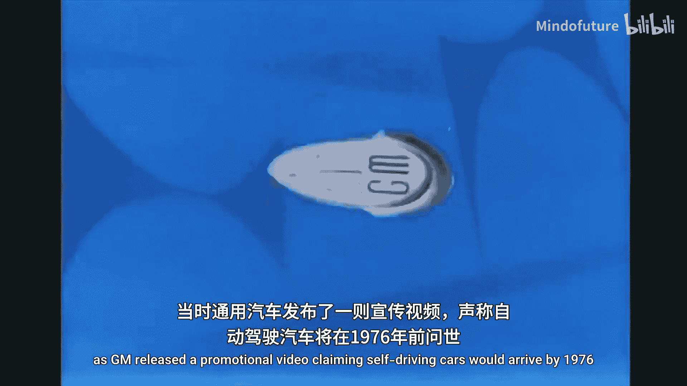
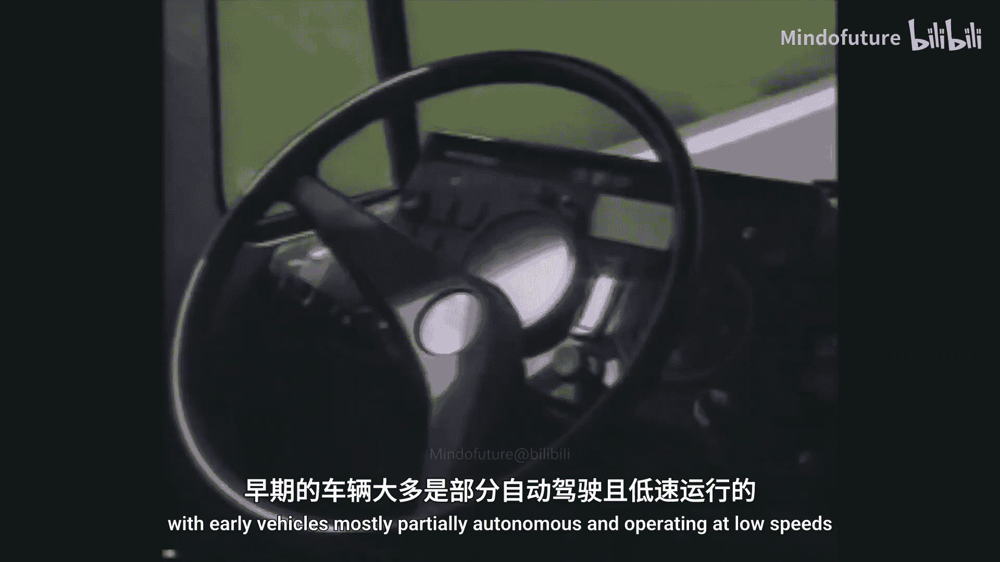
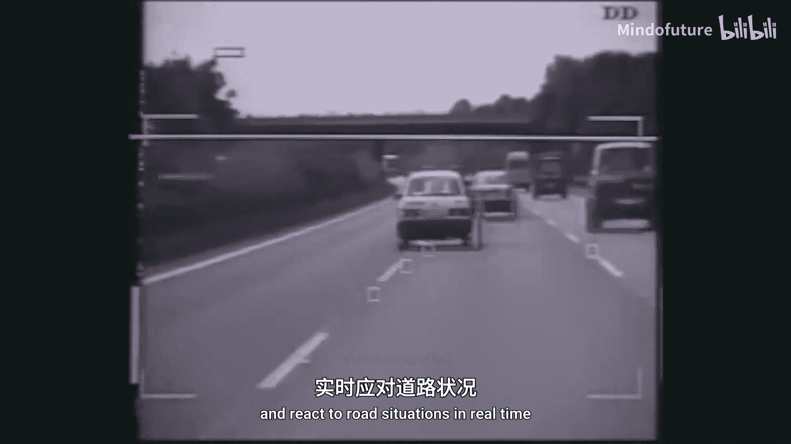
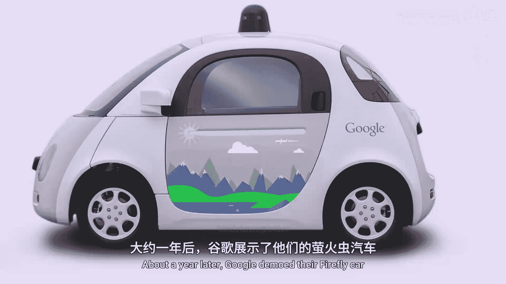
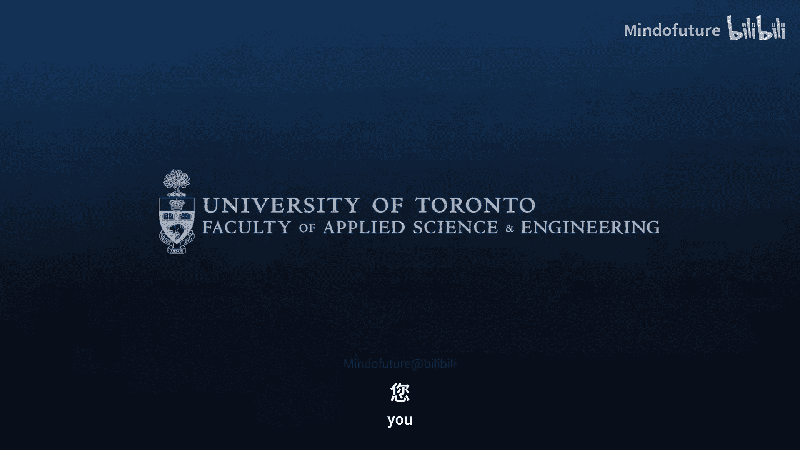

自动驾驶汽车简介：P03：自动驾驶汽车的故事

在本节课中，我们将回顾自动驾驶汽车发展历程中的主要里程碑。从早期的梦想与尝试，到现代技术的突破与挑战，我们将一同探索这段激动人心的历史。

---

### **概述**

自动驾驶的未来看似近在咫尺，但抵达这一点的旅程漫长而艰辛。自动驾驶汽车的梦想几乎与汽车本身一样古老。本教程将带您从最初的构想开始，穿越数十年的技术演进，了解那些定义了这个行业的关键突破与挫折。

---

### **早期梦想与构想（1920s-1950s）**

自动驾驶的构想很早就已出现。早在1925年，弗朗西斯·胡迪纳展示了一辆名为“美国奇迹”的遥控汽车，它空着驾驶座在曼哈顿街道上行驶，吓坏了路人。

需要澄清的是，这位本地机械师弗朗西斯·胡迪纳，并非著名的逃脱艺术家哈里·胡迪尼。后者曾因人们错误地将此壮举归功于他而感到相当不快，并引发了一场争执。

到了1956年，自动驾驶汽车的梦想依然活跃。通用汽车公司发布了一部宣传视频，声称自动驾驶汽车将在1976年问世。

在《未来的钥匙》中，通用汽车设想人类在高速公路上交出控制权，享受无压力的驾驶，乘客甚至可以通过语音激活的控制功能与汽车互动。这个预测在时间上有些乐观，但令人惊讶的是，该视频中的许多预测如今正在市场上成为现实。

主流灵感的来源直接来自于繁忙交通中的驾驶现实。毫无疑问，我们日常所做的最危险的事情之一就是开车。事实上，当今超过94%的驾驶事故都是由某种人为错误引起的。

那么，如果我们能通过自动化消除人为错误，从而最小化或完全消除驾驶死亡事故呢？此外，一个无人驾驶的未来还能带来许多其他深远的好处：你无需再专注于车道、转弯和交通，可以回复工作邮件、吃饭或放松，让早晨的时光变得高效得多。我们还可以将驾驶提供的出行便利扩展到全人类，而不仅仅是那些能够执行驾驶任务的人。

---

### **欧洲与美国的初步探索（1980s-1990s）**

让我们回到自动驾驶汽车故事的开端，看看定义这个行业的里程碑、让一切成为可能的突破，以及提醒我们这个无处不在的自主驾驶愿景有多么雄心勃勃的挫折。

我们的旅程始于20世纪80年代欧洲的一些早期进展。先驱者们研究自动驾驶技术已超过40年，早期的车辆大多是部分自动驾驶，且以低速运行。

1986年，慕尼黑大学的恩斯特·迪克曼斯及其团队开创了一辆机器人货车，它可以在无交通的情况下完全自主驾驶。1987年，它的行驶速度达到了每小时60公里。

在20世纪90年代初，他的团队为尤里卡普罗米修斯项目做出了重大贡献，并开发了一辆使用心理计算机视觉（即专注于环境中兴趣点）的自动驾驶奔驰汽车。他们使用了超过50个当时最新的微处理器——Transputer，并采用了机器人技术中通用的概率方法，来融合传感器输入并实时应对道路情况。

最终，这辆奔驰汽车在交通中从慕尼黑行驶了1600公里到达哥本哈根，人类干预的平均间隔距离为9公里。

与此同时在美国，卡内基梅隆大学的NavLab实验室正忙于构建一系列能力不断提升的原型车。

1986年，他们的第一辆自动驾驶汽车NavLab1，使用多台Sun工作站，在道路上达到了每小时30公里的速度。

随后在1990年，NavLab2——一辆经过改装的悍马车，能够在越野和公路上自主行驶，在公路上达到了每小时110公里的自主速度。

这促使团队尝试了更具雄心的项目。1996年，他们完成了“无手横跨美国之旅”，这是一条横跨大陆的4800公里路线，自动驾驶比例达到了令人印象深刻的98.2%。

不久之后，加州大学伯克利分校的PATH项目崭露头角，成功演示了在I-5公路专用HOV车道上运行的自动驾驶车队。

1992年，四辆车以高速公路速度编队行驶，依靠道路上的磁标记进行精确的相对定位，并证明了使用这种编队行驶可以节省燃油成本并减少风阻。

成功的测试继续进行，1997年，完成了8到10辆车的大规模演示。该项目还牢固确立了雷达系统和车对车通信在自动驾驶汽车行业中的应用，带来了诸如自适应巡航控制和紧急制动等进步。

---

### **DARPA挑战赛与时代转折（2000s）**

接下来在2002年，美国国防高级研究计划局宣布了其首次大奖赛，这将永远改变世界对自主机器人能力的看法。

第一届赛事于2004年举行，DARPA为获胜者提供100万美元奖金，条件是建造一辆能够穿越莫哈韦沙漠142英里的自动驾驶汽车。尽管第一届赛事只有少数几个车队成功起步，且卡内基梅隆大学的“红队”仅行驶了7英里就获得了第一名，但很明显，在没有任何人类帮助的情况下穿越沙漠140英里的任务确实是可能的。

在第二年的第二届DARPA大奖赛中，23支队伍中有5支打破了预期，在没有任何人类干预的情况下成功完成了赛道。斯坦福大学的车辆“斯坦利”赢得了挑战，卡内基梅隆大学的“沙暴”紧随其后。无人驾驶汽车的时代已经到来。

后来的2007年赛事，称为DARPA城市挑战赛，邀请大学在繁忙的道路上展示他们的自动驾驶汽车，并有专业特技驾驶员参与。这一次，在经历了一段令人揪心的30分钟延迟（因为大屏幕阻挡了他们的车辆接收GPS信号）后，卡内基梅隆团队脱颖而出，斯坦福大学的“初级”车辆获得第二名。

这三项大奖赛确实是自动驾驶汽车发展的一个分水岭时刻，改变了公众，更重要的是，改变了科技和汽车行业对全车辆自主可行性的看法。现在很明显，一个巨大的新市场正在打开，竞赛已经开始。

谷歌立即聘请了来自卡内基梅隆大学和斯坦福大学的团队负责人克里斯·厄姆森和迈克·蒙特梅洛，将他们的设计推向公共道路。到2010年，谷歌的汽车已在加利福尼亚州行驶了超过14万英里，后来在一篇博客文章中写道，他们有信心将交通事故死亡人数减少一半。他们对这一宏伟目标的追求持续至今，截至2018年10月，该团队已累计行驶超过1000万英里。

大约在同一时间，美国进行了首次自动驾驶测试，来自VisLab的两辆橙色货车完成了国际自动驾驶挑战赛，从意大利帕尔马大学到中国上海行驶了全程约1.5万公里，驾驶员干预极少。

一年后，沃尔沃展示了他们的“公路列车”概念，其中一辆车可以控制其后面的几辆车，从而减少道路拥堵并提高驾驶员舒适度。汽车驾驶员可以选择跟随一辆领头的卡车，但近距离跟随导致了频繁的车辆损坏，以及在雨天条件下的低能见度。

随着发展步伐的加快，越来越多的公司推动为道路测试建立法律框架。2012年，内华达州机动车辆管理局向谷歌颁发了有史以来第一张自动驾驶汽车测试许可证，这意味着他们现在可以在公共道路上进行自动驾驶测试。加利福尼亚州很快也效仿，强制要求公布各种测试统计数据以及人工干预率。

2013年，在第一辆奔驰汽车公开演示125年后，梅赛德斯-奔驰通过自主覆盖相同的106公里路线，展示了他们的自动驾驶能力。

随着多个参与者展示了可行的道路演示，公众对自动驾驶的兴趣开始高涨。内华达州的消费电子展成为展示最伟大自动驾驶技术和最狂野车辆重新设计的年度盛会。

大约一年后，谷歌展示了他们的“萤火虫”汽车，这是一款从头开始设计的自动驾驶汽车，最高时速可达40公里，没有方向盘或踏板。乘客可以坐下来放松，只有在感到不舒服时按下一个停止按钮。谷歌向我们展示了自动驾驶未来的可能面貌，而特斯拉也不甘落后。

大约在2015年底，特斯拉将一套自动驾驶功能引入名为“Autopilot”的软件中。到2016年，他们展示了Autopilot如何能够自动泊车，并可以通过按钮召唤车辆。这代表了当时部分自动驾驶功能的最大规模部署，并见证了特斯拉的Autopilot系统迅速积累了数百万公里的行驶里程。

---

### **挑战、事故与行业反思（2010s至今）**

然而，不可避免地，随着自动驾驶行驶里程的扩大，2016年在佛罗里达州发生了第一起涉及特斯拉Model S的致命事故。这是由于摄像头和雷达传感器同时未能正确识别一辆左转的运输卡车，以及一位习惯了汽车自行其是的驾驶员疏忽所致。

这一挫折表明了依赖人类监控自动驾驶系统的危险性。尽管遭遇挫折，进展仍在继续。这也是自动驾驶出租车队概念开始流行的时候，像Zoox和nuTonomy这样的初创公司走在了前列。事实上，nuTonomy出租车于2016年首次在新加坡投入运营。

最后，我们来到2018年，以及那场在亚利桑那州夺走一名行人生命的臭名昭著的优步车祸。这一事件给自动驾驶汽车测试社区带来了冲击波。优步停止了测试，直到细节被完全理解。通过美国国家公路交通安全管理局的独立调查，我们将在第一门课程中更详细地讨论这个令人担忧的案例，作为自动驾驶系统仍面临挑战的一个例子。

因此，自动驾驶汽车的发展故事是一个取得巨大成功的故事，也是一个近年来似乎更频繁地发生挫折的故事。那么，是什么导致了测试期间自动驾驶事故的增加呢？

首先，自动驾驶汽车在复杂条件下行驶的里程数正在爆炸式增长，因此事故数量必然上升。事实上，Waymo最近宣布，截至2018年秋季，他们已经完成了超过1000万英里的自动驾驶。人类干预之间的间隔时间持续增长，最先进的系统可以行驶数千公里而无需任何干预。

人类水平的性能似乎近在咫尺，但行业比以往任何时候都需要更多支持来实现并超越这一雄心勃勃的目标。许多新老公司正努力在2020年之前将真正的无人驾驶汽车推向市场。首次大规模部署将出现在车队中，公司拥有车辆并提供革命性的新服务，如机器人出租车、无人驾驶配送。这项技术仍然相当昂贵，但随着规模经济的实现，价格将迅速下降。

为了实现我们期望无人驾驶汽车为社会带来的变革性变化，仍有许多工作要做。该行业将继续需要杰出的工程师来为驾驶提供创新的解决方案。

---

### **总结**

本节课中，我们一起学习了自动驾驶汽车从早期构想到现代实践的发展历程。我们看到了先驱者的探索、DARPA挑战赛的关键推动作用、科技巨头的入场，以及行业发展过程中伴随的技术突破与安全挑战。自动驾驶的故事远未结束，它正站在从测试走向大规模商用的门槛上，等待着更多人贡献智慧，共同塑造个人出行的未来。

那么，真正的问题是：你准备好帮助塑造个人出行的未来了吗？