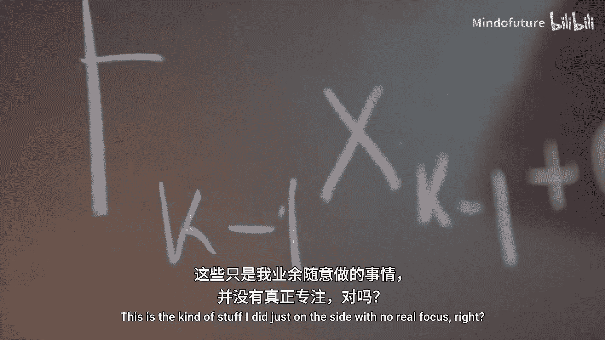
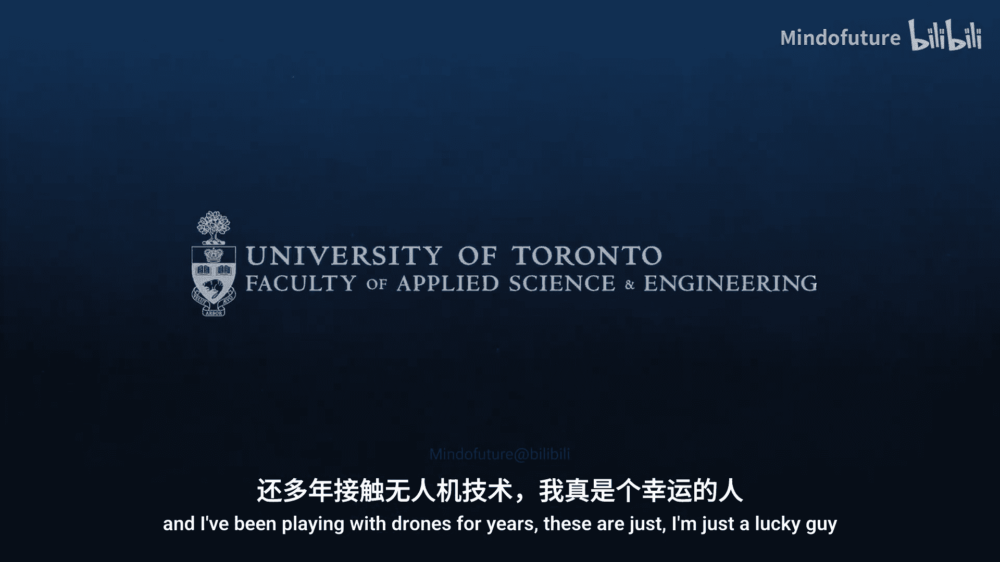

# 004：认识讲师史蒂文·瓦斯兰德


在本节课中，我们将跟随讲师史蒂文·瓦斯兰德的个人经历，了解他如何从一名广泛的兴趣爱好者成长为自动驾驶与机器人领域的研究者，并探讨该领域的发展现状与学习路径。

---

## 童年与广泛的兴趣 🧒

我童年时兴趣广泛，热爱各种事物。我曾以为自己可以成为一名科学家，或许是物理学家，也可能是化学家，但当时其实并没有明确的想法。成长过程中，我对未来并不担忧，度过了一段田园诗般的童年。



## 青年时期的挑战与发现 🚴

到了十六七岁或十八岁时，我开始思考需要做一些有趣的事情来充实人生。正是在这个阶段，我开始接受各种挑战，并逐渐认识到是什么在持续驱动着我。我热爱解决数学问题，喜欢在放学后和朋友一起钻研化学或微积分难题。这些只是我业余时间的消遣，并无特定目标。直到我开始认真尝试选择一项事业时，才发现了我所喜爱的事情经常出现的具体应用领域。

## 职业生涯的起点：航空工业 ✈️

大学毕业后，我在加拿大普拉特·惠特尼公司工作，这是一家小型喷气发动机制造商。在普拉特·惠特尼的工作经历令人着迷，我有机会参与测试喷气发动机控制系统，从而接触到了有趣的航空学知识。

然而，航空领域的挑战在于其极其严格的安全要求。你所做的每一件事都必须严谨无误，且每次都必须精确运行。该领域的发展很大程度上受制于经过反复验证的、已有三十年历史的技术。作为一名试图推动变革、改变世界的年轻工程师，这让我感到非常沮丧。

## 转向研究与机器人领域 🤖

我带着从航空航天工业中获得的美好经验以及对安全的重视，开始了研究生生涯，进入航空与航天领域，并开始建造无人机。

这本质上是解决问题和开发算法。例如，让无人机降落在行驶的汽车上，或者让自动驾驶汽车自行泊车、穿越障碍区域。所有这些问题都非常实际、具有应用性，并且你在构建过程中就能看到成果。你可以看到它运行得如何——如果无人机错过了汽车，它就会坠毁失败。这其中有一种令人兴奋的趣味性。

## 如何打造一辆自动驾驶汽车 🚗

要制造一辆自动驾驶汽车，首先需要将普通汽车改造成线控驾驶车辆。这意味着你可以将计算机接入汽车，并向油门、转向和刹车发送指令，汽车将实际执行这些操作。

```pseudocode
# 伪代码示例：发送基础驾驶指令
send_command(throttle=0.5, steering_angle=0.1, brake=0)
```

一旦具备了这种能力，你就可以真正开始编程让它做任何你想做的事情。

接下来，你必须在后备箱加装一整套传感器和计算设备。拥有了所有这些部件，你就可以开始构建自己的自动驾驶车辆了。

## 研究重点与学术角色 🧪

我的实验室围绕一个理念建立：如果我们拥有一个真实的测试平台，并将其置于真实情境中，我们就能更快地了解当前方法的局限性。

我们真正关注的是寻找特别适合学术界的研究问题。例如，处理恶劣天气条件、应对一些边缘案例，或者试图从理论上证明我们所使用的方法具有可量化的安全性。在学术界，我们确实有很多具体问题可以研究。我们可以尝试许多大胆的想法，可以比工业界更自由、更快地探索可能的解决方案空间。

## 行业展望与挑战 🔮

我们肯定会看到这些车辆的性能不断提升。像特斯拉自动驾驶仪这样的系统每年都会变得越来越好。我们还将看到真正自主的车队在受限领域内运行，这些领域被认为是安全可控的。

但我仍然认为，要实现最终目标——在任何你想驾驶的地方实现完全自主——我们还有很多工作要做。这只是因为汽车可能失败的方式太多，它们必须理解的情境太多，有太多无法提前预测的奇怪状况。

## 给初学者的建议 📚

如果你刚接触自动驾驶领域，并认为这是一个美妙的领域想要尝试，我认为你首先应该完成这个Coursera专项课程。

除此之外，有数百种方法可以丰富你的知识，并更好地了解如何进入这个领域。整个领域依赖于机器人学、计算机视觉、神经网络与深度学习的基础。这些是你能够深入研究的领域，而它们的有趣之处在于也适用于其他美妙的应用，例如机器人操纵器、手机摄像头系统与视频拍摄功能改进、无人机飞行与物体跟踪等。你可以用这些知识做很多事情。

对于那些正在考虑自动驾驶是否是一个值得探索的方向的人，市场无疑将持续增长。对我们项目毕业生的需求非常惊人。

## 总结与个人感悟 🌟

回顾过去，我已经很久没有在放学后玩随机数学题了。想到我现在从事自动驾驶汽车的研究，并且已经玩了很多年无人机，我只是一个幸运的家伙。



在本节课中，我们一起了解了史蒂文·瓦斯兰德从广泛兴趣者到专业研究者的旅程，探讨了自动驾驶汽车的基本构建原理、当前的研究挑战与行业前景，并为初学者提供了进入该领域的学习路径建议。自动驾驶是一个融合多学科、充满实践乐趣与巨大发展潜力的前沿领域。