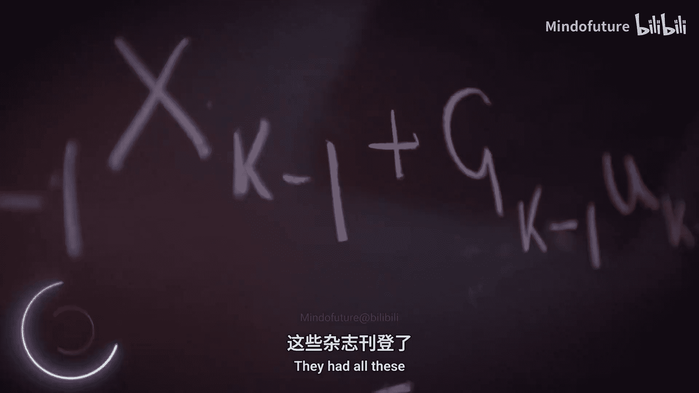
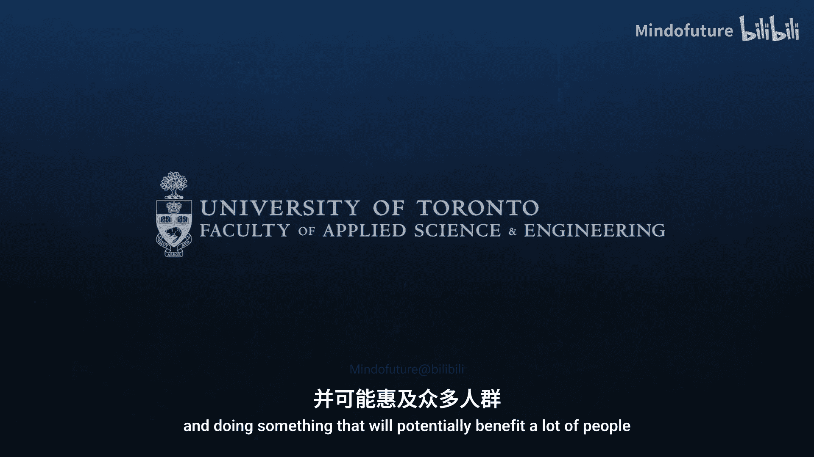

# 005：认识讲师乔纳森·凯利

## 概述
在本节课中，我们将认识本课程的讲师乔纳森·凯利教授，了解他的个人背景、职业选择动机，以及他对自动驾驶汽车技术所持的观点与责任感。

***

我叫乔纳森·凯利，是多伦多大学航空航天研究所的一名助理教授。

***

## 童年兴趣与启蒙
上一节我们认识了讲师，本节中我们来看看他如何对科技产生兴趣。童年时期，我每个月都喜欢去杂志店，总是阅读《大众机械》或《大众科学》。这些杂志包含了从太空旅行到新型车辆，再到新计算设计的各种有趣文章。正是这些内容最终促使我开始将科学技术视为一个可能的职业选择。

***

## 挑战者号事故的启示
对科技的早期兴趣引领我前行，但一次重大事件让我深刻认识到工程的责任。在我还很年轻的时候，发生了第一次航天飞机灾难，即挑战者号事故。我至今仍清楚记得当时的情景，并思考着一定是哪里出了严重问题，以及后果是多么可怕。那时巨大的爆炸场景让我震惊地坐着，我曾认为技术总是可靠的，它不会失败，汽车不会无缘无故爆炸。但在电视上看到这一幕，让我真切地体会到，**扎实的工程**在这些危及生命或可能改变人生的情境中至关重要。

***

## 自动驾驶汽车的责任与前景
认识到工程责任的重要性后，我们来看看这与自动驾驶汽车领域的关联。自动驾驶汽车在许多方面与此非常相似。作为工程师，我们有责任将这些系统设计得尽可能安全可靠。这是即将到来的最令人兴奋的技术革命之一。每天都有新的想法、技术和设计涌现。我常常坐在办公桌前，看到人们提出的创新性新想法和技术时，都会感到眼前一亮。这种兴奋感也来自于它可能改变技术格局，并做一些 potentially benefit a lot of people（可能惠及众多人群）的事情。

***

## 总结
本节课中我们一起学习了讲师乔纳森·凯利的背景。我们了解到他童年对科普杂志的兴趣引导他走向科技生涯，挑战者号事故让他深刻认识到**工程可靠性的极端重要性**，并将这种责任感与对自动驾驶汽车安全性的追求联系起来。最后，他表达了对该领域技术快速革新及其巨大潜力的兴奋与期待。