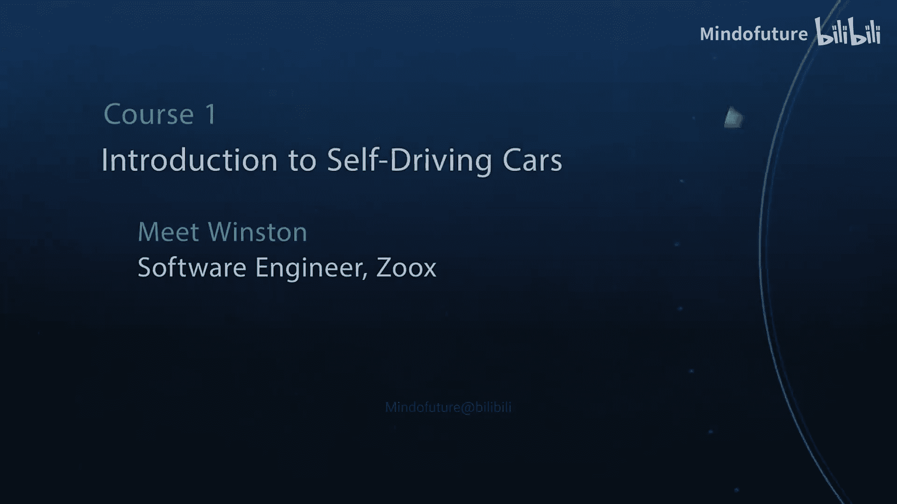
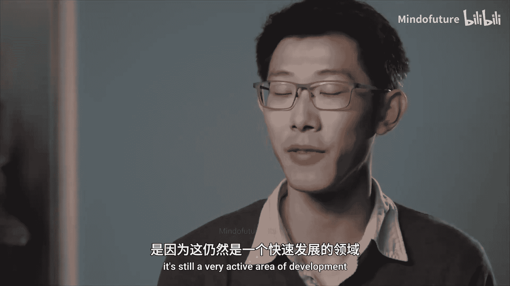
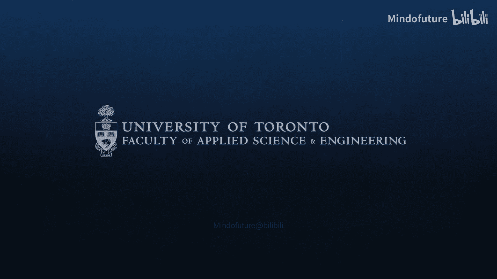

# 007：认识温斯顿-软件工程师

在本节课中，我们将跟随软件工程师温斯顿的视角，了解他如何进入自动驾驶领域，以及他在该领域的具体工作内容。我们将学习到学生竞赛如何激发职业兴趣，以及自动驾驶中一个核心模块——定位与建图的基本概念。

我的名字是温斯顿·维尤。我目前在Zoox公司担任定位与建图方向的软件工程师。

我进入自动驾驶领域的契机是在大学最后一年。当时，通用汽车公司与汽车工程师学会联合发起了一项名为“Autodrive”的学生竞赛。这项竞赛为期三年，每年年底都会有一次比赛。最终目标是让各学生团队在三年后能够打造出一辆符合SAE自动驾驶等级中**L4级别**的车辆。

我当时领导着轨迹规划团队，并设计了我们在第一年比赛中使用的轨迹规划和车道变换算法。

最终，我们团队赢得了第一名。我们提交了一篇详细阐述我们设计的论文，这些成果至今仍在推动着相关进展。我意识到自己对自动驾驶汽车产生兴趣，这背后还有一个小故事。那要追溯到我大学生涯的初期。

我曾是学校“无人驾驶飞行器”学生团队的成员。我们建造的是半自主的固定翼无人机。它们由遥控器控制，搭载了工业摄像头和机载计算设备。我负责该项目的计算机视觉部分，具体任务是检测绘制在木质标牌上的字母。这些标牌被放置在地面上，而我们的飞机则在200英尺的高空飞行。

有一天，当我开车行驶在街道上时，我想到：我能否将用于检测标牌的这些计算机视觉工具，用来识别道路标志呢？我萌生了一个想法：在我父母的车上安装网络摄像头，然后开车在社区里转，检测所有的街道标志。不过，我的父母对此并不太支持，所以这个项目最终没有进行下去。

后来，当学校的Autodrive团队开始招募成员时，我觉得这很酷。而当我真正开始参与这个项目后，我意识到这就是我想从事的事业。于是，我来到了这里。

在Zoox公司，我隶属于CLAMS团队。CLAMS是一种贝类，在这里它是“**校准、定位与建图同步进行**”的缩写。我主要专注于建图方面的工作，这主要涉及生成3D地图。我无法透露更多细节，但可以说，目前通过构建我们的地图，我对旧金山地理的了解可能比亲自到过那里还要多。

真正让我每天早上充满动力去工作的原因是，我正在解决这些非常前沿、非常酷的问题。这些都是个人或公司以前未曾深入涉足的领域，因为它仍然是一个处于快速发展中的活跃领域。

本节课中，我们一起学习了温斯顿从学生竞赛踏入自动驾驶行业的经历。我们了解到，参与实际项目（如Autodrive竞赛）是激发兴趣和获得实践经验的重要途径。同时，我们也初步认识了自动驾驶系统中一个关键组成部分——**CLAMS**，它代表了**校准、定位与建图**的同步优化，是确保车辆精准感知环境的核心技术之一。温斯顿的故事展示了将学术兴趣与工程实践结合，最终投身于前沿科技领域的典型路径。