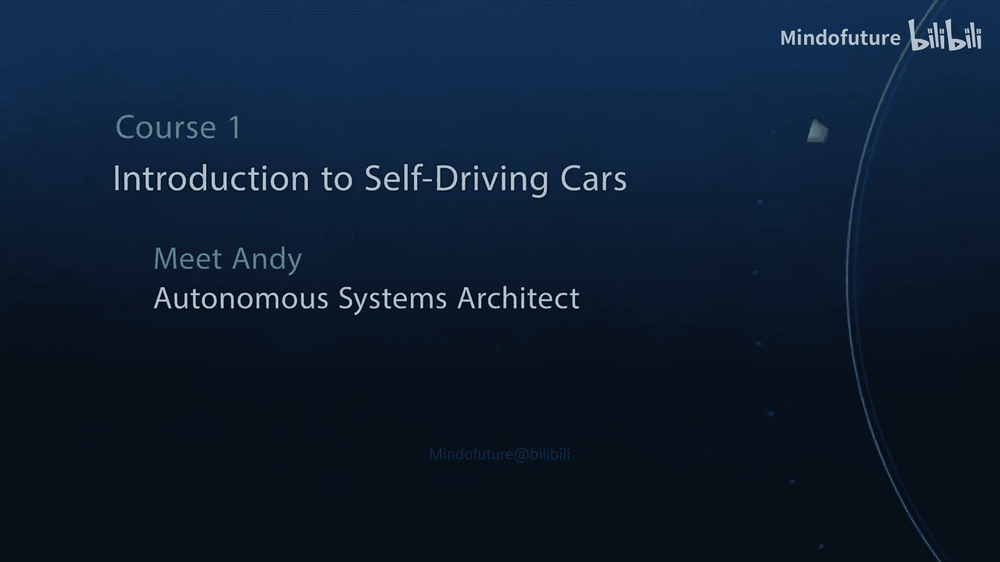
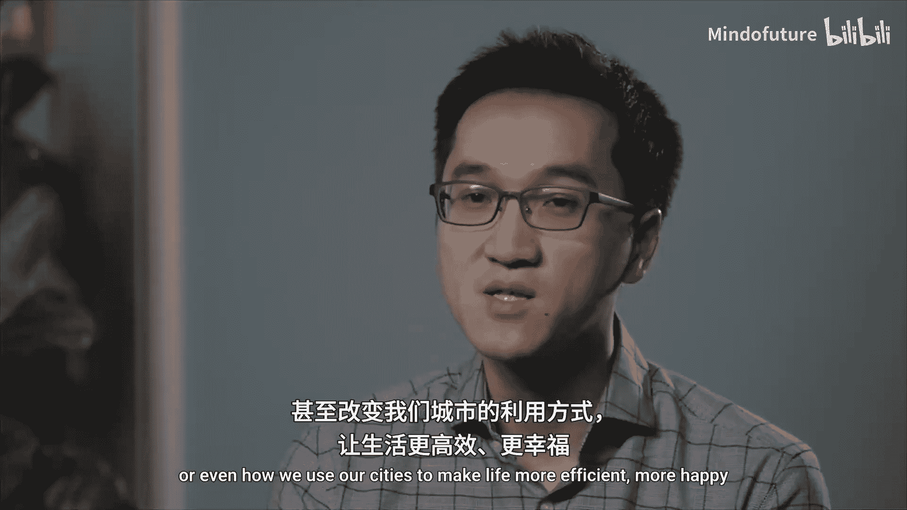
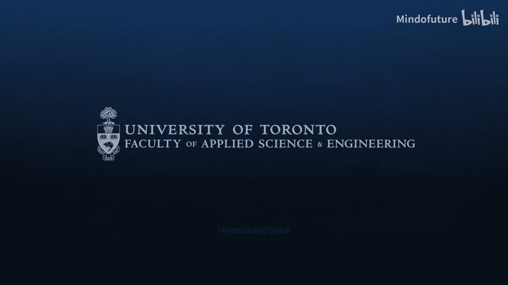

# 008：认识安迪-自动驾驶系统架构师

在本节课中，我们将通过自动驾驶系统架构师安迪·王的视角，了解他进入机器人学和自动驾驶领域的历程，以及他目前工作的内容和意义。

---

我是安迪·王，一名自动驾驶系统架构师。我早在高中时期就开始了机器人学的学习。我是加拿大最早参加机器人竞赛的学生之一。进入大学后，我协助共同创立了一个机器人团队。当时的指导老师刚从美国回来，他告诉我们那里正在举办一个名为**DARPA挑战赛**的比赛。这项赛事是推动整个自动驾驶行业兴起的关键事件之一。由此，我们衍生出一些自动驾驶赛车活动，我也参与其中。从那时起，我便深深着迷于此。

我工作了几年来积累经验，之后回到研究生院深造。在那期间，我学习了**车辆控制与动力学**。现在，我从事下一代自动驾驶汽车平台的工作。作为一名系统级工程师，我有幸能够与多个不同的团队广泛合作，共同构建一个完整的系统。这意味着我既要与负责**感知、运动控制软件**的软件工程师合作，也要与设计**传感器和车辆平台**的硬件工程师合作。

我认为机器人学非常有趣，而自动驾驶这个特定问题尤其令我热爱，因为它能直接影响人类的生活质量。我们不仅致力于提升安全性、挽救生命，它还可能有机会帮助我们重塑对交通的思考方式，甚至改变我们使用城市的方式，让生活更高效、更幸福。

---

---

本节课中，我们一起了解了自动驾驶系统架构师安迪·王从学生时代到职业发展的经历。他分享了如何通过机器人竞赛和DARPA挑战赛进入该领域，并阐述了其当前工作的跨团队协作性质，以及自动驾驶技术对提升人类生活质量和重塑未来社会的潜在影响。