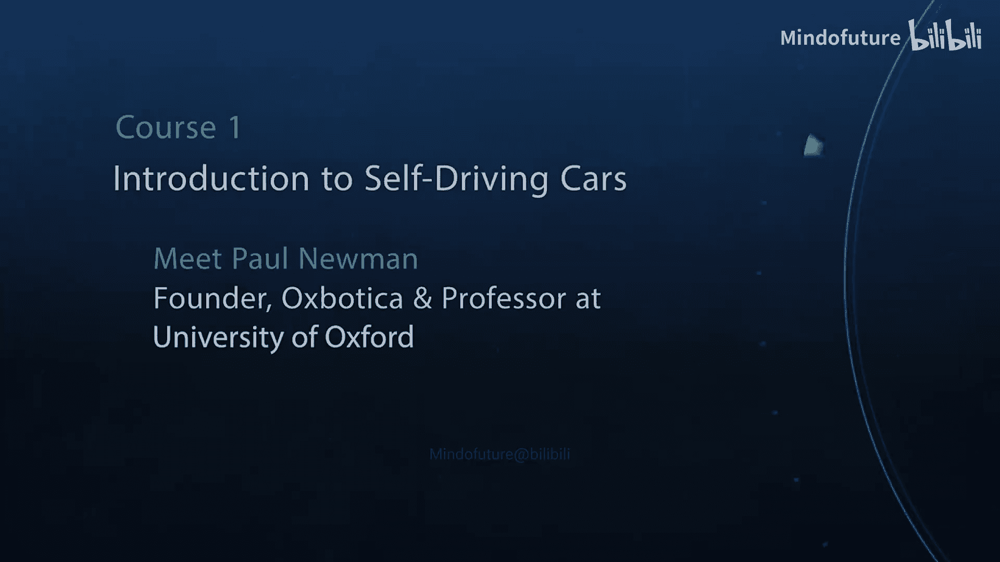
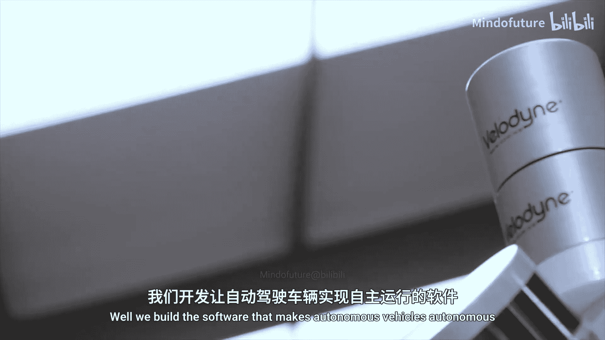

# 009：认识保罗·纽曼-Oxbotica创始人、牛津大学教授

在本节课中，我们将跟随保罗·纽曼的视角，了解他投身自动驾驶领域的契机、他创立的公司Oxbotica的工作，以及他对自动驾驶汽车未来发展的核心观点。

我是保罗·纽曼，我是Oxbotica的首席技术官和创始人，同时也是牛津大学的信息工程学教授。

我记得自己开始对自动驾驶车辆和自主系统产生兴趣的那一天。那是在悉尼，当时我刚开始攻读博士学位，正在和一位博士生交谈。他向我介绍了一个名为“SLAM”的问题。这个问题是：一辆车能否在**没有预先给定地图**的情况下，自己弄清楚它在世界中的位置，并且**自己构建出这张地图**？我当时就意识到，这是我想要研究的“终极问题”。我记得很清楚，那是1996年3月19日，我真正发现这里存在一个重大问题。自那以后，这个问题从未让我感到厌倦。虽然我们现在已经知道如何解决这些问题了。

但我始终是一名工程师，热衷于建造东西。我发现，将软件和机械结合是建造东西最激动人心的方式，而这几乎就是机器人的定义。因此，我从未真正失去这份热情。大概从九岁开始，当我尝试为非常基础的计算机编程起，直到现在每天所做的工作，这种兴奋感从未离开过我。

那么，我们在Oxbotica做什么呢？我们开发让自动驾驶车辆实现自主的软件。我们的工作覆盖整个软件栈，从最底层的传感器开始，一路向上，贯穿**规划、定位、控制、感知**，直到车队管理系统。我们构建的是让整个车队实现自主运行的完整软件环境。

😊

这就是我们构建的东西。同时，我在大学里也进行开发工作。

我是牛津机器人研究所的所长，在那里我也拥有很棒的工作生活。在那里，我研究的是自主系统和机器人领域那些非常、非常困难的问题，这些问题可能是未来**10年**才会遇到的。其中一些是关于机器与智能、机器学习的最初期的研究问题，我们希望在未来5到10年内将其应用到我们的车辆中。因此，我拥有非常优越的生活和工作环境。

那么，我为什么如此关心自动驾驶汽车呢？因为目前的交通系统已经“完成”了，但它现在是有问题的。

道路上**80%** 的事故是由注意力不集中引起的。而机器不会做的一件事就是感到无聊。我们目前完全没有解决这个问题。我们目前的驾驶方式是低效的。随着我们年龄增长，身体变得虚弱，我们最需要的是保持与社会的联系。而如果我们说：“哦，抱歉，你视力下降了，不能开车了。你癫痫发作了，不能开车了。”那么，我们目前这套关于人类如何驾驶、如何移动自身（无论是人本身还是货物）的整个体系简直是荒谬的。它源自马车时代。如果我们现在拥有现有技术，我们绝不会那样做。

所以，目前的体系是荒谬的，而软件和算法将改变这一切。我绝对相信，自动驾驶技术将让更多的物体（人和货物）移动得更高效、更安全。

这里存在一个问题：车辆本身应该是独立智能的，还是应该利用智能基础设施？

那么，什么是智能基础设施？例如，一个交通灯可以告诉你“我即将变红，这是我的位置”。或者一个环岛可以告诉你“这是车辆的位置，你的空位即将到来”。我们可以用无数种方式来设想如何为我们的城市配备智能设备。

我的观点是，车辆本身需要足够智能，能够**不依赖基础设施**而运行。如果提供了智能基础设施，当然可以在信任它的前提下使用它，但这涉及到网络安全等一系列问题。所以，我的观点是，车辆本身必须足够智能，就像你作为司机一样。你可以看到交通灯，可以看到车道线，你不需要前面的车告诉你“前面有辆车”，因为你可以看到它。因为如果基础设施被移除了，你仍然希望自动驾驶车辆能够运行。基础设施可以增强车辆的能力，但我认为不应该依赖它。因为如果你解决了不依赖基础设施的问题，那么你才能真正掌握在任何地点实现全交通自主的可能。这可能需要一些时间，但你走在了正确的轨道上，并且不依赖于昂贵、定制的专用基础设施。在我看来，为自动驾驶汽车准备的昂贵、定制的专用基础设施，就是一座城市本身。

---

**总结**

本节课中，我们一起学习了保罗·纽曼教授进入自动驾驶领域的个人经历，了解了Oxbotica公司致力于开发覆盖全栈的自动驾驶软件，并探讨了他对自动驾驶核心问题的看法。他强调车辆应具备不依赖智能基础设施的独立智能能力，以应对更广泛、更复杂的交通场景，并从根本上改变现有低效且不安全的交通体系。