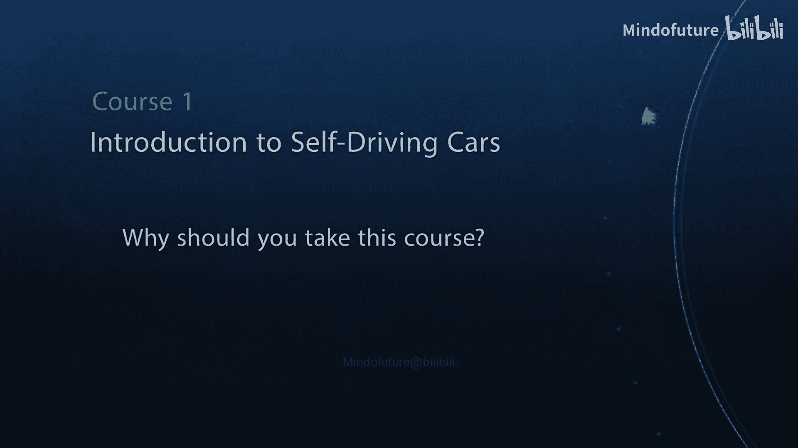

# 010：为什么要学习这门课程




在本节课中，我们将探讨投身自动驾驶汽车领域的原因，并了解学习相关课程的价值。我们将从道德、安全、效率等宏观层面，以及个人职业发展的具体角度进行分析。

---

## 投身自动驾驶领域的宏观理由

上一节我们了解了自动驾驶的基本概念，本节中我们来看看为何这个领域值得投入。

自动驾驶领域在道德、安全和效率方面具有根本性的吸引力。其核心目标是实现更优、更安全、更快速的物质运输。

**公式**：核心目标 = 更优的运输 + 更安全的运输 + 更快速的运输

此外，这个领域本身极具趣味性。它涉及的是非常复杂且尚未被完全解决的难题。我们并非能在某个特定日期（比如某个星期三）就宣告彻底攻克所有挑战。这意味着整个领域仍处于起步阶段，并将持续发展很长时间。所面临的问题不仅极其困难，而且多种多样。

## 学习本课程的个人价值

对于工程师而言，如果你热衷于攻克那些非显而易见、需要层层剖析的复杂难题，并且希望自己的工作能对未来的交通方式产生重大影响，那么这门课程和成为自动驾驶工程师的道路完全适合你。

这门课程在今天非常重要，因为它将教授自动驾驶领域的许多基础知识。课程涵盖广泛的主题，为你理解和开发未来的系统提供了必要的知识储备。

以下是学习本课程的具体益处：


*   **构建知识体系**：课程将教授广泛的主题，帮助你建立理解自动驾驶系统所需的知识框架。
*   **培养适应能力**：课程将使你成为一名灵活且知识渊博的工程师，能够适应这个快速发展的行业。

## 课程知识的实际应用与行业准入

对于任何试图进入该行业的人，这门（或这类）课程都非常有用。它们让你对实现车辆自动驾驶所涉及的一切有一个更全面、更清晰的概览。

课程中的知识具有很高的实用价值。例如，我在滑铁卢大学学习的控制课程（也是本系列课程的一部分）内容，就被我应用到了机器人技术的PID控制器中。

**代码**（PID控制器伪代码）：
```
error = setpoint - current_value
integral += error * dt
derivative = (error - previous_error) / dt
output = Kp*error + Ki*integral + Kd*derivative
```

对于已经工作的专业人士，进入自动驾驶领域的一个途径是获得对我们所面临问题的了解，例如**状态估计**。学习这门Coursera课程正是掌握此类知识的一种有效方式。

---


本节课中，我们一起学习了投身自动驾驶领域的多重价值：从推动社会进步的宏观意义，到解决复杂工程难题的职业乐趣。同时，我们也明确了学习相关课程对于构建专业知识体系、培养行业适应能力以及实现职业转型的具体帮助。无论你是学生还是在职人士，掌握这些基础知识都是迈向这个激动人心领域的重要一步。