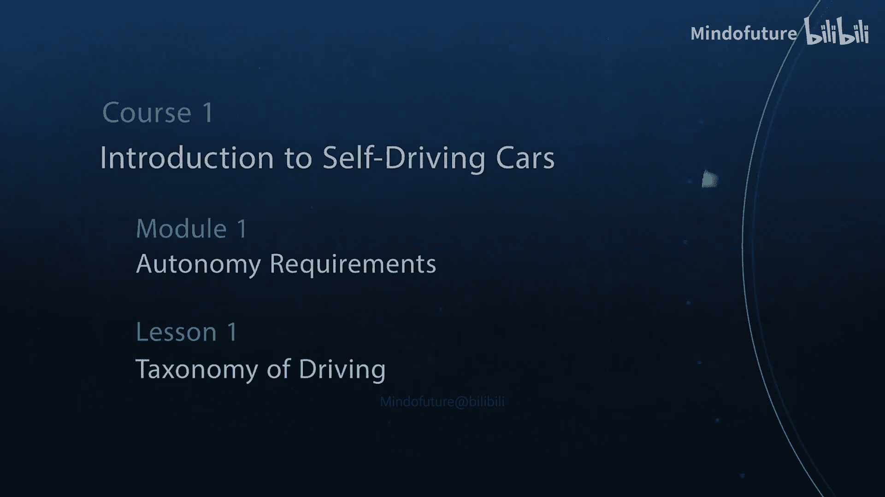
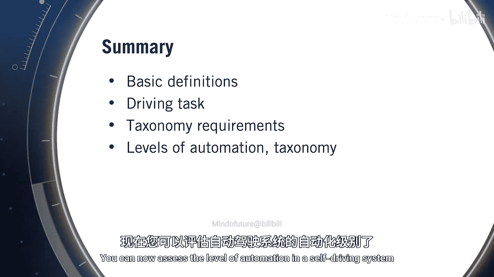

# 011：自动驾驶等级分类

在本节课中，我们将学习自动驾驶汽车的基本术语、驾驶任务的定义，以及一个用于对驾驶自动化水平进行分类的系统。我们将从基础概念开始，逐步深入到由国际自动机工程师学会（SAE）制定的详细分类标准。

## 概述

欢迎来到自动驾驶汽车入门课程的第一个模块。通过本模块，你将了解构建一辆自动驾驶汽车所需的主要组件，以及驱动其设计的技术要求。在开始之前，理解自动驾驶汽车的要求，或者说我们如何定义汽车的“自动驾驶”至关重要。第一周旨在让你对专业课程中将深入探讨的术语和概念有一个宏观的了解。

在模块1中，我将向你介绍自动驾驶汽车的分类法，即我们用来定义驾驶自动化的分类系统。接着，我会描述驾驶任务中的感知需求，即我们需要能够正确识别的项目。最后，我们将探讨如何做出驾驶决策，并讨论几种让车辆在环境中移动的决策方法。本模块的目标是提醒你，驾驶任务实际上需要多少评估和决策。希望这能帮助你理解，在保障道路安全方面，我们人类能够有效管理多么复杂的任务。

## 基本术语与定义

我们将首先介绍一些技术术语和定义。这些术语将在整个专业课程中使用，如果你在这个行业工作，了解它们会很有帮助。

### 驾驶任务

广义上讲，驾驶任务由三个子任务构成。

1.  **感知**：感知我们正在驾驶的环境。这包括跟踪车辆的运动，以及识别周围世界中的各种元素，如路面、路标、车辆、行人等。我们还需要跟踪所有移动物体并预测其未来运动，以便安全、准确地驾驶。
2.  **运动规划**：这使我们能够成功到达目的地。例如，你可能想从家开车到办公室，因此你需要考虑应该走哪条路、何时应该变道或通过十字路口，以及如何执行绕开路上坑洼的转向操作。
3.  **车辆控制**：我们需要操作车辆本身。因此，我们需要采取适当的转向、制动和加速决策来控制车辆在道路上的位置和速度。

这三个子任务构成了主要的驾驶任务，在驾驶车辆时需要持续执行。

### 运行设计域

接下来要介绍的概念是**运行设计域**，简称 **ODD**。ODD 构成了给定系统设计运行的操作条件。它包括环境、时间、道路特征以及其他汽车能够可靠运行的条件。明确定义自动驾驶汽车设计运行的操作条件对于确保系统安全至关重要，因此需要提前仔细规划 ODD。

## 自动驾驶等级分类

现在我们已经了解了一些基本术语，让我们来探讨核心问题：如何对驾驶系统的自动化水平进行分类？

以下是需要考虑的几个方面：
*   **驾驶员注意力需求**：例如，你可以在上班途中看电影吗？还是需要时刻将注意力集中在方向盘上？
*   **驾驶员操作需求**：例如，你需要转向吗？汽车负责控制速度还是你也需要控制？你需要变道吗？或者汽车可以在当前车道行驶而无需干预？
*   **驾驶任务的定义**：当我们说汽车可以自动行驶时，我们具体需要期待什么？我们之前已经广义地定义了驾驶任务，但需要更深入地讨论。

所有这些问题引导我们走向自动驾驶分类法。标准在不断演变，但为了我们的分类目的，我们将采用国际自动机工程师学会在2014年提出的分解方法。

### 驾驶任务的分解描述

现在，让我们讨论一种以自动化水平递增的方式来描述驾驶任务的方法。

1.  **横向控制**：指在道路上转向和横向导航的任务，例如左转、右转、直行或跟踪弯道等。
2.  **纵向控制**：指通过制动或加速等操作，控制车辆沿道路方向的位置或速度的任务。
3.  **物体与事件检测及响应**：简称 **OEDR**。这本质上是检测直接影响驾驶任务的物体和事件，并做出适当反应的能力。OEDR 实际上涵盖了自动驾驶的很大一部分，因此通常与特定的运行设计域结合使用，来对当前的自驾系统进行分类。
4.  **规划**：规划是驾驶的另一个重要方面。由于即时响应已经是 OEDR 的一部分，规划主要关注前往目的地或执行变道、通过十字路口等操作所需的长短期计划。
5.  **其他任务**：人们在驾驶时还会执行一些杂项任务。这些包括使用指示灯示意、挥手、与其他驾驶员互动等。

现在，我们对自动驾驶汽车应执行的任务有了清晰的描述。

### 分类的关键问题

基于以上分解，我们可以提出以下问题，从而得出自动驾驶汽车自动化水平的分类法：

1.  该系统能处理转向任务（横向控制）吗？
2.  它能执行加速、制动和速度操控任务（纵向控制）吗？
3.  该系统能执行物体与事件检测及响应吗？程度如何？关键的是，它能自行处理紧急情况吗？还是始终需要驾驶员在紧急情况下保持注意力？
4.  该系统能在所有场景和条件下运行吗？还是它有一个有限的 ODD 或一组可以安全处理的操作条件？

### SAE J3016 自动化等级

基于这些问题，让我们来看看 SAE 标准 J3016 定义的常用自动化等级。

*   **等级 0：无自动化**
    这是完全由人类进行感知、规划和控制的等级。没有任何驾驶自动化，所有事情都由驾驶员完成。

*   **等级 1：驾驶辅助**
    如果自动驾驶系统通过执行横向或纵向控制任务来辅助驾驶员，我们就处于等级 1 自动化。自适应巡航控制是一个很好的例子。在自适应巡航控制中，系统可以控制车速，但需要驾驶员执行转向。所以它能执行纵向控制，但需要人类执行横向控制。类似地，车道保持辅助系统也属于等级 1。在车道保持辅助中，系统可以帮助你保持在车道内，并在你偏离车道边界时发出警告。当今的系统依赖于对车道边界的视觉检测，并结合车道居中的横向控制。

*   **等级 2：部分自动化**
    在等级 2，系统在特定驾驶场景中执行横向和纵向两种控制任务。等级 2 功能的一些简单例子包括通用的 Super Cruise 和日产的 ProPilot Assist。这些系统可以控制你的横向和纵向运动，但始终需要驾驶员监控系统。如今，许多汽车制造商提供等级 2 自动化产品，包括梅赛德斯-奔驰、奥迪、特斯拉和现代。

*   **等级 3：有条件自动化**
    在等级 3，除了控制任务外，系统还能在一定程度上执行物体与事件检测及响应。然而，在发生故障时，控制权必须由驾驶员接管。等级 2 和等级 3 的关键区别在于，在某些特定情况下，驾驶员不需要集中注意力，因为车辆可以及时提醒驾驶员进行干预。这是一个有争议的自动化等级，因为自动驾驶系统并不总是能知道何时发生故障。等级 3 系统的例子包括奥迪 A8 豪华轿车，它拥有一个可以在慢速交通中无人监控导航的自动驾驶系统。

*   **等级 4：高度自动化**
    在下一个等级，我们达到了高度自动化车辆的水平，系统能够在驾驶员未及时干预紧急情况时，达到最小风险状态。等级 4 系统可以自行处理紧急情况，但仍可能要求驾驶员接管以避免不必要地靠边停车。拥有这种程度的自动化，乘客可以查看手机或看电影，因为他们知道系统能够处理紧急情况并保障乘客安全。然而，等级 4 仍然允许自动驾驶系统具有有限的 ODD。截至 2018 年秋季，只有 Waymo 部署了具有此等级自动化水平的公共交通工具。Waymo 车队可以在定义的地理区域内，在一组标称的操作条件下处理驾驶任务，无需人类驾驶员。

*   **等级 5：完全自动化**
    最后，在等级 5，系统完全自主，其 ODD 不受限制，意味着它可以在任何必要的条件下运行。等级 5 是我们的社会发生变革的时刻，无人驾驶出租车将人们和包裹运送到任何我们需要的地方。目前我们还没有等级 5 的例子，但也许不久的将来，你会是将其变为现实的人。

**需要注意的一点是**：自动化等级实际上是对自动化的粗略衡量。事实上，两款车型可能都声称具有等级 4 自动化，但拥有非常不同的能力和 ODD。

## 总结

在本节课中，我们涵盖了与自动化相关的各种概念。我们介绍了一些基本定义，包括运行设计域和驾驶任务的概念。我们还探讨了驾驶自动化的五个等级。现在，你可以评估自动驾驶系统的自动化水平了。

在下一课中，我们将探讨感知的要求，这是自动驾驶系统设计的一个关键方面。