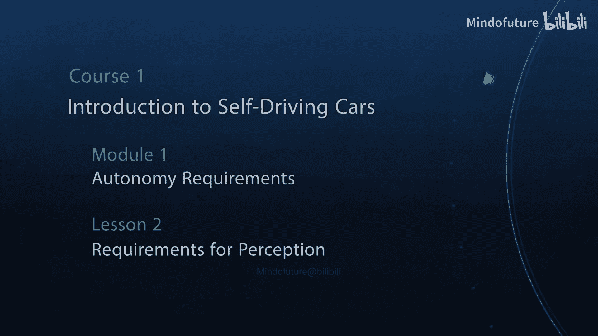
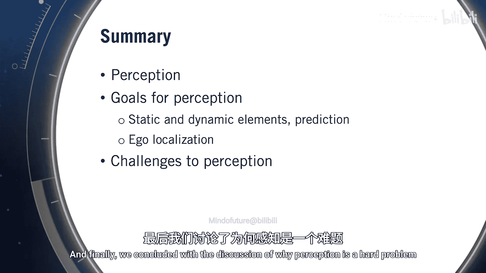

# 012：感知系统的要求

在本节课中，我们将开始分析驾驶任务是如何执行的。具体来说，我们将详细探讨感知的多个过程。我们将首先定义感知任务，列出感知的要求，例如需要识别哪些静态和动态物体，以及跟踪自车在环境中运动的需求。最后，我们将讨论实现鲁棒感知所面临的一些挑战。

## 感知：理解环境与自身运动

上一节我们介绍了根据能力和运行设计域对自动化进行分类。本节中，我们来看看驾驶任务的核心组成部分之一：感知。

粗略地说，任何驾驶任务都可以分解为两个部分。首先，我们需要理解周围发生了什么以及我们身处何处，即感知我们的环境。其次，我们需要做出驾驶决策，例如，在行人即将进入道路时，我们应该加速还是停车？

回想上一课中提到的 **OEDR** 概念，即物体与事件检测及响应。任何驾驶任务都需要某种形式的 OEDR，这意味着我们需要某种方式来识别周围的物体、识别附近发生的事件并对其做出响应。我们讨论的自动化系统分类中，OEDR 就是标准之一。换句话说，如果我们想制造一辆自动驾驶汽车，就需要能够执行 OEDR。

## 感知的具体任务

让我们进一步分析 OEDR 的一个关键部分：感知。什么是感知？如前所述，我们希望理解周围的环境以及我们在其中的运动方式。具体来说，对于道路上的任何智能体或元素，我们需要首先识别它是什么（汽车、骑行者、公交车等）。其次，我们希望理解它的运动——它是否以某种方式移动，这能告诉我们它接下来会做什么。

人类非常擅长理解模式。然而，计算机系统要像我们一样快速识别周围的相同模式仍然很困难。我们能够预测运动物体的轨迹，这对于感知至关重要。如果能够正确预测，我们就能做出明智的决策。例如，如果我知道前方车辆接下来要做什么，我就可以决定下一步该怎么做，以实现我们双方的目标。

## 需要识别的静态元素

以下是感知任务中需要识别的各类静态元素：

*   **道路元素**：如道路本身、车道线、分隔道路区域的斑马线，以及“前方学校”等重要信息标识。
*   **路外元素**：如路缘石，它定义了我们可以行驶的边界。
*   **交通信号**：周期性变化，指示你是否可以前进、左转、右转或必须停止。
*   **道路标志**：如限速标志、方向指示标志、医院或学校预告标志等。这些也属于路外元素。
*   **道路障碍物**：如指示施工或道路封闭的橙色锥桶。这些属于道路元素。

## 需要识别的动态元素

接下来，我们讨论感知中需要识别的动态元素。这些元素的运动需要我们进行预测，以便做出明智的驾驶决策。

*   **其他车辆**：需要识别道路上的其他车辆，如卡车、公交车、汽车等四轮车辆。
*   **两轮车**：需要识别并预测摩托车、自行车等两轮车的运动。这些系统比四轮车拥有更多自由度，因此更难预测。
*   **行人**：应该能够识别并预测周围行人的运动。行人的行为方式与车辆有很大不同，因为人类在移动方式上具有固有的自由性，其运动通常比车辆更难以预测。

## 自车定位

感知的另一个关键目标是**自车定位**。我们需要能够随时估计自身的位置和运动状态。了解我们在环境中的位置和运动方式，对于做出明智且安全的驾驶决策至关重要。

用于自车运动估计的数据来自 **GPS**、**IMU** 和**里程计**传感器，需要将这些数据组合起来，以生成关于我们位置的连贯图像。

本专业的第二和第三门课程将深入探讨这些基本的感知任务，从第二门课程的自车定位开始，接着在第三门课程中学习道路内外物体的检测与跟踪。

## 感知面临的挑战

既然我们已经讨论了感知的主要目标，让我们通过探讨感知为何也是一个难题来结束本次讨论。

*   **实现鲁棒的感知**：这是一个巨大的挑战。检测和分割可以通过现代机器学习方法来解决，但为了达到人类水平的能力，仍在进行大量研究以提高其可靠性和性能。获取大型数据集对此至关重要，更多的训练数据能使我们的分割和检测模型表现更好、更鲁棒。然而，为所有可能的车辆类型、天气条件和路面收集和标注数据是一个非常昂贵且耗时的过程。
*   **传感器不确定性**：感知无法免受传感器不确定性的影响。很多时候，能见度可能具有挑战性，或者 GPS 测量值被干扰，或者 LiDAR 和雷达返回的位置值存在噪声。依赖这些传感器的每个子系统都必须考虑不确定的测量结果。因此，设计能够适应传感器不确定性和损坏测量的子系统，对于每个感知任务都至关重要。
*   **遮挡与反射**：相机或 LiDAR 数据中存在遮挡和反射等效应。这些效应会带来模糊信息，干扰感知方法，使其难以解析出准确的物体位置估计。
*   **极端条件与数据丢失**：还存在诸如光照剧烈变化、镜头眩光或隧道中 GPS 信号中断等效应，这些会使某些传感器数据完全无法使用或不可用。感知方法需要多个冗余的信息源来克服传感器数据丢失。
*   **天气与降水**：天气和降水会对传感器输入数据的质量产生不利影响。因此，拥有至少一些不受不同天气条件影响的传感器（例如雷达）至关重要。

## 总结

本节课中，我们一起学习了感知的主要任务：检测和评估环境中各类静态和动态物体与智能体的任务，以及理解自车在环境中如何运动的任务。最后，我们讨论了感知为何是一个难题。

本节视频内容到此结束。下节视频中，我们将讨论自动驾驶的决策制定方面。

