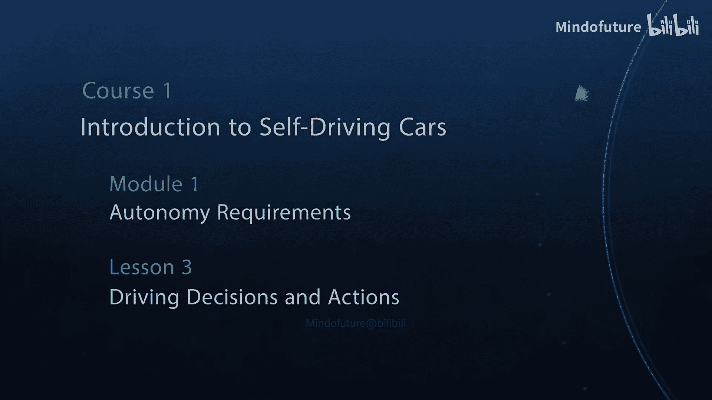
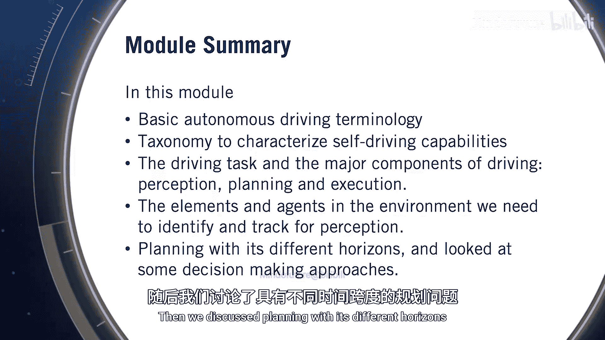

# 013：驾驶决策与规划 🚗




在本节课中，我们将要学习自动驾驶系统中的决策与规划环节。上一节我们介绍了感知，它是执行驾驶任务的第一步。本节中我们来看看后续的步骤：决策制定以及最终的执行。

规划可以根据决策所需考虑的时间窗口进行非正式的分类。我们将通过一个简单的十字路口场景，列举成功完成驾驶任务所需的各种决策。然后，我们将根据用于决策的逻辑类型，对规划进行正式分类：是使用基于当前环境信息的明确定义规则，还是也依赖于对其他交通参与者轨迹的预测。

## 规划的时间层级

驾驶决策属于“规划”这个大范畴。当我们制定驾驶决策时，通常需要考虑三种类型的决策。

以下是三种主要的决策类型：

1.  **长期规划决策**：这类决策回答诸如“如何从纽约导航到洛杉矶”或“如何从家到公司”的问题。其结果是整个驾驶任务的高层**任务计划**。如今的地图应用可以提供这类驾驶指令，例如走哪条路、保持在哪个车道等。

2.  **短期规划决策**：这类决策回答诸如“现在变道安全吗”或“何时在十字路口执行左转”的问题。驾驶还需要一些即时决策或反应。

3.  **即时决策**：这类决策涉及**控制**与**轨迹规划**，回答诸如“如何在弯道上保持车道”或“应该施加多少转向输入”、“应该加速还是刹车，幅度多大”等问题。

## 一个驾驶场景示例

让我们讨论一个非常简单的驾驶任务示例，并思考其中涉及了哪些类型的决策。请注意，在本系列课程中，我们假设所有场景均为右侧通行。

假设你在回家的路上接近一个十字路口。长期规划阶段要求你在这个路口左转。

现在，让我们看看需要做出的中期和短期决策。首先，假设该路口是受控的，即设有交通信号灯。由于你要左转，你必须判断是否需要变道进入左转专用车道。接着，在接近路口时，你选择减速，并且要平稳地减速以避免乘客感到不适。然后，你会在停车线前、人行横道前停下。这些关于变道和停车位置的决策都属于短期规划决策。

但是，你还需要思考并应对途中出现的各种情况。我们仍然需要进行**物体与事件检测及响应**。

以下是可能出现的几种情况及所需的即时决策：

*   如果一辆车插到你前方的左转车道，你会希望更早停车，为那辆车留出空间。
*   如果停车线没有标记，你必须大致判断隐含的停车线位置，并在人行横道前停下。
*   如果你后方有其他车辆，甚至路口有车辆抛锚，执行左转的决策会如何根据这些可能迅速出现的多种场景而变化？

所有这些决策都属于即时决策类别，需要规划系统做出安全的反应。最终结果是，即使对于一个简单的左转场景，也需要在不同时间尺度上评估大量可能的决策。这相当于讨论同一个路口通行的不同情况或**场景**。在每个场景中，我们需要一套一致的、能够实时评估的选择，并随着场景新信息的出现而更新。

此外，由于变道决策会影响行驶位置以及需要相对于哪些车辆来调整自身位置，即使一个看似简单的驾驶场景也需要三到四个层级的决策，并且最终仍需通过精细的车辆控制来执行。这个例子仅仅触及了运动规划所需持续决策流的表面。关键在于：驾驶是复杂的。

## 规划方法：反应式与预测式

接下来，我们讨论一种在软件中表示这些决策的可能结构。应对多层次决策挑战的一种方法是**反应式规划**。

在反应式规划中，我们定义一系列规则，这些规则考虑自车及环境中其他物体的当前状态，并产生即时动作。这些规则只考虑当前状态，而不考虑未来预测。

以下是此类规则的一些示例：

```python
if pedestrian_on_road:
    stop()
if speed_limit_changed:
    adjust_speed(new_limit)
```

在这两条规则中，我们只是观察当前正在发生的情况，并基于即时可用的信息做出决策。

但还有其他类型的规划。在**预测式规划**中，我们对环境中其他参与者（如车辆和行人）随时间的运动方式进行预测。我们利用当前状态和预测信息来定义所有决策。

以下是预测式规划中的规则示例：

*   那辆车已经停了10秒，它很可能在接下来几秒内保持静止，所以也许我可以安全地绕过它。
*   一个行人正在乱穿马路，等我接近时他们会进入我的车道，让我减速，给他们一个在我前方过马路的机会。

可以看出，这是一种更自然的思考方式，与人类驾驶车辆的方式密切相关。我们在做决策之前，会预测道路上其他物体未来的位置。然而，这种类型的规划依赖于对环境其他参与者行为的准确预测，这为感知任务增加了显著的复杂性。尽管如此，预测式规划仍是自动驾驶汽车的主流方法，因为它极大地扩展了车辆能够安全处理的场景范围。我们将在专门讲解自动驾驶汽车规划的第4门课程中详细讨论规划的各个方面，并向你展示解决长期、短期和即时规划问题的方法。

## 总结

本节课中我们一起学习了规划问题以及基于行动时间窗口的不同规划类型，包括长期、短期和即时规划。我们分析了一个需要左转的简单十字路口场景，并得出结论：由于存在众多变量和可能性，驾驶确实是一个非常复杂的问题。接着，我们讨论了两种不同的规划方法：反应式规划和预测式规划。这仅仅是冰山一角，在驾驶任务中做出决策之前，显然还有更多需要考虑的因素。我们将在第4门课程中再次更详细地探讨所有这些概念。



至此，我们完成了自动驾驶汽车专项课程第一门课第一周的学习。让我们快速回顾一下本周所学：在本模块中，我们探讨了有助于后续课程学习的基本自动驾驶术语。然后，我们讨论了自动化等级，并提出了一个用于描述自动驾驶能力的分类法。接着，我们定义了驾驶任务以及驾驶的主要组成部分：感知、规划和执行。我们列出了感知中需要识别和跟踪的环境元素与参与者，并讨论了感知为何如此困难。最后，我们讨论了具有不同时间层级的规划，并了解了一些决策方法。


在下一个模块中，我们将定义自动驾驶汽车的主要组成部分，包括构成完整系统的硬件和软件元素。届时再见。