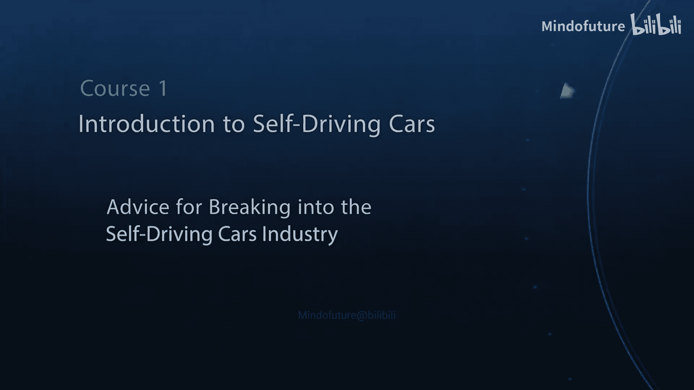
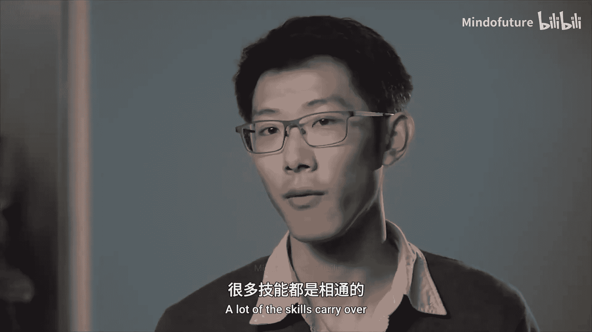
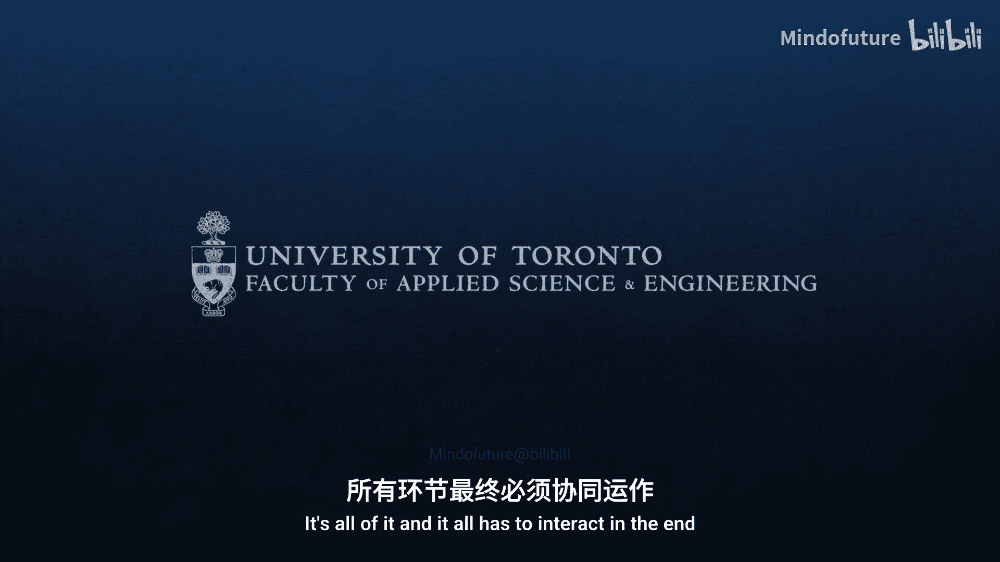

# 014：进入自动驾驶汽车行业的建议

在本节课中，我们将学习来自行业资深人士关于如何进入自动驾驶汽车领域的实用建议。课程内容涵盖教育背景、核心技能、实践经验以及职业心态等多个方面，旨在为初学者和初级工程师提供清晰的职业发展路径。

---

上一节我们探讨了行业概览，本节中我们来看看如何具体地准备自己，以成功进入这个充满活力的领域。以下是来自多位行业专家的核心建议。

## 教育背景与技能准备 🎓

获取工程学学位对我的帮助很大，尤其是在滑铁卢大学期间，我参与了许多实习和互动项目。那时我还协助指导了我们的第一支机器人团队，这些经历都丰富了我的简历。如果你想进入自动驾驶领域从事固件工程，你可能需要的教育背景包括工程学学位。计算机科学学位也可以，但获得一些硬件实践经验绝对有益。

在大学最后几年，我选修了嵌入式课程，以更熟悉日常工作中所需的底层软件或低级软件方面。对硬件非常熟悉在我的日常工作中确实有帮助，因为我需要驱动各种硬件部件。我见过这个行业里有很多机械背景出身的人，这也很有帮助。当然，懂得编程也绝对是一个优势，并且了解你周围的所有组成部分。

总的来说，我认为机电一体化工程对我帮助很大，因为它涉及面广，让我有机会接触所有方面。大量的项目帮助我理解了所有部件是如何协同工作的。

## 行业需求与招聘现状 💼

我认为目前这个行业因为发展非常迅速，几乎需要各种类型的角色，包括固件、感知或自动驾驶技术栈的任何部分都需要人才。由于我的固件背景，我经常收到关于固件工作的联系。但总的来说，现在有大量的工作机会，每家公司都在努力寻找最优秀的人才来解决他们的自动驾驶挑战。

这是一个招聘需求非常旺盛的行业，所以我经常被其他公司招募，他们只想招到人。显然，我也在努力为我的公司寻找尽可能多的人才，以便我们能够继续工作和发展。从我们的数据来看，我们做得还不错。但是，总是需要更多的人，每个人都在努力解决这个问题，每个人都在试图让所有最优秀的人来为此工作。

## 理想候选人的特质 🎯

现在我有机会在工业界工作，我认为理想的候选人应该是对这个领域感兴趣并充满热情的人。在技术技能方面，需要精通 **C++** 和 **Python**。我们需要能够从第一性原理解决问题的研究工程师，也需要有机器学习经验的人。

我能给本科生或研究生级别的人最重要的建议之一是加入学生团队。学生团队让你有机会与同龄人协作，并发展你的沟通和领导技能。虽然你参与的项目可能不是最前沿的，但它们确实能帮助你在半专业的环境中积累工作经验。

沟通技巧对职场中的人也很重要，特别是在自动驾驶领域，我们需要解决所有这些独特的问题，能够清晰地表达你的想法至关重要。在事情失败时在场，是非常宝贵的学习经验。很多技能是可以迁移的，例如故障排除、与他人合作、解决问题的能力。我发现这些经验在开始进入工业界工作时非常有帮助。

## 实践与项目经验 🛠️

我给希望进入这个行业的初级工程师的建议是，真正动手实践。尝试自己承担项目，这可以采取“轮子上的笔记本电脑”的形式，即自己编程实现完整的软件栈，或者使用模拟器来预测我们真正上路时环境会是什么样子。我认为通过这些实践手段解决实际问题能教会你很多，我个人在日常工作中也从以前的项目中汲取了很多经验。

## 成为全面的系统工程师 🌐

如果你想在一家自动驾驶公司工作，我会给出什么建议？首先，对工程的所有领域保持开放态度，如果可以的话，不要只成为一个计算机视觉专家。尝试理解这本质上是一个机器人学问题，因为我们有软件使用多个传感器，试图在一个非常复杂的世界中回答一些非常困难的问题——这个世界有奇怪的照明、奇怪的天气、人们以奇怪的方式行事。你必须了解一点控制知识，或者知道如何与了解控制、规划、视觉、激光雷达、通信和系统工程的人对接。你将需要一直与这些人互动。

所以我想说，要把这理解为一个宏大的工程科学问题。显然，要持续不断地编码、练习、练习、再练习。并且要编写良好的代码。要知道，如果你作为一名本科生在搭建一个电路，而它看起来令人震惊，那它可能确实会“电”到你（这是一个关于电的好笑话）。软件也是如此。所以，要为你编写的代码质量感到自豪，这样你才会做得好。

## 勇于面对复杂环境 🌧️

要乐于深入棘手的环节。请不要只在室内和相机一起工作。走出去，到暴雨中，到大雪中，到刺眼的阳光下，在那里处理相机。不要担心它不工作，因为那是你能得到的最好教训。所以，勇敢地前往那些对这些系统来说难以工作的环境，并从中学习。

成为一名自豪的机器人专家，同时也成为一名系统工程师，因为这是一个全栈问题，而不仅仅是“我想很好地处理相机图像”或“我想识别汽车”。它是所有这一切，并且最终必须全部协同工作。

---

本节课中，我们一起学习了进入自动驾驶汽车行业的多方面建议。关键点包括：获取相关的工程教育背景（如机电一体化），掌握 **C++** 和 **Python** 等核心编程技能，通过学生团队和实际项目积累宝贵的实践经验，培养解决问题的能力和沟通技巧，并对整个机器人系统保持全面的理解。最重要的是，保持热情，勇于动手实践，并乐于在复杂真实的环境中学习和成长。这个快速发展的领域正等待着具备综合能力和实干精神的新鲜血液加入。