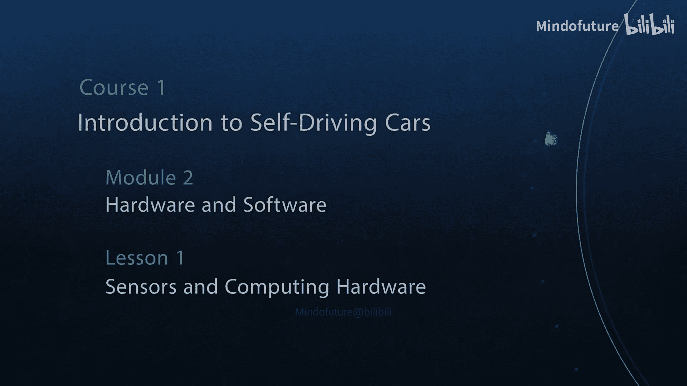
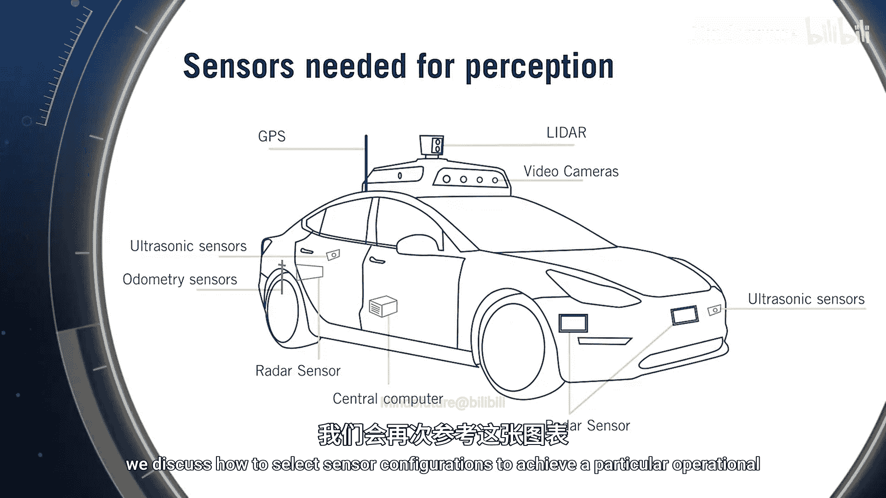
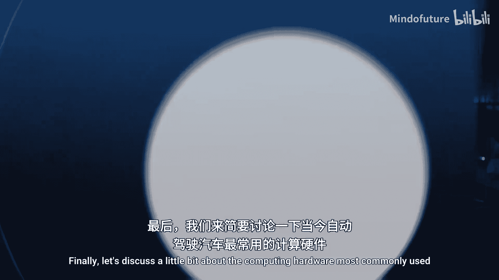
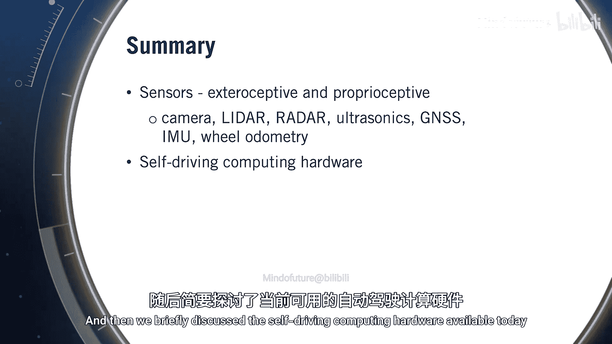

# 015：传感器与计算硬件

在本节课中，我们将学习自动驾驶汽车感知任务中使用的各类传感器，并了解当前主流的自动驾驶计算硬件。我们将从传感器的定义和分类开始，逐一介绍它们的工作原理和关键指标，最后简要探讨支撑自动驾驶决策的计算平台。

## 传感器概述

上一节我们介绍了自动驾驶系统的基本框架，本节中我们来看看感知任务的核心——传感器。即使是最好的感知算法，其性能也受限于传感器数据的质量。精心选择传感器可以极大地简化自动驾驶的感知任务。

那么，什么是传感器？传感器是任何能够测量或检测环境属性或其随时间变化的设备。根据它们记录的属性，传感器被广泛分为两类：
*   **外感受传感器**：记录环境属性。`Extero` 意为外部或来自周围环境。
*   **本体感受传感器**：记录自车（ego vehicle）的属性。`Proprio` 意为内部或自身的。

## 外感受传感器

以下是自动驾驶中常见的外感受传感器。

### 1. 相机

相机是被动的光收集传感器，擅长捕捉场景中丰富、详细的信息。事实上，一些团队认为相机是自动驾驶唯一真正需要的传感器。但目前仅靠视觉还无法实现最先进的性能。

选择相机时，我们通常关注三个重要指标：
*   **分辨率**：构成图像的像素数量，决定了图像质量。
*   **视场角**：相机可见的水平与垂直角度范围，可通过镜头选择和变焦来改变。
*   **动态范围**：图像中最暗和最亮色调之间的差异。由于驾驶中会遇到高度变化的照明条件（尤其是在夜间），高动态范围对自动驾驶汽车至关重要。

在相机和镜头选择上，**视场角**和**分辨率**之间存在重要的权衡。更宽的视场角允许观察环境中更大的区域，但分配到特定物体上的像素会减少。随着视场角增大，我们需要提高分辨率，才能以相同的质量感知可能遇到的各种信息。

相机还有其他影响感知的属性，如焦距、景深和帧率。我们将在关于视觉感知的课程3中更详细地讨论相机和计算机视觉。

**立体相机**由两个视场重叠且图像平面对齐的相机组成，可以从同步的图像对中进行深度估计。将一个图像的像素值与另一个图像匹配，可以生成场景的视差图，进而用于估计每个像素的深度。

### 2. 激光雷达

激光雷达代表“光探测与测距”传感器。其原理是向环境中发射光束并测量反射回来的信号。通过测量返回的光量和光束的飞行时间，可以估计反射物体的**强度**和**距离**。

激光雷达通常包含一个带有多个堆叠光源的旋转元件，并输出三维点云地图，非常适合评估场景几何结构。由于它是自带光源的主动传感器，激光雷达不受环境光照的影响，因此在恶劣或变化的光照条件下不会面临与相机相同的挑战。

以下是选择激光雷达的重要比较指标：
*   **光源数量**：常见的有8、16、32和64线。
*   **每秒点数**：点收集速度越快，3D点云越详细。
*   **旋转速率**：速率越高，3D点云更新越快。
*   **探测范围**：由光源的功率输出决定。
*   **视场角**：激光雷达传感器可见的角度范围。

最后，我们还应该提到目前正在兴起的新型激光雷达：**高分辨率固态激光雷达**。它没有典型激光雷达的旋转部件，由于完全在硅芯片上实现，有望变得极其低成本且可靠。高分辨率固态激光雷达仍在发展中，但对于未来实现经济实惠的自动驾驶无疑是一个令人兴奋的方向。

### 3. 雷达

雷达代表“无线电探测与测距”。雷达传感器比激光雷达出现得更早，能够稳健地探测环境中的大型物体。它们特别适用于恶劣天气，因为基本不受降水影响。

以下是选择雷达的一些比较指标：
*   **探测范围**
*   **视场角**
*   **位置和速度测量精度**

雷达通常有两种类型：一种是**宽视场角但短距离**，另一种是**窄视场角但长距离**。

### 4. 超声波传感器

超声波传感器或声纳，最初得名于“声音导航与测距”，它使用声波测量距离。声纳是短程且廉价的测距设备，这使其适用于自车需要非常靠近其他车辆移动的停车场景。声纳的另一个优点是成本低。此外，与雷达和激光雷达一样，它不受光照和降水条件的影响。

选择声纳基于几个关键指标：
*   **最大测量范围**
*   **探测视场角**
*   **成本**

## 本体感受传感器

现在我们来讨论感知自车属性的本体感受传感器。最常见的包括全球导航卫星系统（简称GNSS，如GPS或伽利略系统）和惯性测量单元。

*   **GNSS接收器**：用于测量自车的位置、速度，有时还包括航向。精度很大程度上取决于实际的定位方法和所使用的校正。
*   **惯性测量单元**：测量自车的角旋转速率和加速度。结合这些测量值可以估计车辆的3D方向，其中航向对于车辆控制最为重要。
*   **轮速里程计传感器**：该传感器跟踪车轮的旋转速率，并利用这些数据估计自车的速度和航向变化率。这与记录车辆里程的传感器是相同的。

## 传感器总结

总而言之，目前用于自动驾驶感知的主要传感器包括相机、雷达、激光雷达、声纳、GNSS、IMU和轮速里程计模块。这些传感器具有许多差异很大的特性，包括分辨率、探测范围和视场角。为自动驾驶汽车选择合适的传感器配置并非易事。

下图简单展示了每种传感器及其在汽车上的通常安装位置。我们将在下一个视频中，讨论如何选择传感器配置以实现特定的运行设计域时，再次回顾这张图。

## 计算硬件

最后，让我们简要讨论当今自动驾驶汽车中最常用的计算硬件。

最关键的部分是**计算大脑**，即汽车的主要决策单元。它接收所有传感器数据，并输出驾驶车辆所需的指令。大多数公司倾向于设计自己的计算系统，以匹配其传感器和算法的特定要求。然而，也存在一些可以“开箱即用”处理自动驾驶计算负载的硬件选项，最常见的例子是英伟达的Drive PX和英特尔与Mobileye的IQ。

任何用于自动驾驶的计算大脑都需要串行和并行计算模块，特别是用于图像和激光雷达处理以进行分割、物体检测和建图。为此，我们使用GPU、FPGA和定制ASIC，这些都是执行特定类型计算的专用硬件。例如，Drive PX单元包含多个GPU，而IQ则使用FPGA，两者都是为了加速可并行化的计算任务，如图像处理或神经网络推理。

最后，关于**同步**的快速说明：由于我们希望基于对道路场景的一致理解来做出驾驶决策，因此正确同步系统中的不同模块并遵循一个共同的时钟至关重要。幸运的是，GPS依赖极其精确的计时来运行，因此在可用时可以作为合适的参考时钟。无论如何，传感器测量必须用一致的时间戳进行标记，传感器融合才能正确运行。

## 课程总结

本节课中我们一起学习了传感器及其基于测量内容的不同类型。我们涵盖了自动驾驶硬件系统中使用的主要传感器，并讨论了它们的优势和比较指标。然后我们简要讨论了当今可用的自动驾驶计算硬件。希望这能巩固我们上周学到的关于进行自主感知的一些概念。在下一课中，我们将更进一步，看看如何为你的自动驾驶汽车选择合适的传感器配置。下个视频见。