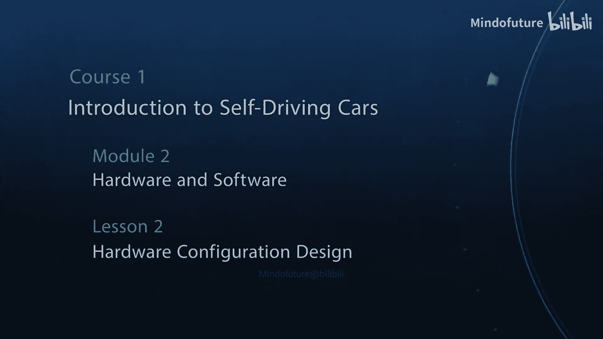
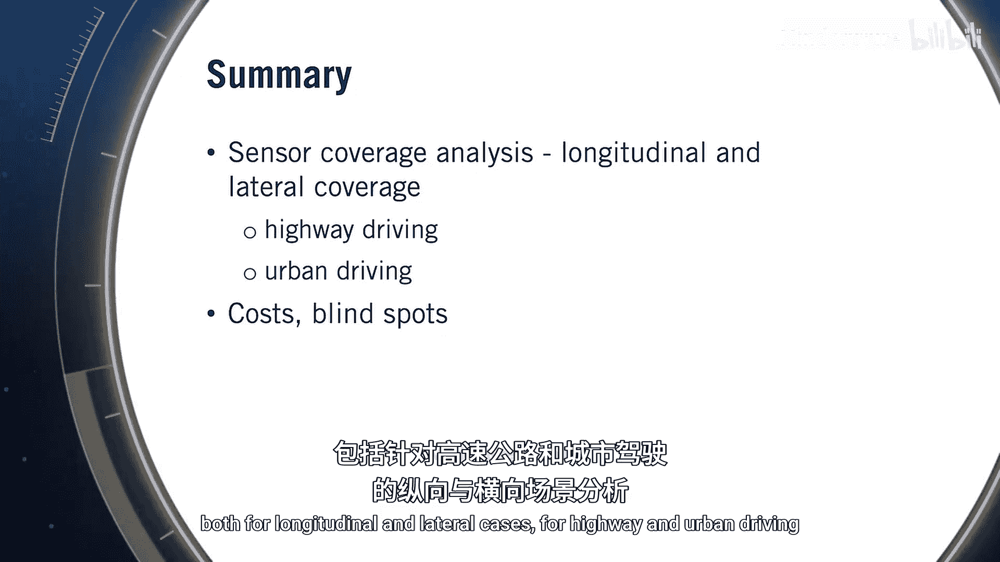

**自动驾驶汽车简介：第2课：硬件配置设计**

在本节课中，我们将学习如何为自动驾驶汽车设计和配置传感器，以满足不同驾驶场景下的感知需求。我们将通过分析高速公路和城市环境两种常见场景，来理解传感器覆盖范围的设计原则。

---

上一节我们介绍了自动驾驶中常用的各类传感器。本节中，我们来看看如何布置这些传感器，以构建对环境的完整感知。

首先，回顾一下最常用的传感器：
*   **摄像头**：用于获取外观信息。
*   **立体摄像头**：用于获取深度信息。
*   **激光雷达**：用于全天候三维信息输入。
*   **雷达**：用于物体检测。
*   **超声波传感器**：用于短距离三维信息输入。
*   **GNSS/IMU数据与轮速里程计**：用于车辆自身状态估计。

这些传感器有不同的配置、探测范围和视场角。其分辨率取决于具体仪器规格和视场角。

在讨论覆盖范围之前，我们先定义驾驶时可接受的减速率，这将决定传感器所需的探测距离。
*   **紧急减速率**：设为 **5 m/s²**，大致相当于紧急情况下猛踩刹车试图突然停止时的减速度。
*   **正常减速率**：设为 **2 m/s²**，在保证车辆能快速停止的同时，提供相对舒适的体验。

给定恒定减速度，制动距离 **D** 可按以下公式计算：
**D = v² / (2a)**
其中，**v** 是车速，**a** 是减速率。我们也可以考虑系统反应时间和路面摩擦极限，但本次讨论将简化处理。

现在讨论覆盖范围。核心问题是：我们应该将传感器放置在何处，才能为驾驶任务提供足够的输入？实际上，我们希望传感器能覆盖我们设想的**运行设计域**，即系统能做出决策的场景范围，并为所有决策提供充分输入。

驾驶场景众多，我们将通过两个常见场景来了解需求如何驱动传感器选择：高速公路驾驶和城市驾驶。

以下是这两种情况的简要对比：
*   **高速公路**：交通流量大、车速快、车道多，但所有车辆同向行驶。道路弯道较少且平缓，需考虑出入口和并道。
*   **城市环境**：交通流量和车速适中，车道较少，但交通流向复杂，尤其在交叉路口。

---

**高速公路场景分析**

我们可以将高速公路驾驶分解为三种基本操作需求：紧急制动、保持车速和变换车道。

**1. 紧急制动**
如果前方道路有障碍，我们需要及时停车。应用制动距离公式，假设高速公路速度为120公里/小时，采用紧急减速度，我们需要能感知前方约110米。因此，大多数自动驾驶系统旨在实现车辆前方**150至200米**的感知范围。

**2. 保持车速（跟车）**
为保持安全跟车距离，我们需要感知本车道前车的相对位置和速度。通常，人类驾驶员的安全跟车时间间隔设定为2秒。也可以根据前车紧急制动和自车反应时间来计算。在120公里/小时下，需要约165米的相对位置和速度测量范围，典型系统将此要求设为**100米**。

**3. 变换车道**
变换车道时，我们需要：
*   **纵向**：观察前方，与前车保持安全距离；观察后方，了解后车动态。
*   **横向**：情况更复杂。我们可能需要观察相邻车道之外的情况，例如，是否有其他车辆同时试图并入目标车道。我们需要协调变道操作以避免碰撞。

变换车道的传感器要求大致与保持车速场景相同，因为两者都需要管理自车前方、后方及两侧的车辆。

综上所述，高速公路驾驶的覆盖需求如下：
*   **纵向传感器**：用于紧急制动和跟车。
*   **横向传感器**：需要宽视场角传感器来跟踪相邻车道（约**160至180度**），以及**40至60米**的探测范围以寻找车辆间隙。
*   需要结合**宽视场角**和**窄视场角**传感器来完成紧急制动、保持车速和变换车道这三种操作。

仅从这一小部分ODD需求中，我们已经看到了多样化的传感器要求。

---

**城市场景分析**

接下来讨论城市场景。如前所述，城市环境交通流量和速度适中，车道比高速公路少，但增加了行人的复杂性。这里有六种基本操作：紧急制动、保持车速、变换车道、超越静止车辆、路口左右转弯以及通过环岛等更复杂的路口操作。

前三种基本操作的覆盖分析与高速公路分析基本相同，但由于车速较慢，不需要同样远的远程感知距离。

以下是其他操作的分析：

**1. 超越静止车辆**
*   **纵向**：需要感知静止车辆，同时观察对向来车。因此需要**宽视场角短距传感器**检测静止车辆，以及**窄视场角长距传感器**识别对向来车。
*   **横向**：与高速公路情况类似，需要观察相邻车道之外是否有并道车辆。

**2. 交叉路口**
需要近乎全向的感知能力，以应对各种可能的动态：接近的车辆、附近的行人、转弯等。

**3. 环岛**
*   **横向**：由于车速慢，需要**宽视场角短距传感器**。
*   **纵向**：由于环岛内的行驶方式，同样需要**宽视场角短距传感器**。我们需要感知所有汇入环岛的交通流以做出正确决策。

由此，我们得到城市驾驶的整体覆盖示意图。与高速公路覆盖的主要区别在于，城市驾驶需要针对路口、环岛和超车操作进行额外的感知。事实上，高速公路的需求几乎完全被城市驾驶的需求所覆盖。

---

**覆盖分析总结与传感器配置**

总结覆盖分析，对于所有驾驶操作，我们需要：
*   **长距离传感器**：通常具有较窄的角视场。
*   **宽角视场传感器**：通常具有中短距离感知能力。

随着场景变得复杂，我们看到需要在短距离尺度上（约**50米**范围内）实现**360度**全向传感器覆盖，并在纵向上有更长的探测距离要求。我们还可以增加像超声波雷达这样的**更短距传感器**，它们在泊车场景中非常有用。

最终，我们的传感器配置大致如下图所示。总结来说，传感器的选择应由我们想要执行的操作需求驱动，并应同时包括用于应对纵向危险的长距离传感器和用于全向感知的宽视场传感器。

最终配置方案还取决于我们对运行条件、传感器故障冗余以及预算的要求。没有单一的答案规定自动驾驶汽车需要哪些传感器。

---

本节课中，我们一起学习了如何通过进行传感器覆盖分析（包括高速公路和城市驾驶的纵向与横向情况）来选择硬件配置。

在下一个视频中，我们将研究典型自动驾驶软件栈的模块化软件架构。下次见。