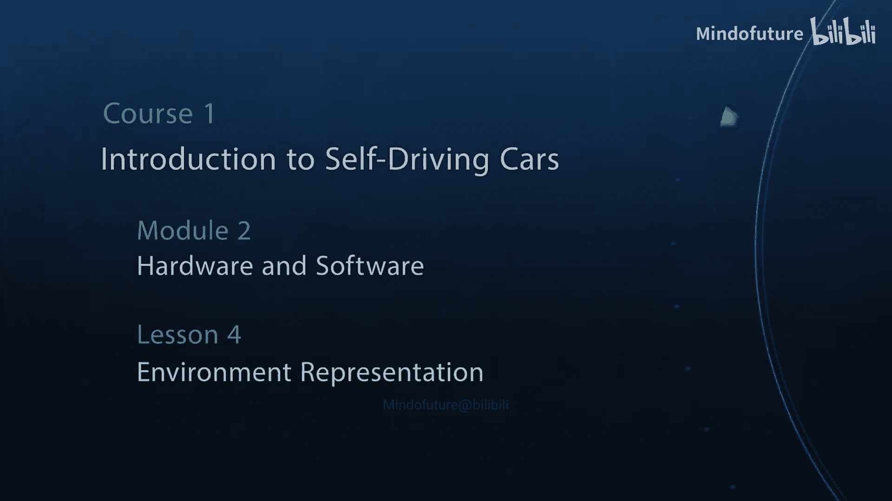
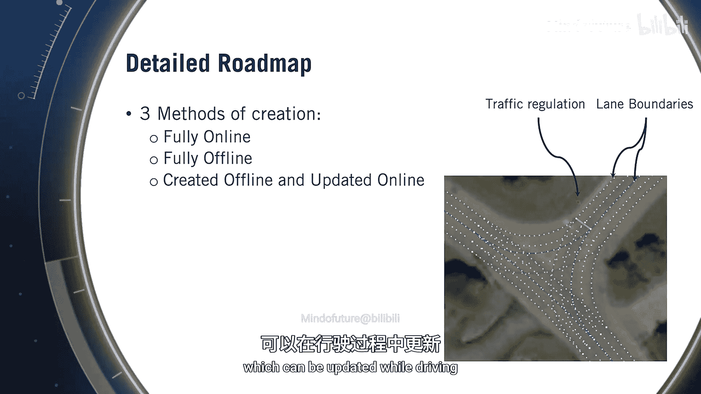
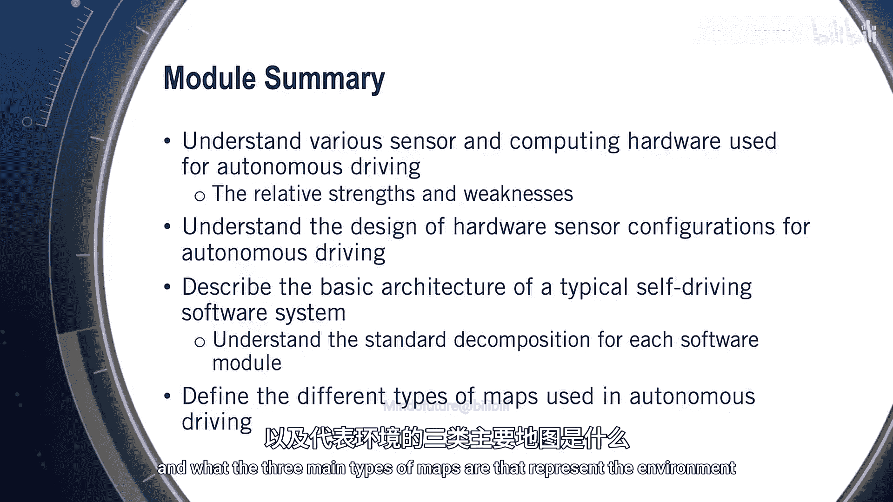

自动驾驶汽车简介：第四课：环境表征

在本节课中，我们将更深入地了解用于表征汽车周围环境的地图。我们将概述自动驾驶中传统使用的三种不同类型的地图，并对每种地图进行更详细的解释，以便你更好地理解它们是如何创建并在整个专业课程中使用的。

上一节我们介绍了环境表征的概览，本节中我们来看看具体的地图类型。

以下是三种核心地图类型：

1.  **定位地图**：此地图使用汽车在环境中移动时采集的连续激光雷达点云或相机图像特征创建。定位模块结合GPS、IMU和轮速里程计数据，利用此地图持续精确估计车辆的位置。
2.  **占据栅格地图**：此地图同样使用连续的激光雷达点云构建，用于标示所有静态或固定障碍物的位置。它为自动驾驶汽车规划安全、无碰撞的路径。
3.  **详细道路地图**：此地图包含所有交通规则元素、规则属性和车道标线的详细位置信息。它用于规划从当前位置到最终目的地的路径。

接下来，让我们逐一详细了解这些地图。

### 定位地图详解

如前所述，定位地图使用记录的激光雷达点或图像，组合成环境的点云表示。

当接收到新的激光雷达或相机数据时，会将其与定位地图进行比较，通过将新数据与现有地图对齐，来生成对自车位置的测量值。该测量值随后与其他传感器数据融合，以估计自车运动，并最终用于控制车辆。

例如，从自动驾驶汽车记录的一些激光雷达数据中，可以清晰地看到车辆从车道驶出并进入前方街道的运动轨迹。这种对汽车在环境中运动的详细、动态的表征，对定位模块极具价值。

定位地图可能非常庞大，存在多种方法来压缩其内容，仅保留定位所需的关键特征。此地图的构建将在本专业的下一门课程中，结合定位主题进行更严谨的讲解。

### 占据栅格地图详解

占据栅格地图是自车周围环境中静态物体的二维或三维离散化地图。创建此地图是为了识别自动驾驶汽车周围的所有静态物体，再次使用激光雷达点云作为输入。

被归类为静态的物体包括树木、建筑物、路缘石以及所有其他不可行驶的表面。例如，在此栅格地图中，如果将所有被占据的栅格涂色，占据栅格地图可能呈现如下形态。

由于占据栅格仅表示环境中的静态物体，因此必须首先移除所有动态物体。这是通过移除感知模块检测到的动态物体边界框内的所有激光雷达点来实现的。

接下来，不会干扰车辆行驶的静态物体也会被移除，例如可行驶路面或任何悬垂的树枝。经过这两步处理后，仅保留环境中来自静态物体的相关激光雷达点。

然而，过滤过程并非完美，因此不能盲目信任剩余的点就一定是障碍物。因此，占据栅格地图通过跟踪栅格单元随时间被占据的可能性，以概率方式表征环境。然后依赖此地图为车辆创建无碰撞的路径。

此地图的创建及其在局部路径规划问题中的应用，将在本专业课程4中进行更详细的介绍。

让我们看一个占据栅格随时间更新的例子。在这里，我们看到占据栅格可视化为自动驾驶汽车下方的浅灰色方形区域，用黑色方块更新环境中静态物体的位置。

当自动驾驶汽车在环境中移动时，所有静止物体，如电线杆、建筑物和停放车辆，都显示为被占据的栅格单元。

### 详细道路地图详解

详细道路地图是自动驾驶汽车可行驶的完整道路网络地图。它包含道路车道信息以及可能影响车道的任何交通规则元素。详细道路地图用于为自动驾驶汽车规划安全高效的行驶路径。

详细道路地图可以通过以下三种方式之一创建：

1.  **完全在线创建**：严重依赖感知模块的静态物体检测，来准确标记和定位所有相关静态物体以创建地图。这包括当前驾驶环境中的所有车道边界、任何交通规则元素（如交通灯或交通标志）以及车道的任何规则属性（如右转标记或人行横道）。由于实时创建此类地图的复杂性，这种方法很少使用。
2.  **完全离线创建**：通常通过多次采集给定道路的数据来完成。配备高精度传感器的专用车辆定期沿道路行驶以构建离线地图。采集完成后，利用静态物体感知的自动标记与人工标注和校正相结合的方式对信息进行标记。这种地图创建方法虽然能产生非常详细和准确的地图，但无法对变化的环境做出反应或适应。
3.  **离线创建并在线更新**：这种地图创建方法结合了前两种方法的优点，创建一个高度准确且能在驾驶时更新的道路地图。

在关于运动规划的课程4中，我们将介绍一种存储详细道路地图中所有信息的方法，称为**Lanelet模型**。

让我们看一个详细道路地图的例子。如图所示，详细道路地图的车道边界用红色可视化。除了边界，每个车道的中心线也用红色标出。这些信息对于路径跟踪至关重要，因为它提供了沿车道的默认路径。如视频所示，车辆在自动驾驶时精确地跟随车道中心线行驶。

### 总结

本节课中，我们一起学习了自动驾驶中常用的三种地图类型：定位地图、占据栅格地图和详细道路地图。随着我们在本专业后续课程中深入探讨定位、防撞和运动规划，你将进一步研究这些地图类型。

恭喜你完成了《自动驾驶汽车简介》课程的第二个模块。在本模块中，你学习了：
*   如何为自动驾驶汽车选择传感和计算硬件。
*   如何根据驾驶要求设计特定的传感器套件。
*   如何分解自动驾驶软件系统。
*   表征环境的三种主要地图类型是什么。

在下一个模块中，我们将更深入地研究用于精确控制的车辆建模。下个模块再见。