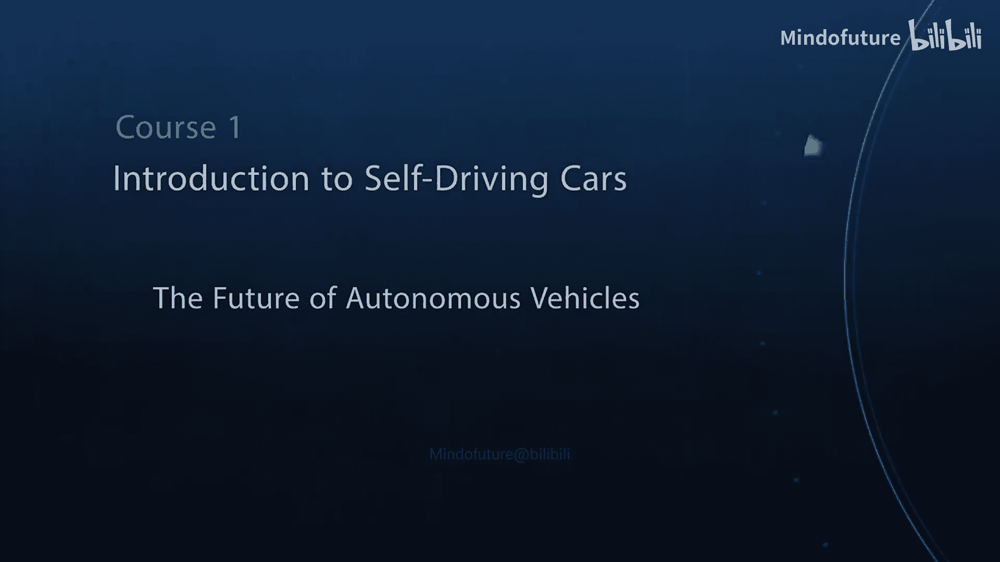
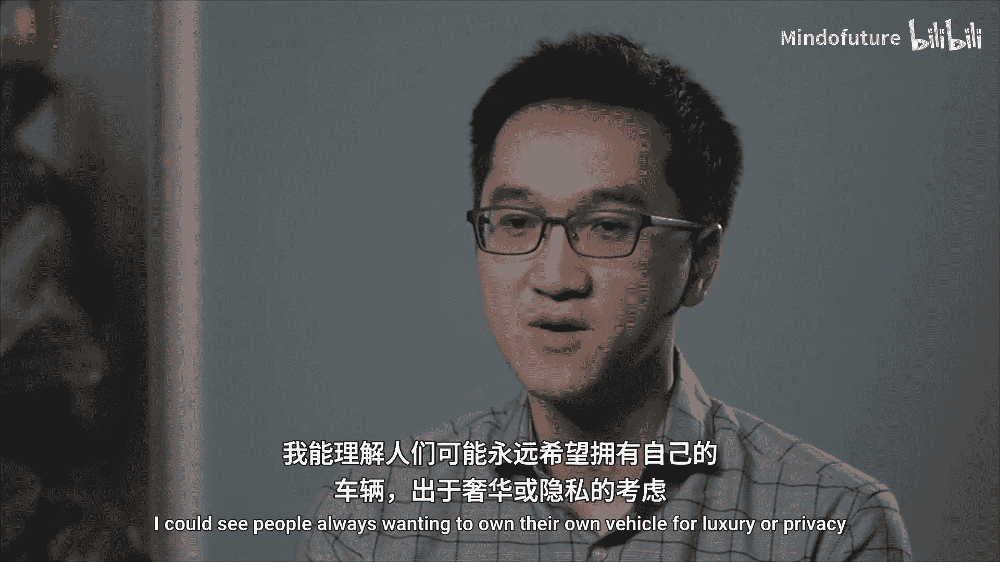
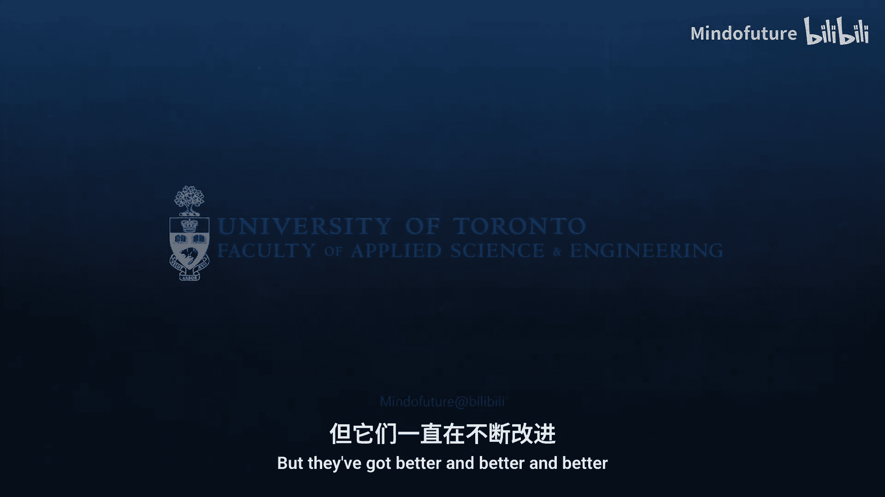

# 019：自动驾驶汽车的未来

## 概述
在本节课中，我们将探讨自动驾驶汽车行业的未来发展趋势。我们将分析其发展模式、行业特点、竞争格局以及个人拥有与出行服务两种模式的未来可能性，并讨论消费者何时能真正购买到完全自动驾驶汽车。

## 自动驾驶行业的发展模式 🚀

上一节我们介绍了自动驾驶的基本概念，本节中我们来看看这个行业将如何演变。

我认为自动驾驶汽车行业不会突然在某一天彻底成功。它更像是计算机行业发展的一个类比。没有人会说“我们什么时候才能拥有计算机”，因为计算机的发展从未停止，它是一个持续进步的过程。自动驾驶技术同样如此，这是一项宏大的事业，它始于现在，并且永远不会停止。每一年，自动驾驶汽车都会变得更好、更智能。

## 软件的核心作用与行业独特性 💻

我认为这个领域非常有趣，因为这次，决定性的因素是**软件**，而不是钢铁原子的排列组合。软件的影响力具有非凡的非线性特征。复制软件的成本很低，但制造另一辆汽车则需要实实在在的成本。这一点非常特别。

因此，这是一个绝佳的工作领域，因为你编写的软件不需要钢铁厂，却可以对交通运输产生巨大影响。我认为这绝对是非凡的。我们以前从未见过这种情况。过去，你必须拥有油田、气田或汽车工厂等实体资产才能在交通领域产生影响。而现在，仅仅通过编写**文本文件（代码）** 就能实现。这确实非同寻常。

这个行业非常新，但未来非常光明。

## 新兴企业与传统车企的竞争 🏎️

至于像Zs这样的新兴公司如何与早已在此领域耕耘的传统汽车制造商竞争，我认为Zs的方法具有独特性。解决自动驾驶汽车的挑战不仅仅是一个汽车工程问题。在移除人类驾驶员后，你需要构建大量的额外冗余系统和软件来实现功能。因此，你必须同时关注汽车工业、汽车工程，以及航空航天、计算机科学和软件工程。

Zs正是为此而设立的，它从诞生之初就旨在从头开始打造车辆，并始终专注于这一使命。因此，它不像一些大型传统制造商那样受到诸多束缚，尤其是那些制造商最初主要只专注于汽车工程。

## 自动驾驶与共享出行的融合 🤝

我看到自动驾驶行业即将真正起飞，因为这是两件事的融合：**自动驾驶**和**共享出行**。目前，汽车的利用率可能只有5%，这意味着95%的时间它们都停在你的车道上或公司的停车场里。自动驾驶的美妙之处在于，我们可以让这些自动驾驶车辆在一天中的大部分时间都在路上行驶，用更少的车辆运送更多的乘客。

## 未来出行模式：个人拥有 vs 服务化 🚗🆚🚕

我可以预见这个行业将出现两种模式的浪潮：个人拥有和出行即服务。

以下是两种模式的论点：
*   **个人拥有**：人们可能总是希望拥有自己的车辆，出于奢华或隐私的原因。
*   **出行即服务**：便捷的交通将极大地受益于自动驾驶技术。

因此，未来我们很可能会看到两种模式并存。

## 何时能购买自动驾驶汽车？ ❓

一个经常被问及的问题是：我什么时候能买一辆自动驾驶汽车？

这是一个非常合理的问题。我认为我们首先体验自动驾驶的方式不是购买，而是在特定区域、特定城市乘坐它们。这就是“地理围栏”论点：车辆将首先出现在它们经过充分演练和实践的城市区域。系统非常了解该城市的变化、光照条件、繁忙时段以及真正困难的转弯处。它们将像城市里高级的巴士一样，成为一种交通服务。

但人们真正想让我回答的问题是：我什么时候能走进汽车销售店，买到一辆没有方向盘、没有窗户的车？这基本上就是完全的L5级系统：完全不需要人类，车辆可以在任何天气、任何地点、任何时间行驶，你永远不用担心到不了目的地。它拥有和你现在的汽车一样的功能，并且是一件消费级科技产品。

这还很遥远，因为驾驶的复杂性很高。许多困难情况与你的驾驶考试毫无关系。你解决的是一个随机出现的问题，因为你是人类，你会想“哦，我知道那里该怎么办”。这个问题可能只出现一次，而你用那种方式解决了它。例如，你可能会倒车绕过它，或者判断“那是个塑料袋”，然后决定碾过那个纸箱，因为你认为它真的只是纸板，或者路上有牛，你会等待它们通过。还有处理后面闪着红蓝灯的紧急车辆，你会开到人行道上让路，因为你知道对方也注意到了警笛声，所以不会对你开上人行道感到惊慌。这是你们之间某种社会契约。

我可以继续列举所有我们人类能解决的有趣极端案例。但要拥有一辆车，能以极高的可靠性（例如五个西格玛水平）在任何时间、任何天气、任何国家、任何地点将你从所在地送到目的地，并且你对其拥有与现在购买的车辆同等的信心，这还有很长的路要走。

但这很棒。这就像问“我们什么时候才能拥有最好的计算机”。它只会一天比一天更好，你无法回答这个问题。

但这并不意味着我们在此之前无法改变交通运输。是的，汽车最初也并非哪里都能去，但它们变得越来越好。

## 总结
本节课中，我们一起学习了自动驾驶汽车的未来。我们了解到这个行业将像计算机一样持续演进，软件是其核心驱动力。新兴企业凭借跨领域的综合方法与传统车企竞争。自动驾驶将与共享出行深度融合，未来可能出现个人拥有和出行服务并存的模式。虽然完全自动驾驶（L5级）的消费级产品尚需时日，但通过地理围栏内的出行服务，我们将逐步体验并见证交通运输的变革。这项技术正在不断进步，并将持续改善我们的出行方式。