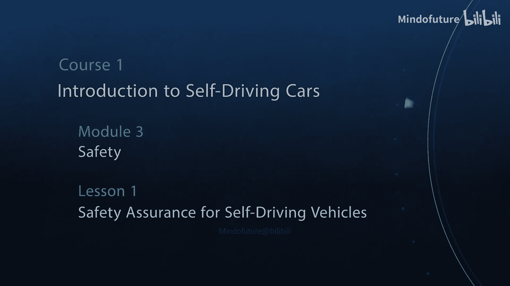
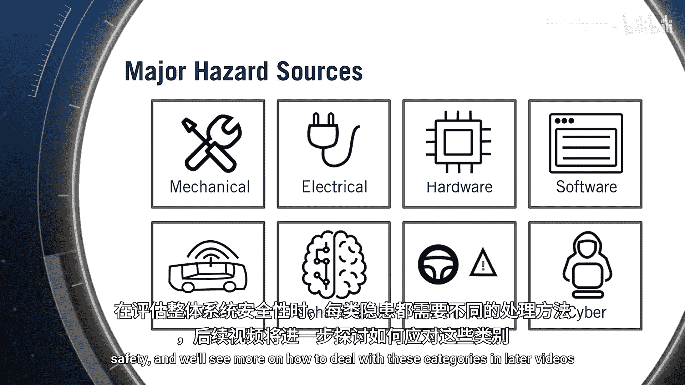
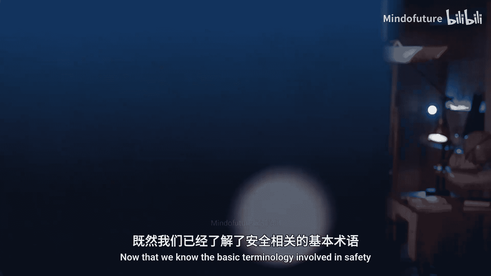
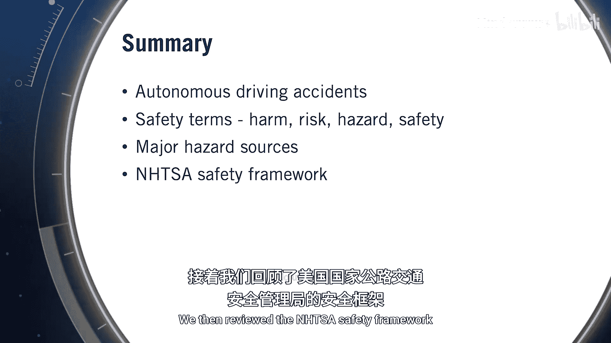

# 020：自动驾驶汽车安全保证

在本节课中，我们将学习如何将安全理念融入自动驾驶汽车设计的基础知识。我们将回顾一些早期的自动驾驶事故案例，正式定义安全相关概念，并探讨确保自动驾驶系统安全性的基本框架。

---

## 事故案例分析

上一节我们介绍了本模块的学习目标，本节中我们来看看自动驾驶发展初期发生的一些典型事故，以理解安全挑战的复杂性。

以下是几起在2017年至2018年间引起广泛关注的自动驾驶事故：

*   **2016年3月，Waymo（前谷歌）车辆与公交车相撞**：一辆Waymo测试车在试图绕过前方障碍物时，与一辆从后方驶来的公交车发生侧面碰撞。软件预测公交车不会在狭窄空间内超车，但公交车的实际驾驶习惯与预期不符，导致反应不及。
*   **2017年，Uber自动驾驶车辆因过度反应而侧翻**：在一次由其他车辆引发的轻微碰撞中，Uber测试车的控制系统因未针对此类外部干扰进行充分测试而反应过度，导致车辆侧翻。这凸显了控制系统需要具备鲁棒性，并进行覆盖尽可能多可预见场景的测试。
*   **2017年底，通用Cruise Bolt与摩托车发生事故**：一辆Chevy Bolt在尝试变道时，因相邻车道前车刹车导致目标空隙关闭，于是中止变道。此时，一位正在车道间穿行的摩托车手驶至其侧方，挡住了车辆返回原车道的路径，使车辆陷入“撞上摩托车”或“撞上邻车”的两难境地。
*   **2018年初，Uber自动驾驶测试车致行人死亡事故**：事故发生在亚利桑那州坦佩市夜间。一名行人推着自行车在未划线的区域横穿多车道道路。调查揭示了多重失效：
    1.  **安全驾驶员监管缺失**：车内的安全驾驶员当时不专注，且系统没有对其状态进行实时监测。
    2.  **感知系统混乱**：系统在碰撞前6秒检测到目标，但分类在“未知物体”、“车辆”、“自行车”之间反复切换，最终因判定检测结果不可靠而选择忽略该目标。
    3.  **紧急制动系统被禁用**：车辆自带的沃尔沃紧急制动系统在碰撞前1.3秒检测到行人，但Uber在自动驾驶测试模式下禁用了该功能，以避免多套避撞系统同时工作产生冲突。

从这些案例可以看出，感知、规划、控制等自动驾驶系统的各个环节都可能失效，而多个系统或多个决策者（包括其他道路使用者）之间的交互常常导致意想不到的后果。

---

## 安全基础概念定义

了解了安全评估的挑战后，我们现在来正式定义一些基本的安全术语。

*   **伤害**：指对生物造成的物理伤害。
*   **风险**：描述事件发生的**概率**与该事件可能造成的伤害的**严重程度**的结合。
    *   公式表示：`风险 = 事件发生概率 × 伤害严重程度`
*   **安全**：避免对生物造成**不合理风险**的过程。
    *   例如，闯红灯驶入交叉路口是不安全的，因为这给车内乘员及其他通过路口的车辆带来了不合理的伤害风险。
*   **危害**：不合理伤害风险的潜在来源，或对安全的威胁。
    *   例如，系统软件中一个可能引发事故的漏洞就是一个危害。

---

## 自动驾驶危害的常见来源

那么，自动驾驶汽车最常见的危害来源有哪些呢？危害可以来自多个方面：

以下是主要的危害类别：
*   **机械危害**：例如制动系统组装错误导致过早失效。
*   **电气危害**：例如内部线路故障导致指示灯失灵。
*   **计算硬件危害**：用于自动驾驶的芯片等硬件发生故障。
*   **软件危害**：自动驾驶软件中的错误或漏洞。
*   **感知危害**：由传感器数据不良、噪声或感知算法不准确导致。
*   **规划危害**：因特定场景的行为选择设计不当，导致无意中选择了危险动作。
*   **驾驶任务接管危害**：在需要人类驾驶员接管时，未能提供足够警告或接管机制失效。
*   **网络安全危害**：自动驾驶系统被恶意实体攻击或入侵。

每种危害在评估整体系统安全性时都需要不同的处理方法，我们将在后续课程中详细探讨。

---

## 如何确保安全：NHTSA安全框架

现在我们了解了安全涉及的基本术语，接下来思考一个问题：如何确保我们的自动驾驶汽车是真正安全的？即，如何针对复杂的驾驶任务和可能出现的众多危害，为完整的自动驾驶系统定义一个安全评估框架？

在美国，国家公路交通安全管理局（NHTSA）定义了一个包含12个部分的安全框架，用以构建自动驾驶的安全评估体系。该框架于2017年发布，是建议性而非强制性的。

该框架首先强调应采用**系统化的安全设计方法**，这贯穿了整个文件。此外，良好规划和受控的软件开发流程至关重要，并应在相关领域应用现有的汽车、航空航天等行业的SAE和ISO标准。

其余11个方面可大致分为两类：**自动驾驶设计**和**测试与事故缓解**。

### 自动驾驶设计相关要求

此类别要求自动驾驶软件栈中包含并考虑某些组件：

1.  **明确的运行设计域**：设计者需清楚了解系统的能力和限制，并能在测试或部署前评估哪些场景是受支持且安全的。
2.  **经过充分测试的物体与事件检测及响应系统**：这对感知和碰撞避免至关重要。
3.  **可靠便捷的降级机制**：当系统出现故障时，能有效提醒驾驶员或使车辆自主进入安全状态。设计需考虑驾驶员可能不专注的情况。
4.  **遵守交通法规**：系统设计应确保在ODD内遵守联邦、州及地方的交通法规。
5.  **网络安全**：考虑网络安全威胁，保护系统免受恶意攻击。
6.  **人机界面**：系统应能向乘客或驾驶员清晰传达车辆状态，例如传感器是否工作、当前运动规划、环境中哪些物体正在影响驾驶行为等。

### 测试与事故缓解相关要求

此类别涵盖了测试自动驾驶功能的方法以及减少故障负面影响并从中学到经验的方式：

1.  **全面的测试计划**：在向公众推出服务前，应进行强有力且广泛的测试，可依靠仿真、封闭场地测试和公共道路驾驶三大支柱。
2.  **碰撞缓解措施**：仔细考虑在碰撞事件中减轻伤害或损坏程度的方法，例如通过设计最小化碰撞能量，并在约束系统、安全气囊和耐撞性方面超越乘客安全标准。
3.  **碰撞后行为**：车辆必须能迅速恢复到安全状态，例如安全停车、切断油泵、报警等。
4.  **数据记录功能**：应具备自动数据记录仪（黑匣子），记录碰撞数据对于分析原因、改进系统以及厘清事故责任至关重要。
5.  **消费者教育与培训**：对测试期间的备用驾驶员以及消费者驾驶员和乘客进行明确培训，使其更好地了解已部署自动驾驶系统的能力和限制，避免因对自动化的过度自信而引发不必要的危险。

需要记住，这些是目前建议公司关注的领域，并非强制性要求。NHTSA的主要目标是在不过度限制创新或预先选定技术的前提下，指导公司开发自动驾驶汽车。

---

## 总结

本节课中我们一起学习了以下内容：
*   回顾了自动驾驶行业早期发生的一些事故，揭示了自动驾驶软件可能失效的多种方式。
*   正式定义了**伤害**、**风险**、**危害**和**安全**等基本概念。
*   列出了自动驾驶汽车危害的主要来源。
*   回顾了美国NHTSA提出的自动驾驶安全框架及其核心要点。

在下一节课中，我们将探讨业界对自动驾驶安全的观点，以及针对自动驾驶汽车的一些安全建议。