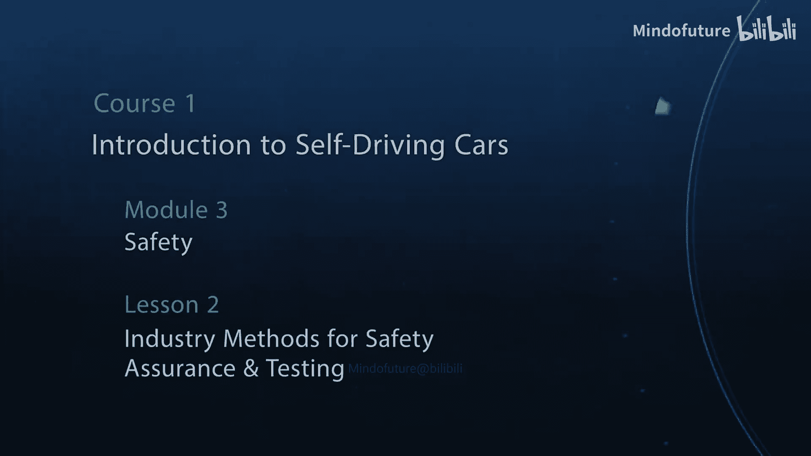
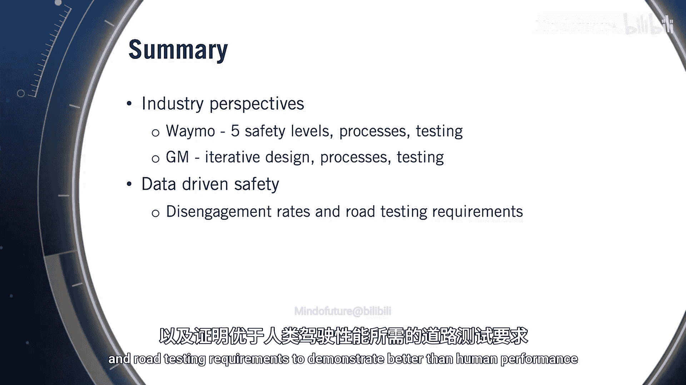

# 021：行业安全保证与测试方法

在本节课中，我们将探讨行业对自动驾驶安全与测试的不同观点。具体来说，我们会首先分析行业两大巨头Waymo和通用汽车的安全理念，然后讨论评估安全的两种不同方法：分析式与经验式。

让我们开始吧。

## Waymo的安全设计方法 🛡️

正如我们在上一个视频中所见，美国国家公路交通安全管理局要求每个自动驾驶开发者制定并描述一个全面的安全策略，涵盖其指导文件中的12个概念。迄今为止，Waymo和通用汽车发布了两份重要的报告。我们将以这两份报告为基础，讨论行业的安全方法。

Waymo的安全报告于2017年发布，其中包含了许多关于如何为自动驾驶汽车组织全面安全策略的深刻见解。Waymo涵盖了NHTSA的所有12个概念，但将其组织成一个五层安全方法。

以下是Waymo的五层安全方法：

1.  **行为安全**：Waymo系统被设计为在行为层面执行安全驾驶。这包括遵守交通规则的决策、能够在运行设计域内处理各种场景，并在此过程中保持车辆安全。
2.  **功能安全**：Waymo确保系统具有备份和冗余。这样，即使发生故障，汽车也可以切换到备用组件或备份流程，以最大限度地降低故障的严重性，并使车辆恢复到安全状态，如果可能则继续行驶。
3.  **碰撞安全**：Waymo强调NHTSA建议的碰撞安全。它设计的系统确保在发生碰撞时，对车内人员的伤害最小。
4.  **操作安全**：Waymo努力确保操作安全。这意味着其界面可用、方便且直观。这里的重点是允许乘客对车辆有一定程度的控制，但仅限于能维持系统安全的方式。
5.  **非碰撞安全**：Waymo促进非碰撞安全。这指的是系统设计能最大限度地降低与系统互动人员（如急救人员、机械师、硬件工程师等）的危险。

这五大支柱构成了Waymo的“安全设计”系统，并形成了一个广泛的需求定义、设计迭代和测试体系，以确保每个组件都满足系统的目标。该过程使用了来自现有领域的多种工具，我们将在下一个视频中详细介绍这些工具。

## Waymo的测试流程 🧪

现在，让我们讨论Waymo为评估其软件而遵循的具体测试程序，因为这是目前最公开可见且记录最完善的程序。

以下是Waymo遵循的测试程序：

1.  **仿真测试**：他们首先在仿真环境中测试所有软件更改，每天进行约1000万英里的仿真。这代表了持续运行的巨大计算量，以确认系统安全要求的预期改进。为此，他们从所有道路经验中挖掘具有挑战性的场景，并进行系统性的场景模糊测试，即随机改变其他车辆和行人的位置和速度参数，以测试自车在所有情况下是否表现安全。这种方法对于发现难以解决的边缘情况特别有用，例如并线或通过交叉路口时的困难时间间隙。
2.  **封闭场地测试**：然后他们在私人场地上进行封闭场地测试。他们涵盖了加州大学伯克利分校研究确定的28个核心场景，以及Waymo增加的19个额外场景。这些场景围绕避免四种最常见的事故场景组织：追尾、交叉路口、偏离道路和变道。这些类别显然有许多变体，但它们共同占所有碰撞事故的84%以上。
3.  **真实世界测试**：最后，他们进行真实世界测试，这在美国许多城市的街道上经常可以看到，包括加利福尼亚州山景城，就在谷歌主园区附近。这种测试使他们能够识别越来越多不寻常的情况，并主要依赖于在测试期间由人类监控自动驾驶软件的动态驾驶任务后备策略。

这些测试策略的组合绝非Waymo独有，但已成为事实上的标准，因为它为固定投资提供了最大的灵活性和反馈。每种测试方法都专注于其最擅长的领域：仿真用于操控使其变得困难的场景，封闭场地测试用于确认特定的安全性能提升，真实世界测试用于发现更具挑战性的场景并增加公众对该技术的信心。

## 通用汽车的安全理念 🚗

现在，让我们将注意力转向通用汽车的安全理念。通用汽车在2016年收购了Cruise Automation，并因此将自己推向了自动驾驶开发的领先地位。

通用汽车的战略非常紧密地遵循NHTSA的安全框架，并单独处理12个主要领域中的每一个。通用汽车的安全策略并不试图重组或简化NHTSA的指导，而是专注于实现所需安全评估的实施策略。

以下是通用汽车安全策略的关键点：

1.  **迭代设计模型**：通用汽车强调其迭代设计模型。他们首先分析场景，然后构建软件，接着仿真场景并测试软件，最后在真实世界的汽车上部署软件。他们不断迭代地对需求和自动驾驶系统进行改进和优化。
2.  **集成设计**：与Waymo依赖原始设备制造商设计其车辆，并且只讨论与其自动驾驶硬件相关的机械和电气危险不同，通用汽车完全自己制造汽车，因此可以执行更集成的设计，在整个自动驾驶硬件中保持一致的质标准。
3.  **全面风险管理**：通用汽车通过全面的风险管理方案确保安全。他们识别并处理风险，试图完全消除风险，而不仅仅是减轻风险。
4.  **内部安全标准**：最后，他们所有的系统都遵循内部明确定义的安全、可靠性、安全性等标准。他们在汽车行业拥有多年的车辆开发经验，并因此制定了广泛的安全流程。

他们的安全流程涉及三种类型的分析。首先，他们通过故障树方法进行演绎分析，精确定位可能发生故障的组件并加以解决。其次，他们通过设计失效模式与影响分析进行归纳分析，即对设计方案进行失效模式与影响分析，并尝试自下而上地确保安全。最后，他们采用危险与可操作性研究进行探索性分析，找出系统可能无法按预期工作的情况。

## 通用汽车的安全阈值与测试 ⚙️

现在，这一切听起来可能很熟悉，事实上，这些正是Waymo描述的相同分析支柱。在下一个视频中，我们将更详细地介绍这些方法实际如何运作。

让我们谈谈通用汽车车辆的安全阈值。所有通用汽车车辆至少必须遵循两个关键的安全阈值。

以下是通用汽车的安全阈值与测试机制：

1.  **故障安全与冗余**：首先，通用汽车为不同组件定义了一套明确的故障安全、备份系统和冗余，以便系统在发生故障后仍能继续工作。
2.  **预期功能安全评估**：其次，组件必须通过预期功能安全评估，我们将在下一个视频中更详细地讨论。通过此评估，我们确保所有关键功能在已知和未知场景下都得到评估。
3.  **严格的测试机制**：最后，通用汽车遵循严格的测试机制，包括性能测试、需求验证、故障注入、侵入式测试、耐久性测试和基于仿真的测试。

这两家公司都严格遵循安全标准，因此是实际有效实施安全的绝佳范例。

## 评估安全的方法：分析与数据驱动 📊

现在，我们对行业如何进行安全评估有了更清晰的认识，但我们仍然面临这个问题：是否真的可能精确评估自动驾驶汽车是否安全？或者至少比人类驾驶员更安全。让我们讨论可用于评估自动驾驶系统安全性的各种方法。

我们有两种可能的方法：分析式或数据驱动的安全评估。

**分析式安全评估**意味着可以通过分析系统来定义可量化的安全性能或故障率，这是基于对危险和场景的关键评估。如果可以通过分析确定整个系统的故障率，它可以为系统的哪些方面对整体安全贡献最大提供强有力的指导。一个很好的例子是航天飞机计划，其最初的分析故障率估计为每10万次飞行发生一次。然而，在该计划结束后，一项法证研究表明，早期航天飞机计划的飞行故障率接近每10次飞行发生一次，并且直到计划结束时才进展到每100次飞行发生一次。考虑到构成航天飞机发射的数千个子系统以及可能影响这些系统运行的数百万个变量，能够对如此复杂的系统进行此类分析本身就是一个奇迹。这种详细分析也适用于自动驾驶汽车，但由于车辆可能遇到的无限多样情况，可以说更为复杂。最终，分析方法只能为自动驾驶系统的安全性能提供指导，其结果需要通过经验来验证。

为了评估经验，我们使用**数据驱动测试**。这个概念是指，我们确信系统是安全的，因为它已经证明，使用特定版本的软件，它可以在运行设计域包含的一组道路和场景上达到所需的故障率。在自动驾驶的情况下，这些所需的故障率可以与人类驾驶水平挂钩，我们希望将事故率比当今驾驶员的水平降低10倍或100倍。

## 当前数据与挑战 📉

那么数据说明了什么，自动驾驶汽车实际上更安全吗？首先要知道，按照人类标准，驾驶仍然很危险。2015年的一份报告得出结论，在所有驾驶死亡事故中，约90%是由于人为错误造成的，有时是由于判断失误，有时是由于人类感知失败等。但人类也非常擅长驾驶，事实上，整个驾驶环境都是基于人类的感知和规划能力设计的。在美国，大约每行驶1.46亿公里发生一起死亡事故，每行驶210万公里发生一起受伤事故，大约每行驶40万公里发生一起碰撞事故。最后一个数字只是估计值，因为大多数较小的碰撞实际上并未报告。事实上，自动驾驶可能会大大有助于阐明这些统计数据，因为借助我们可用的额外传感器，将可能进行更全面的报告和重建。

现在让我们考虑初步的自动驾驶车辆统计数据，更具体地说，是在加利福尼亚州测试的所有自动驾驶车辆发布的脱离率。脱离是指自动驾驶软件请求驾驶员接管控制，或者安全驾驶员认为有必要进行干预。可以理解，获取整个测试车队的真实碰撞统计数据具有挑战性，因为这些是敏感数据。幸运的是，在加利福尼亚州的测试附带了一些有用的报告要求。2017年，Waymo在加利福尼亚州行驶了56.3万公里，经历了63次脱离，大约每9000公里脱离一次。通用汽车Cruise在加利福尼亚州行驶了21万公里，有105次脱离，大约每2000公里脱离一次。两者在整个年度都在快速改进，在当年的最后三个月，脱离率分别达到每12500公里一次和每8300公里一次。这些数字很难与人类表现直接关联，但大致意味着典型的通勤者每年只需因自动驾驶系统故障而干预一次。这是巨大的进步，但距离人类每年在数万亿英里行驶中实现的每40万公里发生一次碰撞仍有差距。

Waymo的63次脱离按频率排序的主要原因依次是：不期望的车辆机动、感知差异、硬件问题、软件问题、行为预测，最后是一起鲁莽道路使用者的情况。很明显，感知、预测和行为规划等核心任务仍然是具有挑战性的问题，仍有许多工作要做。

最后，谈谈统计显著性。从当今车队观察到的性能令人印象深刻。但它们能在多大程度上代表与人类能力的准确比较？我们真正需要行驶多少英里才能证明自动驾驶汽车比人类驾驶员更安全？特别是在死亡事故方面。在补充材料中，我们包含了一份兰德公司报告的链接，该报告试图解决这个问题。数字令人震惊。由于死亡事故是罕见事件，并且考虑到众多因素，报告指出，如果使用纯道路测试来验证自动驾驶系统的安全性，可能需要超过80亿英里的行驶里程。如果一支由100辆车组成的车队每天24小时、每周7天不间断行驶，至少需要400年才能完成。这是一个漫长的等待时间。正是由于这个原因，我们看到了如此多方面的安全方法。每家公司都在扩大车队规模，以增加自动驾驶系统在道路上获得的经验。

## 总结 📝

在本视频中，我们探讨了两种关于自动驾驶安全评估的行业观点：Waymo和通用汽车，并发现许多方法借鉴自其他行业。我们还讨论了当前的脱离率和道路测试要求，以证明优于人类的表现。在下一课中，我们将探讨一些最常用的安全框架和方法论。我们下节课见。

