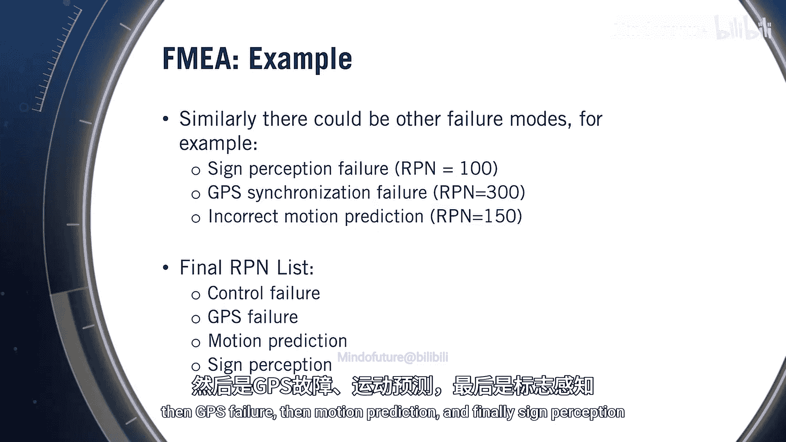
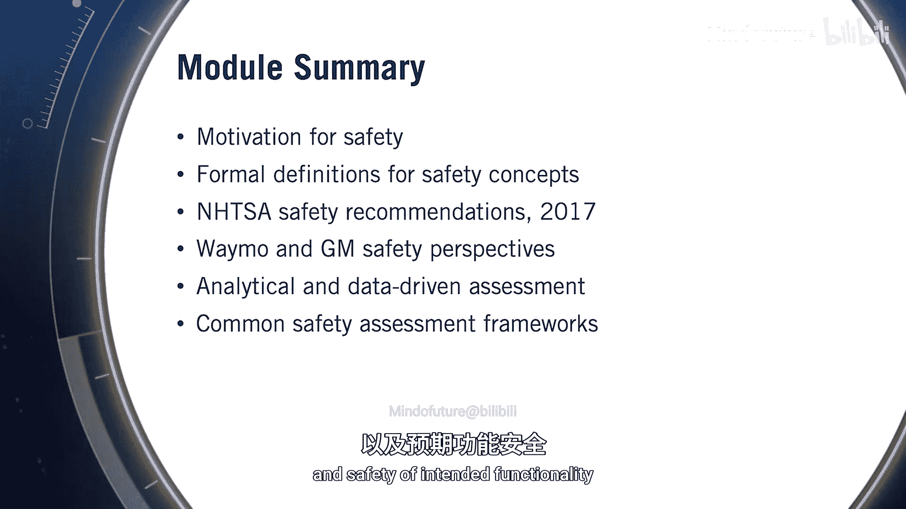

# 022：自动驾驶安全框架

在本节课中，我们将学习几种流行的安全评估框架。我们将从通用的分析框架开始，然后聚焦于汽车和自动驾驶领域特定的安全标准。通过本课，你将了解如何系统地分析和降低自动驾驶系统的风险。

## 通用安全分析框架

上一节我们介绍了安全的重要性，本节中我们来看看几种用于系统化识别和管理风险的分析框架。

### 故障树分析

故障树分析是一种自上而下的安全评估方法。我们从希望避免的系统故障（顶事件）开始，逐层向下分解，找出导致该故障的所有可能原因和底层事件。

故障树的顶层节点称为**根事件**或**顶事件**。中间节点是逻辑门，定义了导致根事件的潜在原因。这种分解会持续到可以为每个底层事件定义发生概率的详细程度。然后，我们可以使用布尔逻辑定律组合这些概率，来评估根事件发生的总体概率，以及哪些原因对其贡献最大。

考虑一个简单的例子：以车辆碰撞作为我们的根事件。导致碰撞的原因可以分解为软件故障或硬件故障（以及其他许多可能性）。硬件故障可能源于制造缺陷或材料缺陷。软件错误可能源于感知代码故障或网络安全问题（例如被黑客攻击）。我们可以继续分解到软件子系统和其中的特定计算，在每一个分支上深化树结构。最终，我们会到达可以分配每小时或每英里运行发生概率的特定故障率节点，即故障树的叶节点。

给定各个叶节点的故障率评估，我们可以使用逻辑门结构明确计算整体故障率的统计数据。用于向上传播这些概率的运算规则与事件遵循集合论时的概率规则相同。例如，对于独立事件，“或”和“与”的概率分别是子节点概率的和或积。

这就是故障树背后的基本思想。当叶节点包含概率时，它被称为**概率故障树**。概率故障树是一种在核能和航空航天工业中广泛使用的自上而下的安全方法，同样可以应用于自动驾驶。挑战在于构建一个全面的树结构，并正确识别叶节点事件的概率。

### 失效模式与影响分析

与故障树从系统故障向下流向所有可能原因不同，失效模式与影响分析是一种自下而上的过程。它着眼于单个原因，并确定可能发生的所有影响。

通常，故障树分析和失效模式与影响分析会结合使用来评估安全关键系统。失效模式是指整个系统中某个特定组件导致系统故障的方式。影响分析是指分析这些模式故障可能引起的所有可能后果。通常，影响分析旨在找出那些导致最严重故障的模式，从而可以改进设计，为系统增加更多冗余或更高可靠性。

以下是失效模式与影响分析的核心思想：目标是根据优先级对失效模式进行分类。因此，我们会问以下问题：影响有多严重？这些故障发生的频率如何？以及检测这些故障的难易程度如何？然后，我们使用优先级值量化所有故障，并首先处理优先级最高的故障。

以下是实施步骤。目标是构建一个包含所有可能风险情况的表格。

首先，与领域专家讨论，确定我们希望在表格中达到的详细程度的过程。
然后，质疑系统的目的，并列出所有可能的故障。
接着，针对每个可能的故障，识别其可能的后果，并为每个后果分配一个1到10的严重性评级（10为最严重）。
对于每个后果，识别可能的根本原因，并为每个根本原因分配另一个1到10的数字，表示该原因发生的频率。
然后，识别操作员、维护检查或故障检测系统可以检测到该失效模式的所有方式。
我们评估在导致影响之前检测到该模式的总体可能性，并分配另一个1到10的分数（1表示保证能被检测到，10表示不可能被检测到）。
最后，我们计算一个最终数字，称为**风险优先级数**，它是严重性、发生频率和可检测性三个分数的乘积。这个值越高，优先级就越高。
最终，我们通过修改系统的实现来解决最有问题的失效模式，直到将风险降低到可接受的水平。

也可以像故障树分析一样，使用实际的故障概率来执行失效模式与影响分析，并根据在固定运行期间发生关键事件的可能性来定义可接受的风险水平。方法不变，只是数字的含义和完成整个分析的复杂性会有所不同。

让我们坚持使用简单的评分方法，并通过一个简短的例子使失效模式与影响分析过程更具体。

考虑一个特定故障：车辆驶入由于其测试区域内道路施工而出现的碎石路面，导致控制器不稳定。最坏的影响可能是物理碰撞，严重性为10。它也可能导致驾驶员不适或险些发生事故，但这些事件的严重性较低。这种事件在城市环境中可能经常发生，只要存在特定类型的施工，所以可能性较高，假设我们将发生频率评分定为4。同样，我们可以为其他影响分配发生频率分数。假设这个问题目前无法检测，因为在我们自动驾驶软件运行期间没有主动监控路面纹理。因此，对于所有这些影响，可检测性评分都是10。那么，碰撞的风险优先级数就是 10 × 4 × 10 = 400。

同样，我们可能还有其他失效模式。例如，一个标志感知故障，优先级数为100；一个GPS同步故障，优先级数为300；一个车辆运动预测故障，优先级数为150。因此，我们将按照优先级顺序，在实施中解决这些故障：先处理碎石路面行驶，然后是GPS故障，接着是运动预测，最后是标志感知。

这就是失效模式与影响分析背后的通用框架。它是一种由军事和航空航天工业开发，后来引入汽车工业的风险评估方法。它提供了一种结构化的方式来量化风险并优先处理最重要的风险。

### 危险与可操作性分析

最后，失效模式与影响分析的一个常见变体是危险与可操作性分析。

与失效模式与影响分析寻求定量定义风险相比，危险与可操作性分析更偏向于定性过程。其主要目的是对可能出现的危险集合进行有效的头脑风暴。对于复杂过程，可以在不必为发生频率、严重性和可检测性分配具体数值的情况下评估风险，而这些数值可能很难确定。危险与可操作性分析通常在设计过程的早期用于指导概念设计阶段。

危险与可操作性分析的关键补充是使用引导词来引导应用于每个系统需求的头脑风暴。这些引导词包括“无”、“多”、“少”、“早”、“晚”等，可以引出其他情况下可能不会被考虑的潜在失效模式。因此，可以将危险与可操作性分析视为一种简化的、持续进行的失效模式与影响分析头脑风暴方法。

## 汽车与自动驾驶安全框架

现在，让我们聚焦于更具体的安全类型，讨论用于汽车和低级自动驾驶功能开发的现有安全框架，这些框架常用于评估自动驾驶车辆中的硬件和软件故障。

### 功能安全

我们将特别讨论ISO 26262中描述的功能安全方法，以及扩展了ISO 26262并在ISO PAS 21448中定义的预期功能安全方法。

功能安全是指因汽车硬件和软件故障引起的功能异常行为，或与其预期设计相关的非预期行为，所导致的不合理风险的缺失。

ISO 26262标准定义了汽车内电气和电子系统的功能安全术语和活动。因此，它仅涉及可能影响自动驾驶车辆安全的硬件和软件危险。该标准定义了四个汽车安全完整性等级，其中D级要求最严格，A级要求最低。每个等级都有与之相关的特定开发要求，必须遵守才能获得认证。

功能安全流程遵循V形流程。从左上角的需求规范开始，然后进行危险和风险分析，接着进行功能实现。然后，我们沿着右侧分支向上攀升，以确认设计目标已实现。我们从低层级的验证（如软件单元测试）开始，然后通过仿真、试验场操作和道路测试，进行子系统和全系统的验证。当我们沿着V形左侧下降时，高层级需求转化为低层级实现；当我们沿着V形右侧攀升时，我们在组合它们以确认系统安全运行需求之前，先确认每个低层级功能的实现。最后一步是进行总结性的功能安全评估，以评估残余风险并确定我们的系统是否已达到可接受的安全水平。

在功能安全V形流程的开始，我们使用危险分析与风险评估。在危险分析与风险评估中，我们识别和分类危险事件，并指定避免不合理风险的要求。这个过程驱动了此后的所有系统开发和测试。为此，我们首先识别可能影响汽车安全的硬件和软件故障、功能异常以及非预期功能。这就是失效模式与影响分析或危险与可操作性分析在功能安全框架中使用的地方，并会导出一组针对我们系统的特定危险。然后，我们定义系统必须运行的场景或情况列表，利用我们的设计运行域来创建此列表。接下来，我们将危险和情况组合成危险事件，描述预期损害，并确定风险参数，以计算每种情况和危险组合的潜在风险数值。在风险评估之后，我们选择风险最高的场景，即针对每种可能的故障可能发生的最坏情况事件。最后，我们基于这些最坏情况场景定义我们的安全要求。

危险分析与风险评估过程以了解所有可能发生的最坏情况故障的方式设定系统的设计目标，并通过验证确认这些最坏情况故障仅以合理的风险得到处理。这就是功能安全背后的主要思想：你专注于最坏情况需求，然后实现至少能够处理这些最坏情况需求的硬件和软件。

### 预期功能安全

最后，让我们简要探讨一下预期功能安全标准。

它在ISO PAS 21448文件中正式定义。预期功能安全特别关注与系统性能限制和系统的可预见误用相关的故障原因。

性能限制是指由于技术限制（如传感器性能限制和噪声）、算法限制（如物体检测失败）以及执行器技术限制导致的已实现功能不足。硬件和软件故障由ISO 26262中的功能安全标准处理，不在预期功能安全的范围内。预期功能安全还解决了由于用户可预见的误用而导致的不安全操作，例如用户困惑、用户过载和用户过度自信。当前的预期功能安全标准针对自动化等级0、1和2，并且也说明其方法可以应用于等级3、4和5的自动驾驶，但可能需要额外的措施。预期功能安全可以被视为功能安全流程的扩展，专门设计用于应对自动驾驶功能的挑战。因此，它遵循非常相似的V形开发理念，但增加了组件。预期功能安全也采用危险分析与风险评估来识别由性能限制和误用引起的危险。然后执行类似的设计、单元测试、验证和确认序列，以确认安全要求已得到满足。

## 总结

本节课中我们一起学习了多种安全评估框架。

我们首先讨论了通用安全框架：作为自上而下安全评估方法的故障树分析，以及作为自下而上安全评估方法的失效模式与影响分析。然后我们讨论了功能安全的概念，这些概念常用于软件和硬件的风险评估。我们还讨论了作为功能安全扩展的预期功能安全，它考虑了性能限制和误用。

正如我们在Waymo和GM的案例中看到的，所有这些理念在工业界都被广泛使用，它们在其安全评估中几乎使用了所有这些技术。恭喜你完成了本安全评估模块的学习。