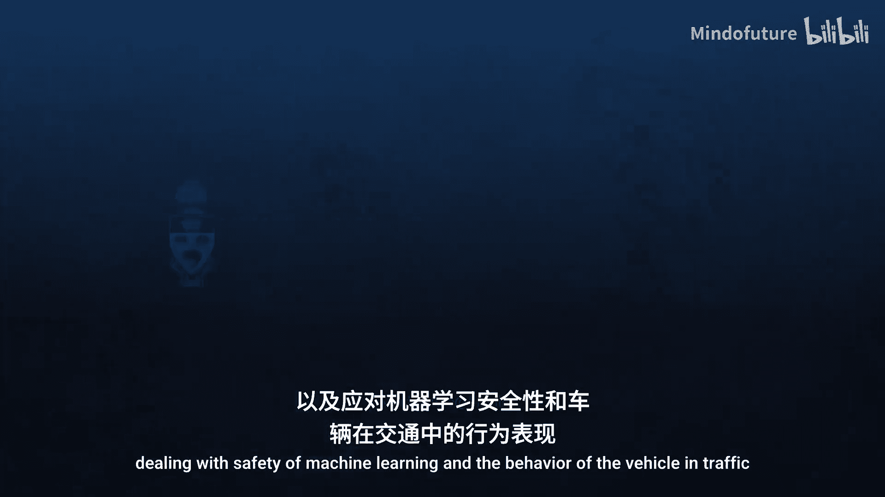

自动驾驶汽车简介：P23：认识安全保证专家克日什托夫·查内茨基教授

在本节课中，我们将与安全保证专家克日什托夫·查内茨基教授对话，探讨自动驾驶汽车的安全性问题。我们将了解他在该领域的工作经历，以及自动驾驶安全设计所涵盖的关键方面。

大家好，欢迎来到滑铁卢大学的自动驾驶汽车车库。

我在这里与我的好友兼同事克日什托夫·查内茨基在一起。

我们今天将讨论自动驾驶的安全性问题。

我们是否可以从您在自动驾驶汽车安全设计方面所做的出色工作开始谈起？我曾为戴姆勒研究部门工作，那是16年前，而12年前，我有机会……没错，在一辆自动驾驶汽车原型车中，那是早期的原型车之一。是的，非常令人兴奋。当我来到滑铁卢大学后，我从事汽车软件工作，而**功能安全**始终是汽车软件中的一个重要主题，主要涉及潜在的缺陷。本质上，你不希望在以每小时100公里速度行驶的车辆中，出现类似电脑“蓝屏死机”那样的致命故障。

大约两年来，我一直在研究自动驾驶汽车，特别是其安全方面。因此，我的工作重点是**系统架构**、**设计方法论**、处理**机器学习的安全性**以及车辆在交通中的**行为安全**。

---

上一节我们介绍了克日什托夫教授的背景和研究重点。本节中，我们来具体看看他提到的几个核心安全领域。

以下是自动驾驶安全设计涉及的几个关键层面：

*   **功能安全**：核心目标是防止由系统故障（如软件缺陷、硬件失效）导致的危险。这通常遵循 **ISO 26262** 等标准，通过系统化的设计、分析和测试流程来确保安全。
*   **预期功能安全**：关注的是系统在无故障情况下，由于性能局限或设计不足而可能引发的风险。例如，传感器在极端天气下性能下降，或算法对某些场景处理不当。
*   **机器学习安全性**：由于自动驾驶大量依赖机器学习模型（如感知、决策），需确保这些模型的**鲁棒性**（对抗干扰的稳定性）、**可解释性**和**可靠性**。这涉及到对训练数据、模型架构和测试验证的特殊要求。
*   **交通行为安全**：确保自动驾驶车辆在复杂的动态交通环境中，其决策和行为符合安全规范，并能与其他道路使用者进行安全、可预测的互动。

---

本节课中，我们一起学习了自动驾驶汽车安全领域的概况。通过与克日什托夫·查内茨基教授的交流，我们了解到自动驾驶安全是一个多维度、跨学科的挑战，它不仅仅关乎硬件和软件的可靠性，还涉及算法行为的合理性以及在真实交通环境中的综合表现。理解这些基础层面是构建安全可靠的自动驾驶系统的第一步。