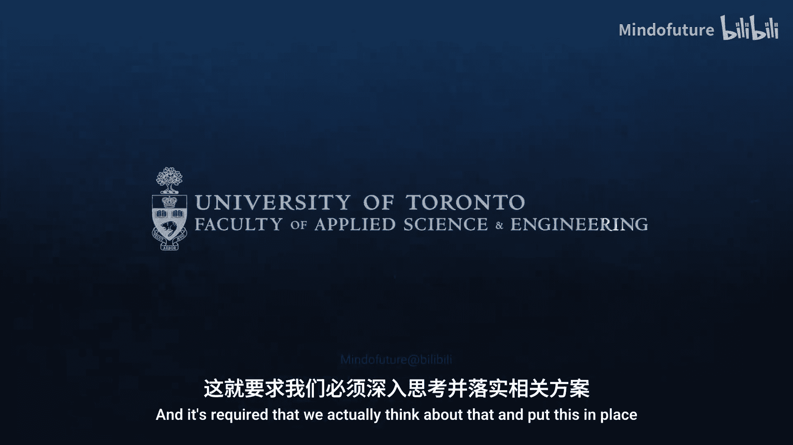

# 025：航空业经验与安全框架

在本节课中，我们将探讨自动驾驶技术发展中的一个核心问题：如何立法与构建安全体系。我们将分析航空业的成熟安全框架，并讨论其如何为自动驾驶领域提供借鉴，同时指出两者在应用环境上的根本差异。

## 立法与责任归属的挑战

一个经常被提及的问题是，我们如何为这项技术立法。我们知道事故终将发生，事实上，我们已经看到一些早期测试甚至导致了死亡案例。一旦我们开始更广泛地部署这项技术，我们永远无法达到完美的安全记录，总会有不可预测的故障和事故发生。

那么，如何划分责任？例如，当某家汽车制造商的车辆第一次撞上一辆载满儿童的校车时，这会终结整个行业吗？如果每个月都有针对这些试图自主驾驶的车辆的诉讼，我们是否会迷失方向？

## 行业目标：零死亡事故

对于行业和所有相关方而言，目标应该是**零死亡事故**。我们知道任何技术系统都可能出现故障，但我们必须尽一切可能避免那些会导致死亡或重伤的故障。这是首要目标。

## 向航空业借鉴安全框架

在某种意义上，汽车行业可以从航空业学到很多。航空业已经建立了一套体系，其中系统工程、运营和维护的所有方面都服从于一个整体的安全体系，即安全工程。

以下是航空业安全框架的核心做法：
*   **系统性风险分析**：审视所有重要的风险因素。例如，航空公司可能会分析成千上万个风险点。
*   **全面应对**：系统地解决所有风险，这既包括技术层面，也包括飞行员培训、确保充足睡眠等操作层面。

## 航空与自动驾驶环境的根本差异

然而，航空业的经验只能提供部分参考。航空器运行的环境要简单和开放得多。自动驾驶面临的真正挑战，似乎来自于与所有其他车辆、智能体以及行人的交互，其复杂性似乎完全不同。

你说得对，问题确实不同。例如，在驾驶飞机时，你有更多的时间来应对问题。我所说的借鉴，主要是指**整体的安全框架**：每一起坠机事故都会被调查，每一个事件都会被记录，我们总是从中学习，并且这种学习成果在国际所有关键利益相关者之间共享。

其核心理念是：**竞争对手不在安全问题上竞争**。这就是关键差异。

## 方法不能完全照搬

因此，我们不能100%照搬航空业的具体方法和技术。例如，在航空领域，你有一名训练有素的飞行员，自动化系统处理所有简单和中等难度的事务，而飞行员仍然负责处理所有困难情况。

在我们的案例中，我们希望实现一切自动化，并且无法依赖一个合格且训练有素的“飞行员”。因此，这些问题必须得到解决，这非常具有挑战性。

## 安全理念可以相通

但是，**对待安全的方法本质上可以是相同的**。我们必须思考这一点，并将此框架建立起来。

---

本节课中，我们一起学习了自动驾驶安全立法面临的挑战，以及向航空业借鉴整体安全框架的可能性。我们认识到，虽然自动驾驶的运行环境远比航空复杂，无法照搬具体技术方案（如依赖飞行员），但建立一套**系统性的、非竞争性的、基于持续学习和共享的安全工程理念**，对自动驾驶行业至关重要。目标是明确的：尽一切努力向**零死亡事故**迈进。