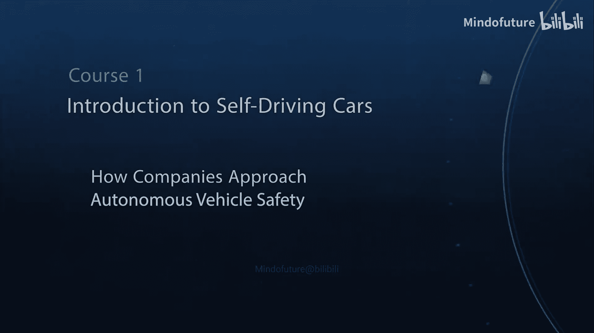
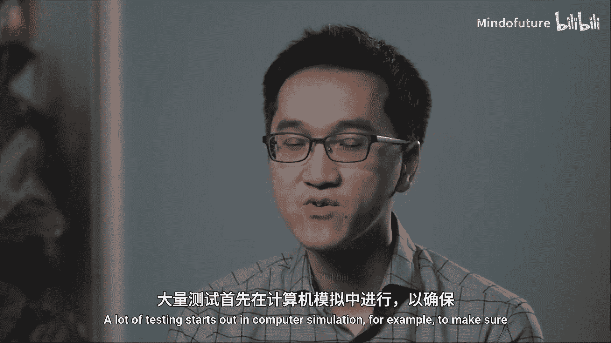

# 027：企业如何应对自动驾驶汽车安全问题

在本节课中，我们将探讨自动驾驶汽车带来的长期效益，以及企业为确保其安全性所采取的多层次测试与验证策略。

## 🚗 自动驾驶的长期效益

自动驾驶汽车的长期效益首先体现在安全性上。人们常听说有人深夜驾驶时目睹车祸，或因前方司机疲劳驾驶或追尾导致交通拥堵。如果社会能达到所有车辆都是自动驾驶的阶段，理论上将不再有车祸发生。人们可以安全地从A点行驶到B点。

此外，交通拥堵有望减少。道路上车辆数量可能减少，因为这些车辆可以相互通信，并且由于无需频繁变道超车，所有车辆能以相同速度行驶，这能极大缓解由变道和施工等因素造成的拥堵。

同时，自动驾驶为无法自行驾驶的人群提供了出行便利。例如，无法获得驾照的人，或在城市中养车不现实的人。对他们而言，乘坐公交车或未来的自动驾驶车辆，无需像公交车那样绕行，就能直达目的地，是更合理的选择。

## 🔬 确保安全的多阶段测试流程

在代码部署到车辆之前，我们会经历多个检查阶段，以确保其功能符合预期。

以下是我们的主要测试阶段：

1.  **仿真模拟**：首先在仿真环境中运行代码。
2.  **历史场景测试**：针对我们以前遇到过的边缘案例进行测试。
3.  **封闭场地测试**：最终将代码部署到车辆上后，我们先在私人测试跑道上进行测试，然后才允许其进入公共道路。

我们通过多个测试阶段来确保上路车辆的安全，然后才实际部署这些软件功能。我们首先在仿真中严格测试代码，然后针对可能遇到过的边缘案例进行测试。一旦代码实际部署到车辆上，我们会先在私人测试跑道上测试这些车辆，之后才让它们驶上公共道路。

## 📊 安全性的核心优势与挑战

自动驾驶汽车的一个主要优势正是安全性。一个常被引用的统计数据是，**94%的交通事故由人为错误造成**。这为自动驾驶汽车提供了巨大的改进空间。

然而，保证车辆在所有不同道路场景下的安全，无疑是主要挑战之一。幸运的是，我们通过仿真、真实世界测试积累里程以及计算机测试等方式来解决这个问题。

## 🌙 应对不同环境的感知能力

这个话题经常被提及。显然，白天和夜晚的能见度不同。幸运的是，我们拥有多种传感器模式，它们能很好地相互补充。例如，雷达和激光雷达在夜间也能完美地“看见”东西。

通过使用多种不同的传感器技术，我们能够创建对周围世界安全、全面的感知，即使在夜间也是如此。

## 🛡️ 对测试与安全的严肃态度

我们绝对非常重视测试和安全。大量测试始于计算机仿真，以确保一切达标。许多真实世界测试开始时由人类驾驶员在方向盘后操控，他们可以随时接管，以保证安全，以防出现任何问题。

随着我们积累更多里程和经验，我们会越来越多地进行此类测试。我们从收集的数据集中不断学习，以进一步完善我们的系统。

## 🤝 机器学习的集体经验优势

我们许多人都认识在驾车时发生过事故的家人或朋友。这很糟糕，但事故发生后，你的邻居并不一定会因此变成更好的司机。

但对于无人驾驶汽车，情况则不同。设想20年后，我坐进的无人驾驶汽车将受益于所有其他无人驾驶汽车曾经行驶过的所有里程。而人类驾驶员恰恰无法做到这一点。因此，有一个非常有说服力的论点支持这些机器共享数据，共享它们在各种驾驶方式中获得的经验。而人类驾驶是一种孤独的体验，我们所有18岁的新手司机都是从不太好的驾驶者开始重复这一过程，这听起来很不合理。

## 🏙️ 改善交通与城市的愿景

我们有很多理由想要改善交通和城市。当你在飞机上望向窗外，会发现我们国家建造的大量基础设施都是为了移动人和物。

---

本节课中，我们一起学习了自动驾驶汽车在安全、效率和包容性方面的长期潜力。我们深入了解了企业为确保安全所采取的从仿真到真实道路的 rigorous 测试流程，并探讨了自动驾驶通过数据共享获得集体经验、从而超越人类驾驶局限性的独特优势。最终，改善城市交通是推动这项技术发展的核心愿景。