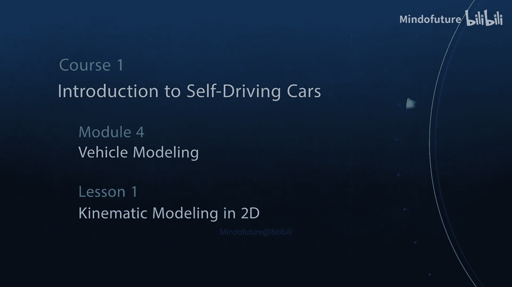
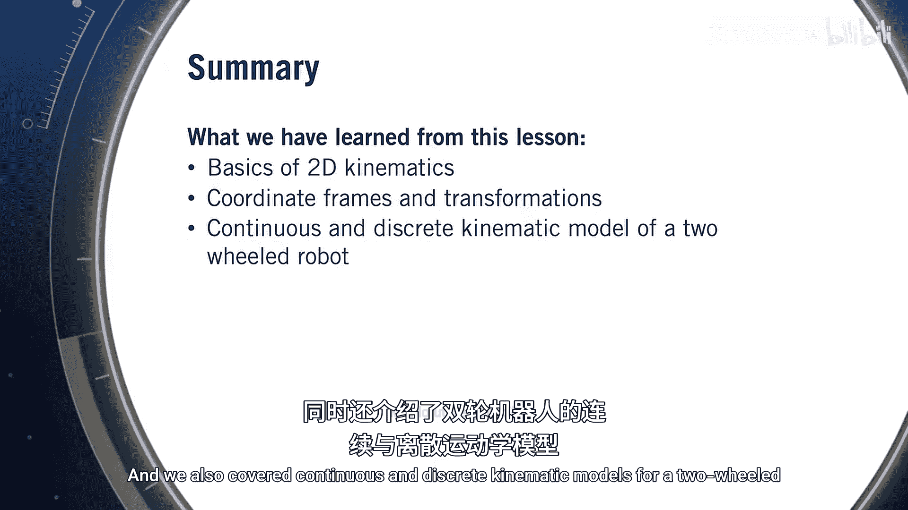

# 028：二维运动学建模

在本节课中，我们将学习自动驾驶汽车的二维运动学建模基础。我们将从坐标系转换开始，然后为一个简单的两轮机器人建立运动学模型，为后续学习更复杂的车辆模型打下基础。

## 坐标系与变换

在开始对车辆运动进行建模之前，理解坐标系变换的概念至关重要。本节中，我们将介绍二维变换，在后续关于状态估计的课程中，您将看到更多三维变换的内容。

我们使用的坐标系通常是右手坐标系，并且在本系列课程中会使用几个标准坐标系。

*   **全局/世界/惯性坐标系**：这是一个固定在地球上的参考系。通常表示为相对于附近参考点的东-北-天（ENU）坐标系，或全球导航卫星系统（GNSS）中使用的地心地固（ECEF）坐标系。
*   **车身坐标系**：该坐标系附着在车体的某个关键位置，例如车辆的重心或后轴中心点。该坐标系随着车辆的运动而相对于固定的惯性坐标系移动和旋转。
*   **传感器坐标系**：该坐标系附着在每个传感器上，描述了传感器输出所使用的坐标。

在许多机器人应用中，我们需要为移动系统附加多个坐标系，并需要在惯性坐标系中表示这些坐标系中的元素。为此，我们需要将变量从一个坐标系转换到另一个坐标系，例如从车身坐标系转换到惯性坐标系。即使是一个带有单个传感器的简单两轮机器人，也需要考虑三个这样的坐标系，而自动驾驶汽车则可能有数十个。为了保持感知中传感器数据表示的一致性，我们需要能够在坐标系之间转换信息。

让我们看一个简单的汽车速度矢量变换示例。通常，速度等运动学变量以具有大小和方向的矢量形式表示。

在下图中，矢量 **V** 在二维坐标系中以绿色箭头表示。这里显示了两个坐标系：由轴 B1 和 B2 定义的车身坐标系，以及由轴 E1 和 E2 定义的惯性坐标系，两者都在二维平面内。

假设两个坐标系（E系和B系）具有相同的固定原点，但B系相对于E系旋转了某个角度 θ。

我们可以定义旋转矩阵 **C_EB**（将矢量从B系变换到E系）和 **C_BE**（使用角度 θ 将E系投影到B系上），如下所示：

**C_EB = [ [cosθ, -sinθ], [sinθ, cosθ] ]**
**C_BE = [ [cosθ, sinθ], [-sinθ, cosθ] ]**

现在，让我们扩展示例以包含平移。这里我们看到一个两轮机器人，我们希望表示机器人车身坐标系 B 中观察到的点 P 相对于惯性坐标系 E 的位置。

机器人相对于惯性坐标系的位置是 (x, y)。机器人的方向再次是 θ。

以下方程关联了点 P 在车身坐标 **p_B** 和惯性坐标 **p_E** 中的位置：

**p_E = C_EB * p_B + O_EB**
**p_B = C_BE * (p_E - O_EB)**

注意，通常要将一个点从一个坐标系转换到另一个坐标系（车身到惯性，反之亦然）需要两项：原点的平移（本例中的 **O_EB** 和 **O_BE**）以及坐标轴的旋转（**C_EB** 和 **C_BE**）。

最后，我们可以使用齐次坐标来总结两个坐标系之间的变换，这导致了一个紧凑的矩阵乘法来应用变换。我们将位置向量扩展为包含 (x, y, 1)，然后可以使用以下公式从车身坐标变换到惯性坐标：

**[p_E; 1] = [C_EB, O_EB; 0, 0, 1] * [p_B; 1]**

## 两轮机器人运动学建模

上一节我们介绍了坐标系变换，本节中我们来看看如何为一个简单的两轮机器人建立运动学模型。

机器人的运动被限制为只能向前移动，因为它的轮子指向这个方向。这个约束称为非完整约束，意味着它限制了机器人位置的变化率。因此，我们的机器人可以向前滚动并在滚动时转向，但不能直接侧向移动。我们将利用这个约束来定义机器人的运动学模型。

机器人的速度由其路径的切向量定义。将机器人的方向角定义为 θ。那么 tanθ 可以写为 dy/dx，即机器人在 y 方向的速度除以在 x 方向的速度。通过重新排列上述方程，我们可以推导出非完整约束方程的表达式如下：

**-sinθ * dx + cosθ * dy = 0**

然后，我们可以结合这些方程构建一对描述机器人运动的方程。机器人在 x 方向的速度是速度矢量大小 v 乘以 cosθ，在 y 方向是 v 乘以 sinθ：

**dx/dt = v * cosθ**
**dy/dt = v * sinθ**

最后，我们可以假设直接控制机器人航向的变化率：

**dθ/dt = ω**

我们现在已经成功地为机器人建立了一个运动学模型。该模型以向前速度 v 和旋转速率 ω 作为输入，并使用三个状态组成的向量来表示机器人：机器人的 x 和 y 位置及其航向角 θ。

在本课程中，我们将使用基于状态的模型。状态是一组变量（通常以向量的形式排列），它们完全描述了系统在当前时刻的情况。回到我们的机器人，模型的输入是速度 v 和方向变化率 ω。然而，对于实际的两轮机器人，也可能需要直接命令轮速作为输入。

我们现在来看看如何扩展模型，并将每个车轮的旋转速度与向前速度 v 和旋转速率 ω 联系起来。我们需要定义更多变量：

*   **P**：机器人的中心。
*   **L**：从机器人中心到每个轮子的距离。
*   **R**：车轮的半径。
*   **ω1** 和 **ω2**：左轮和右轮的角速度。

每个车轮处机器人的速度是车轮半径乘以其旋转速度，即 **v_i = R * ω_i**。这是通过假设车轮与表面之间无滑移来实现的。

机器人的速度可以计算为两个车轮的平均速度，如下图所示。当两个车轮的速度相同时，机器人沿直线移动。如果车轮速度不同，机器人将沿着某个瞬时旋转中心（ICR）做曲线运动。

我们现在将使用 ICR 的概念来定义两轮机器人的运动学模型。我们再次有旋转速率 ω 等于 v / R，并可以使用相似三角形来定义两个关于 ω 的表达式，分别用 v2 和 R、v1、v2 和 L 表示。将这些方程与用轮子旋转速度表示速度 v1 和 v2 的表达式相结合，就得到了机器人旋转速率的最终方程形式：

**ω = (v2 - v1) / (2L)**
**v = (v1 + v2) / 2 = R * (ω1 + ω2) / 2**

现在我们回到原始的机器人模型，并代入两轮机器人速度和旋转速率的新表达式：

**dx/dt = R*(ω1+ω2)/2 * cosθ**
**dy/dt = R*(ω1+ω2)/2 * sinθ**
**dθ/dt = R*(ω2 - ω1) / (2L)**

我们可以看到，该模型的输入是 ω1 和 ω2，即车轮的角速度，而两种机器人的状态保持不变。

此外，通过对连续时间方程进行离散化，我们可以将模型从微分形式转换为有限差分形式。这种形式对于控制器设计（我们很快就会看到）以及仿真和状态估计目的都很方便。

**x_{k+1} = x_k + T * R*(ω1_k+ω2_k)/2 * cosθ_k**
**y_{k+1} = y_k + T * R*(ω1_k+ω2_k)/2 * sinθ_k**
**θ_{k+1} = θ_k + T * R*(ω2_k - ω1_k) / (2L)**

注意，下标 k 表示当前时间步的变量值，下标 k+1 表示下一个时间步的变量值。

## 总结

在本节课中，我们一起学习了二维坐标系及其变换，并为一个两轮机器人建立了连续和离散的运动学模型。在下一个视频中，我们将开发运动学自行车模型，这是一个用于表示自动驾驶汽车运动的便捷而紧凑的工具。下次见。