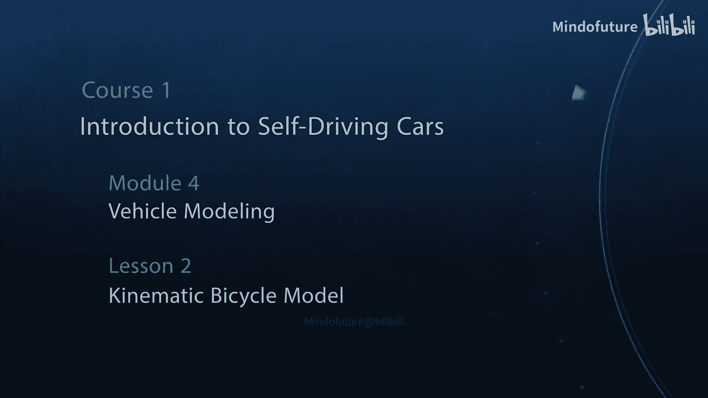
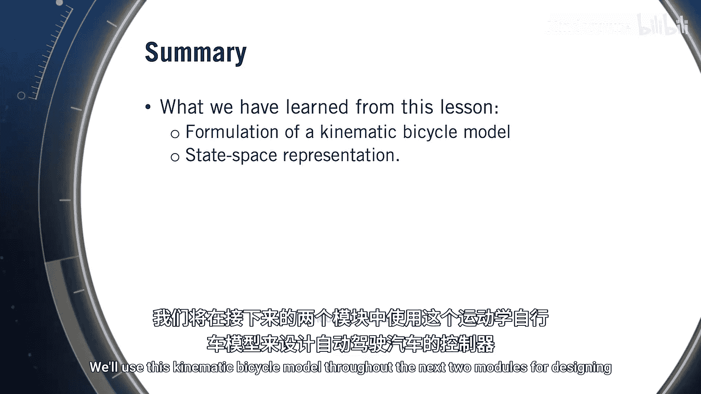

# 029：自行车运动学模型

在本节课中，我们将学习如何建立经典的自行车运动学模型。这个模型因其简洁性，并能很好地满足汽车的非完整约束，在描述车辆正常行驶条件下的运动方面表现出色。

上一节我们介绍了运动学建模的基础和约束条件，并引入了瞬时旋转中心的概念。本节中，我们将推导自行车运动学模型。

## 模型概述与变量定义

著名的自行车运动学模型因其简单且符合汽车的非完整约束，长期以来被用作面向控制的合适车辆模型。

在推导模型之前，我们先在双轮机器人模型的基础上定义一些额外的变量。

我们将要建立的自行车模型被称为前轮转向模型，因为前轮的方向可以相对于车辆航向进行控制。

我们再次假设车辆在由惯性系Fi表示的二维平面上运动。

在提出的自行车模型中，前轮代表汽车的前左和前右轮，后轮代表汽车的后左和后右轮。

## 参考点选择

为了分析自行车模型的运动学，必须在车辆上选择一个参考点 (X, Y)。这个点可以放置在：

*   后轴中心
*   前轴中心
*   重心或质心

参考点的选择会影响最终得到的运动学方程，进而影响我们将要使用的控制器设计。在本课程中，我们将根据需要切换不同的参考点。

## 后轴参考点模型

让我们从后轴参考点模型开始。

我们将后轴参考点的位置表示为 (X_R, Y_R)，自行车的航向表示为 θ。我们用 L 表示自行车两个轮轴之间的长度。与双轮机器人一样，这些是我们的主要模型状态。

自行车模型的输入与双轮机器人略有不同，因为我们现在需要定义前轮的转向角。

令转向角为 δ，它相对于自行车的前进方向测量。速度表示为 V，方向与每个车轮的方向相同。这是一个被称为“无滑移条件”的假设。

该假设要求我们的车轮不能横向移动，也不能纵向打滑。正是这个假设使我们能够根据双轮机器人车轮的旋转速率来计算其前进速度。

由于无滑移条件，我们再次得到自行车的旋转速率 ω 等于速度除以瞬时旋转中心半径 R。

根据由 L、R 和 δ 形成的相似三角形，我们看到 tan(δ) 等于轴距 L 除以瞬时转弯半径 R。

结合这两个方程，我们可以找到车辆旋转速率 ω 与转向角 δ 之间的关系为：**ω = V * tan(δ) / L**。

我们现在可以为后轴参考点建立完整的运动学自行车模型。

基于此模型配置，参考点在 x 和 y 方向的速度分量分别等于前进速度 V 乘以 cos(θ) 和 sin(θ)。

这两个方程与之前推导的旋转速率方程相结合，形成了后轴自行车模型。

## 前轴参考点模型

当以前轴中心作为参考点 (X_F, Y_F) 时，自行车运动学模型可以重新表述。这是一个很好的练习，可以尝试自己推导，以实践应用瞬时旋转中心的原理，其推导过程与后轴模型非常相似。

这一次，速度指向前轮的方向，该方向由 δ 和 θ 之和定义。

通过推导，可以得到车辆的以下运动学模型：
**Ẋ_F = V * cos(θ + δ)**
**Ẏ_F = V * sin(θ + δ)**
**θ̇ = V * sin(δ) / L**

## 重心参考点模型与侧偏角

最后一种情况是将参考点放置在重心或质心处，如右图所示。由于我们对前后轮施加的无滑移约束，重心处的运动方向与任一车轮处的前进速度方向以及自行车的航向都略有不同。

这种差异称为侧偏角，我们将其表示为 β，它被测量为重心处速度方向与自行车航向之间的角度差。

侧偏角的这个定义在我们转向车辆动力学建模时也同样适用，届时它可能会变得更加显著。

以重心为参考点的运动学模型可以类似于后轴和前轴参考点模型进行推导。

我们最终得到以下公式，这也将作为我们车辆动力学建模的基础：
**Ẋ_c = V * cos(θ + β)**
**Ẏ_c = V * sin(θ + β)**
**θ̇ = V * cos(β) * tan(δ) / L**

此外，由于无滑移条件，我们可以根据自行车模型的几何形状计算侧偏角。

给定 L_r 为从后轮到重心的距离，侧偏角 β 等于 L_r / L 乘以 tan(δ)。即：**β = arctan( (L_r / L) * tan(δ) )**。

## 模型扩展：转向角作为状态

最后，通常不可能将车辆的转向角从其范围的一个极端瞬间改变到另一个极端，而这在我们的运动学模型中目前是可能的。由于 δ 是由控制器选择的输入，对其变化速度没有限制，这有些不现实。

相反，如果我们假设只能控制转向角的变化率 φ，我们的运动学模型可以用四个状态来表述：X, Y, θ 和转向角 δ。

我们可以简单地扩展我们的模型，将 δ 作为一个状态，并使用转向速率 φ 作为我们修改后的输入。

## 完整模型与总结

我们的运动学自行车模型现在已经完成。再次强调，为了本课程后期以及整个第二门关于状态估计的课程中的控制目的，我们将使用基于状态的模型表示。

我们的运动学自行车模型以速度 V 和转向速率 φ 作为输入。系统的状态，包括位置 (X_c, Y_c)、方向 θ 和转向角 δ，根据我们模型中的运动学方程演化，这些方程满足无滑移条件。

我们现在可以使用这个模型来设计运动学转向控制器，这将在本课程后面的模块中看到。

本节课中我们一起学习了为车辆上三个不同的参考点建立了自行车运动学模型，并引入了侧偏角的概念。我们将在接下来的两个模块中使用这个运动学自行车模型来为自动驾驶汽车设计控制器。

在下一个视频中，我们将学习如何为任何运动系统建立动态车辆模型。下次见。

