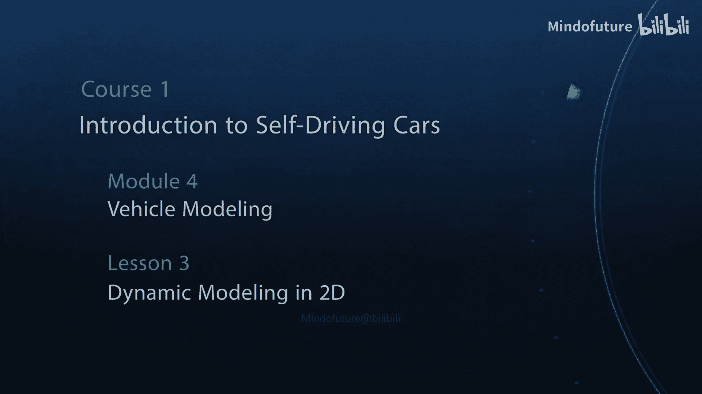
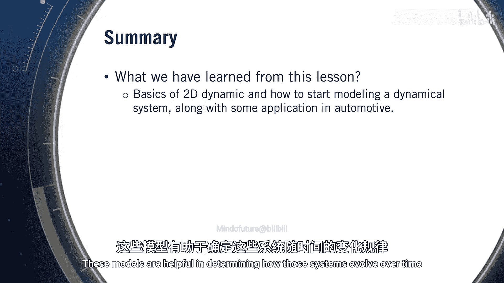

自动驾驶汽车简介：第三课：二维动力学建模

在本节课中，我们将从运动学模型进入动力学建模领域，学习如何考虑作用在车辆上的力和力矩，以建立更高精度的车辆运动预测模型。

上一节我们介绍了基于转向率和速度输入的运动学自行车模型。本节中，我们将开始探讨动力学建模，以考虑作用在车辆上的力和力矩。这类模型能提供比运动学模型更高精度的预测。然而，这种高精度是以更高的计算复杂度为代价的，因此运动学和动力学模型在自动驾驶开发中各有其用。

动力学建模对许多人来说可能非常熟悉。如果你擅长绘制自由体图和应用牛顿方程，可以跳过本介绍部分。如果你需要复习或从未接触过动力学建模，本介绍视频正适合你。

我们为何需要动力学建模？在车辆建模中，当车辆高速移动和转向，或路面湿滑时，由无滑移条件定义的假设可能不再成立，因为作用在车辆上的力会导致轮胎在路面上打滑。对滑移条件下的力平衡进行建模，可以扩展我们模型的适用范围，使其在更多驾驶条件下仍能准确预测运动。此外，汽车中的许多子系统也存在类似情况，硬性的运动学约束无法正确捕捉其演变过程，同样需要动力学模型。一个例子是传动系统，需要通过扭矩平衡来捕捉从油门位置到车轮扭矩，经过发动机和变速系统的连接过程。

通过显式地建模作用在车辆上的力和力矩的平衡，我们可以确定车辆所经历的加速度，并用它们来模拟车辆运动。

我们现在转向为刚体定义动力学建模过程的任务。

要建立一个典型的动力学模型，我们可以遵循以下步骤。

以下是构建动力学模型的四个步骤：

1.  **建立坐标系**：设定模型中要使用的坐标系，例如我们之前讨论过的车身坐标系和惯性坐标系。
2.  **分解动态系统**：将动态系统分解为集总动态元件。这些元件将系统中可能分布的特性组合成离散或集总的元件。以弹簧-质量-阻尼器系统为例，集总元件就是弹簧、质量和阻尼器。
3.  **绘制自由体图**：为元件列表中的每个刚体绘制自由体图，并正确命名和建模作用在该物体上的所有力和力矩。
4.  **应用牛顿第二定律**：使用牛顿第二定律，写出定义我们动力学模型的数学方程。对平移动力学，沿每个轴求和所有力；对旋转动力学，绕每个旋转轴求和所有力矩。结果是一个描述刚体运动的常微分方程，这就是我们的动力学模型。

让我们遵循这个四步流程，为一个一维平移系统——一个滚动的小车——建立模型。

该图显示了质量为 `M` 的小车，我们想要跟踪它的位置。

我们首先定义小车位置的坐标系，用 `X` 表示。接着，我们识别刚体，在本例中就是质量为 `M` 的小车。然后，我们绘制自由体图，并定义作用在小车上的所有力。在本例中，有三个力作用在小车上：`F1` 将小车向右拉，`F2` 和 `F3` 将小车向左拉。最后，我们在 `X` 方向应用牛顿第二定律来形成动力学模型。

描述小车运动的最终动力学方程是：`m * x_double_dot = F1 - F2 - F3`。其中 `x_double_dot` 表示 `X` 方向的加速度。注意，`F2` 和 `F3` 带有负号，因为它们指向 `X` 轴的负方向。

同样的过程可以应用于汽车中的减震器。减震器的动力学模型有助于工程师设计和调校车辆悬架，以获得更好的乘坐舒适性和驾驶性能。

为了对这个部件建模，我们可以遵循前面介绍的相同四个步骤。

我们再次建立坐标系，在本例中是垂直方向的一个坐标 `y`。我们识别刚体或集总动态元件。对于一个真实的物理系统，集总元件的概念非常重要。减震器依靠弹簧和带有限流装置的液压缸来吸收冲击。我们将这个系统建模为三个独立的集总元件：质量、弹簧和液压缸（或阻尼器）。我们使用线性弹簧和阻尼器模型，其中弹簧抵抗 `y` 方向的位移，阻尼器抵抗 `y` 方向的速度。第三步是绘制自由体图。通常，我们在此图中显示力或扭矩以及速度和方向。最后，我们形成动力学方程，在本例中就是著名的二阶弹簧-质量-阻尼器方程。

这个过程在处理旋转或扭转系统时没有变化。旋转系统在汽车中非常常见，例如内燃机轴、齿轮箱、扭矩转换器和轮胎。在旋转系统中，我们绕每个旋转轴求和扭矩 `τ`，并以与平移情况相同的方式处理集总惯量 `J`、扭转弹簧和阻尼器。我们将刚体的旋转加速度称为 `α`。

让我们使用四步建模过程来模拟车轮的旋转动力学。

首先，我们建立坐标系，一个旋转方向的坐标足以表示车轮的运动。我们定义 `θ` 为车轮的角位置，`θ_dot` 为其旋转速率，`θ_double_dot` 为其角加速度。接着，我们形成集总动态元件。轮胎模型具有旋转惯量 `J`（源于其旋转质量），以及由轮胎和轮毂材料属性定义的扭转刚度 `K` 和阻尼 `B`。我们通过车辆驱动轴的驱动扭矩来驱动车轮，并通过轮胎与路面相互作用产生的负载扭矩来抵抗这个驱动。现在我们绘制自由体图，驱动扭矩和负载扭矩被定义为相反方向，因为负载抵抗驱动扭矩对车轮的加速作用。

我们现在可以为车轮系统形成动力学模型。驱动扭矩和负载扭矩之间的差值定义了作用在车轮上的净扭矩，而来自集总元件模型的扭转弹簧和阻尼器则抵抗加速度。最终的动力学模型描述了当受到这个净扭矩作用时，车轮的位置如何变化。

车辆的动力学模型有多种用途。它们可用于在融合传感器数据跟踪运动时改进状态估计方法；可用于辅助控制器设计以跟踪期望的轨迹或路径；还可以帮助自动驾驶工程师定义车辆的性能极限，以避免规划汽车无法跟踪的不安全轨迹。

然而，一个完整的三维车辆模型，需要考虑车身侧倾和俯仰、任意倾斜的道路以及每个轮胎上不同的力和力矩，会构成一个非常复杂的模型。相反，我们可以将模型分离为两个二维模型，从而将车辆控制问题分解为转向控制问题以及油门和刹车控制问题。完整的三维车辆建模是一个引人入胜的领域，如果你想了解更多，我们在补充材料中提供了一些链接。

基于这些原因，我们将为我们的自动驾驶汽车分别建立纵向和横向动力学模型。

纵向模型考虑在倾斜道路上行驶的车辆。我们将车辆运动限制在 `XZ` 平面内。有几个力作用在车身和轮胎上，包括牵引力、滚动阻力、空气动力和由重力引起的坡度阻力。在下一个视频中，我们将更详细地讲解纵向车辆动力学模型。

类似地，可以为 `XY` 平面内的运动建立横向车辆动力学模型，即从俯视或鸟瞰视角观察车辆。在这个二维模型中，也有几个作用在车辆横向方向上的力，例如滑移力和离心力。这个主题也将在未来的课程中讨论。

在本视频中，我们介绍了二维动力学建模的基础知识，并将其应用于减震器和车轮子系统。这些模型有助于确定这些系统如何随时间演变。

在下一课中，我们将讲解车辆纵向动力学，并研究为驱动轮提供扭矩的传动系统部件。我们下节课见。